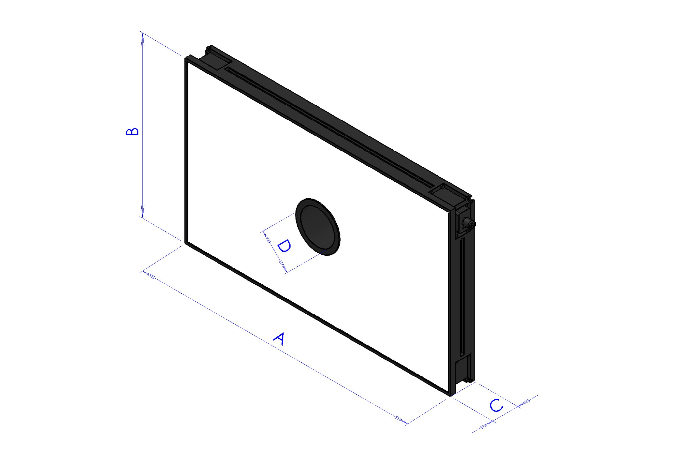
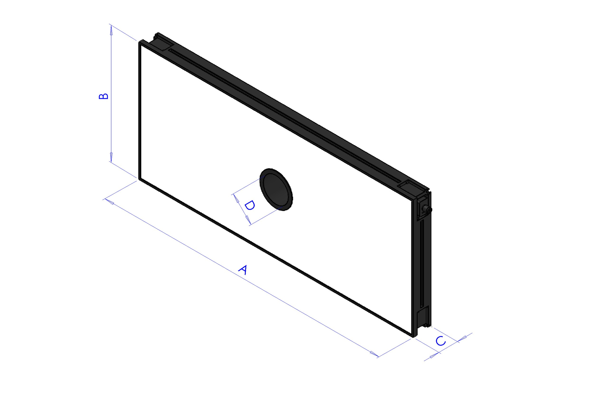
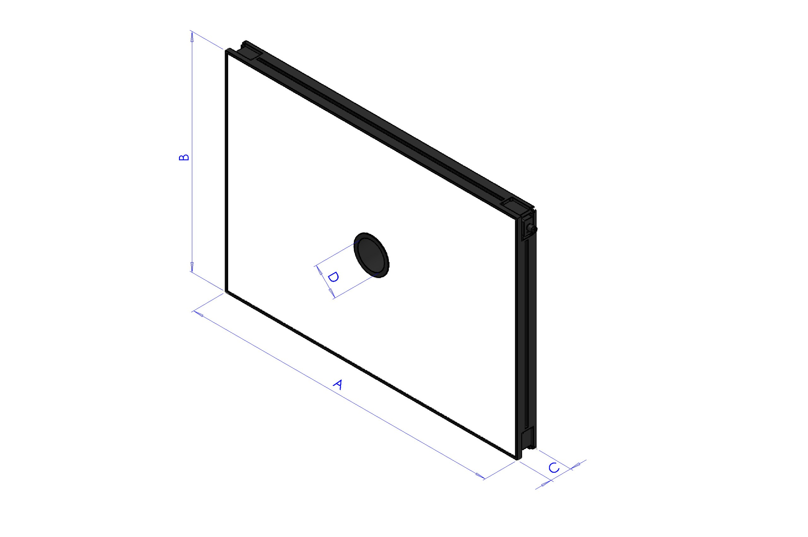

(toplight)=
# **Toplight**

Das Toplight ist eine separate Leuchte, die auf Höhe der Kamera montiert wird und den Sichtbereich des FlexiBowl® von oben beleuchtet, sodass die der Kamera zugewandten Merkmale des Bauteils hervorgehoben werden. Es eignet sich hauptsächlich für glatte, nicht reflektierende Oberflächen oder für Oberflächen mit einer erkennbaren Markierung. Das Toplight ist mit folgenden Lichtfarben erhältlich:
- Weiß
- Rot
- Infrarot

:::{important}
Das Infrarot-Toplight sendet unsichtbares Licht aus und kann daher so wirken, als würde es nicht funktionieren. Prüfen Sie die Funktion mit einer Kamera mit installiertem Infrarotfilter. Die meisten Smartphones können Infrarot darstellen.
:::

## Eigenschaften der Toplights

```{dropdown} TopLight 500x300 - White
Diese Toplight-Größe ist für folgende Modelle geeignet: FlexiBowl® 200, FlexiBowl® 350, FlexiBowl® 500

 
| Länge | Breite | Höhe | Höhe mit Befestigungsplatte | Durchmesser der Mittelbohrung | Max. Nutzfläche [AxB] | Max. Nutzumfang |
|--|--|--|--|--|--|--|
| **A** | **B** | **C** | **C + 10mm** | **D** | - | - |
| 500 | 300 | 45 | 55 | 65 | 0.15 m^2 | 1.6 m |
 
:::{list-table}
:widths: 35 65
:header-rows: 0
 
* - **Code**
  - CM002316
 
* - **Elektronik**
  -
 
* - Spannungsversorgung
  - 24 VDC ±10%
 
* - Steuerungsmodus
  - Dauerbetrieb
 
* - Maximale Anstiegszeit
  - 15 µs
 
* - Maximale Abfallzeit
  - 10 µs
 
* - Steuerung
  - [Connettore M12](cablaggio_illuminatore)
 
* - Pinbelegung des Steckers
  - 1: 24VDC / 3: GND / 4: PNP
 
* - Verbrauch
  - 96.6W
 
* - Minimale Betriebsspannung
  - 20 V am Lichteingang
 
* - Nennbetriebsspannung
  - 24 V am Lichteingang (±10 %)
 
* - Maximale Betriebsspannung
  - 30 V am Lichteingang
 
* - Wellenlänge
  -
 
* - Risikogruppe
  - 0 (kein Risiko)
 
* - **Mechanik**
  -
 
* - Dicke
  - 45 mm + 10 mm mit Befestigungsplatte
 
* - Innendurchmesser
  - 65mm
 
* - Gewicht
  - 23.8 Kg/m² ±15%
 
* - Materialien
  - Aluminium und gefülltes ABS
 
* - Diffusor
  - Weißes PMMA
 
* - Befestigung
  - 4 M4-Muttern (im Lieferumfang), die in die Nut eingesetzt werden, oder 4 M4x20-Schrauben (nicht im Lieferumfang), die an den Ecken angebracht werden
 
* - **Umgebung**
  -
 
* - Betriebstemperatur
  - -10 °C bis +40 °C / 80 % Luftfeuchtigkeit, nicht kondensierend. Kein Thermoschock (maximale Änderung: 10 °C in 24 h)
 
* - Lagertemperatur
  - -20 °C bis +60 °C / 80 % Luftfeuchtigkeit, nicht kondensierend. Kein Thermoschock (maximale Änderung: 10 °C in 24 h)
 
* - IP-Schutzart
  - IP 50
 
* - Kennzeichnungen
  - RoHS-CE-DEEE, UL
:::
 
```
```{dropdown} TopLight 500x300 - Red  
Diese Toplight-Größe ist für folgende Modelle geeignet: FlexiBowl® 200, FlexiBowl® 350, FlexiBowl® 500

 
| Länge | Breite | Höhe | Höhe mit Befestigungsplatte | Durchmesser der Mittelbohrung | Max. Nutzfläche [AxB] | Max. Nutzumfang |
|--|--|--|--|--|--|--|
| **A** | **B** | **C** | **C + 10mm** | **D** | - | - |
| 500 | 300 | 45 | 55 | 65 | 0.15 m^2 | 1.6 m |
 
:::{list-table}
:widths: 35 65
:header-rows: 0
 
* - **Code**
  - CM002401
 
* - **Elektronik**
  -
 
* - Spannungsversorgung
  - 24 VDC ±10%
 
* - Steuerungsmodus
  - Dauerbetrieb
 
* - Maximale Anstiegszeit
  - 15 µs
 
* - Maximale Abfallzeit
  - 10 µs
 
* - Steuerung
  - [Connettore M12](cablaggio_illuminatore)
 
* - Pinbelegung des Steckers
  - 1: 24VDC / 3: GND / 4: PNP
 
* - Verbrauch
  - 96.6W @24 Vdc
 
* - Minimale Betriebsspannung
  - 20 V am Lichteingang
 
* - Nennbetriebsspannung
  - 24 V am Lichteingang (±10 %)
 
* - Maximale Betriebsspannung
  - 30 V am Lichteingang
 
* - Wellenlänge
  - 630 nm
 
* - Risikogruppe
  - 0 (kein Risiko)
 
 
* - **Mechanik**
  -
 
* - Dicke
  - 45 mm + 10 mm mit Befestigungsplatte
 
* - Innendurchmesser
  - 65mm
 
* - Gewicht
  - 23.8 Kg/m² ±15%
 
* - Materialien
  - Aluminium und gefülltes ABS
 
* - Diffusor
  - Weißes PMMA
 
* - Befestigung
  - 4 M4-Muttern (im Lieferumfang), die in die Nut eingesetzt werden, oder 4 M4x20-Schrauben (nicht im Lieferumfang), die an den Ecken angebracht werden
 
* - **Umgebung**
  -
 
* - Betriebstemperatur
  - -10 °C bis +40 °C / 80 % Luftfeuchtigkeit, nicht kondensierend. Kein Thermoschock (maximale Änderung: 10 °C in 24 h)
 
* - Lagertemperatur
  - -20 °C bis +60 °C / 80 % Luftfeuchtigkeit, nicht kondensierend. Kein Thermoschock (maximale Änderung: 10 °C in 24 h)
 
* - IP-Schutzart
  - IP 50
 
* - Kennzeichnungen
  - RoHS-CE-DEEE, UL
:::
 
```
 
```{dropdown} TopLight 500x300 - Infrared
Diese Toplight-Größe ist für folgende Modelle geeignet: FlexiBowl® 200, FlexiBowl® 350, FlexiBowl® 500

 
| Länge | Breite | Höhe | Höhe mit Befestigungsplatte | Durchmesser der Mittelbohrung | Max. Nutzfläche [AxB] | Max. Nutzumfang |
|--|--|--|--|--|--|--|
| **A** | **B** | **C** | **C + 10mm** | **D** | - | - |
| 500 | 300 | 45 | 55 | 65 | 0.15 m^2 | 1.6 m |
 
:::{list-table}
:widths: 35 65
:header-rows: 0
 
* - **Code**
  - CM002405
 
* - **Elektronik**
  -
 
* - Spannungsversorgung
  - 24 VDC ±10%
 
* - Steuerungsmodus
  - Dauerbetrieb
 
* - Maximale Anstiegszeit
  - 15 µs
 
* - Maximale Abfallzeit
  - 10 µs
 
* - Steuerung
  - [Connettore M12](cablaggio_illuminatore)
 
* - Pinbelegung des Steckers
  - 1: 24VDC / 3: GND / 4: PNP
 
* - Verbrauch
  - 96.6W @24 Vdc
 
* - Minimale Betriebsspannung
  - 20 V am Lichteingang
 
* - Nennbetriebsspannung
  - 24 V am Lichteingang (±10 %)
 
* - Maximale Betriebsspannung
  - 30 V am Lichteingang
 
* - Wellenlänge
  - 850 nm
 
* - Risikogruppe
  - 1 (geringes Risiko)
 
* - **Mechanik**
  -
 
* - Dicke
  - 45 mm + 10 mm mit Befestigungsplatte
 
* - Innendurchmesser
  - 65mm
 
* - Gewicht
  - 23.8 Kg/m² ±15%
 
* - Materialien
  - Aluminium und gefülltes ABS
 
* - Diffusor
  - Weißes PMMA
 
* - Befestigung
  - 4 M4-Muttern (im Lieferumfang), die in die Nut eingesetzt werden, oder 4 M4x20-Schrauben (nicht im Lieferumfang), die an den Ecken angebracht werden
 
* - **Umgebung**
  -
 
* - Betriebstemperatur
  - -10 °C bis +40 °C / 80 % Luftfeuchtigkeit, nicht kondensierend. Kein Thermoschock (maximale Änderung: 10 °C in 24 h)
 
* - Lagertemperatur
  - -20 °C bis +60 °C / 80 % Luftfeuchtigkeit, nicht kondensierend. Kein Thermoschock (maximale Änderung: 10 °C in 24 h)
 
* - IP-Schutzart
  - IP 50
 
* - Kennzeichnungen
  - RoHS-CE-DEEE, UL
:::
 
```
 
```{dropdown} TopLight 700x300 - White
Diese Toplight-Größe ist für folgende Modelle geeignet: FlexiBowl® 650, FlexiBowl® 800

 
| Länge | Breite | Höhe | Höhe mit Befestigungsplatte | Durchmesser der Mittelbohrung | Max. Nutzfläche [AxB] | Max. Nutzumfang |
|--|--|--|--|--|--|--|
| **A** | **B** | **C** | **C + 10mm** | **D** | - | - |
| 700 | 300 | 45 | 55 | 65 | 0.21 m^2 | 2 m |
 
:::{list-table}
:widths: 35 65
:header-rows: 0
 
* - **Code**
  - CM002317
 
* - **Elektronik**
  -
 
* - Spannungsversorgung
  - 24 VDC ±10%
 
* - Steuerungsmodus
  - Dauerbetrieb
 
* - Maximale Anstiegszeit
  - 15 µs
 
* - Maximale Abfallzeit
  - 10 µs
 
* - Steuerung
  - [Connettore M12](cablaggio_illuminatore)
 
* - Pinbelegung des Steckers
  - 1: 24VDC / 3: GND / 4: PNP
 
* - Verbrauch
  - 135.6W @24 Vdc
 
* - Minimale Betriebsspannung
  - 20 V am Lichteingang
 
* - Nennbetriebsspannung
  - 24 V am Lichteingang (±10 %)
 
* - Maximale Betriebsspannung
  - 30 V am Lichteingang
 
* - Wellenlänge
  -
 
* - Risikogruppe
  - 0 (kein Risiko)
 
* - **Mechanik**
  -
 
* - Dicke
  - 45 mm + 10 mm mit Befestigungsplatte
 
* - Innendurchmesser
  - 65mm
 
* - Gewicht
  - 23.8 Kg/m² ±15%
 
* - Materialien
  - Aluminium und gefülltes ABS
 
* - Diffusor
  - Weißes PMMA
 
* - Befestigung
  - 4 M4-Muttern (im Lieferumfang), die in die Nut eingesetzt werden, oder 4 M4x20-Schrauben (nicht im Lieferumfang), die an den Ecken angebracht werden
 
* - **Umgebung**
  -
 
* - Betriebstemperatur
  - -10 °C bis +40 °C / 80 % Luftfeuchtigkeit, nicht kondensierend. Kein Thermoschock (maximale Änderung: 10 °C in 24 h)
 
* - Lagertemperatur
  - -20 °C bis +60 °C / 80 % Luftfeuchtigkeit, nicht kondensierend. Kein Thermoschock (maximale Änderung: 10 °C in 24 h)
 
* - IP-Schutzart
  - IP 50
 
* - Kennzeichnungen
  - RoHS-CE-DEEE, UL
:::
```
 
```{dropdown} TopLight 700x300 - Red
Diese Toplight-Größe ist für folgende Modelle geeignet: FlexiBowl® 650, FlexiBowl® 800

 
| Länge | Breite | Höhe | Höhe mit Befestigungsplatte | Durchmesser der Mittelbohrung | Max. Nutzfläche [AxB] | Max. Nutzumfang |
|--|--|--|--|--|--|--|
| **A** | **B** | **C** | **C + 10mm** | **D** | - | - |
| 700 | 300 | 45 | 55 | 65 | 0.21 m^2 | 2 m |
 
:::{list-table}
:widths: 35 65
:header-rows: 0
 
 * - **Code**
   - CM002402
 
* - **Elektronik**
  -
 
* - Spannungsversorgung
  - 24 VDC ±10%
 
* - Steuerungsmodus
  - Dauerbetrieb
 
* - Maximale Anstiegszeit
  - 15 µs
 
* - Maximale Abfallzeit
  - 10 µs
 
* - Steuerung
  - [Connettore M12](cablaggio_illuminatore)
 
* - Pinbelegung des Steckers
  - 1: 24VDC / 3: GND / 4: PNP
 
* - Verbrauch
  - 135.6W @24 Vdc
 
* - Minimale Betriebsspannung
  - 20 V am Lichteingang
 
* - Nennbetriebsspannung
  - 24 V am Lichteingang (±10 %)
 
* - Maximale Betriebsspannung
  - 30 V am Lichteingang
 
* - Wellenlänge
  - 630 nm
 
* - Risikogruppe
  - 0 (kein Risiko)
 
* - **Mechanik**
  -
 
* - Dicke
  - 45 mm + 10 mm mit Befestigungsplatte
 
* - Innendurchmesser
  - 65mm
 
* - Gewicht
  - 23.8 Kg/m² ±15%
 
* - Materialien
  - Aluminium und gefülltes ABS
 
* - Diffusor
  - Weißes PMMA
 
* - Befestigung
  - 4 M4-Muttern (im Lieferumfang), die in die Nut eingesetzt werden, oder 4 M4x20-Schrauben (nicht im Lieferumfang), die an den Ecken angebracht werden
 
* - **Umgebung**
  -
 
* - Betriebstemperatur
  - -10 °C bis +40 °C / 80 % Luftfeuchtigkeit, nicht kondensierend. Kein Thermoschock (maximale Änderung: 10 °C in 24 h)
 
* - Lagertemperatur
  - -20 °C bis +60 °C / 80 % Luftfeuchtigkeit, nicht kondensierend. Kein Thermoschock (maximale Änderung: 10 °C in 24 h)
 
* - IP-Schutzart
  - IP 50
 
* - Kennzeichnungen
  - RoHS-CE-DEEE, UL
:::
```
 
```{dropdown} TopLight 700x300 - Infrared
Diese Toplight-Größe ist für folgende Modelle geeignet: FlexiBowl® 650, FlexiBowl® 800

 
| Länge | Breite | Höhe | Höhe mit Befestigungsplatte | Durchmesser der Mittelbohrung | Max. Nutzfläche [AxB] | Max. Nutzumfang |
|--|--|--|--|--|--|--|
| **A** | **B** | **C** | **C + 10mm** | **D** | - | - |
| 700 | 300 | 45 | 55 | 65 | 0.21 m^2 | 2 m |
 
:::{list-table}
:widths: 35 65
:header-rows: 0
 
* - **Code**
  - CM002406
 
* - **Elektronik**
  -
 
* - Spannungsversorgung
  - 24 VDC ±10%
 
* - Steuerungsmodus
  - Dauerbetrieb
 
* - Maximale Anstiegszeit
  - 15 µs
 
* - Maximale Abfallzeit
  - 10 µs
 
* - Steuerung
  - [Connettore M12](cablaggio_illuminatore)
 
* - Pinbelegung des Steckers
  - 1: 24VDC / 3: GND / 4: PNP
 
* - Verbrauch
  - 135.6W @24 Vdc
 
* - Minimale Betriebsspannung
  - 20 V am Lichteingang
 
* - Nennbetriebsspannung
  - 24 V am Lichteingang (±10 %)
 
* - Maximale Betriebsspannung
  - 30 V am Lichteingang
 
* - Wellenlänge
  - 850 nm
 
* - Risikogruppe
  - 1 (geringes Risiko)
 
* - **Mechanik**
  -
 
* - Dicke
  - 45 mm + 10 mm mit Befestigungsplatte
 
* - Innendurchmesser
  - 65mm
 
* - Gewicht
  - 23.8 Kg/m² ±15%
 
* - Materialien
  - Aluminium und gefülltes ABS
 
* - Diffusor
  - Weißes PMMA
 
* - Befestigung
  - 4 M4-Muttern (im Lieferumfang), die in die Nut eingesetzt werden, oder 4 M4x20-Schrauben (nicht im Lieferumfang), die an den Ecken angebracht werden
 
* - **Umgebung**
  -
 
* - Betriebstemperatur
  - -10 °C bis +40 °C / 80 % Luftfeuchtigkeit, nicht kondensierend. Kein Thermoschock (maximale Änderung: 10 °C in 24 h)
 
* - Lagertemperatur
  - -20 °C bis +60 °C / 80 % Luftfeuchtigkeit, nicht kondensierend. Kein Thermoschock (maximale Änderung: 10 °C in 24 h)
 
* - IP-Schutzart
  - IP 50
 
* - Kennzeichnungen
  - RoHS-CE-DEEE, UL
:::
```
 
```{dropdown} TopLight 700x500 - White
Diese Toplight-Größe ist für folgende Modelle geeignet: FlexiBowl® 650, FlexiBowl® 800

 
| Länge | Breite | Höhe | Höhe mit Befestigungsplatte | Durchmesser der Mittelbohrung | Max. Nutzfläche [AxB] | Max. Nutzumfang |
|--|--|--|--|--|--|--|
| **A** | **B** | **C** | **C + 10mm** | **D** | - | - |
| 700 | 500 | 45 | 55 | 65 | 0.35 m^2 | 2.4 m |
 
:::{list-table}
:widths: 35 65
:header-rows: 0
 
* - **Code**
  - CM002318
 
* - **Elektronik**
  -
 
* - Spannungsversorgung
  - 24 VDC ±10%
 
* - Steuerungsmodus
  - Dauerbetrieb
 
* - Maximale Anstiegszeit
  - 15 µs
 
* - Maximale Abfallzeit
  - 10 µs
 
* - Steuerung
  - [Connettore M12](cablaggio_illuminatore)
 
* - Pinbelegung des Steckers
  - 1: 24VDC / 3: GND / 4: PNP
 
* - Verbrauch
  - 252.6W @24 Vdc
 
* - Minimale Betriebsspannung
  - 20 V am Lichteingang
 
* - Nennbetriebsspannung
  - 24 V am Lichteingang (±10 %)
 
* - Maximale Betriebsspannung
  - 30 V am Lichteingang
 
* - Wellenlänge
  -
 
* - Risikogruppe
  - 0 (kein Risiko)
 
* - **Mechanik**
  -
 
* - Dicke
  - 45 mm + 10 mm mit Befestigungsplatte
 
* - Innendurchmesser
  - 65mm
 
* - Gewicht
  - 23.8 Kg/m² ±15%
 
* - Materialien
  - Aluminium und gefülltes ABS
 
* - Diffusor
  - Weißes PMMA
 
* - Befestigung
  - 4 M4-Muttern (im Lieferumfang), die in die Nut eingesetzt werden, oder 4 M4x20-Schrauben (nicht im Lieferumfang), die an den Ecken angebracht werden
 
* - **Umgebung**
  -
 
* - Betriebstemperatur
  - -10 °C bis +40 °C / 80 % Luftfeuchtigkeit, nicht kondensierend. Kein Thermoschock (maximale Änderung: 10 °C in 24 h)
 
* - Lagertemperatur
  - -20 °C bis +60 °C / 80 % Luftfeuchtigkeit, nicht kondensierend. Kein Thermoschock (maximale Änderung: 10 °C in 24 h)
 
* - IP-Schutzart
  - IP 50
 
* - Kennzeichnungen
  - RoHS-CE-DEEE, UL
:::
```
 
```{dropdown} TopLight 700x500 - Red
Diese Toplight-Größe ist für folgende Modelle geeignet: FlexiBowl® 650, FlexiBowl® 800

 
| Länge | Breite | Höhe | Höhe mit Befestigungsplatte | Durchmesser der Mittelbohrung | Max. Nutzfläche [AxB] | Max. Nutzumfang |
|--|--|--|--|--|--|--|
| **A** | **B** | **C** | **C + 10mm** | **D** | - | - |
| 700 | 500 | 45 | 55 | 65 | 0.35 m^2 | 2.4 m |
 
:::{list-table}
:widths: 35 65
:header-rows: 0
 
* - **Code**
  - CM002403
 
* - **Elektronik**
  -
 
* - Spannungsversorgung
  - 24 VDC ±10%
 
* - Steuerungsmodus
  - Dauerbetrieb
 
* - Maximale Anstiegszeit
  - 15 µs
 
* - Maximale Abfallzeit
  - 10 µs
 
* - Steuerung
  - [Connettore M12](cablaggio_illuminatore)
 
* - Pinbelegung des Steckers
  - 1: 24VDC / 3: GND / 4: PNP
 
* - Verbrauch
  - 252.6W @24 Vdc
 
* - Minimale Betriebsspannung
  - 20 V am Lichteingang
 
* - Nennbetriebsspannung
  - 24 V am Lichteingang (±10 %)
 
* - Maximale Betriebsspannung
  - 30 V am Lichteingang
 
* - Wellenlänge
  - 630 nm
 
* - Risikogruppe
  - 0 (kein Risiko)
 
* - **Mechanik**
  -
 
* - Dicke
  - 45 mm + 10 mm mit Befestigungsplatte
 
* - Innendurchmesser
  - 65mm
 
* - Gewicht
  - 23.8 Kg/m² ±15%
 
* - Materialien
  - Aluminium und gefülltes ABS
 
* - Diffusor
  - Weißes PMMA
 
* - Befestigung
  - 4 M4-Muttern (im Lieferumfang), die in die Nut eingesetzt werden, oder 4 M4x20-Schrauben (nicht im Lieferumfang), die an den Ecken angebracht werden
 
* - **Umgebung**
  -
 
* - Betriebstemperatur
  - -10 °C bis +40 °C / 80 % Luftfeuchtigkeit, nicht kondensierend. Kein Thermoschock (maximale Änderung: 10 °C in 24 h)
 
* - Lagertemperatur
  - -20 °C bis +60 °C / 80 % Luftfeuchtigkeit, nicht kondensierend. Kein Thermoschock (maximale Änderung: 10 °C in 24 h)
 
* - IP-Schutzart
  - IP 50
 
* - Kennzeichnungen
  - RoHS-CE-DEEE, UL
:::
```
 
```{dropdown} TopLight 700x500 - Infrared
Diese Toplight-Größe ist für folgende Modelle geeignet: FlexiBowl® 650, FlexiBowl® 800

 
| Länge | Breite | Höhe | Höhe mit Befestigungsplatte | Durchmesser der Mittelbohrung | Max. Nutzfläche [AxB] | Max. Nutzumfang |
|--|--|--|--|--|--|--|
| **A** | **B** | **C** | **C + 10mm** | **D** | - | - |
| 700 | 500 | 45 | 55 | 65 | 0.35 m^2 | 2.4 m |
 
:::{list-table}
:widths: 35 65
:header-rows: 0
 
* - **Code**
  - CM002407
 
* - **Elektronik**
  -
 
* - Spannungsversorgung
  - 24 VDC ±10%
 
* - Steuerungsmodus
  - Dauerbetrieb
 
* - Maximale Anstiegszeit
  - 15 µs
 
* - Maximale Abfallzeit
  - 10 µs
 
* - Steuerung
  - [Connettore M12](cablaggio_illuminatore)
 
* - Pinbelegung des Steckers
  - 1: 24VDC / 3: GND / 4: PNP
 
* - Verbrauch
  - 252.6W @24 Vdc
 
* - Minimale Betriebsspannung
  - 20 V am Lichteingang
 
* - Nennbetriebsspannung
  - 24 V am Lichteingang (±10 %)
 
* - Maximale Betriebsspannung
  - 30 V am Lichteingang
 
* - Wellenlänge
  - 850 nm
 
* - Risikogruppe
  - 1 (geringes Risiko)
 
* - **Mechanik**
  -
 
* - Dicke
  - 45 mm + 10 mm mit Befestigungsplatte
 
* - Innendurchmesser
  - 65mm
 
* - Gewicht
  - 23.8 Kg/m² ±15%
 
* - Materialien
  - Aluminium und gefülltes ABS
 
* - Diffusor
  - Weißes PMMA
 
* - Befestigung
  - 4 M4-Muttern (im Lieferumfang), die in die Nut eingesetzt werden, oder 4 M4x20-Schrauben (nicht im Lieferumfang), die an den Ecken angebracht werden
 
* - **Umgebung**
  -
 
* - Betriebstemperatur
  - -10 °C bis +40 °C / 80 % Luftfeuchtigkeit, nicht kondensierend. Kein Thermoschock (maximale Änderung: 10 °C in 24 h)
 
* - Lagertemperatur
  - -20 °C bis +60 °C / 80 % Luftfeuchtigkeit, nicht kondensierend. Kein Thermoschock (maximale Änderung: 10 °C in 24 h)
 
* - IP-Schutzart
  - IP 50
 
* - Kennzeichnungen
  - RoHS-CE-DEEE, UL
:::
```
 
```{dropdown} TopLight 900x600 - White
Diese Toplight-Größe ist für die Modelle FlexiBowl® 1200 geeignet

 
| Länge | Breite | Höhe | Höhe mit Befestigungsplatte | Durchmesser der Mittelbohrung | Max. Nutzfläche [AxB] | Max. Nutzumfang |
|--|--|--|--|--|--|--|
| **A** | **B** | **C** | **C + 10mm** | **D** | - | - |
| 900 | 600 | 45 | 55 | 65 | 0.54 m^2 | 3 m |
 
:::{list-table}
:widths: 35 65
:header-rows: 0
 
* - **Code**
  - CM002319
 
* - **Elektronik**
  -
 
* - Spannungsversorgung
  - 24 VDC ±10%
 
* - Steuerungsmodus
  - Dauerbetrieb
 
* - Maximale Anstiegszeit
  - 15 µs
 
* - Maximale Abfallzeit
  - 10 µs
 
* - Steuerung
  - [Connettore M12](cablaggio_illuminatore)
 
* - Pinbelegung des Steckers
  - 1: 24VDC / 3: GND / 4: PNP
 
* - Verbrauch
  - 345.6W @24 Vdc
 
* - Minimale Betriebsspannung
  - 20 V am Lichteingang
 
* - Nennbetriebsspannung
  - 24 V am Lichteingang (±10 %)
 
* - Maximale Betriebsspannung
  - 30 V am Lichteingang
 
* - Wellenlänge
  -
 
* - Risikogruppe
  - 0 (kein Risiko)
 
* - **Mechanik**
  -
 
* - Dicke
  - 45 mm + 10 mm mit Befestigungsplatte
 
* - Innendurchmesser
  - 65mm
 
* - Gewicht
  - 23.8 Kg/m² ±15%
 
* - Materialien
  - Aluminium und gefülltes ABS
 
* - Diffusor
  - Weißes PMMA
 
* - Befestigung
  - 4 M4-Muttern (im Lieferumfang), die in die Nut eingesetzt werden, oder 4 M4x20-Schrauben (nicht im Lieferumfang), die an den Ecken angebracht werden
 
* - **Umgebung**
  -
 
* - Betriebstemperatur
  - -10 °C bis +40 °C / 80 % Luftfeuchtigkeit, nicht kondensierend. Kein Thermoschock (maximale Änderung: 10 °C in 24 h)
 
* - Lagertemperatur
  - -20 °C bis +60 °C / 80 % Luftfeuchtigkeit, nicht kondensierend. Kein Thermoschock (maximale Änderung: 10 °C in 24 h)
 
* - IP-Schutzart
  - IP 50
 
* - Kennzeichnungen
  - RoHS-CE-DEEE, UL
:::
```
```{dropdown} TopLight 900x600 - Red
Diese Toplight-Größe ist für die Modelle FlexiBowl® 1200 geeignet

 
| Länge | Breite | Höhe | Höhe mit Befestigungsplatte | Durchmesser der Mittelbohrung | Max. Nutzfläche [AxB] | Max. Nutzumfang |
|--|--|--|--|--|--|--|
| **A** | **B** | **C** | **C + 10mm** | **D** | - | - |
| 900 | 600 | 45 | 55 | 65 | 0.54 m^2 | 3 m |
 
:::{list-table}
:widths: 35 65
:header-rows: 0
 
* - **Code**
  - CM002404
 
* - **Elektronik**
  -
 
* - Spannungsversorgung
  - 24 VDC ±10%
 
* - Steuerungsmodus
  - Dauerbetrieb
 
* - Maximale Anstiegszeit
  - 15 µs
 
* - Maximale Abfallzeit
  - 10 µs
 
* - Steuerung
  - [Connettore M12](cablaggio_illuminatore)
 
* - Pinbelegung des Steckers
  - 1: 24VDC / 3: GND / 4: PNP
 
* - Verbrauch
  - 345.6W @24 Vdc
 
* - Minimale Betriebsspannung
  - 20 V am Lichteingang
 
* - Nennbetriebsspannung
  - 24 V am Lichteingang (±10 %)
 
* - Maximale Betriebsspannung
  - 30 V am Lichteingang
 
* - Wellenlänge
  - 630 nm
 
* - Risikogruppe
  - 0 (kein Risiko)
 
* - **Mechanik**
  -
 
* - Dicke
  - 45 mm + 10 mm mit Befestigungsplatte
 
* - Innendurchmesser
  - 65mm
 
* - Gewicht
  - 23.8 Kg/m² ±15%
 
* - Materialien
  - Aluminium und gefülltes ABS
 
* - Diffusor
  - Weißes PMMA
 
* - Befestigung
  - 4 M4-Muttern (im Lieferumfang), die in die Nut eingesetzt werden, oder 4 M4x20-Schrauben (nicht im Lieferumfang), die an den Ecken angebracht werden
 
* - **Umgebung**
  -
 
* - Betriebstemperatur
  - -10 °C bis +40 °C / 80 % Luftfeuchtigkeit, nicht kondensierend. Kein Thermoschock (maximale Änderung: 10 °C in 24 h)
 
* - Lagertemperatur
  - -20 °C bis +60 °C / 80 % Luftfeuchtigkeit, nicht kondensierend. Kein Thermoschock (maximale Änderung: 10 °C in 24 h)
 
* - IP-Schutzart
  - IP 50
 
* - Kennzeichnungen
  - RoHS-CE-DEEE, UL
:::
```
 
```{dropdown} TopLight 900x600 - Infrared
Diese Toplight-Größe ist für die Modelle FlexiBowl® 1200 geeignet

 
| Länge | Breite | Höhe | Höhe mit Befestigungsplatte | Durchmesser der Mittelbohrung | Max. Nutzfläche [AxB] | Max. Nutzumfang |
|--|--|--|--|--|--|--|
| **A** | **B** | **C** | **C + 10mm** | **D** | - | - |
| 900 | 600 | 45 | 55 | 65 | 0.54 m^2 | 3 m |
 
:::{list-table}
:widths: 35 65
:header-rows: 0
 
* - **Code**
  - CM002408
 
* - **Elektronik**
  -
 
* - Spannungsversorgung
  - 24 VDC ±10%
 
* - Steuerungsmodus
  - Dauerbetrieb
 
* - Maximale Anstiegszeit
  - 15 µs
 
* - Maximale Abfallzeit
  - 10 µs
 
* - Steuerung
  - [Connettore M12](cablaggio_illuminatore)
 
* - Pinbelegung des Steckers
  - 1: 24VDC / 3: GND / 4: PNP
 
* - Verbrauch
  - 345.6W @24 Vdc
 
* - Minimale Betriebsspannung
  - 20 V am Lichteingang
 
* - Nennbetriebsspannung
  - 24 V am Lichteingang (±10 %)
 
* - Maximale Betriebsspannung
  - 30 V am Lichteingang
 
* - Wellenlänge
  - 850 nm
 
* - Risikogruppe
  - 1 (geringes Risiko)
 
* - **Mechanik**
  -
 
* - Dicke
  - 45 mm + 10 mm mit Befestigungsplatte
 
* - Innendurchmesser
  - 65mm
 
* - Gewicht
  - 23.8 Kg/m² ±15%
 
* - Materialien
  - Aluminium und gefülltes ABS
 
* - Diffusor
  - Weißes PMMA
 
* - Befestigung
  - 4 M4-Muttern (im Lieferumfang), die in die Nut eingesetzt werden, oder 4 M4x20-Schrauben (nicht im Lieferumfang), die an den Ecken angebracht werden
 
* - **Umgebung**
  -
 
* - Betriebstemperatur
  - -10 °C bis +40 °C / 80 % Luftfeuchtigkeit, nicht kondensierend. Kein Thermoschock (maximale Änderung: 10 °C in 24 h)
 
* - Lagertemperatur
  - -20 °C bis +60 °C / 80 % Luftfeuchtigkeit, nicht kondensierend. Kein Thermoschock (maximale Änderung: 10 °C in 24 h)
 
* - IP-Schutzart
  - IP 50
 
* - Kennzeichnungen
  - RoHS-CE-DEEE, UL
:::
```

## Toplight-Farben

:::{list-table}
:widths: 15 15 70
:header-rows: 1

* - Farbe
  - Wellenlänge
  - Empfohlene Verwendung

* - Red
  - 630 nm
  - Wird für spezielle Metallbauteile verwendet. Wellenlänge: 630 nm. Die Zelle muss vor jeder externen Lichtquelle und vor Sonnenlicht abgeschirmt werden.

* - IR
  - 850 nm
  - Für die meisten Anwendungsarten bevorzugt. Für das menschliche Auge nicht sichtbar. Wellenlänge: 850 nm. Es wird empfohlen, die Zelle abzuschirmen, um Störungen durch Sonnenlicht zu vermeiden.

* - White
  - k. A.
  - Wird bei transparenten Bauteilen verwendet. Die Zelle muss vor jeder externen Lichtquelle und vor Sonnenlicht abgeschirmt werden.

:::

(cavoalimtoplight)=
## Toplight-Versorgungskabel
 
| Code   | Beschreibung              | Stecker |
|----------|--------------------------|------------|
| CE001337 | Toplight-Versorgungskabel 2M  | M12 4 Pin Female |
| CE001338 | Toplight-Versorgungskabel 5M | M12 4 Pin Female |
| CE001339 | Toplight-Versorgungskabel 10M | M12 4 Pin Female |

## Befestigung des Toplights

### Befestigung an den Ecken

Das Toplight kann über die offenen Langlöcher an den vier Ecken befestigt werden; es wird empfohlen, vier M4x20-Schrauben zu verwenden und sie je nach Baugröße gemäß der folgenden Tabelle zu positionieren:

:::{figure} ../../../../_shared/media/images/fixtoplight-angoli.PNG
    :width: 80%
    :align: center
:::

:::{list-table}
:widths: 33 33 33
:header-rows: 1

* - Toplight-Baugröße
  - 500x300
  - 700x300
  - 700x500
  - 900x600

* - Länge A
  - 498 mm
  - 698 mm
  - 698 mm
  - 898 mm

* - Länge B
  - 298 mm
  - 298 mm
  - 498 mm
  - 598mm

:::

### Befestigung an den Seiten

Bei Bedarf können für die Befestigung auch die Nuten an den Seiten des Toplights genutzt werden, indem eine passende Mutter eingesetzt und M4-Schrauben verwendet werden:

:::{figure} ../../../../_shared/media/images/fixtoplight-staffa.PNG
    :width: 80%
    :align: center
:::

:::{warning}
Um die Festigkeit der Befestigung zu gewährleisten, ist die Dicke **s** der Befestigungshalterungen entsprechend dem in den vorherigen Tabellen angegebenen Gewicht des Toplights zu dimensionieren. Die Schraubenlänge richtet sich nach dieser Dicke, sodass die Schraube nicht mehr als 5 mm in die Nut eindringt und ein korrektes Anziehen gewährleistet ist.
:::

::::::{error}

:::::{grid} 2

::::{grid-item}
:::{figure} ../../../../_shared/media/images/toplight-staffealte.PNG
:width: 80%
:align: center

Die Beleuchtung nicht von oben aufhängen.
:::
::::

::::{grid-item}
:::{figure} ../../../../_shared/media/images/toplight-staffedef.PNG
:width: 80%
:align: center

Die Befestigungskonstruktion des Toplights nicht verformen.
:::
::::
:::::
::::::

::::::{tip}

Im Folgenden einige Beispiele für die korrekte Montage des Toplights:

:::::{grid} 2

::::{grid-item}
:::{figure} ../../../../_shared/media/images/toplight-staffebasse.PNG
:width: 80%
:align: center
:::
::::

::::{grid-item}
:::{figure} ../../../../_shared/media/images/toplight-steso.PNG
:width: 80%
:align: center
:::
::::
:::::
::::::