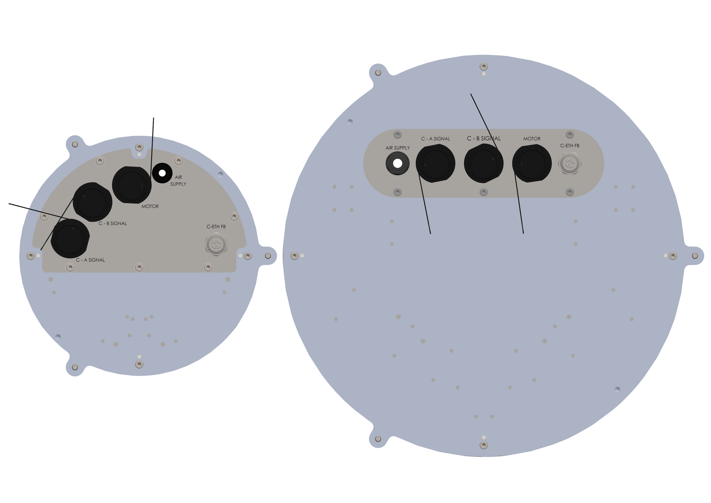
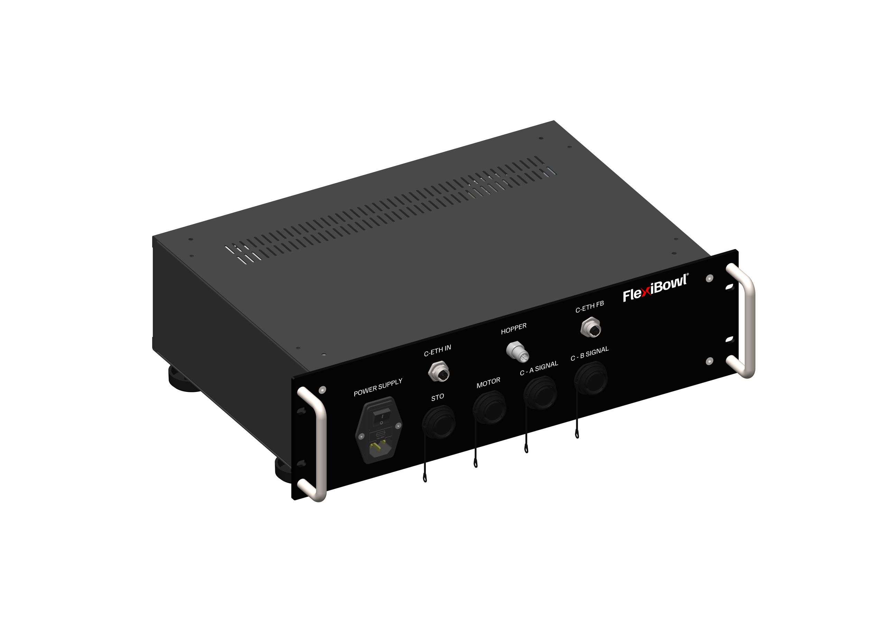
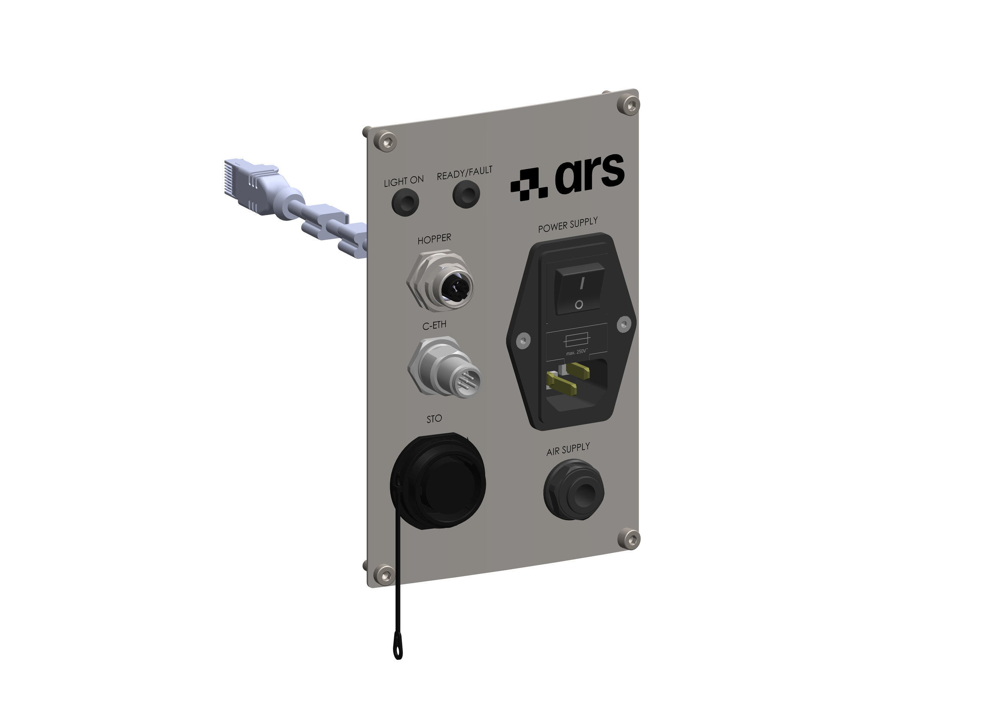
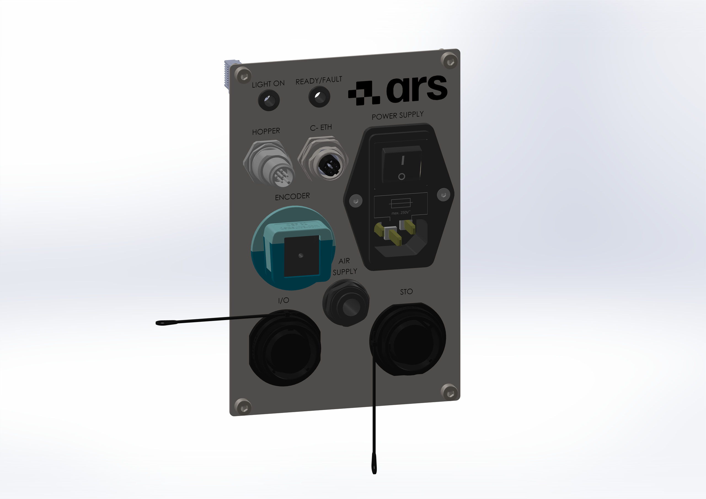

(intele)=
# **Elektrische Schnittstelle**

Das Anschlussfeld des FlexiBowl® variiert je nach Version der Maschine:

:::{raw} html
<style>
.ie-tabs, .ie-wrap, .ie-tabs *, .ie-wrap * {
  box-sizing: border-box;
}
/* Applica margin e padding zero solo ai componenti del tuo pannello se necessario, 
   senza toccare il resto del sito di Sphinx */
.ie-tabs, .ie-panel, .ie-wrap, .ie-row, .ie-bubble, .ie-name, .ie-desc {
  margin: 0;
  padding: 0;
}
:root{
  --acc:#1a6fc4;--acc-dk:#0d4a8a;--acc-bg:#e8f1fb;
  --bd:#e0e0e0;--bg-p:#ffffff;--bg-s:#f7f8f9;--bg-h:#f0f4fa;
  --tx1:#1a1a1a;--tx2:#555;--tx3:#888;
  --r:10px;--tr:0.35s cubic-bezier(.4,0,.2,1);
}
.ie-tabs{display:flex;gap:6px;margin-bottom:12px;flex-wrap:wrap}
.ie-tab{padding:5px 14px;border-radius:6px;border:1.5px solid var(--bd);background:#fff;font-size:13px;font-weight:600;color:var(--tx2);cursor:pointer;transition:background var(--tr),color var(--tr),border-color var(--tr)}
.ie-tab:hover{background:var(--bg-h)}
.ie-tab.on{background:var(--acc-bg);color:var(--acc-dk);border-color:var(--acc)}
.ie-panel{display:none}
.ie-panel.on{display:block}
.ie-wrap{border:1px solid var(--bd);border-radius:var(--r);overflow:hidden;background:var(--bg-p);box-shadow:0 2px 12px rgba(0,0,0,0.07)}
.ie-img-outer{position:relative;width:100%;padding-top:70.71%}
.ie-img-outer img{position:absolute;inset:0;width:100%;height:100%;object-fit:contain;padding:0;transition:opacity var(--tr)}
.ie-img-base{opacity:1;z-index:1}
.ie-img-hl{opacity:0;z-index:2}
.ie-badge{position:absolute;top:12px;left:14px;z-index:3;background:var(--acc);color:#fff;font-size:12px;font-weight:600;padding:4px 10px;border-radius:20px;opacity:0;transform:translateY(-4px);transition:opacity var(--tr),transform var(--tr);pointer-events:none;white-space:nowrap}
.ie-badge.on{opacity:1;transform:translateY(0)}
.ie-hint{position:absolute;bottom:14px;left:50%;z-index:3;transform:translateX(-50%);font-size:13px;color:#fff;background:rgba(0,0,0,0.38);padding:6px 16px;border-radius:20px;pointer-events:none;transition:opacity var(--tr);white-space:nowrap}
.ie-list-panel{border-top:1px solid var(--bd);background:var(--bg-p)}
.ie-list-head{display:grid;grid-template-columns:40px 140px 1fr;gap:8px;padding:8px 14px;background:var(--bg-s);border-bottom:1px solid var(--bd);font-size:11px;font-weight:600;text-transform:uppercase;letter-spacing:.05em;color:var(--tx3)}
.ie-row{display:grid;grid-template-columns:40px 140px 1fr;gap:8px;align-items:center;padding:9px 14px;border-bottom:1px solid var(--bd);cursor:pointer;transition:background var(--tr);user-select:none}
.ie-row:last-child{border-bottom:none}
.ie-row:hover{background:var(--bg-h)}
.ie-row.on{background:var(--acc-bg)}
.ie-bubble{width:26px;height:26px;border-radius:50%;border:1.5px solid var(--bd);background:#fff;display:flex;align-items:center;justify-content:center;font-size:12px;font-weight:600;color:var(--tx2);flex-shrink:0;transition:background var(--tr),color var(--tr),border-color var(--tr)}
.ie-row.on .ie-bubble{background:var(--acc);color:#fff;border-color:var(--acc)}
.ie-name{font-size:13px;font-weight:600;color:var(--tx1);font-family:monospace;transition:color var(--tr)}
.ie-row.on .ie-name{color:var(--acc-dk)}
.ie-desc{font-size:12px;color:var(--tx2);line-height:1.55}
</style>
 
<!-- Tab bar -->
<div class="ie-tabs">
  <button class="ie-tab on" onclick="ieSwitchTab('smallpanel',this)">Anschlussfeld FlexiBowl® 200-350</button>
  <button class="ie-tab"    onclick="ieSwitchTab('rack',this)">Rack</button>
  <button class="ie-tab"    onclick="ieSwitchTab('stpanel',this)">Standard-Anschlussfeld</button>
  <button class="ie-tab"    onclick="ieSwitchTab('encpanel',this)">Circular-Tracking-Anschlussfeld</button>
</div>
<!-- ══════════ PANNELLO FB200-350 ══════════ -->
<div class="ie-panel on" id="ie-panel-smallpanel">
  <div class="ie-wrap">
    <div class="ie-img-outer">
      
      
      <div class="ie-badge" id="smallpanel-badge"></div>
      <div class="ie-hint"  id="smallpanel-hint">Einen Stecker aus der Liste auswählen</div>
    </div>
    <div class="ie-list-panel">
      <div class="ie-list-head"><span>Nr.</span><span>Stecker</span><span>Beschreibung</span></div>
      <div id="smallpanel-list"></div>
    </div>
  </div>
</div>
<!-- ══════════ RACK ══════════ -->
<div class="ie-panel" id="ie-panel-rack">
  <div class="ie-wrap">
    <div class="ie-img-outer">
      
      
      <div class="ie-badge" id="rack-badge"></div>
      <div class="ie-hint"  id="rack-hint">Einen Stecker aus der Liste auswählen</div>
    </div>
    <div class="ie-list-panel">
      <div class="ie-list-head"><span>Nr.</span><span>Stecker</span><span>Beschreibung</span></div>
      <div id="rack-list"></div>
    </div>
  </div>
</div>
<!-- ══════════ PANNELLO STANDARD ══════════ -->
<div class="ie-panel" id="ie-panel-stpanel">
  <div class="ie-wrap">
    <div class="ie-img-outer">
      
      
      <div class="ie-badge" id="stpanel-badge"></div>
      <div class="ie-hint"  id="stpanel-hint">Einen Stecker aus der Liste auswählen</div>
    </div>
    <div class="ie-list-panel">
      <div class="ie-list-head"><span>Nr.</span><span>Stecker</span><span>Beschreibung</span></div>
      <div id="stpanel-list"></div>
    </div>
  </div>
</div>
<!-- ══════════ PANNELLO FLEXITRACKING ══════════ -->
<div class="ie-panel" id="ie-panel-encpanel">
  <div class="ie-wrap">
    <div class="ie-img-outer">
      
      
      <div class="ie-badge" id="encpanel-badge"></div>
      <div class="ie-hint"  id="encpanel-hint">Einen Stecker aus der Liste auswählen</div>
    </div>
    <div class="ie-list-panel">
      <div class="ie-list-head"><span>Nr.</span><span>Stecker</span><span>Beschreibung</span></div>
      <div id="encpanel-list"></div>
    </div>
  </div>
</div>
<script>
(function(){
  var models = {
    smallpanel: {
      imgPath: '../../../../_shared/media/images/smallpanel',
      imgExt: '.PNG',
      comps: [
        {n:1, name:'C-A SIGNAL', desc:'C-A-Signal-Anschluss'},
        {n:2, name:'C-B SIGNAL', desc:'C-B-Signal-Anschluss'},
        {n:3, name:'MOTOR',      desc:'Motorkabel-Anschluss'},
        {n:4, name:'C-ETH FB',   desc:'Ethernet-Verbindung zum Rack'},
        {n:5, name:'AIR SUPPLY', desc:'Lufteinlass'}
      ]
    },
    rack: {
      imgPath: '../../../../_shared/media/images/rack',
      imgExt: '.PNG',
      comps: [
        {n:1, name:'POWER SUPPLY', desc:'Netzanschluss und Schalter; enthält auch einen IEC-Filter'},
        {n:2, name:'STO',          desc:'STO-Anschluss'},
        {n:3, name:'MOTOR',        desc:'Motorkabel-Anschluss'},
        {n:4, name:'C-A SIGNAL',   desc:'C-A-Signal-Anschluss'},
        {n:5, name:'C-B SIGNAL',   desc:'C-B-Signal-Anschluss'},
        {n:6, name:'C-ETH IN',     desc:'Ethernet-Anschluss'},
        {n:7, name:'HOPPER',       desc:'Bulk-Feeder-Anschluss'},
        {n:8, name:'C-ETH FB',     desc:'Ethernet-Verbindung zum FlexiBowl®'}
      ]
    },
    stpanel: {
      imgPath: '../../../../_shared/media/images/stpanel',
      imgExt: '.PNG',
      comps: [
        {n:1, name:'POWER SUPPLY', desc:'Netzanschluss und Schalter; enthält auch einen IEC-Filter'},
        {n:2, name:'AIR SUPPLY',   desc:'Lufteinlass'},
        {n:3, name:'LIGHT ON',     desc:'Status-LED Backlight'},
        {n:4, name:'READY/FAULT',  desc:'Status-LED Ready/Fault'},
        {n:5, name:'HOPPER',       desc:'Bulk-Feeder-Anschluss'},
        {n:6, name:'C-ETH',        desc:'Ethernet-Anschluss'},
        {n:7, name:'STO',          desc:'STO-Anschluss'}
      ]
    },
    encpanel: {
      imgPath: '../../../../_shared/media/images/encpanel',
      imgExt: '.PNG',
      comps: [
        {n:1, name:'POWER SUPPLY', desc:'Netzanschluss und Schalter; enthält auch einen IEC-Filter'},
        {n:2, name:'LIGHT ON',     desc:'Status-LED Backlight'},
        {n:3, name:'READY/FAULT',  desc:'Status-LED Ready/Fault'},
        {n:4, name:'HOPPER',       desc:'Bulk-Feeder-Anschluss'},
        {n:5, name:'C-ETH',        desc:'Ethernet-Anschluss'},
        {n:6, name:'ENCODER',      desc:'Kabeldurchführung Encoder'},
        {n:7, name:'AIR SUPPLY',   desc:'Lufteinlass'},
        {n:8, name:'I/O',          desc:'I/O-Anschluss'},
        {n:9, name:'STO',          desc:'STO-Anschluss'}
      ]
    }
  };
  var state = {};
  Object.keys(models).forEach(function(id){ state[id]={activeN:null,activeRow:null}; });
  Object.keys(models).forEach(function(id){
    var m  = models[id];
    var el = document.getElementById(id+'-list');
    m.comps.forEach(function(c){
      var row = document.createElement('div');
      row.className = 'ie-row';
      row.innerHTML = '<div class="ie-bubble">'+c.n+'</div>'
                    + '<div class="ie-name">'+c.name+'</div>'
                    + '<div class="ie-desc">'+c.desc+'</div>';
      row.addEventListener('click', function(){ toggle(id, c, row); });
      el.appendChild(row);
    });
  });
  function toggle(id, c, row){
    var s       = state[id];
    var m       = models[id];
    var imgBase = document.getElementById(id+'-img-base');
    var imgHl   = document.getElementById(id+'-img-hl');
    var badge   = document.getElementById(id+'-badge');
    var hint    = document.getElementById(id+'-hint');
    if(s.activeN === c.n){ reset(id); return; }
    if(s.activeRow) s.activeRow.classList.remove('on');
    row.classList.add('on');
    s.activeRow = row; s.activeN = c.n;
    badge.textContent = c.name + ' \u2014 ' + c.desc;
    badge.classList.add('on');
    hint.style.opacity = '0';
    var newImg = new Image();
    newImg.onload = function(){
      imgHl.src = newImg.src;
      imgHl.style.opacity = '1';
      imgBase.style.opacity = '0';
    };
    newImg.onerror = function(){
      imgBase.style.opacity = '1';
      imgHl.style.opacity = '0';
    };
    newImg.src = m.imgPath + c.n + m.imgExt;
  }
  function reset(id){
    var s       = state[id];
    var imgBase = document.getElementById(id+'-img-base');
    var imgHl   = document.getElementById(id+'-img-hl');
    var badge   = document.getElementById(id+'-badge');
    var hint    = document.getElementById(id+'-hint');
    if(s.activeRow) s.activeRow.classList.remove('on');
    s.activeRow = null; s.activeN = null;
    imgBase.style.opacity = '1';
    imgHl.style.opacity = '0';
    setTimeout(function(){ imgHl.src = ''; }, 350);
    badge.classList.remove('on');
    hint.style.opacity = '1';
  }
  window.ieSwitchTab = function(id, btn){
    document.querySelectorAll('.ie-panel.on').forEach(function(p){
      var oldId = p.id.replace('ie-panel-','');
      reset(oldId);
    });
    document.querySelectorAll('.ie-tab').forEach(function(b){ b.classList.remove('on'); });
    document.querySelectorAll('.ie-panel').forEach(function(p){ p.classList.remove('on'); });
    btn.classList.add('on');
    document.getElementById('ie-panel-'+id).classList.add('on');
  };
})();
</script>
:::


<style>
.ars-dropdown {
  margin: 0.9rem 0 0.4rem 0;
  border: 2px solid #7fb3dd;
  border-radius: 8px;
  overflow: hidden;
  box-shadow: 0 2px 6px rgba(26,111,196,0.10);
}
.ars-dropdown summary {
  cursor: pointer;
  color: #2980b9;
  font-weight: 600;
  font-size: 0.83rem;
  padding: 0.5rem 0.9rem;
  display: block;
  background: #eaf3fb;
  list-style: none;
  user-select: none;
}
.ars-dropdown summary::-webkit-details-marker { display: none; }
.ars-dropdown summary::before {
  content: "▸ ";
}
.ars-dropdown[open] summary::before {
  content: "▾ ";
}
.ars-dropdown[open] summary {
  border-bottom: 2px solid #7fb3dd;
}
.ars-dropdown .ars-dropdown-body {
  padding: 0.9rem 1rem;
  background: #fff;
}
.ars-dropdown img {
  display: block;
  max-width: 100%;
  width: 360px;
  border-radius: 4px;
}
.ars-step-warn, .ars-step-attn, .ars-step-note {
  border-radius: 5px;
  padding: 0.5rem 0.75rem;
  font-size: 0.83rem;
  margin-top: 0.55rem;
  line-height: 1.4;
}
.ars-step-warn { background:#fff3cd; border-left:4px solid #f0ad4e; color:#7a5b00; }
.ars-step-attn { background:#fee2e2; border-left:4px solid #dc2626; color:#8a1c1c; }
.ars-step-note { background:#eef6fc; border-left:4px solid #2980b9; color:#1a3a52; }
.ars-pin-table { width:100%; border-collapse:collapse; font-size:0.8rem; margin-top:0.4rem; }
.ars-pin-table th { background:#f0f4f8; padding:0.3rem 0.5rem; text-align:left; border:1px solid #d0e4f0; }
.ars-pin-table td { padding:0.3rem 0.5rem; border:1px solid #d0e4f0; }

.ars-zoom-img {
  transition: transform 0.35s cubic-bezier(0.34, 1.56, 0.64, 1), box-shadow 0.35s ease;
  cursor: zoom-in;
  position: relative;
}
.ars-zoom-img:hover {
  transform: scale(1.8);
  box-shadow: 0 12px 40px rgba(0,0,0,0.22);
  z-index: 10;
}
</style>

:::{warning}
Vor jedem elektrischen Anschluss sicherstellen, dass die Spannungsversorgung getrennt ist und sich das System in einem sicheren Zustand befindet.
:::

:::{important}
Um die Stromversorgungsstecker herum etwa {ref}`100 mm freien Platz <dim800>` lassen, um Verdrahtung und Wartung zu erleichtern.
:::

Die elektrische Schnittstelle des FlexiBowl® ändert sich je nach Baugröße der Maschine:

- **FlexiBowl® 500 – 1200**: Alle Stecker (STO, Ethernet, Hopper, Spannungsversorgung, Luft) befinden sich auf einem einzigen **elektrischen Standard-Anschlussfeld**, das direkt an der Maschine montiert ist.
- **FlexiBowl® 200 / 350**: Die Hauptstecker befinden sich an einem externen **Rack**; das Rack wird anschließend über 4 dedizierte Kabel (Ethernet, Motor+STO, Signal A, Signal B) mit der Maschine verbunden. An der Maschine ist nur noch die Druckluft anzuschließen.

---

(pannello-standard)=
## FlexiBowl® 500 – 1200 — Elektrisches Standard-Anschlussfeld

```{list-table}
:widths: 8 52 40
:header-rows: 1

* - #
  - Aktion
  - Bild
* - 1
  - **Den STO anschließen.**

    10-poliger Stecker. Erforderlich, um den Motor zu aktivieren.

    <div class="ars-step-note">
    Die Eingänge <strong>+STO1</strong> und <strong>+STO2</strong> müssen vom Sicherheitskreis <strong>+24 Vdc</strong> erhalten; <strong>−STO1</strong> und <strong>−STO2</strong> sind an die Bezugsspannung −24 Vdc anzuschließen.
    </div>

    <details class="ars-dropdown"><summary>Pinbelegung des STO-Steckers (10-polig)</summary><div class="ars-dropdown-body">

    | Pin | Beschreibung |
    |---|---|
    | 1 | +24 Vdc |
    | 2 | −24 Vdc |
    | 3 | +STO1 |
    | 4 | −STO1 |
    | 5 | +STO2 |
    | 6 | −STO2 |
    | 7–10 | NC |

    </div></details>
  -
    ```{image} ../../../../_shared/media/images/stpanel7.PNG
    :alt: Den STO anschließen
    :class: ars-zoom-img
    ```

* - 2
  - **Das Ethernet (C-ETH) anschließen.**

    M12-Stecker, D-Kodierung. Er ermöglicht die Kommunikation mit dem FlexiBowl®, der auch über einen Webbrowser erreichbar ist.

    <div class="ars-step-attn">
    Wenn der FlexiBowl® mit Spannung versorgt wird, ist die Ethernet-Verbindung <strong>zwingend erforderlich</strong>: Fehlt sie, geht die Maschine in den Zustand <strong>ERROR</strong> über (rote LED Ready/Fault).
    </div>

    <details class="ars-dropdown"><summary>Pinbelegung M12 → RJ45</summary><div class="ars-dropdown-body">

    Adapter M12 8-polig → RJ45:

    | RJ45-Pin | Signal | Funktion | Farbe |
    |---|---|---|---|
    | 1 | TD+ | Datenübertragung (+) | Gelb |
    | 2 | TD− | Datenübertragung (−) | Orange |
    | 3 | RD+ | Datenempfang (+) | Weiß |
    | 4 | NC | Nicht belegt | — |
    | 5 | NC | Nicht belegt | — |
    | 6 | RD− | Datenempfang (−) | Blau |
    | 7 | NC | Nicht belegt | — |
    | 8 | NC | Nicht belegt | — |

    4-poliger M12-Stecker, D-kodiert:

    | M12-Pin | Signal | Funktion | Farbe |
    |---|---|---|---|
    | 1 | TD+ | Datenübertragung (+) | Gelb |
    | 2 | RD+ | Datenempfang (+) | Weiß |
    | 3 | TD− | Datenübertragung (−) | Orange |
    | 4 | RD− | Datenempfang (−) | Blau |

    </div></details>
  -
    ```{image} ../../../../_shared/media/images/stpanel6.PNG
    :alt: Das Ethernet anschließen
    :class: ars-zoom-img
    ```

* - 3
  - **Den Hopper anschließen.**

    M12-Stecker, A-kodiert, der zur Kommunikation mit ARS-Hopper-Steuerungen über das Protokoll **Modbus RTU** dient.

    <details class="ars-dropdown"><summary>Pinbelegung M12 A-kodiert</summary><div class="ars-dropdown-body">

    | M12-Pin | Signal | Funktion | Farbe |
    |---|---|---|---|
    | 1 | A+ | RS485-Datenleitung (+) | Braun |
    | 2 | NC | Nicht belegt | Weiß |
    | 3 | B− | RS485-Datenleitung (−) | Blau |
    | 4 | GND | Gemeinsame Bezugsmasse | Schwarz |
    | 5 | NC | Nicht belegt | Grau |

    </div></details>
  -
    ```{image} ../../../../_shared/media/images/stpanel5.PNG
    :alt: Den Hopper anschließen
    :class: ars-zoom-img
    ```

* - 4
  - **Die Spannungsversorgung (Power Supply) anschließen — als Letztes.**

    Mitgelieferter Stecker, gekennzeichnet mit der Bezeichnung **POWER SUPPLY**. Mit dem Netzschalter kann das Gerät ein-/ausgeschaltet werden.

    <div class="ars-step-attn">
    Sicherstellen, dass der FlexiBowl® <strong>ausgeschaltet</strong> ist, bevor die Spannungsversorgung angeschlossen wird, und dass das Gerät geerdet ist.
    </div>

    <div class="ars-step-warn">
    Zulässige Spannung: <strong>120–230 Vac, 50/60 Hz</strong>.
    </div>

    <div class="ars-step-note">
    Der Stromversorgungsstecker ist mit einer Halterung für <strong>2 Sicherungen</strong> ausgestattet, die vor eventuellen elektrischen Störungen schützen. Beim ersten Start stets deren Zustand prüfen, bevor das Gerät eingeschaltet wird.
    </div>

    <details class="ars-dropdown"><summary>Pinbelegungsschema des Stromversorgungskabels</summary><div class="ars-dropdown-body">

    | Farbe | Typ | Beschriftung |
    |---|---|---|
    | Braun | Phase | L1 |
    | Blau | Neutralleiter | N1 |
    | Gelb/Grün | Erde | PE1 |

    </div></details>
  -
    ```{image} ../../../../_shared/media/images/stpanel1.PNG
    :alt: Die Spannungsversorgung anschließen
    :class: ars-zoom-img
    ```

```

:::{note}
Nach dem Einschalten stets den Zustand der Maschine anhand der **Status-LEDs** am Frontfeld prüfen — siehe Abschnitt {ref}`Status-LEDs <led-stato>` weiter unten auf dieser Seite.
:::

:::{tip}
Die Strom- und Ethernet-Kabel sind optional in den Längen 3, 5 und 10 m erhältlich: siehe {ref}`cavo-alim` und {ref}`cavo-eth`.
:::

---

(rack-esterno)=
## FlexiBowl® 200 / 350 — Externes Rack

Die Modelle FlexiBowl® FB 200 und FB 350 sind mit einem externen **Rack** ausgestattet, das alle für den Betrieb erforderlichen elektronischen Geräte enthält. Die Stecker zu den Anlagen des Kunden befinden sich am Rack (nicht an der Maschine) und haben die **gleiche Pinbelegung** wie die entsprechenden Stecker des Standard-Anschlussfelds, lediglich auf einem externen Gehäuse angeordnet.

### Anschlüsse am Rack

```{list-table}
:widths: 8 52 40
:header-rows: 1

* - #
  - Aktion
  - Bild
* - 1
  - **Den STO** am Rack anschließen.

    10-poliger Stecker, gleiche Funktion und Pinbelegung wie beim Standard-Anschlussfeld.

    <div class="ars-step-note">
    Die Eingänge <strong>+STO1</strong> und <strong>+STO2</strong> müssen vom Sicherheitskreis <strong>+24 Vdc</strong> erhalten; <strong>−STO1</strong> und <strong>−STO2</strong> sind an die Bezugsspannung −24 Vdc anzuschließen.
    </div>

    <details class="ars-dropdown"><summary>Pinbelegung des STO-Steckers (10-polig)</summary><div class="ars-dropdown-body">

    | Pin | Beschreibung |
    |---|---|
    | 1 | +24 Vdc |
    | 2 | −24 Vdc |
    | 3 | +STO1 |
    | 4 | −STO1 |
    | 5 | +STO2 |
    | 6 | −STO2 |
    | 7–10 | NC |

    </div></details>
  -
    ```{image} ../../../../_shared/media/images/rack2.PNG
    :alt: Den STO anschließen
    :class: ars-zoom-img
    ```

* - 2
  - **Den C-ETH IN** am Rack anschließen.

    M12-Stecker, D-Kodierung.

    <div class="ars-step-attn">
    Verbindung <strong>zwingend erforderlich</strong>, wenn die Maschine mit Spannung versorgt wird: Fehlt sie, geht die Maschine in ERROR über (rote LED Ready/Fault).
    </div>

    <details class="ars-dropdown"><summary>Pinbelegung M12 → RJ45</summary><div class="ars-dropdown-body">

    Adapter M12 8-polig → RJ45:

    | RJ45-Pin | Signal | Funktion | Farbe |
    |---|---|---|---|
    | 1 | TD+ | Datenübertragung (+) | Gelb |
    | 2 | TD− | Datenübertragung (−) | Orange |
    | 3 | RD+ | Datenempfang (+) | Weiß |
    | 4 | NC | Nicht belegt | — |
    | 5 | NC | Nicht belegt | — |
    | 6 | RD− | Datenempfang (−) | Blau |
    | 7 | NC | Nicht belegt | — |
    | 8 | NC | Nicht belegt | — |

    4-poliger M12-Stecker, D-kodiert:

    | M12-Pin | Signal | Funktion | Farbe |
    |---|---|---|---|
    | 1 | TD+ | Datenübertragung (+) | Gelb |
    | 2 | RD+ | Datenempfang (+) | Weiß |
    | 3 | TD− | Datenübertragung (−) | Orange |
    | 4 | RD− | Datenempfang (−) | Blau |

    </div></details>
  -
    ```{image} ../../../../_shared/media/images/rack6.PNG
    :width: 110%
    :alt: Rack-Anschlussfeld
    :class: ars-zoom-img
    ```

* - 3
  - **Den Hopper** am Rack anschließen.

    M12-Stecker, A-kodiert, Protokoll **Modbus RTU**.

    <details class="ars-dropdown"><summary>Pinbelegung M12 A-kodiert</summary><div class="ars-dropdown-body">

    | M12-Pin | Signal | Funktion | Farbe |
    |---|---|---|---|
    | 1 | A+ | RS485-Datenleitung (+) | Braun |
    | 2 | NC | Nicht belegt | Weiß |
    | 3 | B− | RS485-Datenleitung (−) | Blau |
    | 4 | GND | Gemeinsame Bezugsmasse | Schwarz |
    | 5 | NC | Nicht belegt | Grau |

    </div></details>
  -
    ```{image} ../../../../_shared/media/images/rack7.PNG
    :width: 110%
    :alt: Rack-Anschlussfeld
    :class: ars-zoom-img
    ```

* - 4
  - **Die Spannungsversorgung** am Rack anschließen — als Letztes.

    Netzbuchse mit Schalter; sie enthält auch einen IEC-Filter.

    <div class="ars-step-attn">
    Sicherstellen, dass der FlexiBowl® <strong>ausgeschaltet</strong> ist, bevor die Spannungsversorgung angeschlossen wird.
    </div>

    <div class="ars-step-warn">
    Zulässige Spannung: <strong>120–230 Vac, 50/60 Hz</strong>.
    </div>

    <div class="ars-step-note">
    Auch am Rack verfügt der Stromversorgungsstecker über eine Aufnahme für die <strong>2 Schutzsicherungen</strong>: Deren Zustand beim ersten Start prüfen.
    </div>

    <details class="ars-dropdown"><summary>Pinbelegungsschema des Stromversorgungskabels</summary><div class="ars-dropdown-body">

    | Farbe | Typ | Beschriftung |
    |---|---|---|
    | Braun | Phase | L1 |
    | Blau | Neutralleiter | N1 |
    | Gelb/Grün | Erde | PE1 |

    </div></details>
  -
    ```{image} ../../../../_shared/media/images/rack1.PNG
    :width: 110%
    :alt: Rack-Anschlussfeld
    :class: ars-zoom-img
    ```
```

(collegamento-rack)=
### Verbindung zwischen Rack und FlexiBowl®

Das Rack kommuniziert über 4 dedizierte Kabel mit dem FlexiBowl®, die jeweils **ausschließlich** an den Anschluss mit der entsprechenden Beschriftung am Maschinen-Anschlussfeld anzuschließen sind.

:::{attention}
Jedes Kabel mit dem Anschluss mit dem **entsprechenden Etikett** verbinden (z. B. MOTOR ↔ MOTOR, C-A SIGNAL ↔ C-A SIGNAL). Eine vertauschte Verbindung kann das System beschädigen.
:::

:::{tip}
Die 3 m langen Kabel zwischen Rack und FlexiBowl® sind im Lieferumfang enthalten; die Versionen mit 5 und 10 m sind optional erhältlich: siehe {ref}`cavo-rack`.
:::

```{list-table}
:widths: 8 52 40
:header-rows: 1

* - #
  - Aktion
  - Bild
* - 5
  - **Das Ethernet-Kabel (C-ETH FB)** zwischen Rack und FlexiBowl® anschließen.

    M12-Stecker, D-kodiert.
  -
    ```{image} ../../../../_shared/media/images/rack8.PNG
    :width: 110%
    :alt: Das Kabel C-ETH FB anschließen
    :class: ars-zoom-img
    ```
    ```{image} ../../../../_shared/media/images/smallpanel4.PNG
    :width: 110%
    :alt: Das Kabel C-ETH FB anschließen
    :class: ars-zoom-img
    ```
* - 6
  - **Das MOTOR-Kabel anschließen.**

    <div class="ars-step-note">
    9-poliger Stecker: Er führt sowohl die Motorversorgung als auch die <strong>STO</strong>-Signale zum FlexiBowl® (am Rack sind STO und Motor getrennte Stecker; am Kabel zur Maschine sind sie in einem einzigen 9-poligen Stecker zusammengefasst).
    </div>

    <details class="ars-dropdown"><summary>Pinbelegung des Motor-Steckers (9-polig)</summary><div class="ars-dropdown-body">

    | Pin | Beschreibung |
    |---|---|
    | 1 | +STO1 – Safe Torque Off |
    | 2 | +24 Vdc – Hilfsspannungsversorgung |
    | 3 | +STO2 – Safe Torque Off |
    | 4 | −24 Vdc – Hilfsspannungsversorgung |
    | 5 | NC |
    | 6 | +48 Vdc – Motor Power |
    | 7 | −STO1 – Safe Torque Off |
    | 8 | −48 Vdc – Motor Power |
    | 9 | −STO2 – Safe Torque Off |

    </div></details>
  -
    ```{image} ../../../../_shared/media/images/rack3.PNG
    :width: 110%
    :alt: Das Motor-Kabel anschließen
    :class: ars-zoom-img
    ```
    ```{image} ../../../../_shared/media/images/smallpanel3.PNG
    :width: 110%
    :alt: Das Kabel C-ETH FB anschließen
    :class: ars-zoom-img
    ```
* - 7
  - **Das Kabel C-A SIGNAL anschließen.**

    12-poliger Stecker für analoge Signale.

    <details class="ars-dropdown"><summary>Pinbelegung C-A Signal (12-polig)</summary><div class="ars-dropdown-body">

    | Pin | Beschreibung |
    |---|---|
    | 1 | Analog Output 1 |
    | 2 | −24 Vdc |
    | 3 | Analog Input 1 |
    | 4 | +24 Vdc |
    | 5–12 | NC |

    </div></details>
  -
    ```{image} ../../../../_shared/media/images/rack4.PNG
    :width: 110%
    :alt: Das Kabel C-A Signal anschließen
    :class: ars-zoom-img
    ```
    ```{image} ../../../../_shared/media/images/smallpanel1.PNG
    :width: 110%
    :alt: Das Kabel C-ETH FB anschließen
    :class: ars-zoom-img
    ```
* - 8
  - **Das Kabel C-B SIGNAL anschließen.**

    19-poliger Stecker für digitale Signale, einschließlich der Ansteuerungen der Status-LEDs.

    <details class="ars-dropdown"><summary>Pinbelegung C-B Signal (19-polig)</summary><div class="ars-dropdown-body">

    | Pin | Beschreibung |
    |---|---|
    | 1 | +24 Vdc – Aktivierung der grünen Status-LED |
    | 2 | −24 Vdc – Gemeinsame Masse der Status-LEDs |
    | 3 | +24 Vdc – Aktivierung der roten Status-LED |
    | 4 | +24 Vdc – Aktivierung der Backlight-Status-LED |
    | 5 | −24 Vdc – Aktivierung der Backlight-Status-LED |
    | 6 | +24 Vdc – Backlight-Aktivierung |
    | 7 | −24 Vdc – Backlight-Aktivierung |
    | 8 | +24 Vdc – Flip-Aktivierung |
    | 9 | −24 Vdc – Flip-Aktivierung |
    | 10 | +24 Vdc – Blasluft-Aktivierung |
    | 11 | −24 Vdc – Blasluft-Aktivierung |
    | 12–19 | NC |

    </div></details>
  -
    ```{image} ../../../../_shared/media/images/rack5.PNG
    :width: 110%
    :alt: Das Kabel C-B Signal anschließen
    :class: ars-zoom-img
    ```
    ```{image} ../../../../_shared/media/images/smallpanel2.PNG
    :width: 110%
    :alt: Das Kabel C-ETH FB anschließen
    :class: ars-zoom-img
    ```
```

:::{note}
Nach dem Einschalten stets den Zustand der Maschine anhand der **Status-LEDs** am Frontfeld prüfen — siehe Abschnitt {ref}`Status-LEDs <led-stato>` weiter unten auf dieser Seite.
:::

---

(led-stato)=
## Status-LEDs

Am Frontfeld des FlexiBowl® befinden sich zwei Status-LEDs, die für **alle Baugrößen** (500–1200 und 200/350) gleich sind:

| LED | Farbe | Bedeutung |
|---|---|---|
| **Light ON** | Grün (einziger Zustand) | Zeigt an, ob das Backlight am FlexiBowl® EIN oder AUS ist. Das Backlight wird vom Bildverarbeitungssystem verwendet, um die Bauteile zu beleuchten und erkennbar zu machen. Es kann über die Bildverarbeitungssoftware oder durch Befehle eines externen Systems, das über Ethernet kommuniziert, aktiviert werden. |
| **Ready / Fault** | Grün | System betriebsbereit und störungsfrei. Ethernet-Verbindung korrekt. |
| **Ready / Fault** | Rot | Interne Störung oder Störung der Ethernet-Verbindung. Die Störungstabelle zu Rate ziehen. |

:::{note}
Nach dem Einschalten warten, bis die LED **Ready/Fault** leuchtet: Sind Hopper und C-ETH korrekt angeschlossen, leuchtet die LED **grün**.
:::

---

(io-flexitrack)=
## Option Circular Tracking — Schnittstellenfeld

Das mit der Option Circular Tracking mitgelieferte Schnittstellenfeld bietet zusätzlich zu den bereits beschriebenen Anschlüssen die folgenden dedizierten Stecker:

- **I/O-Stecker**: Austausch digitaler Signale, einschließlich der Latch-Funktion.
- **Encoder-Kabeldurchführung**: für den im FlexiBowl® integrierten Encoder.

```{list-table}
:widths: 8 52 40
:header-rows: 1

* - #
  - Aktion
  - Bild
* - 10
  - **Den I/O-Stecker** (19-polig) anschließen.

    <details class="ars-dropdown"><summary>Pinbelegung des I/O-Steckers (19-polig)</summary><div class="ars-dropdown-body">

    | Pin | Signal |
    |---|---|
    | 1 | IN – Bit 1 – Seq. Cmd |
    | 2 | IN – Bit 2 – Seq. Cmd |
    | 3 | IN – Bit 3 – Seq. Cmd |
    | 4 | IN – Bit 4 – Seq. Cmd |
    | 5 | IN – Bit 5 – Seq. Cmd |
    | 6 | IN – Latch |
    | 7–8 | NC |
    | 9 | OUT – Ready |
    | 10 | OUT – Fault |
    | 11 | OUT – Busy |
    | 12 | OUT – Hopper_1_IsVibrating |
    | 13 | OUT – Hopper_2_IsVibrating |
    | 14 | OUT – Hopper_3_IsVibrating |
    | 15 | OUT – Hopper_4_IsVibrating |
    | 16–19 | NC |

    </div></details>
  -
    ```{image} ../../../../_shared/media/images/encpanel6.PNG
    :alt: Circular-Tracking-I/O-Stecker
    :class: ars-zoom-img
    ```
* - 11
  - **Die Encoder-Kabeldurchführung anschließen**, die für den im FlexiBowl® integrierten Encoder vorgesehen ist.
  -
    ```{image} ../../../../_shared/media/images/encpanel8.PNG
    :alt: Circular-Tracking-Encoder-Kabeldurchführung
    :class: ars-zoom-img
    ```
```

---

## Allgemeine Hinweise und Warnungen

:::{attention}
Alle Anschlussarbeiten müssen bei ausgeschaltetem und von der Spannungsversorgung getrenntem Gerät durchgeführt werden.
:::

:::{attention}
Die Erdverbindung ist zwingend erforderlich und muss vor jedem Einschalten überprüft werden.
:::

:::{attention}
Bei einer durch die rote LED (Ready/Fault) angezeigten Störung die modellspezifische Störungstabelle zu Rate ziehen.
:::

:::{attention}
Für weitere technische Informationen oder Unterstützung wenden Sie sich an ARS s.r.l. – FlexiBowl® Division.
:::


