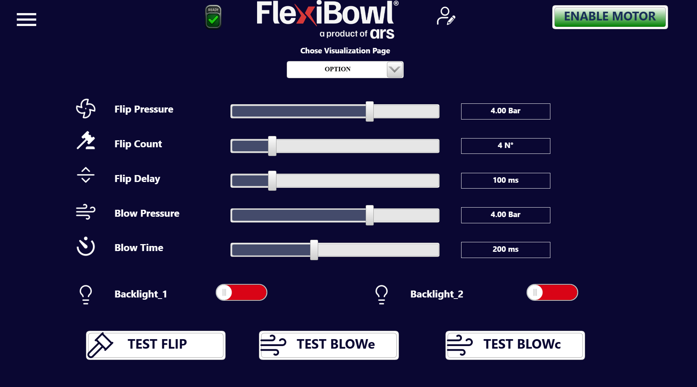
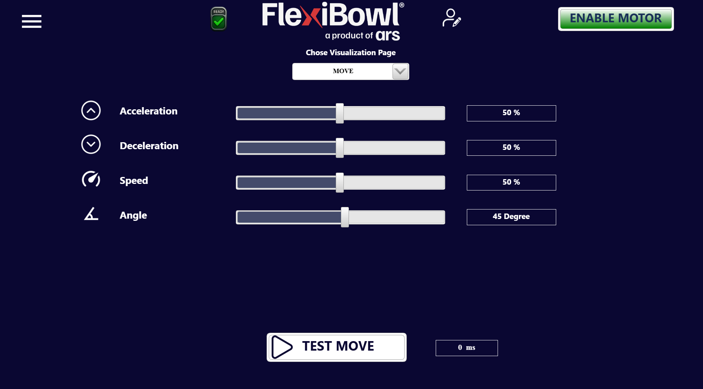
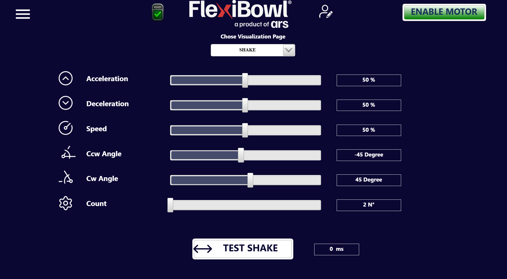

# **Main Command**

## Übersicht

Die Seite **Main Command** ist der wichtigste Betriebsbereich der FlexiBowl®-Software-Oberfläche. Sie ermöglicht es dem Bediener, die Bewegungsparameter und die Zubehöroptionen des Systems zu konfigurieren und zu testen.

Die Seite ist in **drei Unterseiten** gegliedert, die über das zentrale Dropdown-Menü unterhalb der Navigationsleiste mit der Bezeichnung **„Chose Visualization Page“** ausgewählt werden können:

| Unterseite | Kurzbeschreibung |
|---|---|
| **OPTION** | Parameter für Flip, Blow und Hintergrundbeleuchtung |
| **MOVE** | Parameter für die Drehbewegung des FlexiBowl® |
| **SHAKE** | Parameter für die Schwingbewegung des FlexiBowl® |

---

## Unterseite: OPTION

Die Unterseite **OPTION** fasst die Parameter der Zusatzfunktionen des FlexiBowl® zusammen: das System zum Umkippen der Bauteile (Flip), das Blassystem (Blow) und die Hintergrundbeleuchtung (Backlight).

| Parameter | Einheit | Beschreibung |
|---|---|---|
| **Flip Pressure** | Bar  | Luftdruck für die Betätigung des Flips. Über Schieberegler einstellbar |
| **Flip Count** | Nr.  | Anzahl der nacheinander während eines Zyklus ausgeführten Flips |
| **Flip Delay** | ms  | Zeitintervall zwischen einem Flip und dem nächsten |
| **Blow Pressure** | Bar  | Luftdruck für das Anblasen der Bauteile auf dem FlexiBowl® |
| **Blow Time** | ms  | Dauer des Blasimpulses |

Jeder Parameter ist über einen **horizontalen Schieberegler** einstellbar; der aktuelle Wert wird im Zahlenfeld rechts neben dem Schieberegler angezeigt.

### Backlight-Steuerung

| Steuerung | Beschreibung |
|---|---|
| **Backlight_1** | Ein/Aus-Umschalter für Backlight 1  |
| **Backlight_2** | Ein/Aus-Umschalter für Backlight 2  |

Die Umschalter zeigen Rot, wenn das Backlight **eingeschaltet** ist.

### Testschaltflächen

Am Ende der Seite befinden sich drei Schaltflächen, um die Funktionen in Echtzeit zu testen:

| Schaltfläche | Funktion |
|---|---|
| **TEST FLIP** | Führt einen Flip mit den aktuell eingestellten Parametern aus |
| **TEST BLOWe** | Aktiviert die äußere Blasluft (externer Blow) mit den eingestellten Parametern |
| **TEST BLOWc** | Aktiviert die zentrale Blasluft (zentraler Blow) mit den eingestellten Parametern |

:::{attention}  
 Vor der Durchführung der Tests sicherstellen, dass der Motor aktiviert ist (Schaltfläche **ENABLE MOTOR** aktiv) und der Systemzustand **READY** lautet.
:::

---

## Unterseite: MOVE

Die Unterseite **MOVE** ermöglicht es, die Parameter der Drehbewegung des FlexiBowl® zu konfigurieren und direkt über die Oberfläche zu testen.

| Parameter | Einheit | Standardwert | Beschreibung |
|---|---|---|---|
| **Acceleration** | % | 50 | Beschleunigungsrampe des Motors beim Start der Bewegung. Höhere Werte führen zu einem abrupteren Start |
| **Deceleration** | % | 50 | Verzögerungsrampe des Motors beim Anhalten. Höhere Werte führen zu einem abrupteren Stopp |
| **Speed** | % | 50 | Drehgeschwindigkeit des FlexiBowl® während der Bewegung |
| **Angle** | Grad | 45 | Drehwinkel, den der FlexiBowl® bei jeder einzelnen Bewegung zurücklegt |

Jeder Parameter ist über einen **horizontalen Schieberegler** einstellbar; der aktuelle Wert wird im Zahlenfeld rechts neben dem Schieberegler angezeigt.

### Testschaltfläche

| Schaltfläche | Angrenzendes Feld | Funktion |
|---|---|---|
| **TEST MOVE** | Ausführungszeit (ms) | Führt eine Drehbewegung mit den aktuell eingestellten Parametern aus. Das Feld rechts zeigt die tatsächliche Dauer der zuletzt ausgeführten Bewegung in Millisekunden |

:::{note}  
 Das Feld **ms** zeigt die tatsächliche Zeit an, die der Bowl für die eingestellte Bewegung benötigt. Dieser Wert ist nützlich, um den FlexiBowl® mit dem Bildverarbeitungssystem zu synchronisieren.
:::

:::{attention}   
Vor der Durchführung des Tests sicherstellen, dass der Motor aktiviert ist (Schaltfläche **ENABLE MOTOR** aktiv) und der Systemzustand **READY** lautet.
:::

---

## Unterseite: SHAKE

Die Unterseite **SHAKE** ermöglicht es, die Parameter der Schwingbewegung des FlexiBowl® (Shake), die zum Umverteilen der Bauteile auf dem Teller dient, zu konfigurieren und direkt über die Oberfläche zu testen.

| Parameter | Einheit | Standardwert | Beschreibung |
|---|---|---|---|
| **Acceleration** | % | 50 | Beschleunigungsrampe des Motors während der Shake-Phase |
| **Deceleration** | % | 50 | Verzögerungsrampe des Motors während der Shake-Phase |
| **Speed** | % | 50 | Drehgeschwindigkeit während der Shake-Bewegung |
| **Ccw Angle** | Grad | -45 | Drehwinkel **gegen den Uhrzeigersinn** (Counter-ClockWise) bei jeder Schwingung |
| **Cw Angle** | Grad | 45 | Drehwinkel **im Uhrzeigersinn** (ClockWise) bei jeder Schwingung |
| **Count** | Nr. | 2 | Anzahl der vollständigen Schwingungen, die während eines Shake-Zyklus ausgeführt werden |

Jeder Parameter ist über einen **horizontalen Schieberegler** einstellbar; der aktuelle Wert wird im Zahlenfeld rechts neben dem Schieberegler angezeigt.

:::{note}  
 Die **Shake**-Bewegung besteht aus einer Reihe von abwechselnden Drehungen im und gegen den Uhrzeigersinn, die jeweils durch **Cw Angle** und **Ccw Angle** definiert sind. Die Anzahl der vollständigen Schwingungen wird durch den Parameter **Count** gesteuert.
:::

### Testschaltfläche

| Schaltfläche | Angrenzendes Feld | Funktion |
|---|---|---|
| **TEST SHAKE** | Ausführungszeit (ms) | Führt einen Shake-Zyklus mit den aktuell eingestellten Parametern aus. Das Feld rechts zeigt die tatsächliche Dauer des zuletzt ausgeführten Shake in Millisekunden |

:::{attention}  
 Vor der Durchführung des Tests sicherstellen, dass der Motor aktiviert ist (Schaltfläche **ENABLE MOTOR** aktiv) und der Systemzustand **READY** lautet.
:::