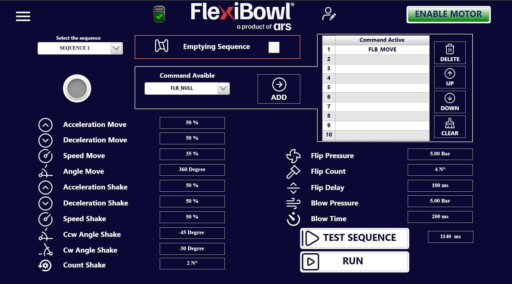
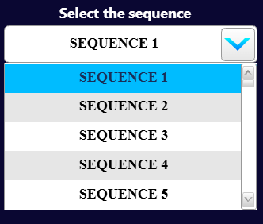
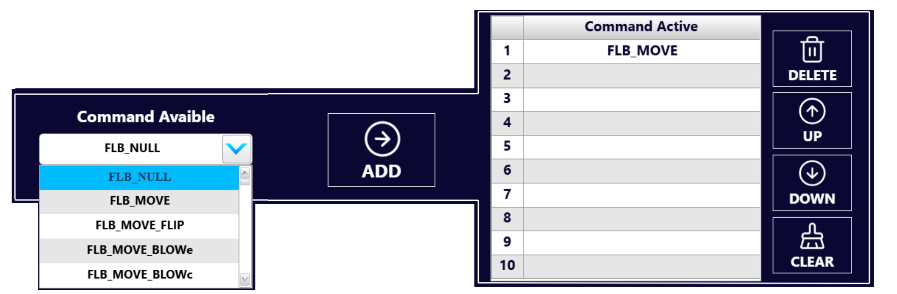

# **Sequence**

## Übersicht

Die Seite **Sequence** ermöglicht es, benutzerdefinierte Betriebssequenzen für den FlexiBowl® zu erstellen, zu bearbeiten und zu verwalten. Eine Sequenz ist eine geordnete Liste von Befehlen, die das System automatisch nacheinander ausführt und dabei Drehbewegungen (MOVE), Schwingbewegungen (SHAKE), Flip und Blasluft kombiniert.

---

## Aufbau der Oberfläche

Die Seite ist in vier Hauptbereiche gegliedert:

| Nr. | Bereich | Position | Beschreibung |
|---|---|---|---|
| 1 | [**Sequenzauswahl**](seq) | Oben links | Dropdown-Menü zur Auswahl der aktiven Sequenz |
| 2 | [**Emptying Sequence**](empty) | Oben Mitte | Umschalter zur Aktivierung des Entleerungsmodus |
| 3 | [**Parameterbereich**](param) | Links | Parameter für MOVE, SHAKE und OPTION; Hinzufügen von Befehlen zur Sequenz |
| 4 | [**Befehlsbereich**](comm) | Rechts | Geordnete Liste der Befehle der aktiven Sequenz und Verwaltungswerkzeuge |

---
(seq)=
## 1. Auswahl der Sequenz

:::{important}
**Vor jedem Arbeitsschritt** die zu bearbeitende Sequenz über das Dropdown-Menü **„Select the sequence“** oben links auswählen.
:::

Das System unterstützt bis zu **20 unabhängige Sequenzen** (SEQUENCE 1 – SEQUENCE 20), jede mit eigener Befehlsliste und unabhängigen Parametern. Die gewählte Sequenz wird zur aktiven Sequenz, auf die sich alle nachfolgenden Änderungen beziehen.

---
(empty)=
## 2. Emptying Sequence

Der Umschalter **Emptying Sequence** (oben Mitte) aktiviert einen Modus, in dem die Sequenz mit dem Ziel ausgeführt wird, den FlexiBowl® von den vorhandenen Bauteilen zu entleeren. Er wird verwendet, wenn die Option Entleerung erworben wurde.
Weitere Informationen zur Option Entleerung finden Sie auf der [entsprechenden Seite](svuotamento).

---
(param)=
## 3. Parameterbereich

### MOVE-Parameter

| Parameter | Beispielwert | Beschreibung |
|---|---|---|
| **Acceleration Move** | 50 % | Beschleunigungsrampe für die Drehbewegung |
| **Deceleration Move** | 50 % | Verzögerungsrampe für die Drehbewegung |
| **Speed Move** | 35 % | Drehgeschwindigkeit des FlexiBowl® |
| **Angle Move** | 360 Grad | Drehwinkel, der während des Befehls MOVE zurückgelegt wird |

### SHAKE-Parameter

| Parameter | Beispielwert | Beschreibung |
|---|---|---|
| **Acceleration Shake** | 50 % | Beschleunigungsrampe während des Shake |
| **Deceleration Shake** | 50 % | Verzögerungsrampe während des Shake |
| **Speed Shake** | 50 % | Drehgeschwindigkeit während des Shake |
| **Ccw Angle Shake** | -45 Grad | Drehwinkel gegen den Uhrzeigersinn bei jeder Schwingung |
| **Cw Angle Shake** | -30 Grad | Drehwinkel im Uhrzeigersinn bei jeder Schwingung |
| **Count Shake** | 2 N° | Anzahl der vollständigen Schwingungen pro Shake-Zyklus |

### OPTION-Parameter (Flip und Blow)

| Parameter | Beispielwert | Beschreibung |
|---|---|---|
| **Flip Pressure** | 5,00 Bar | Luftdruck für die Betätigung des Flips |
| **Flip Count** | 4 N° | Anzahl der pro Zyklus ausgeführten Flips |
| **Flip Delay** | 100 ms | Intervall zwischen einem Flip und dem nächsten |
| **Blow Pressure** | 5,00 Bar | Luftdruck für die Blasluft |
| **Blow Time** | 200 ms | Dauer des Blasimpulses |

:::{note}
Die im linken Bereich angezeigten Parameter gelten für die Befehle der Sequenz. Vor dem Hinzufügen eines Befehls mit **ADD** prüfen, ob die Werte korrekt sind: Die Parameter werden dem Befehl zum Zeitpunkt des Einfügens zugeordnet.
:::

---
(comm)=
## 4. Befehlsbereich
### Auswahl und Hinzufügen eines Befehls

Der obere mittlere Bereich enthält:

- Das Dropdown-Menü **„Command Available“**: Es ermöglicht die Auswahl des Befehlstyps, der der Sequenz hinzugefügt werden soll.
- Die Schaltfläche **ADD** (Pfeil →): Sie fügt den gewählten Befehl am Ende der Liste der aktiven Befehle hinzu.

Die verfügbaren Befehle sind:

| Befehl | Beschreibung |
|---|---|
| `FLB_NULL` | Nullbefehl, es wird keine Aktion ausgeführt |
| `FLB_MOVE` | Drehung des FlexiBowl® gemäß den MOVE-Parametern |
| `FLB_MOVE_FLIP` | Drehung in Kombination mit Flip (Umkippen) des Tellers |
| `FLB_MOVE_BLOWe` | Drehung in Kombination mit äußerer Blasluft |
| `FLB_MOVE_BLOWc` | Drehung in Kombination mit zentraler Blasluft |
| `FLB_MOVE_BLOWce` | Drehung in Kombination mit zentraler und äußerer Blasluft |
| `FLB_MOVE_BLOWe_FLIP` | Drehung, äußere Blasluft und Flip kombiniert |
| `FLB_MOVE_BLOWc_FLIP` | Drehung, zentrale Blasluft und Flip kombiniert |
| `FLB_MOVE_BLOWce_FLIP` | Drehung, zentrale und äußere Blasluft und Flip kombiniert |
| `FLB_SHAKE` | Schütteln des Tellers ohne Drehung |
| `FLB_BLOWe` | Äußere Blasluft, ohne Drehung |
| `FLB_BLOWc` | Zentrale Blasluft, ohne Drehung |
| `FLB_BLOWce` | Zentrale und äußere Blasluft, ohne Drehung |
| `FLB_FLIP` | Flip (Umkippen) des Tellers, ohne Drehung |
| `FLB_PAUSE_100ms` | Pause von 100 Millisekunden |
| `FLB_PAUSE_200ms` | Pause von 200 Millisekunden |
| `FLB_PAUSE_500ms` | Pause von 500 Millisekunden |
| `FLB_LIGHT_1_ON` | Licht 1 einschalten |
| `FLB_LIGHT_1_OFF` | Licht 1 ausschalten |
| `FLB_LIGHT_2_ON` | Licht 2 einschalten |
| `FLB_LIGHT_2_OFF` | Licht 2 ausschalten |
| `FLB_ENABLE` | Aktivierung des FlexiBowl® |
| `FLB_DISABLE` | Deaktivierung des FlexiBowl® |
| `FLB_BARRIER_DOWN` | Absenken der Barriere |
| `FLB_BARRIER_UP` | Anheben der Barriere |

:::{tip}
Den gewünschten Befehl aus dem Dropdown-Menü auswählen, bevor **ADD** gedrückt wird. Der Befehl wird in die erste freie Zeile der Liste **Command Active** eingefügt.
:::

Die Tabelle **Command Active** zeigt die Befehlssequenz in der Ausführungsreihenfolge, nummeriert von 1 bis 10.

Im gezeigten Beispiel enthält die Sequenz nur einen Befehl:

| Nr. | Befehl |
|---|---|
| 1 | FLB_MOVE |
| 2–10 | *(leer)* |

### Werkzeuge zur Listenverwaltung

| Schaltfläche | Funktion |
|---|---|
| **DELETE** | Löscht den ausgewählten Befehl aus der Liste |
| **UP** | Verschiebt den ausgewählten Befehl um eine Position nach oben |
| **DOWN** | Verschiebt den ausgewählten Befehl um eine Position nach unten |
| **CLEAR** | Löscht alle in der Liste vorhandenen Befehle |

:::{warning}
Die Schaltfläche **CLEAR** entfernt **alle** Befehle aus der Sequenz, ohne dass sie wiederhergestellt werden können. Mit Vorsicht verwenden.
:::

---

## 5. Ausführen der Sequenz

Unten rechts befinden sich zwei Ausführungsschaltflächen:

| Schaltfläche | Angrenzendes Feld | Funktion |
|---|---|---|
| **TEST SEQUENCE** | Ausführungszeit (ms) | Führt die Sequenz nur einmal aus. Das Feld rechts zeigt die Gesamtdauer der letzten Ausführung in Millisekunden |
| **RUN** | — | Startet die Sequenz im kontinuierlichen Betriebsmodus (Schleife) und wartet auf Trigger des Bildverarbeitungssystems |

:::{note}
Das Feld **ms** neben **TEST SEQUENCE** zeigt die Gesamtausführungszeit der vollständigen Sequenz. Im gezeigten Beispiel beträgt der Wert **1140 ms**. Dieser Wert ist für die Synchronisierung mit dem Bildverarbeitungssystem nützlich.
:::

:::{important}
Vor dem Drücken von **RUN** prüfen, dass:
- der Motor aktiviert ist (**ENABLE MOTOR** aktiv)
- der Systemstatus **READY** lautet
- die Sequenz mindestens einen gültigen Befehl in der Liste **Command Active** enthält
:::
