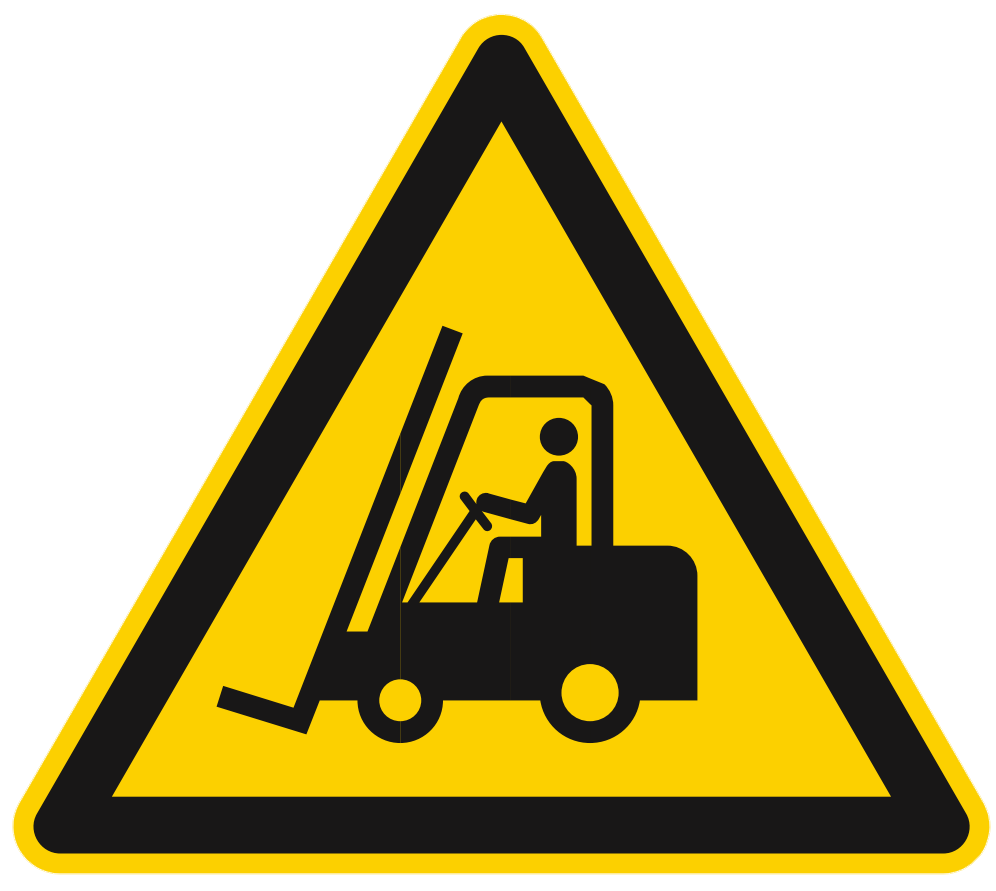
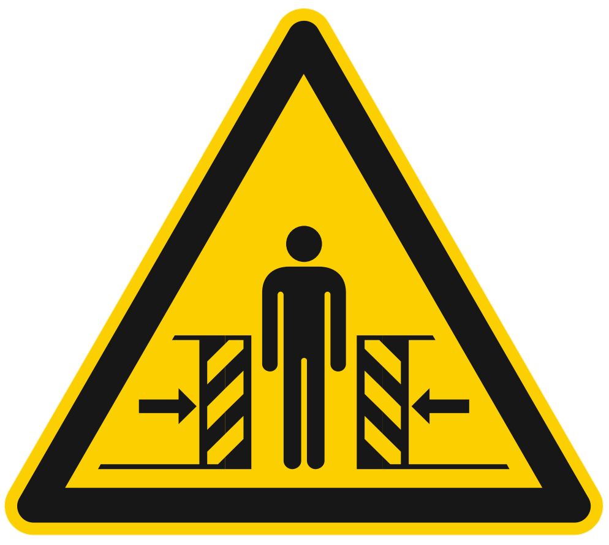
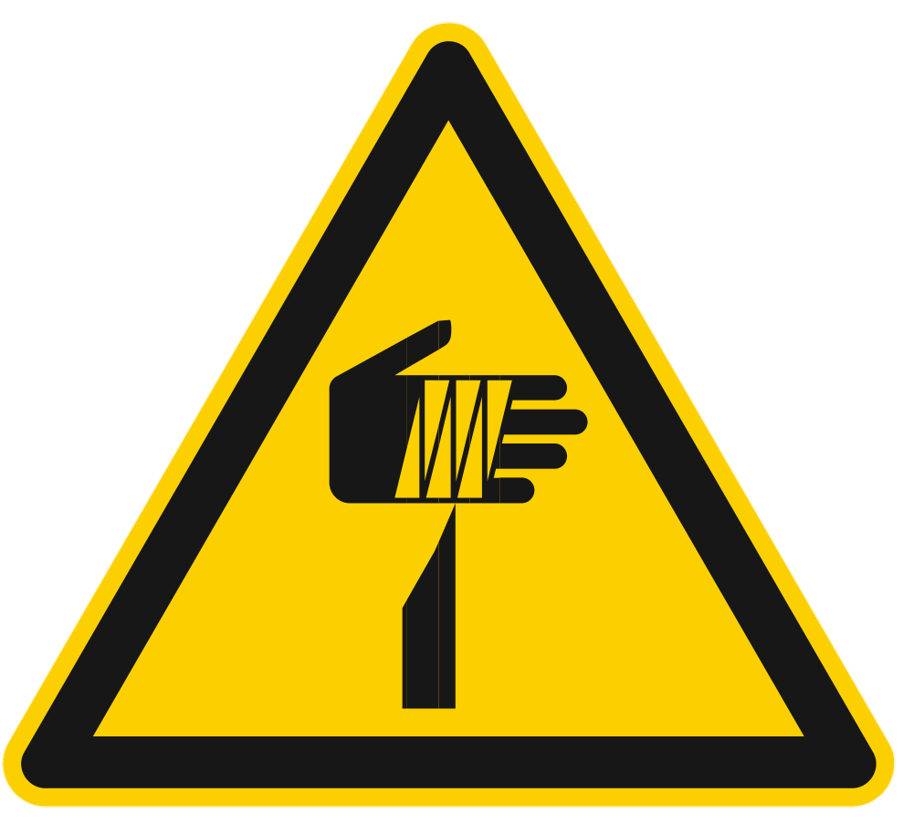
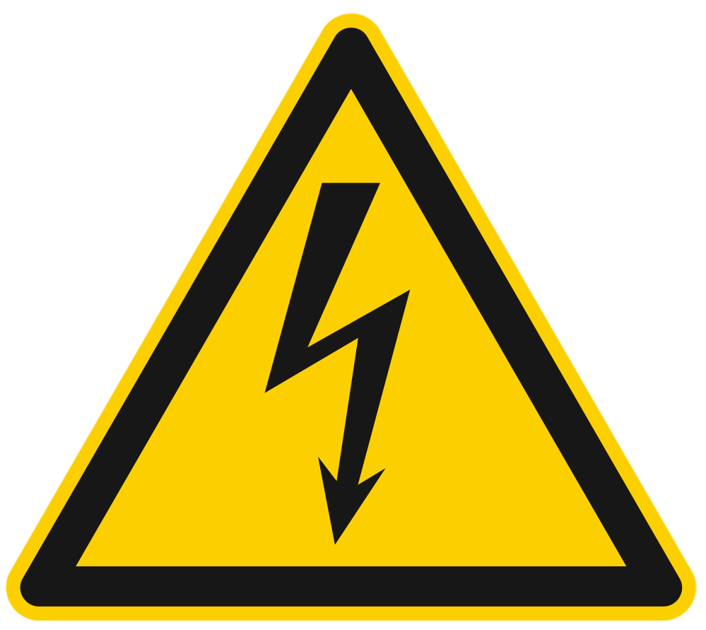

# **Sicherheitsinformationen**

Die folgenden Sicherheitsanweisungen, allgemeinen Vorsichtsmaßnahmen und Regeln zu Handhabung und Betriebsumgebung sind sorgfältig zu beachten, um die Sicherheit des Personals, die Unversehrtheit des Produkts und den ordnungsgemäßen Betrieb der Anlage zu gewährleisten.

```{warning}
**Verantwortung des Anwenders**

Die Einhaltung aller in diesem Abschnitt angegebenen Sicherheitsvorschriften ist verpflichtend und liegt in der Verantwortung des Endanwenders. Die Nichtbeachtung kann zu Personenschäden und Schäden an Geräten führen oder den Betrieb des Systems beeinträchtigen.
```

---

## Sicherheitsbereich des Bedieners

Die Bereiche um die Maschine werden wie folgt unterteilt:

:::{list-table}
:widths: 20 60
:header-rows: 1

* - Begriff
  - Beschreibung

* - Bedienbereiche
  - Dies sind die Bereiche, in denen der Anwender und die anderen Bediener die Steuer- und Überwachungsvorgänge der zyklischen Funktionen der Maschine („Bedienplatz“) sowohl im Automatik- als auch im Halbautomatikbetrieb über die vorgesehenen Bedienfelder oder zur Durchführung manueller Arbeiten ausführen können.

* - Wartungs-/Einstellbereiche
  - Dies sind die Bereiche, in denen mechanisches Wartungspersonal Wartungs- oder Einstellarbeiten ausführen kann. Diese Bereiche gelten als gefährlich und sind im normalen Betrieb der Maschine nicht zugänglich. Die Bediener müssen die Sicherheitshinweise und die zu tragende persönliche Schutzausrüstung genau kennen.

* - Gefahrenbereiche
  - Als Gefahrenbereiche gelten alle Bereiche innerhalb (oder in der Umgebung) der Maschine, in denen Restrisiken bestehen, die Personenschäden verursachen können. Der Zutritt zu diesen Bereichen ist während des Betriebs der Maschine für jedermann verboten.

:::

Die in diesen Bereichen bestehenden Gefahren und Risiken sind, soweit möglich, durch Schutzeinrichtungen (Verkleidungen, Klappen) und durch Sicherheitseinrichtungen (Sensoren, Mikroschalter, Lichtschranken) abgesichert, die bei Aktivierung die Maschine vollständig stoppen. Während des Betriebs der Maschine ist das Arbeiten in den Gefahrenbereichen jedoch strengstens verboten, da einige Risiken möglicherweise nicht vollständig beseitigt wurden.

(dpi)=
## Persönliche Schutzausrüstung (PSA)

Bei Arbeiten in der Nähe des FlexiBowl®, sei es bei Montage-, Wartungs- und/oder Einstellarbeiten, sind die allgemeinen Unfallverhütungsvorschriften strikt einzuhalten; daher ist es wichtig, die für den jeweiligen Arbeitsschritt vorgeschriebene persönliche Schutzausrüstung (PSA) zu verwenden. Nachfolgend die vollständige Liste der persönlichen Schutzausrüstung (PSA), die für die verschiedenen Verfahren erforderlich sein kann:

:::: {list-table}
:header-rows: 1
:widths: 20 60

* - Symbol
  - Beschreibung

* - ::: {figure} ../../../../_shared/media/images/guanti.png
    :align: center
    :width: 50%
    :::

  - **Schutz- oder Isolierhandschuhe tragen.**

    Weist darauf hin, dass das Personal Schutz- oder Isolierhandschuhe tragen muss.

* - ::: {figure} ../../../../_shared/media/images/occhiali.png
    :align: center
    :width: 50%
    :::

  - **Schutzbrille tragen.**

    Weist darauf hin, dass das Personal eine Schutzbrille zum Schutz der Augen tragen muss.

* - ::: {figure} ../../../../_shared/media/images/scarpe.png
    :align: center
    :width: 50%
    :::

  - **Sicherheitsschuhe tragen.**

    Weist darauf hin, dass das Personal Sicherheitsschuhe zum Schutz der Füße tragen muss.

* - ::: {figure} ../../../../_shared/media/images/rumore.png
    :align: center
    :width: 50%
    :::

  - **Gehörschutz tragen.**

    Weist darauf hin, dass das Personal Kapselgehörschutz oder Gehörschutzstöpsel zum Schutz des Gehörs tragen muss.

* - ::: {figure} ../../../../_shared/media/images/tuta.png
    :align: center
    :width: 50%
    :::

  - **Schutzkleidung tragen.**

    Weist darauf hin, dass das Personal spezielle Schutzkleidung tragen muss.

* - ::: {figure} ../../../../_shared/media/images/casco.png
    :align: center
    :width: 50%
    :::

  - **Schutzhelm tragen.**

    Weist darauf hin, dass das Personal einen Helm zum Schutz des Kopfes tragen muss.

* - ::: {figure} ../../../../_shared/media/images/manuale.png
    :align: center
    :width: 50%
    :::

  - **Betriebsanleitung/Handbuch beachten.**

    Weist darauf hin, dass das Personal die Bedienungs- und Warnhinweise der Maschine vor der Arbeit mit ihr lesen (und verstehen) muss.

::::

Die Kleidung der Personen, die an der Linie arbeiten oder sie warten, muss den grundlegenden Sicherheitsanforderungen der **Verordnung (EU) 2016/425** und den im Aufstellland geltenden Gesetzen entsprechen.

## Sicherheitseinrichtungen

Um die vollständige Sicherheit des Bedieners zu gewährleisten und den Zugriff auf das Innere der Maschine bei laufender Bewegung zu verhindern, ist die Maschine mit einer Reihe von Sicherheitseinrichtungen ausgestattet, die bei Aktivierung zu ihrem vollständigen Stillstand führen. Die Maschine wurde so konstruiert und mit Sicherheitssystemen ausgestattet, dass die Risiken für den Bediener auf ein Minimum reduziert werden.  Die Maschine verfügt über die in der folgenden Tabelle beschriebenen Sicherheitseinrichtungen. Zur Lage dieser Einrichtungen siehe das folgende Schema.

:::{list-table}
:widths: 10 20 60
:header-rows: 1

* - Nr.
  - Element
  - Beschreibung

* - 1
  - Elektrischer Schalter
  - Er befindet sich am Bedienfeld und ermöglicht es, die elektrische Versorgung zu unterbrechen bei:

    * Gefahr für die Unversehrtheit des Bedieners;
    * elektrischer Gefahr an der Maschine;
    * mechanischen oder elektrischen Eingriffen an der Maschine.

* - 2
  - Abdeckungen
  - Sie bestehen aus feststehenden Umfangsschutzeinrichtungen (Verkleidungen), die den Zugriff auf die Bewegungen der verschiedenen Maschinenteile während des Betriebszyklus verhindern und zu deren Entfernung spezielle Werkzeuge erforderlich sind.

:::

:::{figure} ../../../../_shared/media/images/AS000006_DispSicurezza.PNG
:align: center
:width: 80%
:::

:::{warning}
Aufgrund der spitzen Vorsprünge auf Oberflächen oder starren Scheiben mit Spike kann der Bediener bei Kontakt mit diesen der Gefahr von Abschürfungen und/oder Schnitten ausgesetzt sein. Bei Arbeiten in der Nähe solcher Oberflächen oder starren Scheiben geeignete PSA tragen.
:::

:::{warning}
Im Notfall die am Bedienfeld angeschlossene Stromversorgung trennen, um die Befehle des FlexiBowl® sicher zu deaktivieren.
:::

## Gefahren und Risiken

### Lärm
Die Lärmmessungen wurden gemäß den Vorgaben der EN ISO 11200:2020 – „Geräuschemission von Maschinen und Geräten – Leitlinien für die Anwendung der Grundnormen zur Bestimmung von Emissionsschalldruckpegeln am Arbeitsplatz und an anderen festgelegten Orten“ und der EN ISO 3746:2011 „Bestimmung der Schallleistungs- und Schallenergiepegel von Geräuschquellen aus Schalldruckmessungen – Hüllflächenverfahren über einer reflektierenden Ebene“ durchgeführt. Die Bewertung erfolgte außerdem nach den Verfahren der RICHTLINIE 2006/42/EG Punkt 1.5.8 – Punkt 1.7.4.2 Buchstabe u.

Der vollständige Bericht ist in der Dokumentation zur unvollständigen Maschine enthalten, die bei ARS aufbewahrt wird. Der Messbericht ist für Anwender und Integratoren auf Anfrage erhältlich.

Die Messungen wurden unter 3 verschiedenen Betriebsbedingungen durchgeführt:

- FlexiBowl in Betrieb (MOVE, SHAKE, FLIP) ohne Bauteile („Leerlaufbetrieb“);
- FlexiBowl in Betrieb (MOVE, SHAKE, FLIP) mit Bauteilen auf der rotierenden Scheibe, Bauteile aus Hartkunststoff;
- FlexiBowl in Betrieb (MOVE, SHAKE, FLIP) mit Bauteilen auf der rotierenden Scheibe, Bauteile aus Metall;

Bei Leerlaufzyklen beträgt der A-bewertete äquivalente Dauerschalldruckpegel am Arbeitsplatz 73,3 dB(A). Bei Betriebszyklen mit Bauteilen, bei denen der A-bewertete Emissionsschalldruckpegel an den Arbeitsplätzen 80 dB(A) überschreitet, ist in der folgenden Tabelle auch der A-bewertete Schallleistungspegel der Maschine angegeben.

:::{list-table} Schallemissionswerte, bewertet nach EN ISO 3746:2011 - EN ISO 11202:2021
:widths: 30 30 30 30 30
:header-rows: 1

* - FlexiBowl® 800
  - A-bewerteter Schallleistungspegel Lw(A)
  - Messunsicherheit K
  - Linearer Schallleistungspegel Lw(z)
  - Messunsicherheit K

* - Leerlaufbetrieb
  - 82.6 dB(A)
  - 8.9
  - 87.7 dB
  - 8.9

* - Betrieb mit Teilen aus Hartkunststoff
  - 89.7 dB(A)
  - 6.0
  - 90.7 dB
  - 6.0

* - Betrieb mit metallischen Halterungsteilen
  - 85.0
  - 6.0
  - 88.5
  - 6.0

:::

Der tatsächliche Geräuschpegel der installierten Maschine im Betrieb vor Ort in einem Produktionsprozess kann von dem oben angegebenen abweichen, da der Lärm von verschiedenen Faktoren beeinflusst wird, wie zum Beispiel:

- vom FlexiBowl bewegte Bauteile und Betriebsparameter;
- Art und Beschaffenheit des Aufstellorts;
- Eigenschaften der Maschine, in die der FlexiBowl® integriert ist;
- andere benachbarte Maschinen im Betrieb.

::::{warning}
<table style="width: 100%; border: none; background: transparent;">
  <tr style="background: transparent !important; border: none !important;">
    <td style="width: 20%; border: none; vertical-align: middle; text-align: center; background: transparent !important;">
      
    </td>
    <td style="width: 80%; border: none; vertical-align: middle; background: transparent !important; padding-left: 15px;">
      Bei täglichen Expositionspegeln über 80 dB(A) ist die Verwendung der entsprechenden persönlichen Schutzausrüstung verpflichtend.
    </td>
  </tr>
</table>
::::

### Backlight und Toplight

Die folgende Tabelle enthält die Einstufung des Risikograds bei Verwendung der Leuchtkörper Toplight und Backlight gemäß der Norm EN-62471:

:::{list-table} Toplight
:widths: 30 15 15
:header-rows: 1

* - Farbe
  - Klasse
  - Risiko

* - Weiß
  - 0
  - Keine

* - Rot
  - 0
  - Keine

* - IR
  - 1
  - Gering

:::

:::{list-table} Backlight
:widths: 30 15 15
:header-rows: 1

* - Farbe
  - Klasse
  - Risiko

* - Weiß
  - 0
  - Keine

* - Rot
  - 0
  - Keine

* - IR
  - 0
  - Gering

:::

:::{note}
Infrarot-Beleuchtungen senden unsichtbares Licht aus und können daher so wirken, als würden sie nicht funktionieren. Prüfen Sie die Funktion mit einer Kamera mit installiertem Infrarotfilter. Die meisten Smartphones können Infrarot darstellen.
:::

(temp)=
### Temperatur

::::{warning}
Bei intensiver Nutzung oder in warmen Umgebungen können einige Komponenten des Systems hohe Temperaturen erreichen:

- Scheibenspannkappe: bis zu 65 °C
- Motor: bis zu 80 °C

Die obere Plattform des Rahmens kann einen heißen Bereich aufweisen, der etwa so groß ist wie das um 25 % vergrößerte zentrale Loch:

:::{figure} ../../../../_shared/media/images/FB800_zone-calde.PNG
    :width: 80%
    :align: center
:::

{strong}`NOTA:` Diese Werte wurden ermittelt, indem der FlexiBowl® zwei Wochen lang kontinuierlich in einer beengten Umgebung ohne Belüftung mit den folgenden Parametern betrieben wurde:

:::{raw} html
<p class="centered-params">
  Move 90° <br> Pause 1000 ms <br> Shake +45° -45° <br> Pause 1000 ms
</p>
:::

::::

### Vibrationen

Die von der Maschine erzeugten Vibrationen sind je nach Betriebsweise nicht gesundheitsgefährdend für die Bediener.

:::{warning}
Übermäßige Vibrationen können nur durch einen mechanischen Defekt verursacht werden, der unverzüglich gemeldet und beseitigt werden muss, um die Sicherheit der Linie und der Bediener nicht zu gefährden.
:::

### Elektromagnetische Verträglichkeit

Die gelieferte Maschine enthält elektronische Bauteile, die den Vorschriften zur Elektromagnetischen Verträglichkeit unterliegen und von leitungsgebundenen und abgestrahlten Störaussendungen beeinflusst werden.

Die Emissionswerte erfüllen die normativen Anforderungen durch den Einsatz von Bauteilen, die der Richtlinie zur Elektromagnetischen Verträglichkeit entsprechen, geeignete Verbindungen und den Einbau von Filtern, wo erforderlich. Die Maschine entspricht somit der Richtlinie zur Elektromagnetischen Verträglichkeit (EMV).

:::{warning}
Nicht fachgerecht durchgeführte Wartungsarbeiten an der elektrischen Ausrüstung oder fehlerhafter Austausch von Bauteilen können die Wirksamkeit der getroffenen Maßnahmen beeinträchtigen.
:::

### Restrisiken

Die Maschine wurde so konstruiert, dass die grundlegenden Sicherheitsanforderungen für den Bediener erfüllt sind. Die Sicherheit wurde, soweit möglich, in Konstruktion und Bau der Maschine integriert; dennoch bleiben Risiken bestehen, vor denen die Bediener insbesondere in den folgenden Phasen geschützt werden müssen:

- Transport und Installation;
- Normalbetrieb;
- Einstellung und Inbetriebnahme,
- Wartung und Reinigung;
- Demontage und Stilllegung.

Nachfolgend wird für jedes Restrisiko eine Beschreibung gegeben, zusammen mit dem betroffenen Bereich oder Maschinenteil (sofern nicht die gesamte Maschine betroffen ist) und den Verfahrensinformationen zu seiner Vermeidung:

:::{raw} html
<style>
  .custom-safety-table {
    width: 100%;
    border-collapse: collapse;
    font-family: sans-serif;
    font-size: 0.95em;
    color: #333;
    border: 1px solid #e0e6ed;
  }

  /* Riga intestazione */
  .custom-safety-table thead tr {
    background-color: #f8f9fa;
    border-bottom: 3px solid #176de8; /* Il tuo blu specifico */
  }

  .custom-safety-table th {
    padding: 15px;
    text-align: left;
    font-weight: bold;
    color: #1a202c;
    border-right: 1px solid #e0e6ed; /* Linea verticale nell'header */
  }

  .custom-safety-table th:last-child {
    border-right: none;
  }

  /* Righe alternate (Zebra) */
  .custom-safety-table tbody tr:nth-child(even) {
    background-color: #f1f5f9;
  }

  .custom-safety-table tbody tr:nth-child(odd) {
    background-color: #ffffff;
  }

  /* Effetto Hover */
  .custom-safety-table tbody tr:hover {
    background-color: #dbeafe !important;
    transition: background-color 0.2s ease !important;
  }

  .custom-safety-table td {
    padding: 15px;
    vertical-align: top;
    border-bottom: 1px solid #e0e6ed;
    border-right: 1px solid #e0e6ed; /* Linea verticale tra le colonne */
  }

  .custom-safety-table td:last-child {
    border-right: none; /* Rimuove l'ultima linea a destra */
  }

  .pittogrammi-container {
    display: flex;
    justify-content: center;
    gap: 8px;
    margin-top: 10px;
  }
</style>

<table class="custom-safety-table">
  <thead>
    <tr>
      <th style="width: 25%;">Risiko</th>
      <th>Beschreibung und Verfahrensinformationen</th>
    </tr>
  </thead>
  <tbody>
    <tr>
      <td style="text-align: center;">
        <strong>GEFAHREN DURCH DEN TRANSPORT UND DIE HANDHABUNG</strong><br><br>
        <small style="color: #666;">PIKTOGRAMME:</small>
        <div class="pittogrammi-container">
          
          
          
        </div>
      </td>
      <td>
        Die Handhabungsverfahren sind im Kapitel <strong>„Transport und Installation“</strong> dieser Betriebsanleitung beschrieben.<br>
        <strong>Restrisiko:</strong><br>
        Die Arbeitsschritte:
        <ul>
            <li>Abladen der Verpackungen,</li>
            <li>Öffnen der Verpackungen,</li>
            <li>Handhabung der Maschine</li>
        </ul>
        setzen die Bediener dem Risiko schwebender Lasten und des Quetschens aus. Diese Arbeiten dürfen ausschließlich von Personal ausgeführt werden, das auf die Bedienung von Hebezeugen spezialisiert und dafür entsprechend geschult ist.
      </td>
    </tr>
    <tr>
      <td style="text-align: center;">
        <strong>GEFAHR VON ABSCHÜRFUNGEN, SCHNITTEN, STOSS</strong><br><br>
        <small style="color: #666;">PIKTOGRAMME:</small>
        <div class="pittogrammi-container">
          
          
        </div>
      </td>
      <td>
        Aufgrund der spitzen Vorsprünge auf den <strong>„Rotary Disc“</strong> mit Spike kann der Bediener bei Kontakt mit diesen der Gefahr von Abschürfungen und/oder Schnitten ausgesetzt sein.<br> Bei Arbeiten in der Nähe solcher <strong>„Rotary Disc“</strong> geeignete PSA tragen.
      </td>
    </tr>
    <tr>
      <td style="text-align: center;">
        <strong>ELEKTRISCHE GEFAHR</strong><br><br>
        <small style="color: #666;">PIKTOGRAMME:</small>
        <div class="pittogrammi-container">
          
          
        </div>
      </td>
      <td>
        Zugangs- und Wartungsarbeiten an der Maschine setzen die Bediener einem elektrischen Risiko aus. Arbeiten an unter Spannung stehenden Geräten dürfen ausschließlich von erfahrenem und qualifiziertem Personal ausgeführt werden.<br> Folgende Sicherheitsmaßnahmen werden empfohlen:
        <ul>
            <li>den Sicherheitspiktogrammen zum elektrischen Risiko größte Aufmerksamkeit schenken;</li>
            <li>keine Wartungsarbeiten durchführen, ohne zuvor die elektrische Energie freigeschaltet zu haben;</li>
            <li>die Handbücher der handelsüblichen Geräte auf eventuelle spezifische Empfehlungen konsultieren;</li>
            <li>den Schutzpotentialausgleichskreis regelmäßig überprüfen.</li>
        </ul>
      </td>
    </tr>
    <tr>
      <td style="text-align: center;">
        <strong>GEFAHR DURCH BELEUCHTUNGSSTÖRUNGEN</strong><br><br>
        <small style="color: #666;">PIKTOGRAMME:</small>
        <div class="pittogrammi-container">
          
        </div>
      </td>
      <td>
        Das <strong>„Backlight“</strong> befindet sich im Inneren des Maschinenkörpers, außerhalb des Sichtfelds des Bedieners, und ist durch die Schutzeinrichtungen des Maschinenkörpers fast vollständig abgeschirmt.<br>
        <strong>Restrisiko:</strong><br>
        Der Bediener kann Augenschäden erleiden, wenn er längere Zeit in das intensive Licht des <strong>„Backlight“</strong> blickt.
      </td>
    </tr>
    <tr>
      <td style="text-align: center;">
        <strong>GEFAHR DURCH STAUB, SPLITTER USW.</strong><br><br>
        <small style="color: #666;">PIKTOGRAMME:</small>
        <div class="pittogrammi-container">
          
        </div>
      </td>
      <td>
        Am Ende des Arbeitszyklus können auf dem <strong>„Rotary Disc“</strong> der Maschine Rückstände der zugeführten Teile oder Staubansammlungen verbleiben.<br> Den <strong>„Rotary Disc“</strong> nach jeder Verwendung gründlich reinigen, wie in Kapitel 7 dieses Handbuchs beschrieben.
      </td>
    </tr>
  </tbody>
</table>
:::

:::{warning}
Wartungs- und Reinigungsarbeiten nur durchführen, wenn zuvor alle vorhandenen Energien abgeschaltet wurden.
:::

:::{warning}
Es ist strengstens verboten, die an der Maschine angebrachten Schutzeinrichtungen zu entfernen oder die feststehenden Abdeckungen zu öffnen, ohne zuvor die elektrische und pneumatische Versorgung der Maschine freigeschaltet zu haben.
:::

Der Anwender ist verantwortlich dafür:
- die Risiken zu analysieren, die bei Transport und Installation am eigenen Standort auftreten können (die Analysen zur Handhabung der Maschine wurden nur unter Berücksichtigung ihrer Eigenschaften durchgeführt);
- das mit den Arbeiten an den Arbeitsplätzen betraute Personal und das Personal für den Betrieb der Maschine zu sensibilisieren und zu unterweisen;
- nach Bewertung der Risiken in den Verkehrs- oder Bedienbereichen optische Sicherheitskennzeichnungen in der Arbeitsumgebung anzubringen.

## An der Maschine angebrachte Sicherheitspiktogramme

Die folgende Tabelle listet die an der Maschine vorhandenen Piktogramme auf, die sich üblicherweise neben dem Bedienfeld befinden.

::::{list-table}
:widths: 30 60
:header-rows: 1

* - Piktogramm
  - Beschreibung

* - :::{figure} ../../../../_shared/media/images/manutenzione.png
    :width: 80%
    :align: center
    :::
  - **GEFAHR! NUR BEFUGTES PERSONAL DARF WARTUNGS- ODER REPARATURARBEITEN DURCHFÜHREN.**

    Weist auf das Verbot hin, dass nicht befugtes Personal Wartungs- oder Reparaturarbeiten durchführt.

* - :::{figure} ../../../../_shared/media/images/disconnettere.png
    :width: 80%
    :align: center
    :::
  - **ACHTUNG! VOR REINIGUNGS- ODER WARTUNGSARBEITEN DIE ELEKTRISCHE STROMVERSORGUNG TRENNEN.**

    Weist auf das Verbot hin, Wartungs- oder Reinigungsarbeiten durchzuführen, bevor die elektrische Stromversorgung getrennt wurde.

::::

## Integration in robotergestützte Systeme

### **Sicherheitsanforderungen der Zelle**

:::{warning}
Der FlexiBowl® arbeitet in enger Verbindung mit Robotersystemen von Drittanbietern. Der Anwender muss sicherstellen, dass der Arbeitsbereich mit allen erforderlichen Sicherheitsmaßnahmen ausgestattet ist, die von den einschlägigen Vorschriften verlangt werden
:::

### **Vorsicht im Betrieb**

:::{warning}

Während des Betriebs des Systems stets berücksichtigen:

- Physische Abmessungen von Roboter und FlexiBowl
- Bahnen und Geschwindigkeiten der Roboterbewegungen
- Mögliche unvorhergesehene Situationen (herabfallende Teile, Entnahmefehler)
- Gefahrenbereiche während der Vibrationsphasen des FlexiBowl
:::

## Allgemeine Vorsichtsmaßnahmen vor Eingriffen

### **Trennen der Versorgungen**

```{warning}
Vor jeglichen Wartungs-, Änderungs- oder Inspektionsarbeiten am System stets sicherstellen, dass:

- alle elektrischen Energiequellen getrennt sind (VisionController, FlexiBowl, Kamera, Leuchtkörper)
- die pneumatische Versorgung drucklos gemacht und getrennt ist (falls vorhanden)
- die Verbindungskabel physisch abgezogen sind
- der Roboter sich im sicheren Modus befindet oder vollständig ausgeschaltet ist
```
### **Sicherheitsverfahren**

```{warning}

Sich nicht ausschließlich auf Schalter verlassen: Wenn verfügbar, Lockout/Tagout-Verfahren (LOTO) anwenden.
```

## Änderungen und Manipulationen

### **Verbot nicht genehmigter Änderungen**

```{warning}
Das Produkt oder seine Komponenten niemals ohne ausdrückliche schriftliche Genehmigung von ARS S.r.l. verändern.
```
### **Folgen von Änderungen**

```{warning}
Nicht genehmigte Änderungen können:

- Fehlfunktionen des Systems verursachen
- die Garantie erlöschen lassen
- Risiken von Verletzungen, Stromschlägen oder Bränden schaffen
- die Sicherheitszertifizierungen des Produkts beeinträchtigen
```