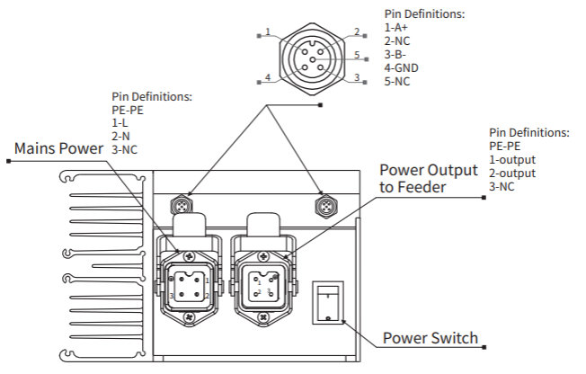
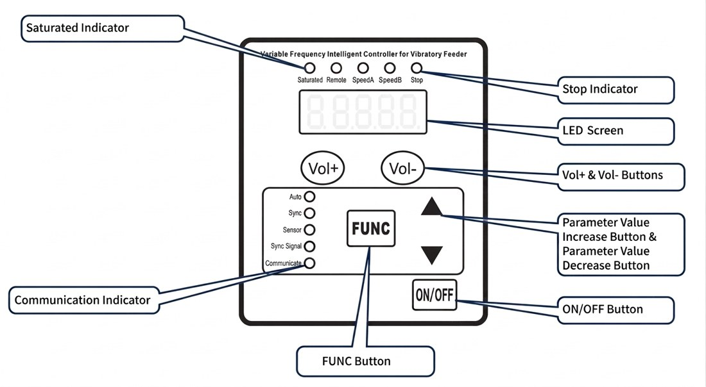
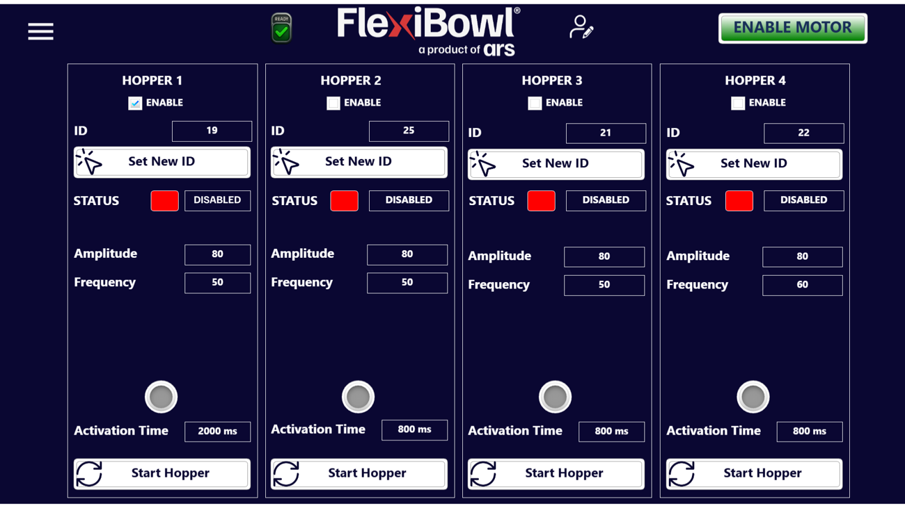
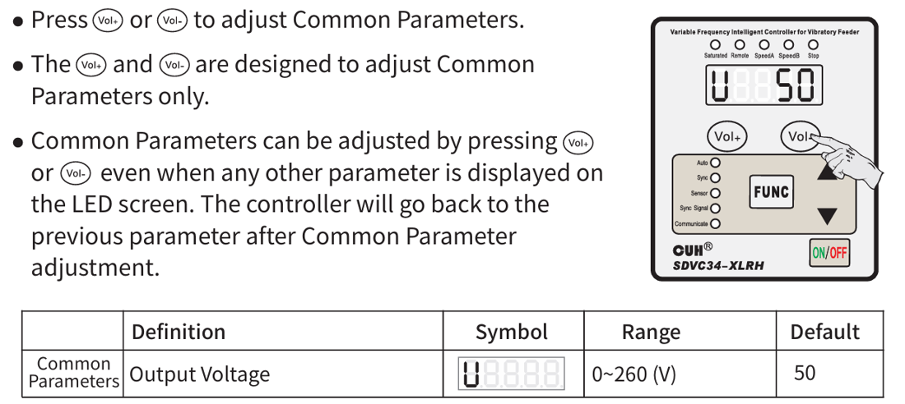
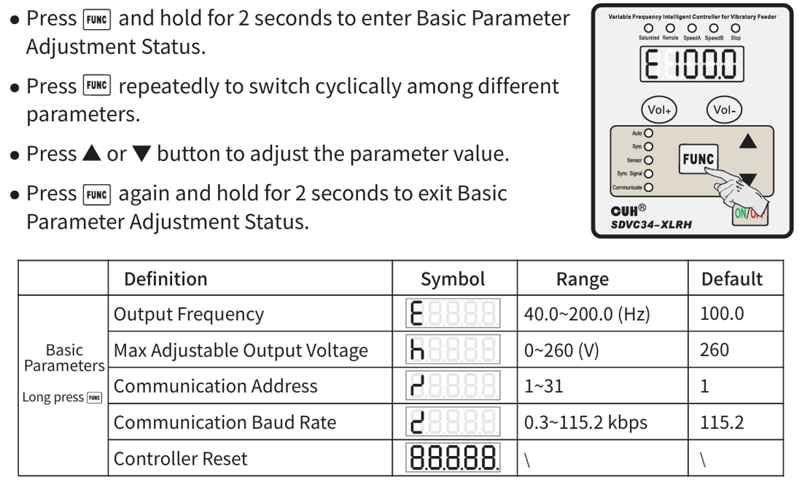
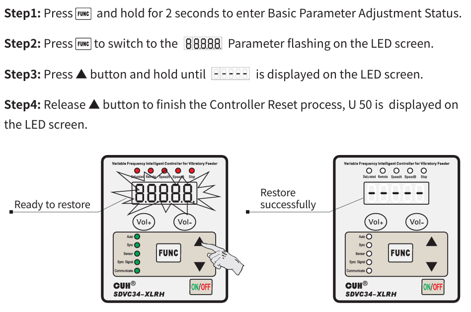

# **Konfiguration des Bulk Feeders**

Diese Seite führt Sie durch die Inbetriebnahme des Vibrations-Bulk-Feeders, des optionalen Zubehörs, das den FlexiBowl® kontinuierlich und gleichmäßig beschickt. Befolgen Sie die vier Phasen der Reihe nach: mechanische Positionierung und Montage, elektrische Anschlüsse, Einstellung der Kommunikationsadresse und Konfiguration der Parameter über die Software-Oberfläche.

  

  <!-- Step 1 -->
  

    

      
1

      

    

    

      

        <i class="ph ph-package"></i>
        <a class="qs-title-link" href="conf_tramoggia.html#posizionamento-e-installazione-meccanica">Positionierung und mechanische Installation</a>
      

      

        Positionieren Sie den Bulk Feeder in der richtigen Ausrichtung zum FlexiBowl® und befestigen Sie ihn an der Haltekonsole.
      

    

  

  <!-- Step 2 -->
  

    

      
2

      

    

    

      

        <i class="ph ph-plugs"></i>
        <a class="qs-title-link" href="conf_tramoggia.html#collegamenti-elettrici">Elektrische Anschlüsse</a>
      

      

        Verbinden Sie die Steuerung unter Einhaltung der Anschlussreihenfolge mit dem Bulk Feeder, dem FlexiBowl® (oder dem Rack) und der Stromversorgung.
      

    

  

  <!-- Step 3 -->
  

    

      
3

      

    

    

      

        <i class="ph ph-hash"></i>
        <a class="qs-title-link" href="conf_tramoggia.html#indirizzo-di-comunicazione-rs485">RS485-Kommunikationsadresse</a>
      

      

        Stellen Sie am Bedienfeld der Steuerung eine eindeutige Adresse ein, die für die Kommunikation mit dem FlexiBowl® und eventuellen weiteren Bulk Feedern erforderlich ist.
      

    

  

  <!-- Step 4 -->
  

    

      
4

      

    

    

      

        <i class="ph ph-hash"></i>
        <a class="qs-title-link" href="conf_tramoggia.html#configurazione-da-interfaccia-software">Konfiguration über die Software-Oberfläche</a>
      

      

        Aktivieren Sie den Bulk Feeder in der Weboberfläche des FlexiBowl® und stellen Sie Amplitude, Frequenz und Aktivierungszeit der Vibration ein.
      

    

  

---

## 1. Positionierung und mechanische Installation

Bulk Feeder sind in verschiedenen Größen erhältlich, jeweils mit eigener maximaler Last:

| Fassungsvermögen | Maximale Last |
|---|---|
| 1,5 l | 1 kg |
| 3 l | 1,5 kg |
| 5 l | 6 kg |
| 10 l | 6 kg |
| 20 l | 6 kg |
| 40 l | 15 kg |

Der Bulk Feeder wird bereits montiert geliefert: Er muss nicht zusammengebaut, sondern nur positioniert und befestigt werden.

::::{tab-set}
:::{tab-item} Korrekte Positionierung

Die Rutsche des Bulk Feeders muss die Bauteile direkt in den Arbeitsbereich der Platte abgeben, mit einer Neigung, die dem Profil des FlexiBowl® folgt.
:::
:::{tab-item} Falsche Positionierung

Eine Rutsche, die zu weit vom Arbeitsbereich entfernt ist, führt zu einer ungleichmäßigen Zuführung und beeinträchtigt die Leistung der Anwendung.
:::
::::

**Schritte:**

1. Stellen Sie den Bulk Feeder auf eine stabile, waagerechte Fläche in der Nähe des FlexiBowl® und beachten Sie dabei die oben gezeigte korrekte Ausrichtung.
2. Wird der Bulk Feeder auf der Fläche einer vibrationsempfindlichen Maschine installiert, legen Sie zwischen die beiden Flächen ein isolierendes, schwingungsdämpfendes Material, damit sich die Vibrationen des Bulk Feeders nicht auf den FlexiBowl® übertragen.
3. Befestigen Sie den Bulk Feeder mit M8-Schrauben über die vorgesehenen Bohrungen an der Haltekonsole: Der Standard-Bulk-Feeder hat 4 Bohrungen im Sockel, die kleinere Version (1,5 l) hat 2.

## 2. Elektrische Anschlüsse

:::{warning}
Stellen Sie vor dem Herstellen oder Ändern jeglicher elektrischer Anschlüsse sicher, dass das System ausgeschaltet ist. Prüfen Sie stets, dass der Schutzleiter korrekt installiert und unversehrt ist: Der elektrische Anschluss, einschließlich der Erdung, muss für den korrekten Betrieb der Maschine stets gewährleistet sein.
:::

Die Bulk-Feeder-Steuerung verfügt über: einen Netzeingang (Erde, Phase, Neutralleiter), einen RS485-Steckverbinder für die Kommunikation (A+, B-, GND), einen Leistungsausgang zum Motor des Bulk Feeders und einen Hauptschalter.

**Schritte:**

1. Verbinden Sie die Steuerung mit dem dafür vorgesehenen Kabel mit dem Bulk Feeder.
2. Verbinden Sie die Steuerung über den M12-Steckverbinder mit A-Kodierung (Modbus-RTU-Kommunikation) mit dem FlexiBowl®. Bei Multi-Feeder-Installationen mit Rack verbinden Sie die Steuerung stattdessen mit dem Rack.
3. Verschließen Sie jeden nicht verwendeten Steckverbinder mit der passenden Kappe, um ihn vor Staub und Schmutz zu schützen. Die Kappe muss zwischen den Kanälen A+ und B- der RS485-Leitung einen Widerstand von 120 Ω gewährleisten.
4. Schließen Sie das Netzkabel an die Steuerung an: Verbinden Sie immer zuerst das Ende auf der Steuerungsseite, bevor Sie das andere Ende anschließen.
5. Stecken Sie das Netzkabel bei auf OFF stehendem Schalter der Steuerung in die Netzsteckdose. Die Standardversorgung beträgt 115 oder 230 V AC ±5 % (die 115-V-Version ist nur auf ausdrückliche Anfrage erhältlich).
6. Schalten Sie die Steuerung am Hauptschalter ein.

:::{tip}
Das Modbus-RTU-Kabel zwischen Steuerung und FlexiBowl® ist in den Längen 3, 5 und 10 m erhältlich: siehe {ref}`cavo-modbus`.
:::

:::{note}
Ein einzelner FlexiBowl® unterstützt bis zu **4 Bulk Feeder**. Verbinden Sie bei Multi-Feeder-Installationen jeden Bulk Feeder mit seiner eigenen Steuerung, schließen Sie die erste Steuerung an den FlexiBowl® (oder das Rack) an und verketten Sie die weiteren Steuerungen über den Bulk-Feeder-Steckverbinderport (Daisy-Chain). Verschließen Sie den ungenutzten Port an der letzten Steuerung der Kette und schließen Sie an jeder Steuerung das Netzkabel an.
:::

## 3. RS485-Kommunikationsadresse

Jede Bulk-Feeder-Steuerung muss eine eindeutige Kommunikationsadresse im RS485-Netzwerk haben (Parameter **r**, Bereich 1–31). Stellen Sie bei mehreren Bulk Feedern sicher, dass jede Steuerung im selben Netzwerk eine andere Adresse hat.

**Schritte am Bedienfeld der Steuerung:**

1. Halten Sie **FUNC** 2 Sekunden lang gedrückt, um in den Zustand zur Einstellung der Basisparameter zu gelangen.
2. Drücken Sie wiederholt **FUNC**, um den Parameter **r** (Kommunikationsadresse) auszuwählen.
3. Drücken Sie **▲** oder **▼**, um den Wert zu ändern (1–31).
4. Halten Sie **FUNC** erneut 2 Sekunden lang gedrückt, um zu beenden und zu speichern.

## 4. Konfiguration über die Software-Oberfläche

Sind die Anschlüsse hergestellt und die Adresse eingestellt, kann der Bulk Feeder über die zugehörige Seite der FlexiBowl®-Weboberfläche konfiguriert und gesteuert werden.

Für jeden der 4 verfügbaren Bulk Feeder können Sie einstellen:

| Feld | Beschreibung |
|---|---|
| **Enable** | Aktiviert den entsprechenden Bulk Feeder. |
| **ID** | RS485-Adresse der angeschlossenen Steuerung; verwenden Sie **Set New ID**, um per Software eine neue zuzuweisen. |
| **Status** | Aktueller Status des Bulk Feeders (z. B. Disabled). |
| **Amplitude** | Amplitude der Vibration. |
| **Frequency** | Frequenz der Vibration. |
| **Activation Time** | Dauer jedes Vibrationsimpulses in Millisekunden. |

**Schritte:**

1. Rufen Sie die FlexiBowl®-Weboberfläche auf und öffnen Sie die Bulk-Feeder-Seite.
2. Wählen Sie beim zu aktivierenden Bulk Feeder **Enable** aus.
3. Prüfen Sie, ob das Feld **ID** mit der an der Steuerung eingestellten Adresse (Schritt 3) übereinstimmt; andernfalls verwenden Sie **Set New ID**.
4. Stellen Sie die Anfangswerte für **Amplitude**, **Frequency** und **Activation Time** entsprechend dem zuzuführenden Bauteil ein.
5. Drücken Sie **Start Hopper**, um den Bulk Feeder zu starten und seine Funktion zu prüfen; passen Sie die Parameter an, bis die Bauteilzuführung kontinuierlich und gleichmäßig ist.

:::{note}
Die optimalen Werte für Amplitude, Frequenz und Aktivierungszeit hängen vom Bauteil und von der Geometrie des Bulk Feeders ab: Passen Sie sie schrittweise an, indem Sie den Zuführfluss beobachten; beginnen Sie mit niedrigen Werten und erhöhen Sie diese, bis eine gleichmäßige Zuführung ohne Stau erreicht ist.
:::

## Erweiterte Parameter der Steuerung 

### **Allgemeine Parameter** 
Die allgemeinen Parameter können jederzeit mit den Tasten **Vol+** / **Vol-** eingestellt werden, auch während ein anderer Parameter angezeigt wird:

| Definition | Symbol | Bereich | Standard |
|---|---|---|---|
| Ausgangsspannung | U | 0–260 V | 50 |

### **Basisparameter**
Um auf die Basisparameter zuzugreifen, halten Sie **FUNC** 2 Sekunden lang gedrückt; mit **FUNC** blättern Sie durch die Parameter, mit **▲/▼** ändern Sie sie, und mit 2 Sekunden langem Halten von **FUNC** verlassen Sie das Menü:

| Definition | Symbol | Bereich | Standard |
|---|---|---|---|
| Ausgangsfrequenz | E | 40,0–200,0 Hz | 100,0 |
| Maximal einstellbare Ausgangsspannung | h | 0–260 V | 260 |
| Kommunikationsadresse | r | 1–31 | 1 |
| Baudrate der Kommunikation | c | 0,3–115,2 kbit/s | 115,2 |
| Zurücksetzen der Steuerung | — | — | — |

### **Zurücksetzen der Steuerung**

1. Halten Sie **FUNC** 2 Sekunden lang gedrückt, um in den Zustand zur Einstellung der Basisparameter zu gelangen.
2. Drücken Sie **FUNC**, bis der Reset-Parameter (`88888`) auf dem Display blinkt.
3. Halten Sie **▲** gedrückt, bis `-----` auf dem Display erscheint.
4. Lassen Sie **▲** los, um das Zurücksetzen abzuschließen: Das Display zeigt `U 50` an und bestätigt damit den erfolgreichen Vorgang.

