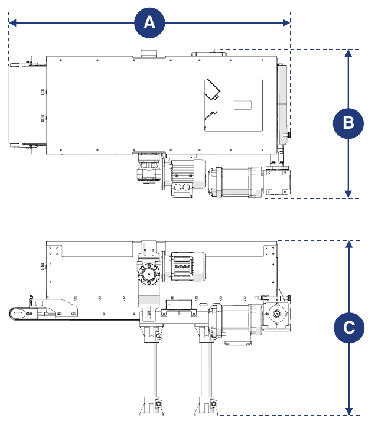
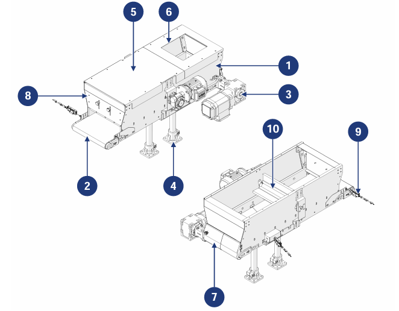

# **Maschinenbeschreibung**

:::{important}
Um verwendet werden zu können, muss die unvollständige Maschine in andere entsprechend aufgebaute Maschinen/unvollständige Maschinen eingebunden werden.
:::

## Beschreibung

Die Conveyor Hopper ist dafür ausgelegt und gebaut, kleine, mittlere und große Schüttgutteile von einem vorgelagerten System aufzunehmen und an ein nachgelagertes System weiterzugeben.

Sie wird von einem Getriebemotor angetrieben, der mit einer Antriebsrolle verbunden ist und das am Trichterboden befindliche Förderband bewegt. An der Rückseite befindet sich eine Klappe zur manuellen Entleerung am Zyklusende, an der Vorderseite eine Dosierschranke zur Regulierung des Materialaustritts.

Die Maschine kann mit einem Zuführsystem (vom Kunden bereitgestellt) kombiniert werden, das über die mit der Maschine gelieferten Anwesenheitssensoren die Beladung des Bandes mit Material automatisch steuert.

## Bestimmungsgemäße Verwendung

| Vorgang | Zulässig | Nicht zulässig | Umgebung |
|:--- |:--- |:--- |:--- |
| Handhabung von Schüttgutteilen unterschiedlicher Größe und Beschaffenheit | Ja | Jede andere als die zulässige Verwendung | Industriell |

:::{important}
Die Maschine darf nicht zum Transport folgender Objekte verwendet werden:
- Objekte, die größer sind als die Abmessungen des Trichters;
- Objekte mit klebrigen oder haftenden Außenflächen;
- scharfe Objekte, die das Bandgewebe beschädigen könnten.
:::

Die Maschine wurde so konstruiert, dass sie die im Kaufvertrag angegebenen spezifischen Anforderungen erfüllt und gemäß den im Handbuch genannten Anweisungen und Einsatzgrenzen verwendet werden kann. Sie arbeitet sicher, wenn:
- sie in eine Anlage eingebunden ist, die mit geeigneten Sicherheits- und Schutzeinrichtungen gemäß den geltenden Vorschriften ausgestattet ist;
- sie innerhalb der im Vertrag und im Handbuch angegebenen Grenzen verwendet wird;
- die Verfahren der Betriebsanleitung eingehalten werden;
- die planmäßige Wartung zu den angegebenen Zeitpunkten und in der angegebenen Weise durchgeführt wird;
- außerplanmäßige Wartung bei Bedarf umgehend durchgeführt wird;
- die Sicherheitseinrichtungen nicht entfernt und/oder überbrückt werden.

## Fehlanwendung (vernünftigerweise vorhersehbar)

- Verwendung der Maschine, ohne zuvor die Betriebsanleitung gelesen zu haben;
- Verwendung der Maschine ohne Einbindung in eine Anlage gemäß den geltenden Vorschriften;
- Verwendung durch nicht ausreichend geschulte Bediener;
- Verwendung der Maschine als Abstützpunkt, auch wenn sie nicht in Betrieb ist;
- Verwendung zur Erzielung von Produktionswerten über den vorgeschriebenen Grenzen;
- Verwendung in einer Weise, die im Abschnitt „Bestimmungsgemäße Verwendung" nicht vorgesehen ist.

Jede andere, nicht ausdrücklich genannte Verwendung muss vorab schriftlich vom Hersteller genehmigt werden. Fehlt diese Genehmigung, gilt die Verwendung als „fehlerhaft": Der Hersteller lehnt jede Haftung für Sach- oder Personenschäden ab und betrachtet jegliche Gewährleistung als erloschen.

:::{important}
Die fehlerhafte Verwendung der Maschine schließt jede Haftung des Herstellers aus.
:::

## Pflichten und Verbote

### Pflichten der Anwender

Der Benutzer (Auftragnehmer oder Arbeitgeber) muss:
- die Fähigkeiten und den Zustand der Bediener im Hinblick auf deren Gesundheit und Sicherheit berücksichtigen;
- für die einzelnen Verfahren geeignete PSA bereitstellen;
- Standard-Hebemittel und -Verfahren bereitstellen;
- sicherstellen, dass die Beschäftigten die betrieblichen Sicherheitsvorschriften und die Verwendung der verfügbaren kollektiven und persönlichen Schutzeinrichtungen einhalten;
- das Personal in den Verfahren bei Unfällen unterweisen;
- das Personal über die bestehenden Restrisiken unterweisen;
- das Personal über die für die Sicherheit des Bedieners vorgesehenen Einrichtungen unterweisen;
- das Personal über die Risiken durch Lärmemission am Arbeitsplatz unterweisen;
- das Personal über die allgemeinen Unfallverhütungsvorschriften der europäischen Richtlinien und der Gesetzgebung des Bestimmungslandes unterweisen.

Nur Personal an der Maschine arbeiten lassen, das das Handbuch gelesen hat und angemessen geschult ist.

### Pflichten des eingesetzten Personals (Bediener/Wartungspersonal/Techniker)

Das Personal muss:
- Wartungsarbeiten nur bei ausgeschalteter Maschine durchführen;
- lange Haare zusammenbinden, damit sie sich nicht verfangen oder das Produkt verunreinigen;
- am Schaltschrank, an den Anschlusskästen, an den Kabeln und an allen elektrischen Komponenten nur bei ausgeschaltetem Hauptschalter arbeiten;
- sicherstellen, dass während des Betriebs niemand direkten Zugang zu den beweglichen Teilen hat;
- die vom Arbeitgeber bereitgestellten Schutzeinrichtungen korrekt verwenden;
- jeden Defekt der Sicherheitseinrichtungen unverzüglich dem Arbeitgeber, der Führungskraft oder dem Vorgesetzten melden.

### Verbote für das Bedienpersonal

Das Personal darf nicht:
- die Maschine unsachgemäß verwenden, d. h. für Verwendungen, die im Abschnitt „Bestimmungsgemäße Verwendung" nicht vorgesehen sind;
- Sicherheitseinrichtungen oder -kennzeichnungen ohne Genehmigung entfernen oder verändern;
- eigenmächtig Arbeiten oder Handgriffe ausführen, die nicht in ihren Zuständigkeitsbereich fallen oder die die eigene Sicherheit oder die anderer gefährden können;
- sich der Maschine in betrunkenem Zustand oder unter Drogeneinfluss nähern;
- Drehzahl und/oder Leistung der Maschinenkomponenten ohne Genehmigung eines Verantwortlichen ersetzen oder ändern;
- den Maschinenzyklus ändern;
- die elektrischen Anschlüsse verändern, um die internen Sicherheitseinrichtungen zu umgehen;
- die Maschine verwenden, wenn sie nicht gemäß den geltenden Normen installiert wurde;
- die Maschine als Abstützpunkt verwenden, auch wenn sie nicht in Betrieb ist (Sturz- und/oder Beschädigungsgefahr);
- die Maschine außerhalb der zulässigen Umgebungsbedingungen verwenden (siehe *Transport und Einbindung*).

:::{attention}
Der Hersteller haftet nicht für Sach- oder Personenschäden, wenn:
- festgestellt wird, dass die Maschine außerhalb der zulässigen Umgebungen verwendet wurde;
- die im Handbuch beschriebenen Pflichten und Verbote nicht eingehalten wurden.
:::

## Technische Daten

```{list-table} Elektrische Versorgung
:header-rows: 0
:widths: 40 60

* - **Spannung**
  - 400 Vac
* - **Leistung**
  - 0,18 kW (Bandantrieb) · 0,09 kW (Bürstenantrieb, optional)
* - **Frequenz**
  - 50 Hz
```

```{list-table} Einsatzgrenzen
:header-rows: 0
:widths: 40 60

* - **Maximal transportierbares Gewicht**
  - 15 kg/m
* - **Maximale Bandgeschwindigkeit**
  - 8 m/min
```

:::{important}
Weitere Informationen finden Sie im Schaltplan und in den dem Handbuch beigefügten Handbüchern der Unterlieferanten.
:::

## Abmessungen



| Abmessung | Wert |
|:--- |:--- |
| **Länge (A)** | 1075 mm (mit Antrieb links) · 1050 mm (mit Antrieb rechts) |
| **Breite (B)** | 564 mm (mit Antrieb links) · 562 mm (mit Antrieb rechts) |
| **Höhe (C)** | 666 mm |

## Hauptkomponenten



| Pos. | Beschreibung |
|:--- |:--- |
| 1 | Trichterwanne |
| 2 | Förderband |
| 3 | Antriebseinheit |
| 4 | Standfuß |
| 5 | Trichterdeckel |
| 6 | Materialeinlauföffnung |
| 7 | Hintere Klappe |
| 8 | Vordere Klappe |
| 9 | Materialanwesenheitssensor |
| 10 | Motorisierte Bürste *(optionale Komponente)* |

## Arbeitszyklus

| Phase | Beschreibung |
|:--- |:--- |
| 1 | Das vom vorgelagerten System kommende Material gelangt über die Beladeöffnung in den Trichter und fällt auf das Band. |
| 2 | Das Band transportiert das Material zum Austrittsbereich. |
| 3 | Das Material wird je nach Produktionsbedarf an das nachgelagerte System abgegeben. |

:::{important}
Die vorhandenen Sensoren prüfen, ob sich im Ein- und Auslaufbereich Produkt auf dem Band befindet oder nicht.

Bei der Einbindung müssen sie ordnungsgemäß angeschlossen werden, damit die Maschine mit den vor- und nachgelagerten Systemen kommunizieren kann (nicht im Lieferumfang enthalten).
:::
