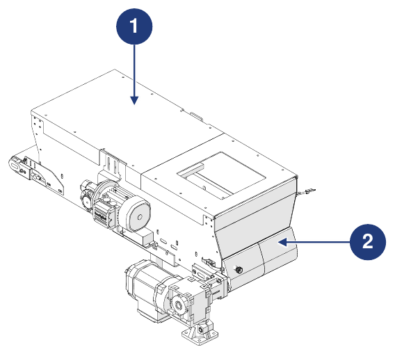
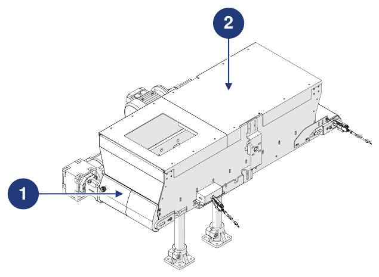

# **Vorabinformationen und Sicherheit**

:::{important}
Lesen Sie vor Installation, Verwendung oder Wartung der Maschine das gesamte Handbuch und die gesamte beigefügte Dokumentation sorgfältig durch.

Die Nichtbeachtung der angegebenen Anweisungen kann Folgendes verursachen:
- Schäden an der Maschine;
- Verlust der Sicherheitsbedingungen;
- Gefahren für Bediener und Wartungspersonal;
- Erlöschen der Garantie.
:::

## Identifikation

### Hersteller

| | |
|:--- |:--- |
| **Hersteller** | ARS S.r.l. |
| **Adresse** | Via Aretina Nord, 157 – 52041 Pieve al Toppo (AR), Italien |
| **Kontakt** | Tel. +39 0575 398611 · Fax +39 0575 398620 |
| **E-Mail / Web** | info@arsautomation.com · www.arsautomation.com |

### Identifikation der unvollständigen Maschine

| | |
|:--- |:--- |
| **Typ** | Trichter mit motorisiertem Förderband |
| **Bezeichnung** | Conveyor Hopper |
| **Modell** | CH60 |
| **Fassungsvermögen** | 60 L |

### Typenschild

Die Maschine ist mit einem Typenschild an der Seite des Bandantriebs versehen. Anhand der auf dem Schild angegebenen Daten, die dem Hersteller mitgeteilt werden, lässt sich die Maschine genau identifizieren.

:::{warning}
**ACHTUNG — Typenschild**

Es ist strengstens verboten, das Typenschild zu entfernen oder durch andere Schilder zu ersetzen. Wird das Schild beschädigt oder versehentlich entfernt, ist der Kunde **verpflichtet**, den Hersteller zu informieren.
:::

## Einbauerklärung

Die Maschine wird mit der **Einbauerklärung für unvollständige Maschinen** geliefert, die gemäß der Maschinenrichtlinie 2006/42/EG (Anhang II, Teil 1, Abschnitt B) erstellt wurde.

```{list-table}
:header-rows: 0
:widths: 30 70

* - **Maschine**
  - 60-Liter-Bandtrichter – Trichter mit motorisiertem Förderband, Fassungsvermögen 60 Liter
* - **Modell**
  - CH60, Revision 1.0 und folgende
* - **Funktion**
  - Bandsystem zur Zuführung von Schüttgutteilen
* - **Angewandte grundlegende Anforderungen**
  - 1.1.1, 1.1.2, 1.1.3, 1.3.7, 1.5.1, 1.5.5, 1.5.6, 1.5.8, 1.6.1, 1.7.1, 1.7.3, 1.7.4
* - **Richtlinien**
  - 2006/42/EG (Maschinenrichtlinie) · 2014/30/EU (Elektromagnetische Verträglichkeit)
* - **Technische Dokumentation**
  - Erstellt gemäß Anhang VII, Teil B, und den nationalen Behörden auf begründetes Verlangen zur Verfügung gestellt
```

:::{attention}
Die unvollständige Maschine darf erst in Betrieb genommen werden, wenn die Maschine, in die sie eingebaut werden soll, als konform mit den Bestimmungen der Richtlinie 2006/42/EG erklärt wurde.
:::

## Bezugsrichtlinien

Vor dem Inverkehrbringen hat der Hersteller die Risikobeurteilung durchgeführt, um die Konformität mit den grundlegenden Sicherheits- und Gesundheitsanforderungen zu überprüfen, sowie die in den Bezugsnormen vorgesehenen Prüfungen und Kontrollen vorgenommen. Die technischen Unterlagen sind gemäß **Anhang VII** der Richtlinie 2006/42/EG erstellt und stehen den Aufsichtsbehörden auf begründetes Verlangen zur Verfügung.

Die Maschine wird in Verkehr gebracht mit:
- Einbauerklärung
- Betriebsanleitung *(Punkt 1.7.4 und Anhang VI der Maschinenrichtlinie 2006/42/EG)*

| Referenz | Beschreibung / Geltungsbereich |
|:--- |:--- |
| **2006/42/EG** | Maschinenrichtlinie |
| **2014/30/EU** | EMV-Richtlinie (Elektromagnetische Verträglichkeit) |
| **UNI EN ISO 12100:2010** | Sicherheit von Maschinen – Allgemeine Gestaltungsleitsätze – Risikobeurteilung und Risikominderung |

## Adressaten, Lieferung und Aufbewahrung

Das Handbuch richtet sich an die Bediener, die mit der Verwendung und Verwaltung der Maschine in **allen Phasen ihrer technischen Lebensdauer** betraut sind. Zusammen mit der Einbauerklärung ist es **fester Bestandteil der Maschine** und muss sie bei jeder Verlagerung oder jedem Weiterverkauf begleiten.

| Aspekt | Vorgabe |
|:--- |:--- |
| **Unversehrtheit** | In allen Teilen unversehrt aufbewahren. Bei Verlust oder Beschädigung umgehend eine Kopie beim Hersteller anfordern. |
| **Eigentümerwechsel** | Es muss die Maschine bis zur Verschrottung begleiten (Standortwechsel, Verkauf usw.). |
| **Format** | Wird in Papierform und elektronisch geliefert; zusätzliche Dokumentation wird als Anlage beigefügt. |
| **Anlagen** | Die beigefügten Dokumente sind Bestandteil; es gelten dieselben Vorgaben. |
| **Originalsprache** | Italienisch. Bei Abweichungen von den Übersetzungen ist der Originaltext maßgebend. |
| **Aktualisierungen** | Bei funktionalen Änderungen oder Austausch obliegt die Aktualisierung dem Hersteller. Der Anwender stellt sicher, dass an den Einsatzorten nur die aktuelle Version verfügbar ist. |

:::{attention}
Der Hersteller lehnt jede Haftung für die unsachgemäße Verwendung der Maschine und für Schäden ab, die durch in der technischen Dokumentation nicht vorgesehene Tätigkeiten verursacht werden.
:::

## Bedienerprofile und Qualifikationen

| Qualifikation | Definition |
|:--- |:--- |
| **Bediener** | Vom Hersteller geschultes Personal, das für die Verwendung der Maschine in der Produktion qualifiziert ist. Es muss alle für den ordnungsgemäßen Betrieb erforderlichen Tätigkeiten ausführen und sich selbst sowie seine Kollegen schützen können. Im Zweifelsfall meldet es Auffälligkeiten dem Vorgesetzten. **Nicht berechtigt, Wartungsarbeiten durchzuführen.** |
| **Mechanischer Instandhalter** | Für die vorbeugende und korrektive Wartung aller mechanischen Teile qualifizierter Techniker. Kann die Maschine wie ein Bediener fahren, Einstellungen, Wartungs- und mechanische Reparaturarbeiten durchführen sowie Pläne, technische Zeichnungen und Ersatzteillisten lesen. Nicht qualifiziert für Arbeiten an elektrischen Anlagen unter Spannung. |
| **Elektrofachkraft für die Wartung** | Für die vorbeugende und korrektive Wartung aller elektrischen Teile qualifizierter Techniker. Kann die Maschine wie ein Bediener fahren, Einstellungen und Arbeiten an elektrischen Anlagen durchführen sowie Schaltpläne lesen. Unter Spannung darf er in Schaltschränken und Anschlusskästen nur arbeiten, wenn er eine beauftragte Person ist (PEI – EN 50110-1). |
| **Fahrer von Hebezeugen** | Gesunde Person, die in der Handhabung von Lasten und im Umgang mit Hebezeugen geschult und unterwiesen ist. |

Alle Qualifikationen müssen in die Kategorie **unterwiesene Person** fallen: eine Person, die über die Arbeit und die Gefahren bei unsachgemäßer Verwendung informiert, unterwiesen und geschult ist und die die Bedeutung von Sicherheitseinrichtungen, Unfallverhütungsvorschriften und sicheren Arbeitsbedingungen kennt.

## Im Handbuch verwendete Symbole

| Symbol | Bedeutung |
|:--- |:--- |
| **Achtung / Gefahr** | Wichtige Hinweise für die Sicherheit des Bedieners und/oder der Maschine. |
| **Wichtig / Hinweis** | Wichtige Informationen, auch zur Sicherheit des an der Verwendung der Maschine beteiligten Personals. |

## Glossar

| Begriff | Definition |
|:--- |:--- |
| **Lastaufnahmemittel** | Nicht mit den Maschinen verbundene Bauteile oder Ausrüstungen, die zwischen Maschine und Last oder an der Last selbst angebracht werden und deren Aufnahme ermöglichen. Auch Anschlagmittel und ihre Bestandteile sind Lastaufnahmemittel. |
| **ATEX** | Von *ATmosphères EXplosibles*: Konventioneller Name zweier EU-Richtlinien (2014/34/EU für Geräte zur Verwendung in explosionsgefährdeten Bereichen; 1999/92/EG für die Sicherheit und den Gesundheitsschutz der Arbeitnehmer in explosionsgefährdeten Bereichen). |
| **Ketten, Seile und Gurte** | Elemente, die für das Heben als Teil von Maschinen oder Lastaufnahmemitteln ausgelegt und gebaut sind. |
| **Gabelstapler** | Flurförderzeug zur Handhabung von Waren in Lagern, Industrieumgebungen oder auf Betriebsgeländen, mit Rädern ausgestattet und von einem Elektro-, Diesel- oder Gasmotor angetrieben. |
| **Schaden** | Jede negative Folge eines Gefährdungsereignisses. |
| **PSA** | Persönliche Schutzausrüstung: Kleidung oder Ausrüstung, die den Träger vor Gefahren für Gesundheit und Sicherheit schützen soll. |
| **Ausfall** | Zustand einer Einheit, der durch die Unfähigkeit gekennzeichnet ist, die geforderte Funktion zu erfüllen. |
| **Maschine** | Gesamtheit, die mit einem Antriebssystem ausgestattet oder dafür vorgesehen ist und aus fest miteinander verbundenen Teilen oder Bauteilen besteht, von denen mindestens eines beweglich ist, für eine bestimmte Anwendung. |
| **Unvollständige Maschine** | Gesamtheit, die fast eine Maschine ist, für sich allein aber keine bestimmte Anwendung erfüllen kann. |
| **Schutzmaßnahme** | Maßnahme zur Risikominderung, die vom Konstrukteur (inhärent sichere Konstruktion, Schutzeinrichtungen, Benutzerinformation) und/oder vom Anwender (Organisation, sichere Arbeitsverfahren, PSA, Schulung) umgesetzt wird. |
| **Gefährdung** | Potenzielle Quelle von Verletzungen oder Gesundheitsschäden. |
| **Exponierte Person** | Jede Person, die sich ganz oder teilweise in einem Gefahrbereich befindet. |
| **Prävention** | Gesamtheit der Vorkehrungen oder Maßnahmen, die je nach Besonderheit der Arbeit, Erfahrung und Stand der Technik erforderlich sind, um Risiken zu vermeiden oder ihre Wahrscheinlichkeit zu verringern. |
| **Schutzeinrichtung** | Physische Barriere, die als Teil der Maschine konstruiert ist und Schutz bietet. |
| **Feststehende Schutzeinrichtung** | Schutzeinrichtung, die dauerhaft oder durch Befestigungselemente (Schrauben, Bolzen usw.) in Position (geschlossen) gehalten wird und sich ohne Werkzeug weder entfernen noch öffnen lässt. Leicht lösbare Befestigungen (z. B. Kunststoffknöpfe) sind nicht zulässig. |
| **Bewegliche Schutzeinrichtung** | Mechanisch mit der Struktur verbundene Schutzeinrichtung (z. B. durch Scharniere oder Führungen), die sich ohne Werkzeug öffnen lässt. |
| **Risiko** | Kombination aus der Wahrscheinlichkeit eines Schadens und dessen Schwere. |
| **Restrisiko** | Risiko, das nach der Anwendung von Schutz- und Präventionsmaßnahmen verbleibt. |
| **Bestimmungsgemäße Verwendung** | Verwendung der Maschine in Übereinstimmung mit den Angaben in der Betriebsanleitung. |
| **Vernünftigerweise vorhersehbare Fehlanwendung** | Verwendung der Maschine in einer vom Konstrukteur nicht vorgesehenen Weise, die sich aus leicht vorhersehbarem menschlichem Verhalten ergeben kann. |

## Persönliche Schutzausrüstung (PSA)

Bei Arbeiten in der Nähe der Maschine (Installation, Wartung, Einstellungen) sind die allgemeinen Unfallverhütungsvorschriften einzuhalten und die für jede Tätigkeit vorgesehene PSA zu verwenden. Die Kleidung der an der Maschine tätigen Personen muss den grundlegenden Sicherheitsanforderungen der EU-Verordnung 2016/425 und den im Installationsland geltenden Gesetzen entsprechen.

| Gebot | Beschreibung |
|:--- |:--- |
| **Handschuhe** | Es sind Sicherheits- oder Isolierhandschuhe für den professionellen Gebrauch zu tragen. |
| **Schutzbrille** | Zum Schutz der Augen ist eine Schutzbrille zu tragen. |
| **Fußschutz** | Zum Schutz der Füße sind Sicherheitsschuhe zu tragen. |
| **Gehörschutz** | Zum Schutz des Gehörs sind Kapselgehörschützer oder Ohrstöpsel zu tragen. |
| **Schutzkleidung** | Die vorgeschriebene Schutzkleidung ist zu tragen. |
| **Handbuch lesen** | Die Betriebsanleitung und die Sicherheitshinweise sind vor der Verwendung der Maschine zu lesen (und zu verstehen). |

## Gewährleistung

:::{important}
Die vollständigen Gewährleistungsbedingungen sind im Kaufvertrag festgelegt. Weichen die Vertragsbedingungen davon ab, haben sie Vorrang vor den Angaben in diesem Abschnitt.
:::

Die Gewährleistung unterliegt den folgenden allgemeinen Bedingungen:
- Das Öffnen der Verpackung und die Einbindung müssen im Beisein von vom Hersteller autorisierten Technikern erfolgen;
- Die Erstinbetriebnahme und die Abnahme müssen im Beisein und unter Anleitung der Techniker des Herstellers erfolgen, sofern die Parteien nichts anderes vereinbaren;
- Die Maschine muss innerhalb der im Vertrag angegebenen und in der technischen Dokumentation festgelegten Grenzen verwendet werden;
- Die Wartung muss zu den im Handbuch angegebenen Zeitpunkten und in der dort beschriebenen Weise, mit Originalersatzteilen und durch qualifiziertes Personal erfolgen.

Die Gewährleistung **erlischt** bei:
- Nichteinhaltung der Sicherheitsvorschriften;
- Entfernen oder Manipulation der Steuer- und Sicherheitseinrichtungen (Schutzeinrichtungen, Sensoren usw.);
- unsachgemäße Verwendung der Maschine;
- Verwendung durch nicht geschultes und/oder nicht autorisiertes Personal oder Personal, das die im Handbuch vorgesehenen Voraussetzungen nicht erfüllt;
- Änderungen oder Reparaturen durch den Anwender ohne Genehmigung des Herstellers;
- teilweise oder vollständige Nichtbeachtung der Anweisungen;
- Anomalien in der elektrischen Versorgung;
- fehlende Wartung;
- Verwendung von Nicht-Originalersatzteilen;
- außergewöhnliche Ereignisse wie Überschwemmungen oder Brände (sofern nicht durch die Maschinen verursacht).

## Sicherheitsmaßnahmen

### Sicherheitseinrichtungen

Die Maschine ist so konstruiert und mit Sicherheitssystemen ausgestattet, dass die Risiken für den Bediener auf ein Minimum reduziert werden.



| Pos. | Gerät | Beschreibung |
|:--- |:--- |:--- |
| 1 | **Feststehende Schutzeinrichtung** | Feststehende Schutzeinrichtungen (Verkleidungen), die in Bereichen, die nur bei Wartungsarbeiten zugänglich sind, den Zugang zu Gefahrbereichen verhindern. Zum Entfernen sind spezielle Werkzeuge erforderlich. |
| 2 | **Bewegliche Schutzeinrichtung** | Zu öffnende Schutzeinrichtungen (Klappen), die in bestimmten Situationen den Zugang zum Arbeitsbereich ermöglichen. Um sie sicher zu öffnen, sind bestimmte Verfahren einzuhalten. |

:::{warning}
Für die Einbindung der Maschine in die Endanlage muss der externe elektrische Anschluss vorgesehen werden, um die Sicherheitsfunktionen der Maschine in die Steuerungslogik der Anlage zu integrieren.
:::

### Lärm

Der Lärm wurde gemäß den Normen UNI EN 11200 und UNI EN ISO 3746 gemessen. Während der Arbeitszyklen ist das Personal einem Lärmpegel ausgesetzt, der:
- unter **70 dB(A)** liegt, ohne Teile im Inneren;
- unter **75 dB(A)** liegt, mit Teilen im Inneren. Der Wert beruht auf der Erfahrung des Herstellers; einige Teile/Komponenten können aufgrund ihrer durch Band und Bürste verursachten Relativbewegung eine höhere Emission erzeugen. Die Bewertung der abgegebenen Geräusche anhand der Spezifikation obliegt dem Integrator/Einbauer.

Der tatsächliche Lärmpegel der in einem Produktionsprozess installierten Maschine weicht vom gemessenen ab, da er von Art und Beschaffenheit des Standorts und von den in der Nähe betriebenen anderen Maschinen beeinflusst wird. Der Anwender ist für die Anwendung der Präventions- und Schutzmaßnahmen verantwortlich, die die Gesetzgebung des Installationslandes vorsieht.

### Vibrationen

Das von der Maschine erzeugte Vibrationsniveau ist vernachlässigbar und für die Gesundheit der Bediener nicht gefährlich.

:::{warning}
Übermäßige Vibrationen können nur durch einen mechanischen Defekt verursacht werden, der umgehend gemeldet und behoben werden muss, um die Sicherheit der Maschine und der Bediener nicht zu gefährden.
:::

### Elektromagnetische Verträglichkeit

Die Maschine enthält elektronische Komponenten, die den Normen zur elektromagnetischen Verträglichkeit unterliegen und von leitungsgebundenen und abgestrahlten Störaussendungen betroffen sind. Die Emissionswerte erfüllen die normativen Anforderungen durch den Einsatz konformer Komponenten, geeignete Anschlüsse und, wo erforderlich, die Installation von Filtern. Die Maschine entspricht daher der EMV-Richtlinie.

:::{warning}
Jede nicht normgerechte Wartung an der elektrischen Anlage oder fehlerhafter Austausch von Komponenten kann die Wirksamkeit der getroffenen Lösungen beeinträchtigen.
:::

### Restrisiken

Die Sicherheit wurde so weit wie möglich in Konstruktion und Bau der Maschine integriert; dennoch verbleiben einige Risiken, vor denen die Bediener geschützt werden müssen.

| Risiko | Beschreibung und Hinweise |
|:--- |:--- |
| **Risiken durch den Transport** | Das Abladen und Öffnen der Verpackung sowie die Handhabung der Maschine bergen das Risiko schwebender Lasten und von Quetschungen. Die Verfahren sind auf der Seite *Transport und Einbindung* beschrieben. Diese Tätigkeiten dürfen nur von Personal durchgeführt werden, das im Umgang mit Hebezeugen erfahren und entsprechend geschult ist, mit geeigneter PSA. |
| **Risiko durch spannungsführende Teile** | Wartungsarbeiten und der Zugang zur Maschine bergen elektrische Risiken. Arbeiten an Anlagen unter Spannung dürfen nur von erfahrenem und qualifiziertem Personal durchgeführt werden. Den Piktogrammen für elektrische Gefahren ist größte Aufmerksamkeit zu schenken; keine Wartungsarbeiten durchführen, solange die Spannungsversorgung nicht abgeschaltet wurde; für spezifische Hinweise die Handbücher der Zukaufkomponenten konsultieren; den Potentialausgleich regelmäßig prüfen und sicherstellen, dass keine Unterbrechungen vorliegen. |
| **Risiko durch Staub, Bruchstücke usw.** | Am Zyklusende können Materialreste oder Staubablagerungen auf den Maschinenoberflächen zurückbleiben. Nach jeder Verwendung gründlich reinigen, wie auf der Seite *Wartung* beschrieben. |

:::{warning}
Der Hersteller der Endanlage muss die Reduzierung der mechanischen Risiken in den verschiedenen Bereichen der Maschine auf Grundlage der allgemeinen Risikoanalyse der Anlage sicherstellen.
:::

:::{warning}
Die Sicherheitsfunktionen des Lieferumfangs von ARS S.r.l. müssen vom Hersteller der Endanlage in die Sicherheitsfunktionen der anderen verbundenen unvollständigen Maschinen oder Maschinen integriert werden.
:::

**Der Anwender ist verantwortlich für:**
- die Risiken zu analysieren, die bei Handhabung und Einbindung am eigenen Standort auftreten können (die Analysen zur Handhabung berücksichtigen nur die Eigenschaften der Maschine);
- den Fahrweg von Gabelstaplern und/oder lasergeführten Fahrzeugen durch Bodenmarkierungen abzugrenzen;
- das an den Arbeiten und an der Verwendung der Maschine beteiligte Personal zu sensibilisieren und zu unterweisen;
- nach der Beurteilung der Risiken in Durchgangs- oder Kontrollbereichen visuelle Sicherheitszeichen rund um den Arbeitsplatz anzubringen.

### An der Maschine angebrachte Sicherheitspiktogramme

Die Maschine wird mit einer Reihe von Piktogrammen geliefert, anhand derer sich die Restrisiken sofort erkennen lassen.

:::{warning}
Es ist verboten, die Piktogramme zu entfernen und/oder durch Piktogramme mit anderer Bedeutung zu ersetzen. Der Anwender ist verpflichtet, fehlende oder schlecht lesbare Piktogramme zu ersetzen.
:::



| Pos. | Beschreibung |
|:--- |:--- |
| 1 | Gefahr des Einzugs / Quetschens der Hände. |
| 2 | Sicherheitseinrichtungen dürfen nicht entfernt werden. |
