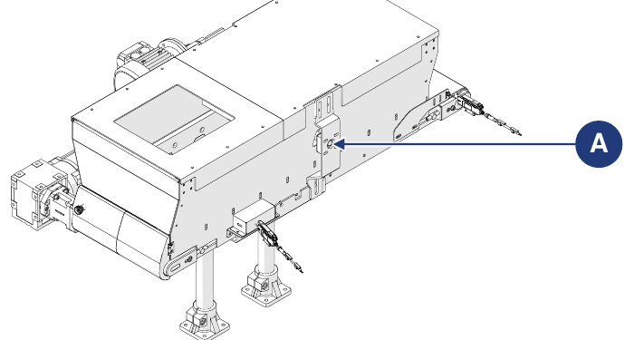

# **Wartung**

:::{warning}
Wartungsarbeiten nur bei ausgeschalteter und spannungsfreier Maschine durchführen (Hauptschalter des Versorgungsschaltschranks in Stellung „0-OFF“). Am Hauptschalter das Schild „MASCHINE IN WARTUNG – NICHT EINSCHALTEN“ anbringen.
:::

:::{warning}
Wartungsarbeiten müssen von qualifiziertem und autorisiertem Personal durchgeführt werden.
:::

Zur Wartung gehören die Arbeiten (Inspektionen, Kontrollen, Einstellungen und Austausch), die infolge des normalen Gebrauchs erforderlich werden.

**Richtlinien für eine ordnungsgemäße Wartung:**
- nur Originalersatzteile und für den Zweck geeignete Werkzeuge in einwandfreiem Zustand verwenden;
- die für die planmäßige Wartung (vorbeugend und periodisch) angegebenen Intervalle einhalten: Der Abstand (angegeben in Zeit oder Arbeitszyklen) zwischen zwei Eingriffen ist als zulässiges Maximum zu verstehen; er darf nicht überschritten, kann aber verkürzt werden.

Eine gute vorbeugende Wartung erfordert ständige Aufmerksamkeit und fortlaufende Überwachung der Maschine. Die Ursache etwaiger Auffälligkeiten (übermäßige Geräusche, Überhitzung, Flüssigkeitsaustritte usw.) sofort prüfen und beheben: Die rechtzeitige Beseitigung der Ursachen verhindert weitere Schäden und gewährleistet die Sicherheit des Bedieners.

Das Wartungspersonal muss gut geschult sein und die Unfallverhütungsvorschriften genau kennen; nicht autorisierte Personen müssen sich während der Arbeiten außerhalb des Arbeitsbereichs aufhalten. Auch Reinigung und Einstellungen dürfen nur während der Wartung bei stillgesetzter und vom Schaltschrank getrennter Maschine erfolgen.

:::{warning}
Reparaturen oder Wartungsarbeiten, die nicht im Handbuch aufgeführt sind, dürfen nur mit vorheriger Genehmigung des Herstellers durchgeführt werden; der Hersteller haftet nicht für Personen- oder Sachschäden, die aus nicht beschriebenen oder abweichend von den Angaben durchgeführten Tätigkeiten entstehen.
:::

| Typ | Beschreibung |
|:--- |:--- |
| **Planmäßige Wartung** | Alle Tätigkeiten, die der Instandhalter vorbeugend durchführen muss, um den einwandfreien Betrieb der Maschine auf Dauer zu gewährleisten: Inspektionen, Kontrollen, Einstellungen, Reinigung und Schmierung. |
| **Außerplanmäßige Wartung** | Alle Tätigkeiten, die der Instandhalter durchführen muss, wenn die Maschine es erfordert: Inspektionen, Reparaturen, Wiederherstellung der Nennbetriebsbedingungen oder Austausch einer defekten, ausgefallenen oder verschlissenen Einheit. |

## Planmäßige Wartung

Zur planmäßigen Wartung gehören die Inspektionen, Kontrollen und Eingriffe, die zur Vermeidung von Ausfällen Folgendes überwachen:
- den mechanischen Zustand der Maschine;
- die Schmierung;
- die Reinigung;
- die elektrische Versorgungsanlage.

Die angegebenen Intervalle beziehen sich auf normale Betriebsbedingungen, d. h. auf Bedingungen, die den vorgesehenen Einsatzbedingungen entsprechen.

### Kontrollen und Inspektionen

| Vorgang | Häufigkeit |
|:--- |:---: |
| Die Unversehrtheit aller Schutz- und Sicherheitseinrichtungen der Maschine per Sichtprüfung kontrollieren. | Täglich |
| Verschleißzustand und Sauberkeit der Maschine per Sichtprüfung kontrollieren. | Täglich |
| Die korrekte Funktion der Sensoren (falls verwendet) prüfen. | Wöchentlich |
| Die korrekte Funktion der Antriebe prüfen. | Monatlich |
| Den Verschleißzustand der Isolierung der Anschlusskabel und der elektrischen Steckverbinder prüfen. | Monatlich |
| Die korrekte Spannung des Bandgewebes prüfen. | Monatlich |
| Den Verschleißzustand des Bandgewebes prüfen und es bei Bedarf austauschen. | Halbjährlich |

:::{important}
Für die Beschreibung der Wartungsverfahren des in die Maschine integrierten Bandes siehe das der Dokumentation beigefügte Handbuch des Bandlieferanten.
:::

### Reinigung

:::{warning}
Reinigungsarbeiten müssen von qualifiziertem und autorisiertem Personal durchgeführt werden. Die im Installationsland geltenden Vorschriften zur Behandlung etwaigen Waschwassers sind einzuhalten.
:::

| Vorgang | Häufigkeit |
|:--- |:---: |
| Allgemeine Reinigung. | Wöchentlich |

:::{important}
Die allgemeine Reinigung muss jedes Mal durchgeführt werden, wenn Material in die Maschine gegeben wird, um etwaige Rückstände des vorherigen Prozesses zu entfernen.
:::

:::{warning}
Niemals Wasser- oder Flüssigkeitsstrahlen auf die elektrischen Teile der Maschine richten. Für die Reinigung keine Säuren, Lösungsmittel, brennbaren Stoffe oder scheuernden Werkzeuge verwenden.
:::

**Allgemeine Reinigung**

| Phase | Aktion |
|:--- |:--- |
| 1 | Die Spannungsversorgung der Maschine trennen. *Hinweis: Das Handbuch der Anlage beachten, in die die Maschine eingebunden ist.* |
| 2 | Mit Druckluft oder einem weichen, mit mildem Reinigungsmittel getränkten Tuch Prozessrückstände und Verschmutzungen von den Oberflächen entfernen. *Hinweis: Zur Erleichterung der Arbeit das Band über die hintere Klappe zugänglich machen.* |
| 3 | Eventuelle Fett- und/oder Ölrückstände mit einem weichen, mit mildem Reinigungsmittel getränkten Tuch von den Oberflächen entfernen. |
| 4 | Warten, bis die Maschine vollständig trocken ist, bevor sie wieder in Betrieb genommen wird. |

### Schmierung

:::{important}
Keiner der Antriebe der Maschine muss geschmiert werden. Für Schmierarbeiten eine Handfettpresse verwenden.
:::

| Vorgang | Häufigkeit |
|:--- |:---: |
| Schmierung der Lagerung (A) der motorisierten Bürste (optional). | Monatlich |

## Außerplanmäßige Wartung

:::{warning}
Außerplanmäßige Wartungsarbeiten und Reparaturen dürfen nur von qualifizierten, geschulten und autorisierten Technikern durchgeführt werden, die beim Hersteller oder beim autorisierten Servicezentrum angestellt sind. Diese Eingriffe erfordern fundierte Spezialkenntnisse über die Maschine, die erforderlichen Arbeiten, die damit verbundenen Risiken und die korrekten Verfahren für sicheres Arbeiten.
:::

Bei außergewöhnlichen Ereignissen, die eine außerplanmäßige Wartung erfordern, müssen die Wartungstechniker des Anwenders für die planmäßige Wartung:
- den Zustand beschädigter oder phasenverschobener Einheiten prüfen;
- die in diesem Abschnitt beschriebenen Arbeiten ausführen;
- falls die durchzuführenden Arbeiten nicht im Handbuch aufgeführt sind, dem Hersteller den Bericht über den Vorfall, das Ergebnis der Inspektion und etwaige Anmerkungen übermitteln.

Der Hersteller oder das autorisierte Servicezentrum beurteilt jeden Fall einzeln und vereinbart mit dem Wartungspersonal die am besten geeignete Lösung:
- Der Hersteller entsendet einen autorisierten, geschulten und qualifizierten Techniker, der die erforderlichen Arbeiten ausführt;
- oder der Hersteller ermächtigt die Wartungstechniker des Anwenders, die Arbeiten selbst auszuführen, und übermittelt gegebenenfalls zusätzliche Anweisungen.

:::{warning}
Ersatzteile müssen beim Hersteller bestellt werden. Verwendet der Kunde keine Originalersatzteile oder vom Hersteller schriftlich genehmigten Teile, ist der Hersteller von jeder Haftung für die Funktion der Maschine und die Sicherheit der Bediener befreit. Genehmigungen und/oder Anweisungen müssen stets schriftlich erteilt werden: Ohne schriftliche Genehmigung ist jeder Eingriff verboten.
:::

:::{important}
Müssen Verfahren durchgeführt werden, die nicht im Handbuch beschrieben sind, oder bestehen Zweifel, ist jeder Eingriff verboten. Den Hersteller zur Klärung kontaktieren.
:::

### Austausch des Bandgewebes

| | |
|:--- |:--- |
| **Qualifikation des Bedieners** | Elektrischer Instandhalter |
| **Zu verwendende Werkzeuge** | Schraubwerkzeuge |

| Phase | Aktion |
|:--- |:--- |
| 1 | Die Befestigungsschrauben (A) des Trichterkörpers an der Trägerplatte der Standfüße auf beiden Seiten der Struktur lösen. |
| 2 | Den Trichterkörper (B) von den Standfüßen (C) trennen: manuell mit zwei Bedienern oder mithilfe eines Gabelstaplers (siehe die Hinweise zur Handhabung unter *Transport und Einbindung*). |
| 3 | Den Trichterkörper zur Werkbank bringen. |
| 4 | Die Schrauben (D), mit denen das Band am Trichter befestigt ist, auf beiden Seiten der Struktur entfernen. |
| 5 | Das Band (E) vom Trichter (F) trennen. *Hinweis: Dies kann von einem Bediener manuell durchgeführt werden.* |
| 6 | Für den Austausch des Gewebes die Anweisungen im Handbuch des Bandlieferanten befolgen. *Hinweis: Das Handbuch des Bandlieferanten ist der Dokumentation beigefügt.* |
| 7 | Die Maschine in umgekehrter Reihenfolge wieder zusammenbauen. |
