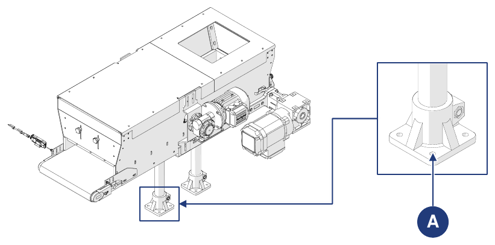

# **Transport und Einbindung**

## Verpackung

Die Maschine wird vom Hersteller vom Produktionswerk an den Standort des Kunden versandt. Je nach Entfernung, Kundenwunsch und Dauer des Verbleibs in der Verpackung erfolgt der Versand mit:
- normaler Schutzverpackung für kurze und mittlere Entfernungen;
- spezielle Schutzverpackung für lange Entfernungen.

Der Transport muss je nach Ladungsart in geschlossenen oder mit Planen versehenen Fahrzeugen erfolgen.

Bei Erhalt der Maschine muss der Kunde prüfen, dass keine Schäden durch den Transport oder durch das mit den Arbeiten betraute Personal entstanden sind.
- Werden Schäden festgestellt, die Verpackung im vorgefundenen Zustand belassen und sofort beim Spediteur eine Schadensschätzung anfordern; anschließend ein Schadensprotokoll senden, um die Versicherung des Transporteurs und die Verkaufsstelle zu informieren.
- Wird die Maschine in einer Kiste auf einer Palette oder auf mit Schrumpffolie geschützten Holzbohlen geliefert, zuerst die Verpackung bzw. Abdeckung entfernen. Um die Maschine vollständig freizulegen, Schrauben und Metallbänder entfernen. Danach die Maschine mit einem Kran oder Gabelstapler anheben und die für den Transport verwendete Palette entfernen.

### Entfernen der Verpackung

| Phase | Aktion |
|:--- |:--- |
| 1 | Die Maschine an den vorgesehenen Ort bringen. |
| 2 | Die in einer Kiste gelieferten Teile auspacken: Schrumpffolie entfernen; Bänder entfernen; Kiste entfernen; etwaige Befestigungen am Holzboden entfernen. |
| 3 | Die auf einer Palette gelieferten Teile auspacken: Bänder entfernen; Schrumpffolie entfernen; etwaige Befestigungen am Holzboden entfernen. |

Zur Handhabung der Maschine und/oder ihrer Teile siehe den Abschnitt *Handhabung*.

### Entsorgung der Verpackung

Die Verpackung ist Bestandteil des Lieferumfangs und wird nicht zurückgenommen: Sie muss vom Käufer entsorgt werden. Jede Entsorgung oder Vernichtung muss unter Beachtung der im Land des Anwenders geltenden Vorschriften und unter Berücksichtigung der Art der Materialien erfolgen.

## Handhabung

:::{important}
Die in diesem Abschnitt beschriebenen Handhabungstätigkeiten müssen von qualifiziertem Personal durchgeführt werden, das für Be- und Entladen sowie für die Handhabung mit Hebemitteln geschult ist. Das Personal muss autorisiert und im Umgang mit Hebemitteln geschult sein und die geltenden Vorschriften zum persönlichen Schutz einhalten.
:::

:::{warning}
Der Hersteller:
- haftet nicht für Sach- oder Personenschäden infolge von Unfällen, die durch Nichtbeachtung der Anweisungen im Handbuch verursacht werden;
- haftet nicht für Schäden an der Maschine, die durch Nichtbeachtung der gegebenen Anweisungen entstehen.
:::

### Einheiten und Gewichte

Die Maschine wird üblicherweise in folgende Gruppen aufgeteilt und transportiert:

| Einheit | Gewicht |
|:--- |:--- |
| **Trichterkörper + Band** | Siehe Transportdokument |
| **Standfüße** | Siehe Transportdokument |

In einigen Fällen kann die Maschine auch komplett transportiert werden:

| Einheit | Gewicht |
|:--- |:--- |
| **Komplette Maschine (ohne Optionen)** | 45 kg |

Merkmale der für den Versand verwendeten Verpackung:

| Verpackung | |
|:--- |:--- |
| **Verpackungsart** | Holzkiste |
| **Abmessungen der Kiste** | 1200 x 800 x 650 mm |
| **Gewicht der Maschine mit Verpackung** | 80 kg |

### Handhabung mit Gabelstapler

| | |
|:--- |:--- |
| **Qualifikation des Bedieners** | Fahrer von Hebezeugen |
| **Hebemittel** | Gabelstapler |
| **Erforderliche Werkzeuge** | Seile, Klemmen oder Ähnliches (falls erforderlich) |

:::{danger}
- Nur geeignete und zugelassene Hebemittel verwenden, die zu den Abmessungen und zum Gewicht der Maschine passen.
- Sicherstellen, dass sich niemand im Wirkbereich des Hebemittels befindet.
:::

**Verpackte Maschine**

| Phase | Aktion |
|:--- |:--- |
| 1 | Die Gabeln des Staplers unter die Basis der zu transportierenden Last schieben. |
| 2 | Sicherstellen, dass die Gabeln weit genug über die Vorderseite der Last hinausragen, um die Kippgefahr auszuschließen. |
| 3 | Die Gabeln anheben, bis sie die Last berühren. *Hinweis: Bei Bedarf die Last mit Seilen, Klemmen oder ähnlichen Vorrichtungen an den Gabeln sichern.* |
| 4 | Die Last langsam etwa zehn Zentimeter vom Boden anheben und ihre Stabilität prüfen, wobei sich der Schwerpunkt in der Mitte der Gabeln befinden muss. |
| 5 | Die Fahrgeschwindigkeit an Boden und Ladungsart anpassen und abrupte Manöver vermeiden. |

**Maschine ohne Verpackung**

| Phase | Aktion |
|:--- |:--- |
| 1 | Die Gabeln des Staplers unter die Arbeitsfläche der Maschine schieben. |
| 2 | Sicherstellen, dass die Gabeln weit genug über die Vorderseite der Last hinausragen, um die Kippgefahr auszuschließen. |
| 3 | Die Gabeln anheben, bis sie die Last berühren. *Hinweis: Bei Bedarf die Last mit Seilen, Klemmen oder ähnlichen Vorrichtungen an den Gabeln sichern.* |
| 4 | Die Last langsam etwa zehn Zentimeter vom Boden anheben und ihre Stabilität prüfen, wobei sich der Schwerpunkt in der Mitte der Gabeln befinden muss. |
| 5 | Die Fahrgeschwindigkeit an Boden und Ladungsart anpassen und abrupte Manöver vermeiden. |

## Einbindung

### Vorbereitungen

Der Anwender hat normalerweise Folgendes bereitzustellen:
- die Räumlichkeiten (einschließlich etwaiger Bauarbeiten wie Fundamente oder Kanäle sowie der Beleuchtung);
- die elektrischen Anlagen der Maschine gemäß den im Verwendungsland geltenden Vorschriften und entsprechend der Betriebslogik der Anlage, in die die Maschine eingebunden wird;
- die Spannungsversorgung der Maschine, einschließlich des Schutzleiters;
- die den Anforderungen der Maschine entsprechenden Hilfsdienste;
- die für die Einbindung erforderlichen Werkzeuge und Verbrauchsmaterialien;
- etwaige für die Inbetriebnahme erforderliche Schmierstoffe;
- geeignete Hebe- und Fördermittel.

### Zulässige Umgebungsbedingungen

Die Einsatzumgebung muss sich in geschlossenen Räumen befinden, vor Witterungseinflüssen (Regen, Hagel, Schnee, Nebel, Schwebstaub und brennbarem Staub) und vor aggressiven Einflüssen (korrosive Dämpfe, übermäßige Wärmequellen) geschützt sein und **darf nicht als ATEX-Bereich eingestuft sein**. Die Maschine, die zugehörigen Steuerungssysteme und die Antriebe dürfen nicht unter anderen als den aufgeführten Bedingungen betrieben werden.

Insbesondere darf die Einsatzumgebung nicht sein:
- korrosiven Dämpfen ausgesetzt;
- übermäßiger Feuchtigkeit (über 85 %) und schnellen Änderungen der relativen Luftfeuchtigkeit (über 0,005 p.u./h) ausgesetzt;
- übermäßigem oder abrasivem Staub ausgesetzt;
- öligen Dämpfen ausgesetzt;
- explosionsfähigen Staub- oder Gasgemischen ausgesetzt;
- salzhaltiger Luft ausgesetzt;
- außergewöhnlichen Vibrationen, Stößen oder Schlägen ausgesetzt;
- widrigen Witterungsbedingungen außerhalb der zulässigen Grenzen oder Tropfwasser ausgesetzt;
- außergewöhnlichen Transport- oder Lagerbedingungen ausgesetzt;
- hohen oder schnellen Temperaturschwankungen (über 5 K/h) ausgesetzt;
- nuklearer Strahlung ausgesetzt.

Die Maschine ist so ausgelegt und gebaut, dass sie unter den folgenden Umgebungsbedingungen sicher arbeitet:

| Bedingung | Wert |
|:--- |:--- |
| **Umgebungstemperatur** | min. +5 °C / max. +40 °C |
| **Relative Luftfeuchtigkeit** | min. 5 % / max. 90 % (nicht kondensierend) |
| **Aufstellort** | Industriehalle |
| **Aufstellfläche** | Industrieboden aus Beton |
| **Beleuchtung** | Beleuchtung um die Maschine >100 Lux; für den Bediener verfügbare Beleuchtung ≥400 Lux (Leuchtstoffröhren) |

:::{warning}
Von den angegebenen abweichende Umgebungsbedingungen können die Maschine schwer beschädigen. Die Aufstellung in Umgebungen, die den obigen Vorgaben nicht entsprechen, führt zum Erlöschen der Gewährleistung für die auszutauschenden Teile.
:::

:::{important}
Die Arbeitsfläche muss ausreichend beleuchtet sein. Gibt es am Arbeitsplatz Schatten- oder unebene Bereiche, hat der Anwender für geeignete Beleuchtung zu sorgen. Werden diese Anforderungen nicht erfüllt, lehnt der Hersteller jede Haftung ab.
:::

### Montage

Wird die Maschine in Gruppen aufgeteilt geliefert, müssen diese zusammengebaut werden.

| Phase | Aktion |
|:--- |:--- |
| 1 | Die Trägerplatte der Standfüße auf die Bohrungen an der Basis des Trichterkörpers ausrichten. |
| 2 | Die beiden Gruppen mit den vorgesehenen Befestigungsschrauben verbinden. |

### Positionierung

:::{important}
Die Maschine muss gemäß dem mit dem Hersteller vereinbarten Layout in der Zielanlage positioniert werden.
:::

Für die Positionierung und die anschließenden Anschlüsse einen den Abmessungen der Maschine und der Hebemittel entsprechenden Bereich vorbereiten und dabei auf etwaige Hindernisse (andere Maschinen, Wände o. Ä.) entlang des Wegs der Fördermittel achten.

:::{important}
Sobald die optimale Position der Maschine am Arbeitsplatz festgelegt ist, muss sie mit geeigneten Dübeln, die in die dafür vorgesehenen Bohrungen (A) an den Standfüßen zu setzen sind, am Boden befestigt werden.
:::

## Anschlüsse

Um die Maschine in Betrieb zu nehmen, muss sie korrekt an die lokalen Netze angeschlossen werden: **elektrischer Anschluss** (einschließlich Erdungsanschluss) gemäß den im Installationsland geltenden Vorschriften. Der Anwender ist dafür verantwortlich, die erforderlichen Anschlusseigenschaften sicherzustellen.

:::{warning}
Die erforderlichen Anschlüsse müssen von qualifiziertem und autorisiertem Personal hergestellt werden.
:::

### Elektrischer Anschluss

:::{warning}
- Vor jedem elektrischen Anschluss sicherstellen, dass die Maschine ausgeschaltet und die Spannungsversorgung bereits getrennt ist.
- Der Vorgang darf nur von spezialisiertem und autorisiertem Personal (Elektrofachkraft für die Wartung) durchgeführt werden.
:::

Vor dem elektrischen Anschluss sicherstellen, dass:
- der Instandhalter die im Installationsland geltenden Vorschriften genau kennt;
- Frequenz und Spannung der Maschinenversorgung mit denen des Netzes übereinstimmen;
- der Querschnitt der elektrischen Kabel für die Stromaufnahme ausreicht;
- die Versorgungsleitung die maximale Stromaufnahme der Maschine verträgt;
- die Erdung des Stromkreises der Norm EN 60204-1 entspricht;
- die Werkstoffe der Erdungsanlage einen ausreichenden Widerstand oder einen ausreichenden mechanischen Schutz aufweisen.

:::{warning}
Nicht mit nassen Händen oder Gegenständen arbeiten. Bei einem Brand kein Wasser auf elektrische Komponenten verwenden.
:::

| | |
|:--- |:--- |
| **Qualifikation des Bedieners** | Elektrischer Instandhalter |
| **Zu verwendende Werkzeuge** | Schraubwerkzeuge |

:::{important}
Der Anwender muss den Anschluss der Maschine an eine Versorgungsleitung vorsehen, die mit einem zum Trennen der Energieversorgung der Maschine geeigneten Hauptschalter ausgestattet ist.
:::

| Phase | Aktion |
|:--- |:--- |
| 1 | Die Kabel R, S und T in die jeweiligen Klemmen im Klemmenkasten des Motors einführen. *Hinweis: Sicherstellen, dass die Kunststoffummantelung am Kabelanfang entfernt wurde.* |
| 2 | Die Schrauben anziehen, um die Kabel an den Klemmen zu befestigen. |
| 3 | Den Anschluss des Erdungskabels an der Erdungsplatte befestigen, indem die dafür vorgesehene Schraube angezogen wird. *Hinweis: Sicherstellen, dass die Kunststoffummantelung am Kabelanfang entfernt wurde.* |
| 4 | Mit einem Prüfgerät kontrollieren, dass die vorgesehenen Spannungen und die drei Phasen an den Klemmen anliegen. |
