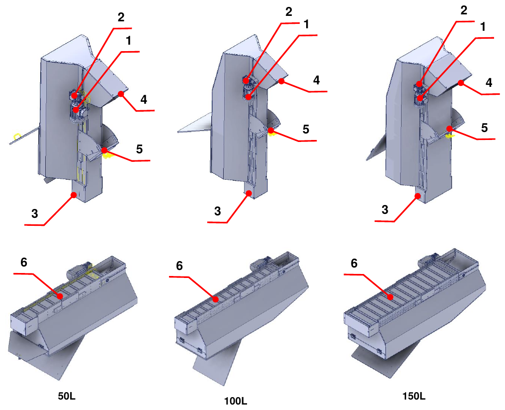
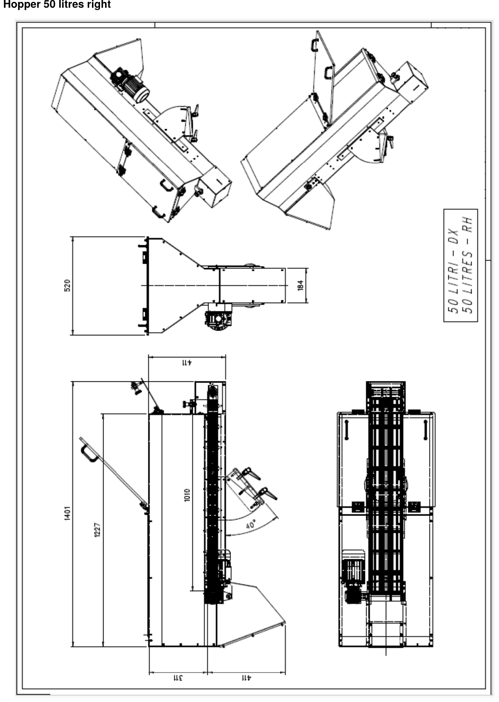
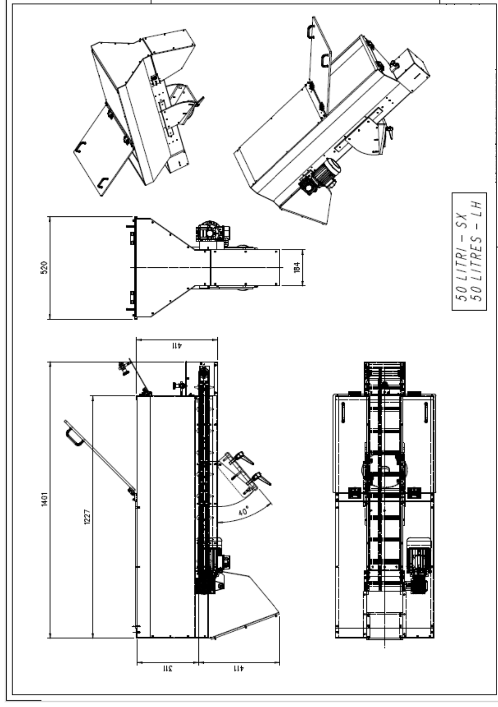
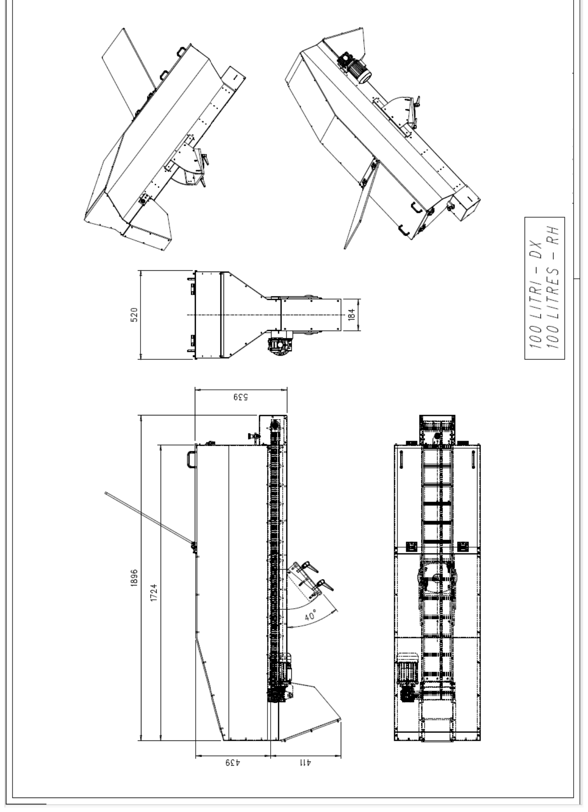
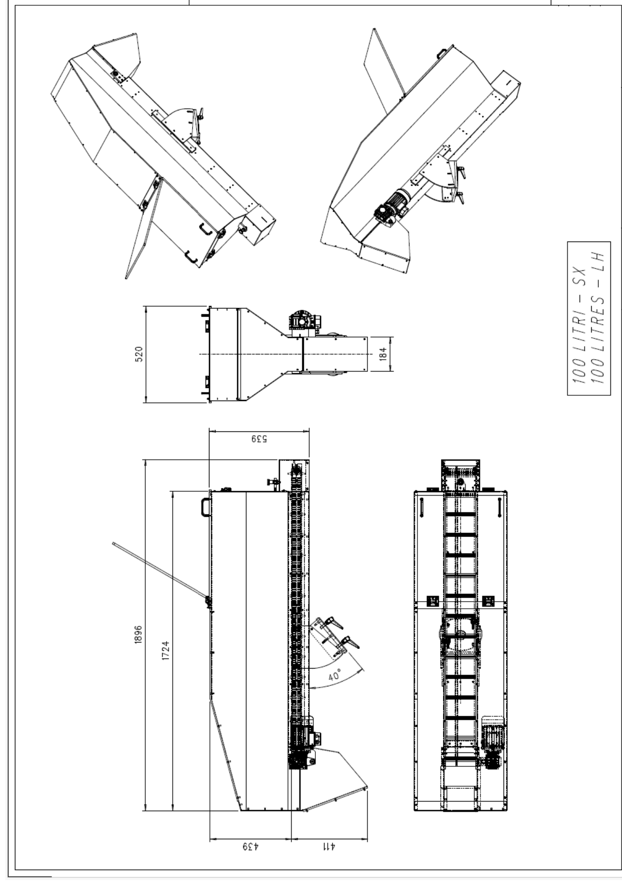
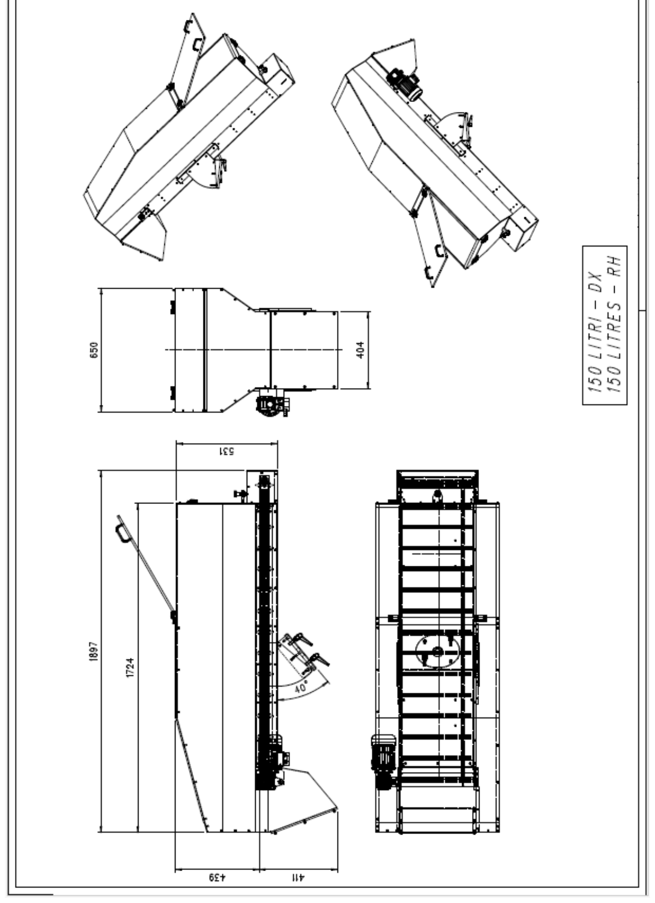
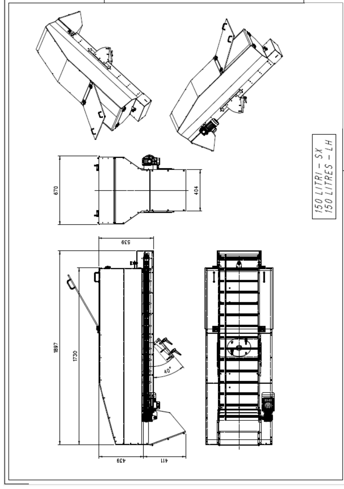
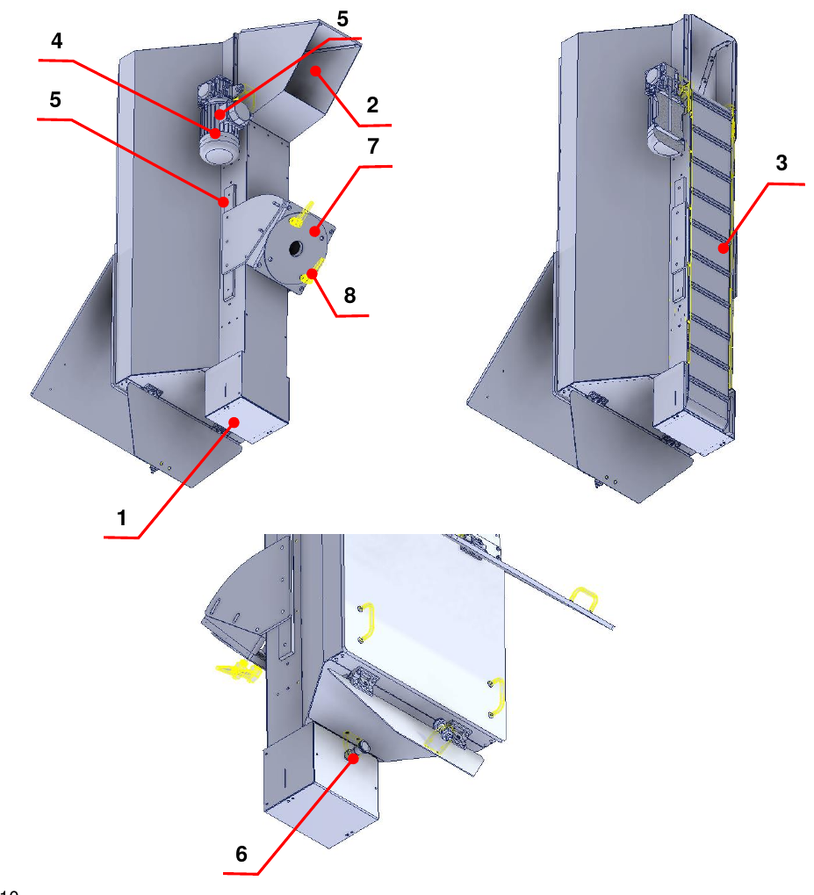

# **Maschinenbeschreibung**

Die unvollständige Maschine ist dafür ausgelegt und gebaut, **Material mittels eines Schaufelbandes von unten nach oben zu fördern**.

## Layout

| Pos. | Beschreibung | Pos. | Beschreibung |
|:--- |:--- |:--- |:--- |
| 1 | Elektromotor | 4 | Entleerungsklappe |
| 2 | Getriebe | 5 | Verstellbare Stütze |
| 3 | Befüllklappe | 6 | Schaufelband |

## Technische Daten

Die folgenden Tabellen enthalten die wichtigsten technischen Merkmale der unvollständigen Maschine.

| | **50 Liter** | **100 Liter** | **150 Liter** |
|:--- |:--- |:--- |:--- |
| **Schaufelmaterial** | PVC | PVC | PVC |
| **Maximale / minimale Neigung** | 50° / 34° | 50° / 34° | 50° / 34° |
| **Trichtergewicht** | 75 kg | 100 kg | 125 kg |
| **Durchmesser der Bandantriebsrolle** | 50 mm | 50 mm | 50 mm |
| **Bandantriebsmotor** | 0,18 kW, 4-polig, Flansch B14 – Strom 0,75 A bei Sternschaltung, 400 Vac | 0,18 kW, 4-polig, Flansch B14 – Strom 0,75 A bei Sternschaltung, 400 Vac | 0,18 kW, 4-polig, Flansch B14 – Strom 0,75 A bei Sternschaltung, 400 Vac |
| **Nennmoment** | 1,2 Nm | 1,2 Nm | 1,2 Nm |
| **Bandantriebsgetriebe** | Schneckengetriebe, Übersetzung 1:50 | Schneckengetriebe, Übersetzung 1:50 | Schneckengetriebe, Übersetzung 1:50 |
| **Maximal zulässige Last** | Volumen 50 Liter / Gewicht 30 kg | Volumen 100 Liter / Gewicht 30 kg | Volumen 150 Liter / Gewicht 30 kg |

:::{note}
Die angegebenen Merkmale können Änderungen unterliegen: Für größere Genauigkeit oder Überprüfungen die beigefügten Pläne heranziehen.
:::

## Abmessungen

Für jede Baugröße sind die Ausführung mit Antrieb rechts und die mit Antrieb links erhältlich.

### 50-Liter-Trichter

### 100-Liter-Trichter

### 150-Liter-Trichter

## Beschreibung der unvollständigen Maschine

Die unvollständige Maschine verfügt über eine Tragstruktur mit einer Befüllklappe (1), über die das Material eingebracht wird, und einer Entleerungsklappe (2) für den Materialaustritt.

Im Inneren des Trichters befindet sich ein Schaufelband (3), das von einem Elektromotor (4) und einem Getriebe (5) angetrieben wird und das Material innerhalb der unvollständigen Maschine bewegt.

Im unteren Bereich befindet sich die Befüllklappe, deren Schließen und Öffnen über einen eigenen Rastbolzen (6) geregelt wird. Um die unvollständige Maschine in Position zu halten, ist eine verstellbare Stütze (7) vorgesehen, die über dafür vorgesehene Griffe (8) betätigt wird.

