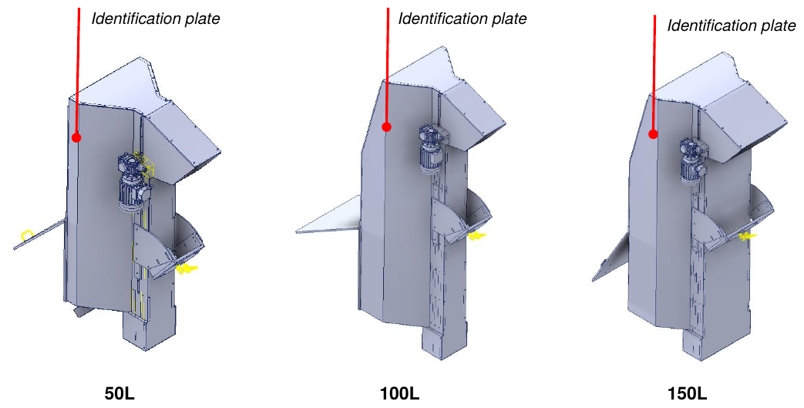
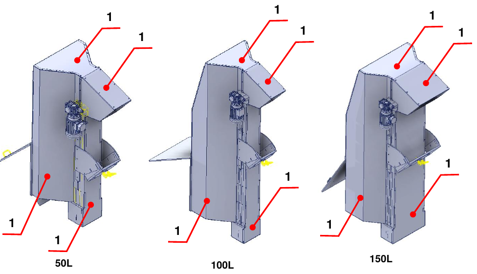
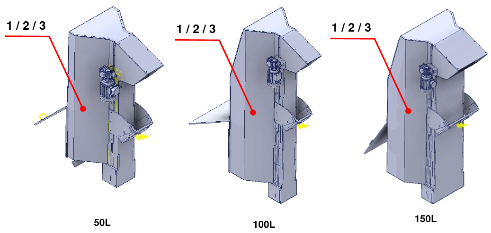

# **Vorabinformationen und Sicherheit**

:::{important}
Lesen Sie vor Installation, Verwendung oder Wartung der Maschine das gesamte Handbuch und die gesamte beigefügte Dokumentation sorgfältig durch.

Die Nichtbeachtung der angegebenen Anweisungen kann Folgendes verursachen:
- Schäden an der Maschine;
- Verlust der Sicherheitsbedingungen;
- Gefahren für Bediener und Wartungspersonal;
- Erlöschen der Garantie.
:::

## Einführung

Das Handbuch enthält alle Informationen, die für die korrekte Installation, Verwendung und Wartung der unvollständigen Maschine erforderlich sind. Der Hersteller schreibt vor, dass das Dokument von dem mit Bedienung und Wartung betrauten Personal sowie von dem für Transport und Montage zuständigen Personal gelesen wird.

Dieses Dokument ist die Montageanleitung für die **Motorized Hopper 50 L / 100 L / 150 L** (Modelle TRM/MOT 50/100/150 D/S) und wurde in Übereinstimmung mit der Maschinenrichtlinie 2006/42/EG erstellt. Es ist fester Bestandteil der unvollständigen Maschine und muss bis zur endgültigen Demontage aufbewahrt werden, und zwar vom Verantwortlichen für die unvollständige Maschine nach der endgültigen Installation.

:::{note}
ARS S.r.l., die Herstellerin der unvollständigen Maschine, wird im Handbuch als **Hersteller** bezeichnet. Das Unternehmen, das die unvollständige Maschine erwirbt, wird als **Kunde** bezeichnet.
:::

## Service und Kontakt

Das Technische Büro des Herstellers steht jederzeit für Auskünfte oder Klärungen zu Verwendung, Wartung, Installation usw. zur Verfügung. Fragen klar formulieren, sich dabei auf das Handbuch beziehen und stets die auf dem Typenschild der unvollständigen Maschine angegebenen Daten nennen.

| | |
|:--- |:--- |
| **Hersteller** | ARS S.r.l. |
| **Adresse** | Via Aretina Nord, 157 – 52041 Pieve al Toppo (AR), Italien |
| **Kontakt** | Tel. +39 0575 398611 · Fax +39 0575 398620 |
| **E-Mail / Web** | info@arsautomation.com · www.arsautomation.com |

## Identifikation

Die Position des Typenschilds mit den wichtigsten Daten der unvollständigen Maschine ist in der Abbildung für die drei Baugrößen dargestellt.

## Glossar

| Begriff | Definition |
|:--- |:--- |
| **Not-Halt** | Funktion, die dazu bestimmt ist, das Entstehen von Gefahren für Personen, Schäden an der Maschine oder am laufenden Arbeitsprozess zu verhindern oder bestehende Gefahren zu verringern, und die durch eine einzelne menschliche Handlung ausgelöst wird. |
| **Sicherheitsbauteil** | Bauteil, das eine Sicherheitsfunktion erfüllen soll, getrennt in Verkehr gebracht wird, dessen Ausfall und/oder Fehlfunktion die Sicherheit von Personen gefährdet und das für den Betrieb der unvollständigen Maschine nicht unerlässlich ist. |
| **Maschinenrichtlinie** | Richtlinie 2006/42/EG des Europäischen Parlaments und des Rates über Maschinen. |
| **Schutzeinrichtung (nicht trennend)** | Schutzmittel, das keine trennende Schutzeinrichtung ist. |
| **Lieferant** | Beteiligter (Hersteller, Installateur, Systemintegrator), der Geräte oder Dienstleistungen im Zusammenhang mit der unvollständigen Maschine liefert. |
| **Sicherheitsfunktion** | Funktion der unvollständigen Maschine, deren Ausfall zu einer unmittelbaren Erhöhung der Risiken führen kann. |
| **Ausfall** | Beendigung der Fähigkeit einer Einheit, die geforderte Funktion zu erfüllen. |
| **Benutzerinformation** | Schutzmaßnahme, bestehend aus Kommunikationsmitteln (Texte, Wörter, Signale, Symbole, Diagramme), die einzeln oder in Kombination verwendet werden, um dem Anwender Informationen zu vermitteln. |
| **Fehlfunktion** | Unfähigkeit einer unvollständigen Maschine, ihre vorgesehene Funktion zu erfüllen. |
| **Kennzeichnung** | Symbol und Aufschrift zur Identifikation der unvollständigen Maschine, vom Hersteller angebracht. |
| **Material** | Zu handhabendes Produkt. |
| **Sicherheitsmaßnahme** | Mittel, das eine Gefährdung beseitigt oder verringert. |
| **Bediener** | Person, die mit der Bedienung der unvollständigen Maschine beauftragt ist. |
| **Gefährdung** | Potenzielle Schadensquelle. |
| **Qualifizierter Techniker / spezialisierter Wartungstechniker** | Person, die Fachkurse, Berufsausbildungen usw. absolviert hat und Expertin bzw. Experte für Installation, Inbetriebnahme, Wartung, Reparaturen, Transport und Handhabung der unvollständigen Maschine ist. |
| **Unvollständige Maschine** | Gesamtheit, die fast eine Maschine ist, für sich allein aber keine bestimmte Anwendung erfüllen kann. Sie ist ausschließlich dazu bestimmt, in andere Maschinen, unvollständige Maschinen oder Ausrüstungen eingebaut oder mit ihnen zusammengefügt zu werden, um eine unter die Richtlinie fallende Maschine zu bilden. |
| **Schutzeinrichtung** | Physische Barriere, die als Teil der unvollständigen Maschine konstruiert ist und Schutz bietet. |
| **Risiko** | Kombination aus der Wahrscheinlichkeit eines Schadens und dessen Schwere. |
| **Restrisiko** | Risiko, das nach der Anwendung von Schutzmaßnahmen verbleibt. |
| **Notfallsituation** | Gefährliche Situation, die dringend beendet oder vermieden werden muss. |
| **Transport** | Gesamtheit der Tätigkeiten, um die unvollständige Maschine vom Montageort des Herstellers an den endgültigen Standort beim Kunden zu bringen. |
| **Bestimmungsgemäße Verwendung** | Verwendung der unvollständigen Maschine in Übereinstimmung mit der in der Anleitung gegebenen Benutzerinformation. |
| **Vernünftigerweise vorhersehbare Fehlanwendung** | Verwendung der unvollständigen Maschine in einer vom Konstrukteur nicht vorgesehenen Weise, die sich aus leicht vorhersehbarem menschlichem Verhalten ergeben kann. |
| **Anwender** | Beteiligter, der die unvollständige Maschine und die zugehörigen elektrischen Betriebsmittel verwendet. |
| **Arbeitsbereich** | Von den Schutzeinrichtungen begrenztes Volumen, das für den Betrieb der unvollständigen Maschine vorgesehen ist. |
| **Gefahrbereich** | Jeder Bereich innerhalb und/oder um die Maschine, in dem eine Person einer Gefährdung ausgesetzt sein kann. |

## Im Handbuch verwendete Symbole

| Symbol | Bedeutung |
|:--- |:--- |
| **GEFAHR** | Situation unmittelbarer Gefahr, die, wenn sie nicht vermieden wird, zu schweren Verletzungen oder zum Tod des Bedieners führen kann. Kennzeichnet streng verbotene Tätigkeiten und zwingend anzuwendende Verfahren, um sie zu vermeiden. |
| **WARNUNG** | Potenziell gefährliche Situation, die, wenn sie nicht vermieden wird, zu schweren Verletzungen oder zum Tod des Bedieners führen kann. Beschreibt Tätigkeiten, die besondere Aufmerksamkeit erfordern. |
| **VORSICHT** | Situation nicht unmittelbarer oder potenzieller Gefahr, die, wenn sie nicht vermieden wird, zu auch leichten Verletzungen oder Gesundheitsschäden des Bedieners führen kann. |
| **HINWEIS** | Wichtige Informationen und/oder Verfahren, die bei Missachtung oder nur teilweiser Befolgung die unvollständige Maschine oder die angeschlossenen Einrichtungen beschädigen können. |
| **ZUSATZINFORMATIONEN** | Nützliche Informationen und/oder Verweise auf weitere Dokumentation (beigefügte Betriebsanleitungen, technische Dokumente oder andere Abschnitte des Handbuchs). |

## Sicherheitsvorschriften

Die im Handbuch beschriebenen Vorgaben, Anweisungen, Vorschriften und zugehörigen Sicherheitshinweise legen die Verhaltensweisen und Regeln fest, die bei den Tätigkeiten der bestimmungsgemäßen Verwendung der unvollständigen Maschine zu befolgen sind, um für Personal, Ausrüstung und Umgebung sicher zu arbeiten. Die Sicherheitsanweisungen richten sich an das gesamte autorisierte, geschulte und beauftragte Personal für folgende Tätigkeiten:
- Transport;
- Installation;
- Verwendung;
- Betriebsführung;
- Wartung;
- Reinigung;
- Außerbetriebnahme und Demontage.

## Haftung des Herstellers

Der Hersteller lehnt jede Haftung ab, die sich aus fehlerhafter oder unsachgemäßer Verwendung der unvollständigen Maschine ergibt, sowie für Schäden durch die Verwendung nicht vorgeschriebener Ersatzteile, nicht korrekt ausgeführte Wartung und Manipulationen an Stromkreisen und Komponenten.

Die Verantwortung für die Anwendung der Sicherheitsanforderungen liegt beim technischen Personal, das für die an der unvollständigen Maschine vorgesehenen Tätigkeiten zuständig ist; dieses muss sicherstellen, dass die autorisierten Bediener qualifiziert sind und die Vorgaben des Handbuchs sowie die allgemeinen Sicherheitsvorschriften beachten und kennen. Die Nichtbeachtung der Sicherheitsanweisungen kann zu Verletzungen von Personen und Schäden an Einrichtungen führen.

## Betrieb der unvollständigen Maschine

Der Betrieb ist nur autorisierten und angemessen geschulten Personen oder jedenfalls Personen mit ausreichender technischer Kompetenz gestattet. Wer die unvollständige Maschine verwendet und wartet, muss wissen, dass Kenntnis und Anwendung der Sicherheitsvorschriften fester Bestandteil der eigenen Arbeit sind.

Vor dem Start der unvollständigen Maschine:
- das Handbuch sorgfältig lesen;
- wissen, welche Schutzeinrichtungen und Not-Halt-Einrichtungen vorhanden sind, wo sie sich befinden und wie sie funktionieren.

Das – auch teilweise – Entfernen von Schutzeinrichtungen, Sicherheitseinrichtungen und Warnschildern an der unvollständigen Maschine ist streng verboten. Bei Fehlfunktion oder Ausfall dieser Einrichtungen sind sie unverzüglich zu reparieren oder zu ersetzen.

## Gewährleistung

Der Hersteller gewährleistet, dass seine Maschinen frei von Material- und/oder Herstellungsfehlern sind. Für Klärungen sind die Vertragsbedingungen maßgeblich.

- Der Käufer hat nur Anspruch auf den Austausch der als mangelhaft anerkannten Teile; die Kosten für Verpackung, Transport und eventuelle Installation gehen zu seinen Lasten. In diesem Fall sind anzugeben: Datum und Nummer des Kaufbelegs, Modell der unvollständigen Maschine, Seriennummer.
- Für Produktionsausfälle, die durch etwaige Stillstandszeiten der unvollständigen Maschine entstehen, wird keine Entschädigung geleistet.
- Von der Gewährleistung ausgeschlossen sind Schäden, die durch eine andere als die im Handbuch angegebene Verwendung entstehen, einschließlich nicht anleitungsgemäßer Wartung.
- Die Gewährleistung wird nicht anerkannt für unvollständige Maschinen, an denen nicht autorisierte Änderungen vorgenommen wurden. Änderungen oder Manipulationen an den Sicherheitseinrichtungen sind streng verboten.
- Bei Schäden während der Gewährleistungsfrist gilt die Gewährleistung nur bei Verwendung von Originalersatzteilen.
- Reparaturen dürfen nur von qualifizierten Bedienern durchgeführt werden, die die unvollständige Maschine kennen.

## Sicherheit

### Allgemeine Informationen

Der Kunde muss die Bediener über die Unfallgefahren, die an der unvollständigen Maschine installierten Sicherheitseinrichtungen und die allgemeinen Unfallverhütungsvorschriften der Gemeinschaftsrichtlinien und der Gesetzgebung des Installationslandes unterweisen. Die Bediener müssen die Position und Funktion aller Bedienelemente sowie die Merkmale der unvollständigen Maschine kennen.

Manipulationen oder nicht autorisierter Austausch einzelner oder mehrerer Komponenten, die Verwendung von Zubehör und der Einsatz anderer als der empfohlenen Teile können Verletzungsrisiken zur Folge haben.

:::{warning}
Es ist strengstens verboten, die Sicherheitseinrichtungen der unvollständigen Maschine zu überbrücken oder zu manipulieren. Der Hersteller lehnt jede Haftung für die Sicherheit der unvollständigen Maschine ab, wenn dieses Verbot nicht beachtet wird.
:::

:::{warning}
Es obliegt dem Bediener, der die unvollständige Maschine verwendet, sicherzustellen, dass der Bereich sicher und frei von Personen und/oder Gegenständen ist.
:::

### Zertifizierung

Die unvollständige Maschine wird mit der Einbauerklärung geliefert, in Übereinstimmung mit den grundlegenden Sicherheitsanforderungen der Maschinenrichtlinie 2006/42/EG (Anhang II B) und der EMV-Richtlinie 2014/30/EU.

:::{note}
Jede an der unvollständigen Maschine vorgenommene Änderung hebt die vom Hersteller ausgestellte Einbaubescheinigung unverzüglich auf.
:::

### Bestimmungsgemäße und nicht bestimmungsgemäße Verwendung

Die unvollständige Maschine ist dafür ausgelegt und gebaut, **Material mittels eines Schaufelbandes von unten nach oben zu fördern**. Sie darf weder für andere als die vorgesehenen Zwecke noch für die Verarbeitung von Teilen jenseits der vereinbarten Grenzen verwendet werden.

:::{danger}
Die Verwendung der unvollständigen Maschine für im Handbuch nicht beschriebene Bearbeitungszwecke ist **UNSACHGEMÄSSE VERWENDUNG**. Der Hersteller lehnt jede Haftung für Sach- und/oder Personenschäden ab und betrachtet jede Art von Gewährleistung als erloschen. Der Hersteller lehnt jede Haftung bei Manipulationen, nicht autorisierten Änderungen oder Wartungsarbeiten durch nicht geschultes Personal ab.
:::

:::{warning}
Die unvollständige Maschine darf nur von erfahrenen und qualifizierten Bedienern verwendet werden, die den Inhalt des Handbuchs gelesen und verstanden haben.
:::

:::{note}
Es ist verboten, bei abnormalem Verhalten der unvollständigen Maschine oder bei Spannungsausfall irgendwelche Bewegungen auszuführen, da dies in die spezifische Zuständigkeit des Wartungspersonals fällt.
:::

### Umgebungsbedingungen im Betrieb

Die unvollständige Maschine muss in einer überdachten Umgebung installiert werden, die mit allen nach den im Land des Anwenders geltenden Gesetzen vorgeschriebenen Sicherheitsmaßnahmen ausgestattet ist.

| Aspekt | Angabe |
|:--- |:--- |
| **Brandschutz** | Die unvollständige Maschine verfügt über kein eigenes Brandbekämpfungssystem. |
| **Explosionsfähige Atmosphäre** | Sie ist weder dafür ausgelegt noch dafür gebaut, in explosionsfähigen oder teilweise explosionsfähigen Atmosphären zu arbeiten. |
| **Beleuchtung** | Sie verfügt über kein eigenes Beleuchtungssystem: Es ist Pflicht und Verantwortung des Kunden, sie in einem ausreichend beleuchteten Bereich aufzustellen. |
| **Lärm** | Gemessen gemäß den akustischen Normen. Ohne Last liegt der insgesamt erzeugte Lärm unter **75 dB(A)**, gemessen am Arbeitsplatz des Bedieners. Der tatsächliche Pegel hängt von der Art der Bearbeitung ab; die Messung der Lärmbelastung der Beschäftigten obliegt dem Anwender gemäß der in seinem Land geltenden Gesetzgebung. |
| **Elektromagnetische Emissionen** | Die Emissionswerte entsprechen den Normen durch den Einsatz EMV-gerechter Komponenten, geeignete Anschlüsse und, wo erforderlich, Filter. Eine nicht normgerechte Wartung der elektrischen Anlage oder ein fehlerhafter Austausch von Komponenten kann deren Wirksamkeit beeinträchtigen. |
| **Vibrationen** | Die unvollständige Maschine erzeugt keine für die Gesundheit des Personals gefährlichen Vibrationen. Übermäßige Vibrationen können nur durch einen mechanischen Defekt verursacht werden, der umgehend gemeldet und beseitigt werden muss. |

### Sicherheitsfunktionen

| Art der Einrichtung | Funktion |
|:--- |:--- |
| **Feststehende Schutzeinrichtungen** | Abtrennung der Gefahrbereiche der unvollständigen Maschine. |

**Feststehende Schutzeinrichtungen:** verhindern den Zugang zu beweglichen Teilen während des Betriebs. Sie werden nicht überwacht und dürfen nur für Wartungsarbeiten entfernt werden, wenn die Energiequellen der unvollständigen Maschine getrennt sind.

:::{warning}
Der Hersteller haftet in keiner Weise, wenn die unvollständige Maschine mit unvollständigen, geöffneten und/oder nicht installierten Schutzeinrichtungen betrieben wird.
:::

### Persönliche Schutzausrüstung (PSA)

Der Bediener muss persönliche Schutzausrüstung verwenden, um die Möglichkeit von Gefährdungen auf ein Minimum zu reduzieren.

:::{warning}
Das Personal muss zur Unfallverhütung geeignete Arbeitskleidung tragen. Um mechanische Gefährdungen (Einzug, Einklemmen usw.) zu vermeiden, Haare zusammenbinden und keine Armbänder, Uhren, Ringe oder Halsketten tragen.
:::

:::{note}
Die Kleidung von Personen, die an der unvollständigen Maschine arbeiten oder Wartungsarbeiten durchführen, muss den grundlegenden Sicherheitsanforderungen der EU-Richtlinien und der Gesetze des Installationslandes entsprechen.
:::

### Restrisiken

In der Konstruktionsphase wurden alle Bereiche oder Teile mit hohem Risiko bewertet und die erforderlichen Vorkehrungen getroffen, um Gefährdungen für Personen und Schäden an den Komponenten der unvollständigen Maschine zu vermeiden. Aus der durchgeführten Risikoanalyse, die in den technischen Unterlagen des Herstellers aufbewahrt wird, ergeben sich keine Restrisiken.

:::{warning}
Die Funktion aller Sicherheitseinrichtungen regelmäßig prüfen. Die installierten Schutzeinrichtungen nicht entfernen.
:::

### An der unvollständigen Maschine angebrachte Schilder

Der Hersteller hat an der unvollständigen Maschine eine Reihe von Warnschildern angebracht, die gemäß den europäischen Normen zu den zu verwendenden grafischen Symbolen gestaltet und gut sichtbar angeordnet sind. Der Wartungsdienst muss alle Schilder, die durch Abnutzung unleserlich werden, sofort ersetzen.

:::{warning}
Es ist strengstens verboten, die an der unvollständigen Maschine angebrachten Warnschilder zu entfernen. Der Hersteller lehnt jede Haftung für die Sicherheit der unvollständigen Maschine ab, wenn dieses Verbot nicht beachtet wird.
:::

:::{note}
Informationen zu den Warnschildern an den eingebauten Teilen der unvollständigen Maschine finden Sie in den jeweiligen Handbüchern.
:::

| Schild | Beschreibung |
|:--- |:--- |
| 1 | Eingriff in bewegliche Teile verboten. |
| 2 | Sicherheitseinrichtungen dürfen nicht entfernt werden. |
| 3 | Gebot: Betriebs- und Wartungsanleitung lesen. |
