# **Wartung**

## Allgemeine Sicherheitsvorkehrungen

Wartung, Fehlersuche und Reparaturen sind ausschließlich autorisiertem Personal vorbehalten. Das mit Bedienung und Wartung betraute Personal muss gut geschult sein und die Unfallverhütungsvorschriften genau kennen; nicht autorisierte Personen müssen sich während der Arbeiten außerhalb des Arbeitsbereichs aufhalten. Die Sicherheitsvorkehrungen in diesem Abschnitt sind stets einzuhalten. Nach jedem Eingriff müssen die Schutzeinrichtungen wieder angebracht und auf korrekte Funktion geprüft werden.

### Allgemeine Gefahrenhinweise

- Hochspannung kann bei Berührung zum Tod führen. Stets mit größter Vorsicht und gemäß den im Land geltenden Sicherheitsvorschriften arbeiten.
- An der laufenden unvollständigen Maschine befinden sich bewegliche Teile, die Personen schwer verletzen können. Spezielle Reinigungs- und Wartungsarbeiten, die den Ausbau oder Austausch von Komponenten oder Steuereinheiten betreffen, müssen bei abgeschalteter Versorgung und drucklosen Anlagen durchgeführt werden.
- Die Hauptschalter müssen in Stellung OFF stehen und mit einem Sicherheitsschloss gesichert sein.
- Geeignete Warnschilder („UNVOLLSTÄNDIGE MASCHINE IN WARTUNG – NICHT EINSCHALTEN“) am Schaltschrank und an der Wartungseinheit der Druckluft anbringen.
- Bei der Druckentlastung der Anlage Abstand zu Entlüftungsöffnungen und Hähnen halten.
- Bei Arbeiten an den Einrichtungen stets Schutzbrille und Schutzhandschuhe tragen.
- Sicherstellen, dass die verwendeten Werkzeuge in einwandfreiem Zustand sind und, wo erforderlich, isolierte Griffe haben.
- Prüfen, dass die Isolierung von Kabeln und Leitern der Prüfgeräte keinerlei Bruch oder Beschädigung aufweist.
- Nicht geerdete Einrichtungen können schwere Personenschäden verursachen. Stets sicherstellen, dass die Erdungsverbindungen vorhanden sind und den Normen entsprechen.
- Bei einem Brand niemals Wasserstrahlen auf die Einrichtungen richten: jede Spannungsversorgung trennen und CO2-Feuerlöscher verwenden.
- Vor dem Herstellen der Anschlüsse diese sorgfältig prüfen und sicherstellen, dass die Gewinde weder Defekte noch Verschmutzungen aufweisen.
- Vor dem Druckbeaufschlagen der Anlage nach einer Reparatur die Dichtheit von Verschraubungen und Verbindungen prüfen.
- Vor dem Start der Einrichtung stets sicherstellen, dass sich das Wartungspersonal außerhalb des geschützten Bereichs befindet und keine Werkzeuge oder Materialien in der Nähe zurückgelassen wurden.
- Die Fehlersuche ist soweit möglich außerhalb des geschützten Bereichs durchzuführen; wenn bei eingeschalteter Steuereinheit und Anlage gearbeitet werden muss, sind alle von den Sicherheitsnormen vorgesehenen Vorkehrungen für Arbeiten bei gefährlichen Spannungen und unter Spannung bewegten Baugruppen zu treffen.
- Nichts tragen, was sich in den Einrichtungen verfangen oder als Leiter wirken könnte (Halsketten, Armbänder usw.).
- Wartung, Reparatur und Fehlersuche müssen mit der Prüfung der korrekten Funktion der unvollständigen Maschine und der Wiederherstellung aller Sicherheitseinrichtungen abgeschlossen werden.

### Allgemeine Hinweise

- Höchste Zuverlässigkeit und niedrigste Wartungskosten sind das Ergebnis eines Wartungs- und Inspektionsprogramms, das während der gesamten Lebensdauer der unvollständigen Maschine geplant und gewissenhaft befolgt wird. Die angegebenen Wartungsintervalle einhalten und die Eingriffe nach den spezifischen Anforderungen des Produktionszyklus planen.
- Sind Eingriffe von gewissem Umfang erforderlich, den Hersteller bei Fragen oder für technische Unterstützung kontaktieren.
- Vor Beginn jeder Kontroll- und Wartungsarbeit die unvollständige Maschine von Schmutz befreien.
- Für die Reinigung stets vollkommen trockene Luft mit einem Druck von höchstens 0,2 MPa verwenden.
- Stets Werkzeuge in einwandfreiem Erhaltungszustand verwenden, die eigens für die auszuführende Arbeit hergestellt wurden: ungeeignete oder unzureichende Werkzeuge können schwere Schäden verursachen.
- Beim Zerlegen die einzelnen Teile mit einem Schildchen kennzeichnen, damit sie wieder korrekt eingebaut werden.
- Nach jeder Wartung, bei der Verkabelungen und/oder feste und bewegliche Teile getrennt werden, die Übereinstimmung der Nummerierung der festen und beweglichen Teile prüfen.
- Vor der Wiederinbetriebnahme der Einrichtung nach einem Ausfall diese sorgfältig inspizieren und prüfen, um etwaige Schäden festzustellen.
- Zusätzlich zu den herkömmlichen Wartungstätigkeiten muss der Wartungstechniker, wenn vorgesehen, auch vorausschauende Wartungsarbeiten durchführen, bestehend aus instrumentellen Analysen und Spezialkontrollen, um das Auftreten von Ausfällen bestimmter Komponenten rechtzeitig vorherzusagen.

## Qualifikation des Wartungspersonals

:::{warning}
Der Sicherheitsverantwortliche muss sicherstellen, dass alle an der unvollständigen Maschine tätigen Personen alle im Handbuch enthaltenen Anweisungen erhalten haben, einschließlich der anfänglichen Installations- und Inbetriebnahmearbeiten.
:::

Das Wartungspersonal muss:
- die geltenden Richtlinien zur Unfallverhütung bei Arbeiten an Maschinen kennen und anwenden können;
- das Kapitel zur Sicherheit gelesen und verstanden haben;
- den grundlegenden Aufbau und die Funktionen der Fördersysteme kennen;
- die Konstruktionsunterlagen und die Dokumentation der unvollständigen Maschine verwenden und einsehen können;
- die Verantwortung für die eigenen Entscheidungen über Eingriffe an der unvollständigen Maschine übernehmen;
- bereit sein, sich an technologische Änderungen an der unvollständigen Maschine anzupassen;
- Unregelmäßigkeiten im Produktionsprozess beobachten und bei Bedarf geeignete Maßnahmen ergreifen.

## Plan der Sicherheitskontrollen

:::{warning}
Die Wirksamkeit der Sicherheitssysteme der unvollständigen Maschine regelmäßig prüfen. Dieses Verfahren ist als normale Wartungspraxis zu wiederholen.
:::

Das Wartungspersonal ist verpflichtet, die Funktion der Sicherheitseinrichtungen regelmäßig zu prüfen. Die Prüfung muss von kompetentem Personal mit spezifischen Kenntnissen im Umgang mit Sicherheitseinrichtungen durchgeführt werden.

:::{warning}
Die Funktions-, Anzugs- und Positionskontrollen der im Abschnitt *Sicherheitsfunktionen* genannten Sicherheitssysteme durchführen.
:::

## Verfahren zum Stillsetzen der unvollständigen Maschine

Vor Durchführung der nachfolgend beschriebenen Wartungsverfahren muss der Bediener die unvollständige Maschine stillsetzen und nach folgendem Verfahren in den Wartungszustand versetzen:
- auf eventuelle Restenergie prüfen und diese bei Bedarf abbauen, bevor an den Einrichtungen gearbeitet wird;
- das Schild „KEINE BEWEGUNGEN AUSFÜHREN – MASCHINE IN WARTUNG“ in der Nähe des Hauptschalters anbringen;
- nach den Wartungsarbeiten die zuvor abgeschalteten Energiequellen wiederherstellen;
- vor der Wiederaufnahme des Normalbetriebs das gesamte System erneut prüfen, wie im Handbuch beschrieben.

## Sicherheitsvorschriften für die Wartung

Die wichtigsten bei Wartungsarbeiten zu treffenden Vorkehrungen:
- komplexe Arbeiten an der unvollständigen Maschine sind nur spezialisierten Bedienern gestattet;
- niemals blanke Klemmen oder elektrische Einrichtungen berühren, bevor die Spannungsversorgung getrennt wurde (Hauptschalter in Stellung OFF);
- vor dem Entfernen einer feststehenden Schutzeinrichtung oder dem Austausch einer elektrischen Komponente die Spannungsversorgung trennen;
- bei der Wartung keine Ringe, Uhren, Halsketten oder Armbänder tragen;
- bei den Arbeiten eine hochohmige Gummimatte unter die Füße legen; nicht auf nassen Böden oder in sehr feuchten Umgebungen arbeiten; die Ansammlung statischer Elektrizität vermeiden, die elektrische Komponenten beschädigen könnte;
- stets Handschuhe und Schutzkleidung tragen, die möglichst viele Körperteile bedeckt;
- für die Reinigung keine offenen Flammen, spitzen Werkzeuge oder Nadeln verwenden;
- nicht rauchen.

## Wartungstabelle

Um die Zuverlässigkeit der unvollständigen Maschine zu gewährleisten, sind eine regelmäßige und wirksame Wartung sowie die ständige Überwachung der Parameter der Anzeigeinstrumente sicherzustellen. Wartung, Fehlersuche und Reparaturen sind nur autorisiertem Personal gestattet.

| Häufigkeit | Beschreibung | Mittel |
|:--- |:--- |:--- |
| Täglich | Die unvollständige Maschine gründlich reinigen. | Tuch + Alkohol |
| Monatlich | Die korrekte Spannung des Schaufelbandes prüfen. | Manuell |
| Monatlich | Den Anzug von Schrauben und Muttern an den beweglichen Teilen prüfen. | Drehmomentschlüssel |
| Monatlich | Den Verschleiß der beweglichen Teile prüfen. | Sichtprüfung |

## Schmiertabelle

| Komponente | Empfohlener Schmierstoff |
|:--- |:--- |
| Drehscheiben | Getriebeöl, ISO VG 320 |
| Hydraulische Bremsen | Hydrauliköl, ISO VG 46 |
| Bewegliche Teile allgemein | Mehrzweckfett EP |

## Mechanische Einstellungen

### Spannen und Einstellen des Bandes

Die unvollständige Maschine umfasst ein Schaufelband, das die Teile aus der Beladewanne zur Austrittsrutsche fördert. Damit das Band korrekt läuft, muss es mithilfe der Schrauben gespannt und eingestellt werden.

Das **Spannen** dient dazu, jegliches Rutschen zwischen Band und Antriebsrolle zu verhindern, während die **Einstellung** sicherstellt, dass das Band während des Laufs in der richtigen Position bleibt und nicht nach links oder rechts wandert.

Spannen und Einstellen erfolgen durch Anziehen oder Lösen der M8-Schrauben **bei laufendem Band**; anschließend wird das Verhalten des Bandes auf beiden Seiten der Rolle kontrolliert. Die Einstellung muss gleichzeitig auf der linken und rechten Seite erfolgen, da das richtige Gleichgewicht zwischen den beiden Schrauben gefunden werden muss.

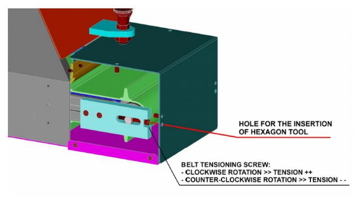

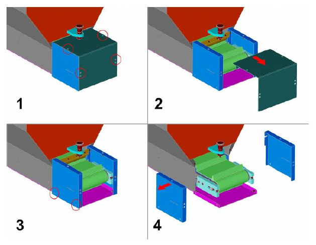

### Austausch des Schaufelbandes

:::{warning}
Dieser Vorgang darf nur von erfahrenen Technikern mit entsprechenden Kenntnissen und Werkzeugen durchgeführt werden. Im Zweifelsfall die ARS-Techniker kontaktieren.
:::

| Phase | Aktion |
|:--- |:--- |
| 1 | Den Trichter von den Energiequellen trennen, um unbeabsichtigte Bewegungen des Bandes zu vermeiden. |
| 2 | Den Trichter von der Tragstruktur (nicht im Lieferumfang enthalten) trennen: Es wird empfohlen, geeignete Hebemittel (z. B. Anschlagschlingen) zu verwenden, um ruckartige Bewegungen der Last bei der Handhabung zu vermeiden. Nach dem Trennen den Trichter auf einer ebenen Fläche auf einer Seite liegend und mit dem Motor nach unten abstellen. Um ihn in Position zu halten, einen Block zwischen Boden und Trichterseite einlegen. |
| 3 | Die Seitenplatte vom Trichterkörper trennen. |
| 4 | Die untere Abdeckung (bestehend aus 3 Teilen: Mittelteil + rechte Seite + linke Seite) vom Trichterkörper trennen. |
| 5 | Die Entleerungsklappe vom Trichterkörper trennen. |
| 6 | Die feststehende Schutzeinrichtung an der Oberseite des Trichters vom Hauptkörper trennen. |
| 7 | Die Austrittsrutsche vom Trichterkörper trennen. Zuerst die 4 hervorgehobenen Schrauben entfernen (zwei an der Oberseite + zwei an der Unterseite); anschließend die übrigen Schrauben entfernen, die die äußeren Blechteile verbinden. |
| 8 | Die transparente Schutzeinrichtung von der Oberseite des Trichterkörpers trennen. |
| 9 | Die Befüllklappe vom Trichterkörper trennen. |
| 10 | Das seitliche Blech vom Trichterkörper trennen. |
| 11 | Das Band vollständig lockern, wie unter *Spannen und Einstellen des Bandes* beschrieben. |
| 12 | Das Band nach oben herausziehen. Reicht das Lockern nicht aus, um die das Band führenden Seitenplatten zu passieren, müssen diese entfernt werden. |
| 13 | Das neue Band einsetzen, indem es von oben hineingleiten gelassen wird. |
| 14 | Das Band ein erstes Mal spannen, um eine gute Haftung zwischen Antriebsrolle und Band sicherzustellen. Die Feineinstellung der Spannung erfolgt später, wenn das Band laufen kann. |
| 15 | Das seitliche Blech wieder am Trichterkörper anbringen (siehe Schritt 10). |
| 16 | Die Befüllklappe wieder am Trichterkörper anbringen (siehe Schritt 9). |
| 17 | Die transparente Schutzeinrichtung wieder an der Oberseite des Trichters anbringen (siehe Schritt 8). |
| 18 | Die Austragsrutsche wieder am Trichterkörper anbringen (siehe Schritt 7). Zuerst die Schrauben zwischen den äußeren Blechteilen wieder einsetzen, dann die vier hervorgehobenen Schrauben (zwei von oben + zwei von unten). |
| 19 | Die obere feststehende Schutzeinrichtung wieder am Trichterkörper anbringen (siehe Schritt 6). |
| 20 | Die Entleerungsklappe wieder am Trichterkörper anbringen (siehe Schritt 5). |
| 21 | Die untere Abdeckung (3 Teile: Mittelteil + rechte Seite + linke Seite) wieder am Trichterkörper anbringen (siehe Schritt 4). |
| 22 | Die Seitenplatte wieder am Trichterkörper anbringen (siehe Schritt 3). |
| 23 | Den Trichter wieder auf der Tragstruktur montieren. Es wird empfohlen, geeignete Hebemittel (z. B. Anschlagschlingen) zu verwenden, um ruckartige Bewegungen der Last bei der Handhabung zu vermeiden. |
| 24 | Den Trichter wieder an die Energiequellen anschließen. |
| 25 | Den Trichter ohne Teile im Inneren starten und die Feineinstellung der Bandspannung vornehmen. |

**Referenzabbildungen (Schritte 2–12)**

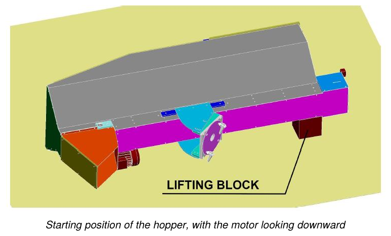

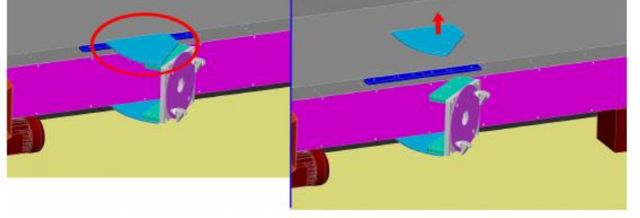

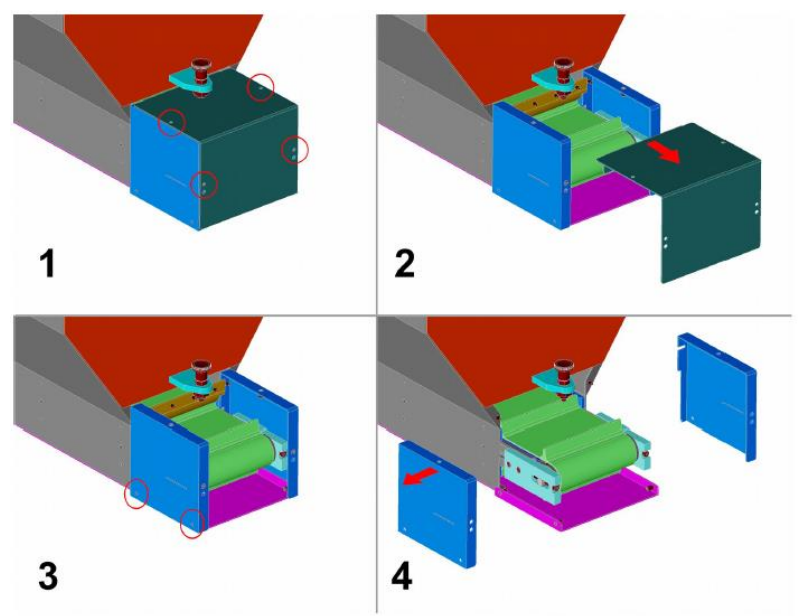

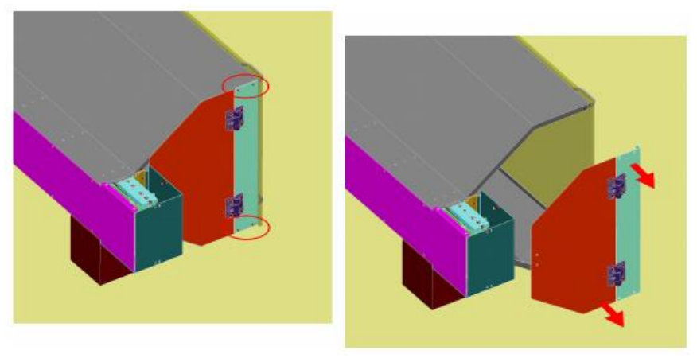

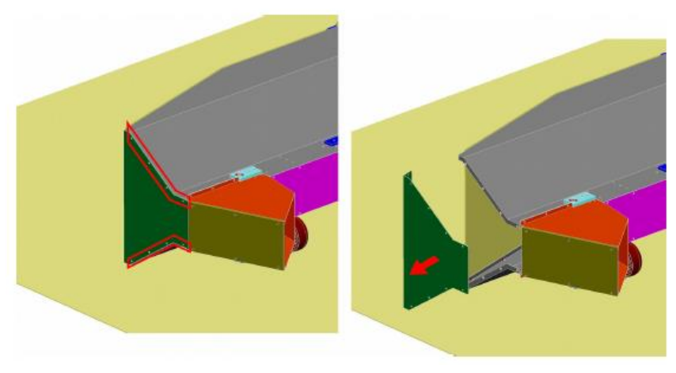

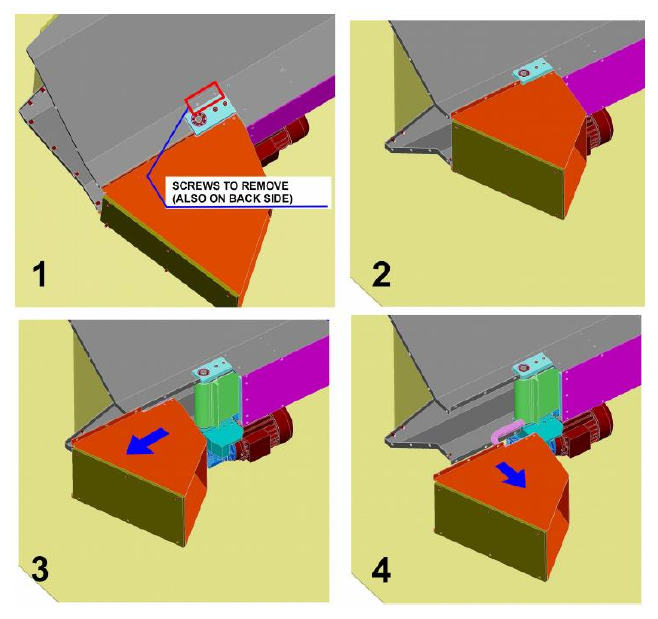

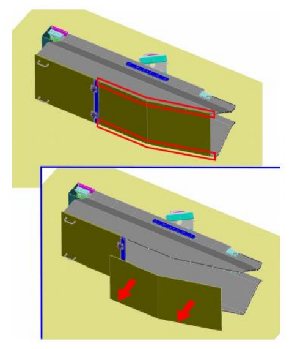

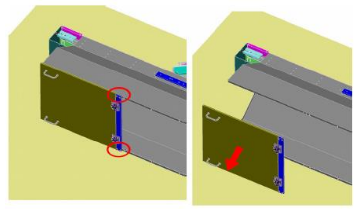

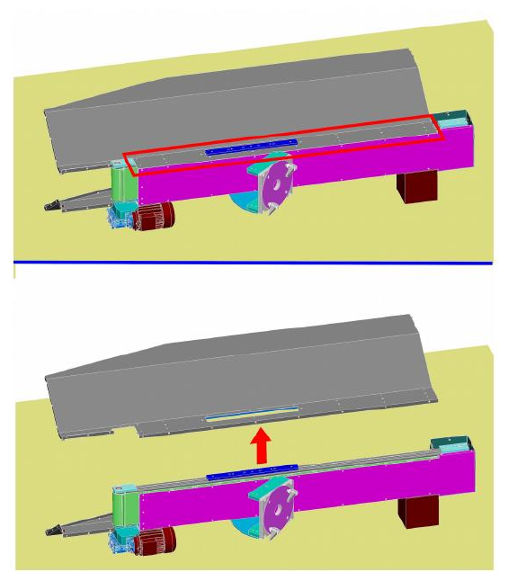

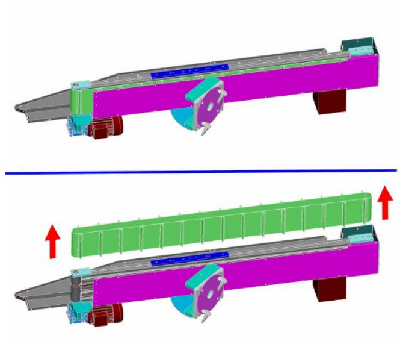

## Diagnose mechanischer Störungen

| Störung | Ursachen | Abhilfen |
|:--- |:--- |:--- |
| **Schmierölaustritt** | 1. Verschlissene Dichtung. 2. Zu große Schmierölmenge. | 1. Das verschlissene Bauteil ersetzen. 2. Die Schmierölmenge verringern. |
| **Kratzer oder Spiel in den Führungssystemen (Stangen, Buchsen, Führungen)** | 1. Verschleiß der Bauteile. 2. Einstellung erforderlich. 3. Unzureichende Schmierung. | 1. Das verschlissene Bauteil ersetzen. 2. Das Bauteil einstellen. 3. Den korrekten Schmierstoffstand wiederherstellen. |

## Außerplanmäßige Wartung

Außerplanmäßige Wartungsarbeiten sind nicht routinemäßige Arbeiten, die den Austausch verschleiß- bzw. bruchanfälliger Komponenten und die Demontage von Teilen der unvollständigen Maschine betreffen. Darüber hinaus:
- können die Nutzungsdauer verlängern und/oder nachrangig Effizienz, Zuverlässigkeit, Produktivität, Wartbarkeit und Inspektionsverfahren verbessern;
- ändern weder die ursprünglichen Eigenschaften (Typenschilddaten, Dimensionierung, Konstruktionswerte usw.) noch die wesentliche Struktur;
- führen zu keiner Änderung der Zweckbestimmung.

:::{warning}
Außerplanmäßige Wartungsarbeiten dürfen nur von qualifizierten Technikern durchgeführt werden, die in den jeweiligen Bereichen (Elektrik oder Mechanik) Experten sind.
:::

:::{note}
Für außerplanmäßige Wartungsarbeiten den Hersteller kontaktieren, wie im Abschnitt *Service und Kontakt* angegeben.
:::

## Protokollblatt der Wartungsarbeiten

| Datum | Bediener | Beschreibung des Eingriffs |
|:--- |:--- |:--- |
| | | |
| | | |
| | | |
