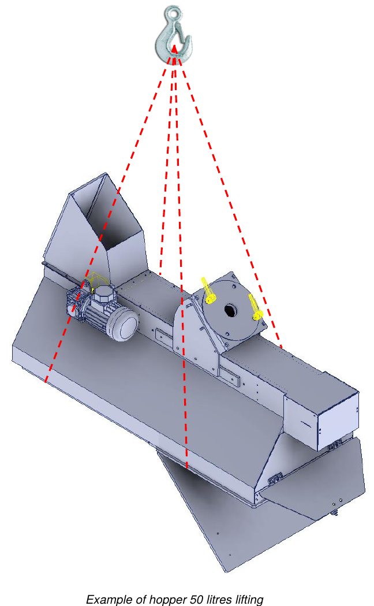

# **Verpackung, Transport und Installation**

## Verpackung

Die unvollständige Maschine wird vom Hersteller vom Produktionswerk an den Standort des Kunden in **Cellophanfolie** verpackt versandt.

Die Verpackung schützt nicht vor äußeren Witterungseinflüssen wie Regen, Schnee, Hagel usw.: Bleibt die unvollständige Maschine der Witterung ausgesetzt, muss sie bis zur endgültigen Einlagerung in geschlossenen Behältern aufbewahrt werden. Alle äußeren Teile, die der Oxidation unterliegen (bearbeitete Oberflächen, unlackierte Teile usw.), sind durch einen Film aus Korrosionsschutzöl geschützt.

:::{note}
Die Ladung muss stets aufrecht gehalten werden.
:::

## Transport

Die Anschlagpunkte zum Heben sind auf der versandten Verpackung angegeben. Außen auf den Verpackungen sind außerdem alle Angaben zur Identifikation des Inhalts und zur sicheren Handhabung aufgeführt:
- Adresse von Empfänger und Absender;
- Abmessungen (Länge, Breite, Höhe);
- Brutto-, Netto- und Taragewicht;
- Schwerpunkt;
- Hinweise und Symbole (z. B. zerbrechlich, oben usw.);
- Dokumententasche mit der Packliste.

## Heben und Handhabung

Vor jeder Handhabung und/oder jedem Heben ist es wichtig, das Gewicht zu kennen.

:::{note}
- Alle Handhabungs- und Hebearbeiten müssen von qualifizierten Bedienern durchgeführt werden, die die Vorschriften zum Heben und Handhaben von Lasten kennen und einhalten.
- Hebemittel verwenden, die zu Gewicht und Abmessungen der Last passen.
- Stets die korrekte Ausbalancierung der Last prüfen. Ist sie unausgewogen, sie sofort am Boden absetzen und Gabeln/Anschlagmittel neu positionieren.
- Für den Transport über lange Strecken wird empfohlen, den Trichter auf eine Palette zu stellen und mit geeigneten Gurten zu sichern. Die Palette wird dann mit einem Hubwagen oder Gabelstaplern bewegt.
:::

:::{warning}
Wenn die Last mehr als 50 cm über dem Boden angehoben ist, müssen die Bediener einen Sicherheitsabstand von mehr als 2 m zum Umfang einhalten. Eine unkontrollierte Bewegung der Last stellt nämlich eine ernste Gefahr für die Sicherheit der Bediener dar.
:::

| Beschreibung | Gewicht |
|:--- |:--- |
| **50-Liter-Trichter** | ca. 75 kg |
| **100-Liter-Trichter** | ca. 100 kg |
| **150-Liter-Trichter** | ca. 125 kg |

### Heben mit einem Brückenkran

Zum Heben und Bewegen der unvollständigen Maschine wie folgt vorgehen:
- die unvollständige Maschine an den angegebenen Punkten ordnungsgemäß anschlagen;
- die Gurte an den Haken des Hebemittels befestigen;
- die Last langsam und ohne ruckartige Bewegungen anheben und möglichst bodennah transportieren;
- am Ziel angekommen, die Last langsam und schrittweise absenken;
- die Gurte erst entfernen, wenn die Last vollständig am Boden aufliegt.

## Installation

Vor der Installation der unvollständigen Maschine müssen die Schutzverpackung und etwaige für den Transport verwendete Befestigungen entfernt werden.

### Unversehrtheitskontrolle

Prüfen, dass die unvollständige Maschine beim Transport nicht beschädigt wurde. Bei Unfällen oder sichtbaren Schäden (Spuren von Stößen) wie folgt vorgehen:
- den Schaden auf dem Transportdokument vermerken;
- den Spediteur und den Hersteller innerhalb von 48 Stunden nach Erhalt der unvollständigen Maschine per Einschreiben über den festgestellten Schaden informieren.

### Allgemeine Sicherheitsvorkehrungen

Die in diesem Kapitel beschriebenen Arbeiten müssen von autorisiertem Personal durchgeführt werden. Nicht autorisierte Personen müssen sich außerhalb des Installationsbereichs aufhalten.

:::{warning}
Sicherstellen, dass sich bei der Installation im umgebenden Bereich keine Elemente (Kabel, Rohre usw.) befinden, die Störungen oder Gefahren für die Bediener verursachen könnten.
:::

:::{note}
Die mit Installation, Anschluss, Kontrollen und Inspektionen betrauten Bediener müssen gut geschult sein, um fehlerhafte Arbeiten zu vermeiden, die die unvollständige Maschine beschädigen könnten. Informationen zu den eingebauten Einrichtungen finden Sie in den jeweiligen Handbüchern.
:::

### Wahl des Einsatzortes und Prüfung der Installationsvoraussetzungen

Der Kunde **MUSS** bereitstellen:
- einen ausreichend großen, hindernisfreien Bereich, der gemäß den im Land des Anwenders geltenden Sicherheitsvorschriften ausgestattet ist;
- ausreichende Belüftung und Beleuchtung;
- Bedienflächen;
- Durchgangswege;
- Fluchtwege;
- einen Bodenbelag, der das Gewicht der unvollständigen Maschine tragen kann;
- die allgemeine elektrische Versorgung, einschließlich Schutzleiter, gemäß den geforderten Eigenschaften und Toleranzen;
- die pneumatische Versorgung gemäß den geforderten Eigenschaften und Toleranzen.

### Positionierung

Vor Beginn des Betriebs die unvollständige Maschine auf einer stabilen Tragstruktur mit ausreichender Steifigkeit und Festigkeit montieren. Die maximale Tragfähigkeit der Tragstruktur muss **mindestens das Doppelte** des auf dem Typenschild der unvollständigen Maschine angegebenen Gewichts betragen.

Anschließend die korrekte Ausrichtung prüfen, indem eine Wasserwaage auf eine ebene Fläche gelegt wird, sowohl in Längs- als auch in Querrichtung. Für weitere Informationen den technischen Service des Herstellers kontaktieren.

### Anschlüsse

:::{warning}
Die Anschlussarbeiten der Energieversorgungen dürfen nur von erfahrenen Technikern durchgeführt werden, die die erforderliche persönliche Schutzausrüstung verwenden müssen.
:::

:::{note}
Alle Anschlüsse der externen Energieversorgung der unvollständigen Maschine müssen bei der Installation unter Aufsicht des Herstellers erfolgen. Es ist streng verboten, die unvollständige Maschine vor dem Eintreffen der Techniker des Herstellers an externe Energiequellen anzuschließen. Der für den Betrieb der unvollständigen Maschine erforderliche elektrische Anschluss obliegt dem Kunden.
:::

## Kontrollen und Inspektionen

Vor der Inbetriebnahme eine Reihe allgemeiner Kontrollen und Inspektionen durchführen, um Probleme beim Betrieb der unvollständigen Maschine zu vermeiden.

:::{warning}
Die Erstinbetriebnahme muss von einem erfahrenen Techniker des Herstellers durchgeführt werden.
:::

:::{note}
Vor dem Start jeglicher Bewegung sicherstellen, dass keine Ausfälle vorliegen, um Schäden an der unvollständigen Maschine zu vermeiden. Die nachfolgend aufgeführten Kontrollen und Inspektionen gelten als normale Wartungsarbeiten.
:::

### Allgemeine Kontrollen der mechanischen Einheiten

- Eine allgemeine Sichtprüfung der verschiedenen Baugruppen der unvollständigen Maschine durchführen und sicherstellen, dass keine besonderen mechanischen Auffälligkeiten oder Fremdkörper vorhanden sind.
- Prüfen, dass die Teile der unvollständigen Maschine und die zugehörigen Schutzeinrichtungen korrekt befestigt sind.
- Den Anzug von Schrauben und Muttern an den Hauptkomponenten prüfen.

Bei Problemen umgehend den Hersteller kontaktieren.

### Anzugsmomente

Die folgende Tabelle enthält die Anzugsmomente für jede Schraubengröße. Zum Anziehen einen Drehmomentschlüssel verwenden.

| Schrauben-Ø | Steigung | Vorspannmoment [kgm] | Anzugsmoment [kgm] |
|:---: |:---: |:---: |:---: |
| M6 | 1 | 0,75 | 1 |
| M8 | 1,25 | 1,8 | 2,4 |
| M10 | 1,5 | 3,6 | 4,8 |
| M12 | 1,75 | 6,5 | 8,5 |
| M14 | 2 | 10 | 13 |
| M16 | 2 | 15 | 20,5 |
| M18 | 2,5 | 22 | 29 |
| M20 | 2,5 | 30 | 40 |
| M22 | 2,5 | 42 | 56 |
| M24 | 3 | 50 | 70 |
| M27 | 3 | 80 | 105 |
| M30 | 3,5 | 95 | 130 |

### Kontrolle der Zukaufeinrichtungen

Allgemein die installierten Zukaufbaugruppen prüfen, insbesondere:
- den korrekten Anschluss an die Energiequellen;
- dass sie korrekt installiert sind und korrekt funktionieren.

Weitere Informationen finden Sie in der beigefügten Dokumentation der einzelnen Einrichtungen.

### Kontrolle der Sicherheitssysteme

Prüfen, dass die installierten Schutz- und Sicherheitseinrichtungen korrekt montiert sind und funktionieren.

:::{warning}
Die Sicherheit der unvollständigen Maschine kann nicht gewährleistet werden, wenn die Sicherheitseinrichtungen entfernt oder manipuliert werden.
:::

:::{note}
Die Funktions-, Anzugs- und Positionskontrollen der im Abschnitt *Sicherheitsfunktionen* genannten Sicherheitssysteme durchführen. Dieses Verfahren ist als normales Wartungsverfahren anzuwenden.
:::

## Internationale Recyclingcodes

| Code | Beschreibung |
|:--- |:--- |
| **Kunststoffe** | |
| #1 PET / PETE | Polyethylenterephthalat: Wasserflaschen, Getränke, Shampoo |
| #2 HDPE | Polyethylen hoher Dichte: Joghurtbecher, Waschmittelflaschen |
| #3 PVC | Polyvinylchlorid: Lebensmittelbehälter |
| #4 LDPE | Polyethylen niedriger Dichte: Gefrierbeutel, Quetschflaschen |
| #5 PP | Polypropylen: Flaschen |
| #6 PS | Polystyrol: Einwegbecher |
| #7–#19 | Sonstige Kunststoffe |
| **Papier** | |
| #20 PAP | Wellpappe: Kartons für Möbel zum Selbstaufbau |
| #21 PAP | Nicht gewellte Pappe: Sandwichverpackungen in Fast-Food-Restaurants |
| #22 PAP | Papier: Chipstüten in Fast-Food-Restaurants, Zeitungen, Papiertüten |
| #23–#39 | Sonstige Papierarten |
| **Metalle** | |
| #40 FE | Stahl |
| #41 ALU | Aluminium: Dosen |
| #42–#49 | Sonstige Metallarten |
| **Holz** | |
| #50 FOR | Holz |
| #51 FOR | Kork |
| #52–#59 | Sonstige Arten |
| **Textilien** | |
| #60 TEX | Baumwolle |
| #61 TEX | Jute |
| #60–#69 | Sonstige Textilmaterialien |
| **Glas** | |
| #70 | Klarglas / farbloses Glas: Wasserflaschen |
| #71 | Grünglas: Weinflaschen |
| #72 | Braunglas: Bierflaschen |
| #73–#79 | Sonstige Glasmaterialien und Dosen |
| **Verbundmaterialien** | |
| #80 | Papier und Karton / diverse Metalle |
| #81 | Papier und Karton / Kunststoff |
| #82 | Papier und Karton / Aluminium: Keksbeutel |
| #83 | Papier und Karton / Weißblech |
| #84 | Papier und Karton / Kunststoff / Aluminium |
| #85 | Papier und Karton / Kunststoff / Aluminium / Weißblech |
| #86–#89 | Sonstige Verbundmaterialien |
| #90 | Kunststoff / Aluminium |
| #91 | Kunststoff / Weißblech |
| #92 | Kunststoff / diverse Metalle |
| #93–#94 | Sonstige zusammengesetzte Materialien |
| #95 | Glas / Kunststoff |
| #96 | Glas / Aluminium |
| #97 | Glas / Weißblech |
| #98 | Glas / diverse Metalle |
| #99 | Sonstige Verbundmaterialien |
