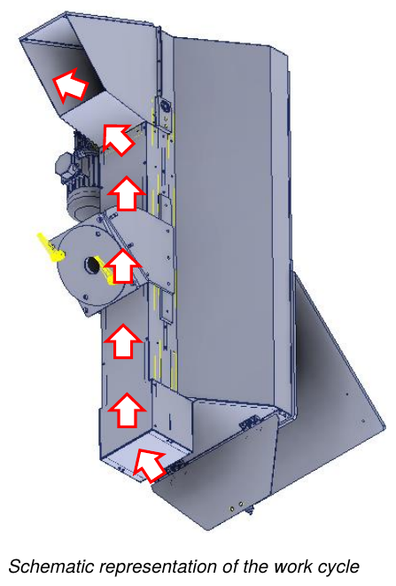

# **Verwendung**

## Anfangskontrollen

Vor dem Start der unvollständigen Maschine muss der Bediener prüfen, dass:
- alle Energiequellen korrekt an die jeweiligen Leitungen angeschlossen sind;
- sich keine Fremdkörper im Inneren der unvollständigen Maschine befinden;
- die vorhandenen Sicherheitseinrichtungen korrekt funktionieren;
- sich die unvollständige Maschine nicht im Reparatur-/Reinigungszustand befindet;
- alle Schutzeinrichtungen korrekt positioniert und befestigt sind.

## Arbeitszyklus

Nach dem Start der unvollständigen Maschine und den vom Bediener durchgeführten Kontrollen läuft der Arbeitszyklus wie folgt ab:
- Das Material wird vom Schaufelband, angetrieben vom Elektromotor, bis zum Auslauf gefördert.

