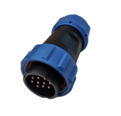

<style>
.compare-grid {
  display: grid;
  grid-template-columns: 1fr 1fr;
  gap: 1rem;
  margin: 1rem 0 1.5rem;
}
@media (max-width: 680px) {
  .compare-grid { grid-template-columns: 1fr; }
}
.compare-card {
  border: 1px solid #5a9fd4;
  border-radius: 7px;
  overflow: hidden;
  font-size: 0.92rem;
}
.compare-card-header {
  padding: 0.5rem 1rem;
  font-weight: 700;
  font-size: 0.82rem;
  letter-spacing: 0.05em;
  color: #ffffff;
}
.v20 .compare-card-header { background: #1a4a7a; }
.v30 .compare-card-header { background: #1e6fbf; }
.compare-card-body {
  padding: 0.85rem 1rem;
}
.compare-card-body p, .compare-card-body li { margin: 0.25rem 0; }
.compare-card-body ul, .compare-card-body ol { padding-left: 1.2rem; margin: 0.4rem 0; }
.compare-card-body table {
  width: 100%;
  border-collapse: collapse;
  margin: 0.5rem 0;
  font-size: 0.88rem;
}
.compare-card-body table th {
  padding: 0.35rem 0.6rem;
  text-align: left;
  font-size: 0.78rem;
  font-weight: 700;
  border-bottom: 2px solid #5a9fd4;
  opacity: 0.75;
}
.compare-card-body table td {
  padding: 0.35rem 0.6rem;
  border-bottom: 1px solid rgba(90, 159, 212, 0.3);
}
.compare-card-body table tr:last-child td { border-bottom: none; }
</style>

# **Electrical Comparison**

This page compares the main electrical differences between **FlexiBowl® 2.0** and **FlexiBowl® 3.0**, in terms of power supply, connectivity and safety.

:::{important}
Before reading the contents of this page, it is good practice to be familiar with the information given on the [Electrical and Pneumatic Specifications](dati_elettrici) page
:::

---

## 1. Power supply

```{list-table}
:header-rows: 1
:widths: 25 37 38

* -
  - FlexiBowl® 2.0
  - FlexiBowl® 3.0
* - **AC power supply**
  - 110-220 Vac ±5%
  - 110-230 Vac ±5%
* - **Frequency**
  - 50/60 Hz
  - 50/60 Hz
* - **Nominal power**
  - 150 W
  - 345-920 W *(depending on FlexiBowl® size)*
* - **DC power supply**
  - Generated internally
  - Generated internally
```

:::{note}
FlexiBowl® 3.0 draws a higher nominal power than the previous generation, because the drive electronics are integrated directly into the unit.
:::

---

## 2. Ethernet connectivity

<div class="compare-grid">
<div class="compare-card v20">
<div class="compare-card-header">FlexiBowl® 2.0</div>
<div class="compare-card-body">

Standard **RJ45** connector.

</div>
</div>
<div class="compare-card v30">
<div class="compare-card-header">FlexiBowl® 3.0</div>
<div class="compare-card-body">

**M12 D-code** connector.

</div>
</div>
</div>

---

## 3. Safety

<div class="compare-grid">
<div class="compare-card v20">
<div class="compare-card-header">FlexiBowl® 2.0</div>
<div class="compare-card-body">

To stop the unit safely, the **230 Vac power supply must be completely disconnected**.

</div>
</div>
<div class="compare-card v30">
<div class="compare-card-header">FlexiBowl® 3.0</div>
<div class="compare-card-body">



Integrated **Safe Torque Off (STO)** function, which allows safe stopping without having to disconnect the power supply.

</div>
</div>
</div>

:::{note}
For details on the STO channels and their wiring, refer to the [Electrical Interface](dati_elettrici) page.
:::

---

## 4. Summary

FlexiBowl® 3.0 draws more power than the previous generation because of the integrated drive electronics, but it introduces a more robust Ethernet connector (M12 D-code) and an integrated STO safety function, which removes the need to disconnect the power supply to stop the unit safely.
