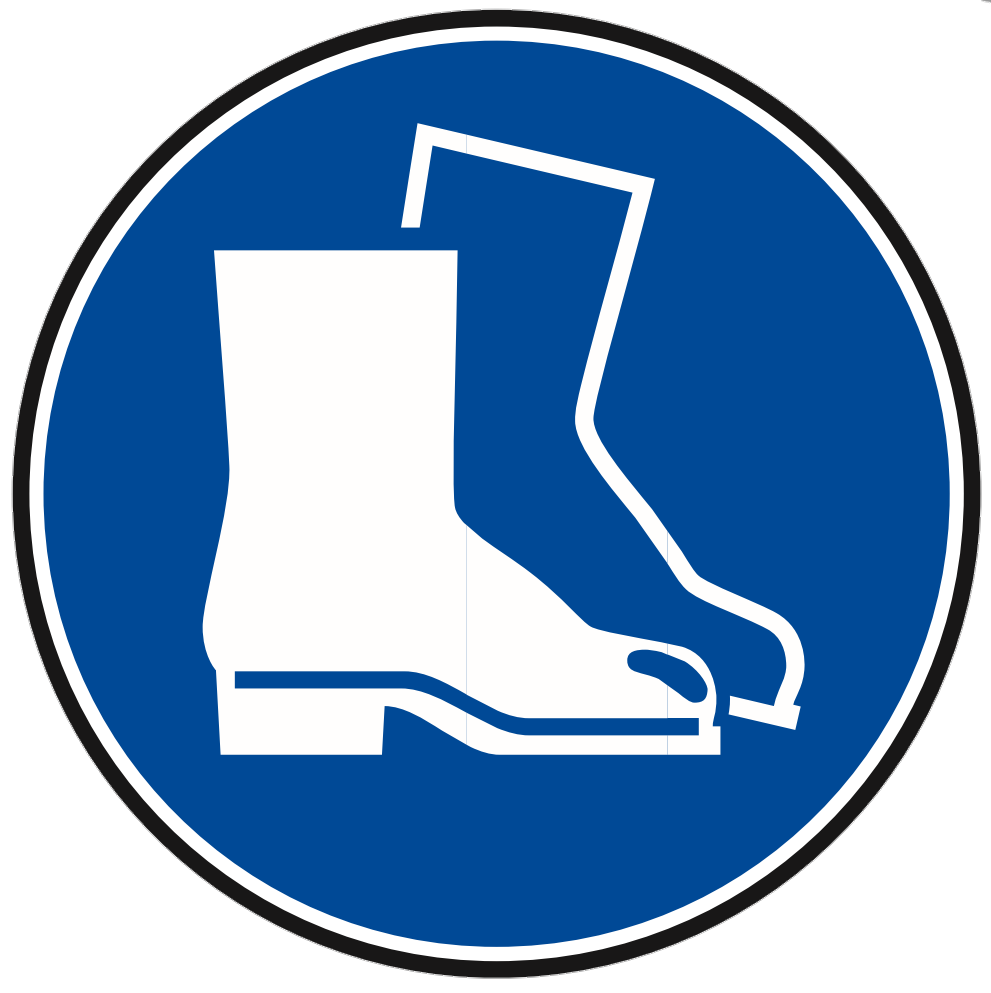
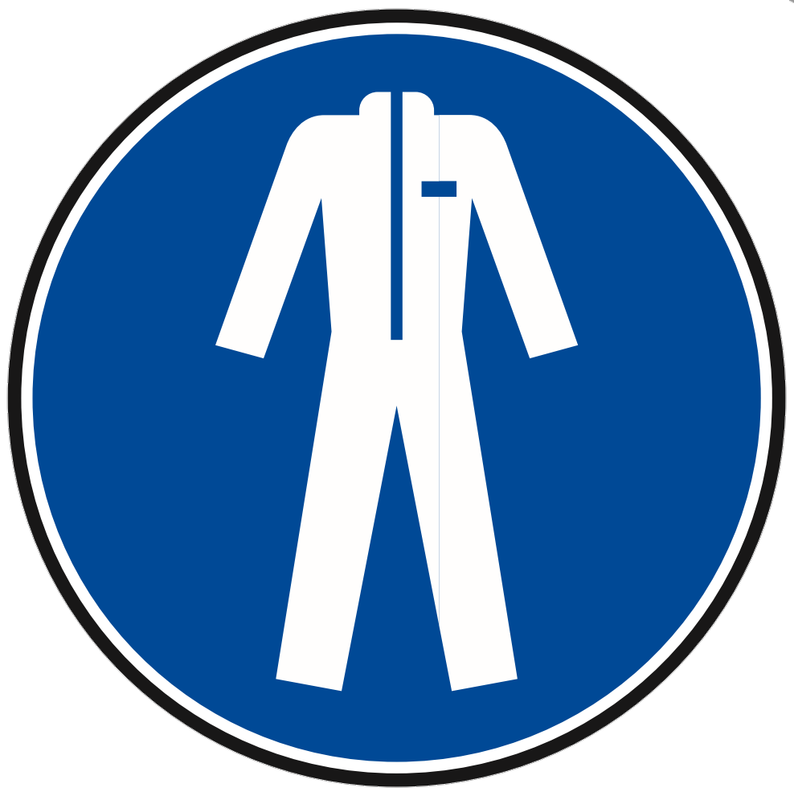
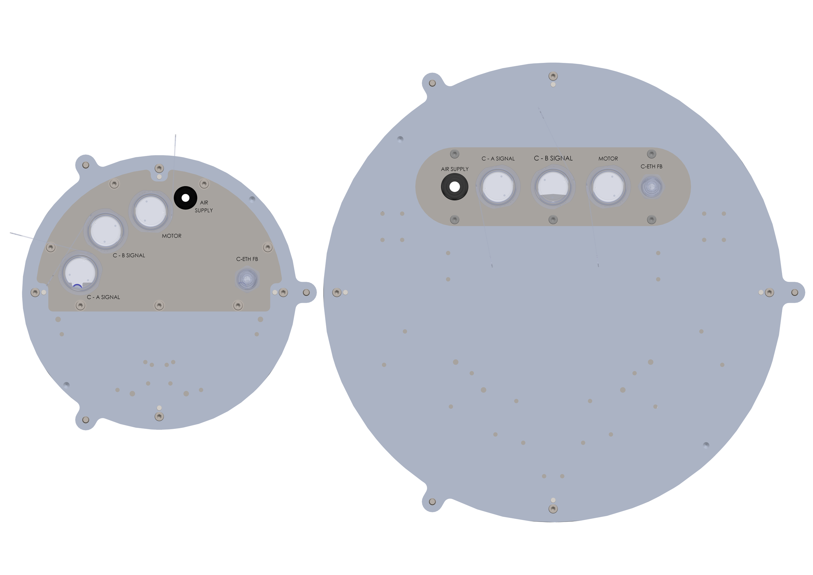
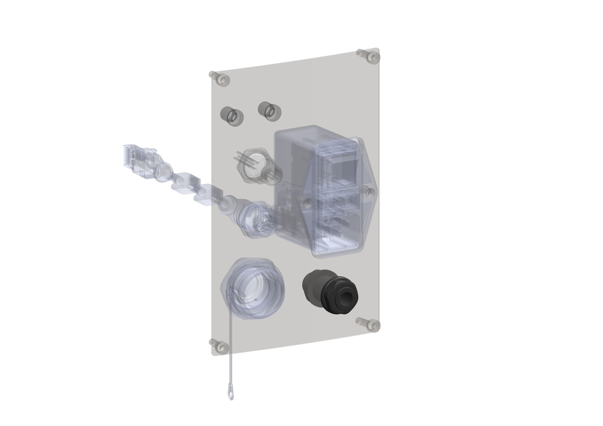
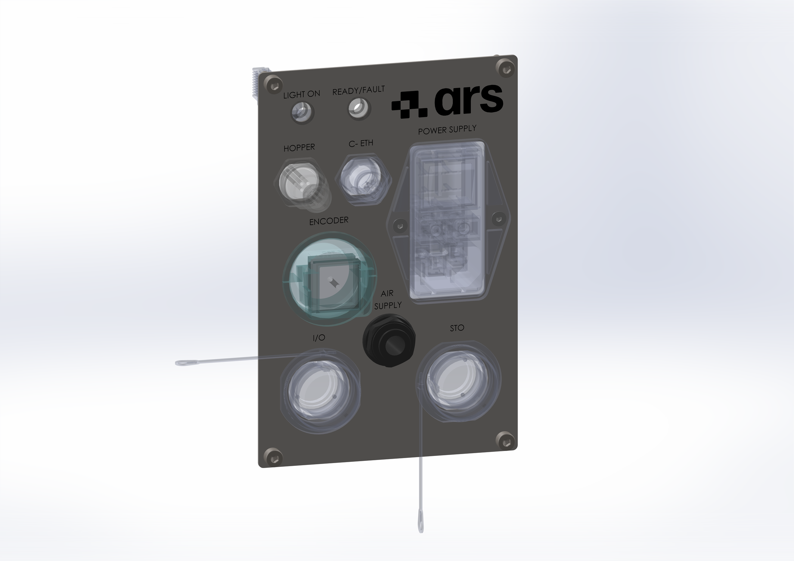

(intpneum)=
# **Pneumatic Interface**

The machine is equipped with pneumatic actuation. Before making the **pneumatic connection**, verify that:
- the compressed air supply system present guarantees the machine the quantity of air at the right pressure;
- the compressed air tank provided is correctly sized.

The pneumatic connection must be made by connecting the main line to the machine circuit. The customer must also ensure an air supply with the characteristics listed in the {ref}`"Pneumatic Technical Data" <datipneum>` paragraph of this manual.

:::{warning}
Never exceed 7 bar of pressure in the machine's pneumatic system.
:::

:::{warning}
The FlexiBowl® is supplied without a manual shut-off and exhaust device for the pneumatic supply. The integrator must provide upstream a clearly identified, easily accessible device that can be locked in the closed position, which allows the supply to be interrupted, the residual pressure to be released and unintentional re-activation to be prevented. Pipes and fittings must be suitable for the operating pressure, correctly secured and protected against pulling out. Any further pneumatic safety devices must be defined through the risk assessment of the final machine.
:::

:::::{important}

:::{raw} html
   <style>
     .ars-img-row { display: flex; gap: 12px; align-items: center; justify-content: center; }
     .ars-img-row img { width: 25%; }
   </style>
:::

::::{list-table}
:widths: 30 60
:header-rows: 1
* - {ref}`Operator qualification <operatori>`
  - {ref}`Required PPE <dpi>`

* - **Mechanical maintenance technician**
  - :::{raw} html
       <div class="ars-img-row">
         
         
         
       </div>
    :::
::::
:::::

To connect to the pneumatic network, connect an air tube {ref}`of the right size <datipneum>` to the "Air Supply" inlet located on the {ref}`control panel <intele>`.

:::{raw} html
<style>
.img-zoom-grid {
  display: flex;
  flex-wrap: wrap;
  justify-content: center;
  gap: 16px;
  padding: 1rem 0;
}
.img-zoom-wrap {
  flex: 1 1 0;
  min-width: 0;
  overflow: visible;
  display: flex;
  align-items: center;
  justify-content: center;
}
.img-zoom-wrap img {
  width: 100%;
  border-radius: 8px;
  transition: transform 0.35s cubic-bezier(0.34, 1.56, 0.64, 1), box-shadow 0.35s ease;
  cursor: zoom-in;
  position: relative;
  transform: scale(1);
}
.img-zoom-wrap img:hover {
  transform: scale(1.85);
  box-shadow: 0 12px 40px rgba(0,0,0,0.22);
  z-index: 10;
}
</style>

<div class="img-zoom-grid">
  <div class="img-zoom-wrap">
    
  </div>
  <div class="img-zoom-wrap">
    
  </div>
  <div class="img-zoom-wrap">
    
  </div>
</div>
:::

<style>
.ars-dropdown {
  margin: 0.9rem 0 0.4rem 0;
  border: 2px solid #7fb3dd;
  border-radius: 8px;
  overflow: hidden;
  box-shadow: 0 2px 6px rgba(26,111,196,0.10);
}
.ars-dropdown summary {
  cursor: pointer;
  color: #2980b9;
  font-weight: 600;
  font-size: 0.83rem;
  padding: 0.5rem 0.9rem;
  display: block;
  background: #eaf3fb;
  list-style: none;
  user-select: none;
}
.ars-dropdown summary::-webkit-details-marker { display: none; }
.ars-dropdown summary::before {
  content: "▸ ";
}
.ars-dropdown[open] summary::before {
  content: "▾ ";
}
.ars-dropdown[open] summary {
  border-bottom: 2px solid #7fb3dd;
}
.ars-dropdown .ars-dropdown-body {
  padding: 0.9rem 1rem;
  background: #fff;
}
.ars-step-warn, .ars-step-attn, .ars-step-note {
  border-radius: 5px;
  padding: 0.5rem 0.75rem;
  font-size: 0.83rem;
  margin-top: 0.55rem;
  line-height: 1.4;
}
.ars-step-warn { background:#fff3cd; border-left:4px solid #f0ad4e; color:#7a5b00; }
.ars-step-attn { background:#fee2e2; border-left:4px solid #dc2626; color:#8a1c1c; }
.ars-step-note { background:#eef6fc; border-left:4px solid #2980b9; color:#1a3a52; }

.ars-zoom-img {
  transition: transform 0.35s cubic-bezier(0.34, 1.56, 0.64, 1), box-shadow 0.35s ease;
  cursor: zoom-in;
  position: relative;
}
.ars-zoom-img:hover {
  transform: scale(1.8);
  box-shadow: 0 12px 40px rgba(0,0,0,0.22);
  z-index: 10;
}
</style>

---

## Required Air Characteristics

| Parameter | Value |
|---|---|
| Air quality | Clean and dry compressed air, according to **ISO 8573-1:2010, class 1.3.2** |
| Recommended supply pressure | **7 bar** (never to be exceeded) |
| Tube diameter — FB200 / FB350 | **Ø 6 mm** |
| Tube diameter — FB500E / FB500 / FB650 / FB800 / FB1200 | **Ø 8 mm** |

<details class="ars-dropdown"><summary>Indicative air consumption by model (Flip action)</summary><div class="ars-dropdown-body">

| Model | Average consumption | Peak consumption |
|---|---|---|
| FB200 | 25 l/min | 45 l/min |
| FB350 | 15 l/min | 24 l/min |
| FB500E | 55 l/min | 74 l/min |
| FB500 | 35 l/min | 48 l/min |
| FB650 | 30 l/min | 45 l/min |
| FB800 | 45 l/min | 60 l/min |
| FB1200 | 135 l/min | 176 l/min |

The values shown refer to the Flip action only; for full details on consumption, refer to the {ref}`"Pneumatic Technical Data" <datipneum>` paragraph.

</div></details>

:::{note}
On FlexiBowl® 3.0, pressure adjustment and gauge reading are done through the **software interface**, and no longer with a physical regulator and gauge on the panel as in the previous 2.0 generation.
:::

---

## Guided Procedure — Pneumatic Connection

For the pneumatic connection too, the procedure changes slightly depending on the size of the machine, in particular for the tube diameter and the position of the **AIR SUPPLY** connector.

:::{attention}
Before starting any pneumatic connection, make sure that the compressed air supply is **disconnected** and that the residual pressure in the circuit has been **released**.
:::

### FlexiBowl® 500 – 1200 — Standard Electrical Panel

```{list-table}
:widths: 8 52 40
:header-rows: 1

* - #
  - Action
  - Image
* - 1
  - **Preliminary checks.**

    Check that the supply system guarantees the required pressure and flow rate, and that the compressed air tank is correctly sized for the installed model.

    <div class="ars-step-note">
    Clean and dry air according to ISO 8573-1:2010, class 1.3.2. Recommended pressure: 7 bar.
    </div>
  -

* - 2
  - **Disconnect the air supply** upstream of the system, before connecting the tube.

    <div class="ars-step-attn">
    Never connect or disconnect the air tube while the system is still pressurized.
    </div>
  -

* - 3
  - **Connect the air tube** to the **AIR SUPPLY** inlet on the standard electrical panel, using a tube with an outer diameter of **Ø 8 mm**.
  -
    ```{image} ../../../../_shared/media/images/connectAir.png
    :alt: Connect the Ø8mm compressed air
    :class: ars-zoom-img
    ```

* - 4
  - **Check the tightness of the connection**: check that the fitting is correctly inserted and that there are no audible or tactile leaks along the tube and the fitting.
  -

* - 5
  - **Restore the air supply** and check that the downstream pressure is within the expected parameters.

    <div class="ars-step-note">
    On FlexiBowl® 3.0, the pressure can be read and adjusted directly from the software interface.
    </div>
  -
```

### FlexiBowl® 200 / 350

On these sizes, the **AIR SUPPLY** connector is located directly on the machine panel (not on the external rack), downstream of all the other wiring.

```{list-table}
:widths: 8 52 40
:header-rows: 1

* - #
  - Action
  - Image
* - 1
  - **Preliminary checks.**

    Check that the supply system guarantees the required pressure and flow rate, and that the compressed air tank is correctly sized for the installed model.

    <div class="ars-step-note">
    Clean and dry air according to ISO 8573-1:2010, class 1.3.2. Recommended pressure: 7 bar.
    </div>
  -

* - 2
  - **Disconnect the air supply** upstream of the system, before connecting the tube.

    <div class="ars-step-attn">
    Never connect or disconnect the air tube while the system is still pressurized.
    </div>
  -

* - 3
  - **Connect the air tube** directly to the machine panel, using a tube with an outer diameter of **Ø 6 mm**.
  -
    ```{image} ../../../../_shared/media/images/connectAir200.png
    :width: 110%
    :alt: Connect the Ø6mm compressed air
    :class: ars-zoom-img
    ```

* - 4
  - **Check the tightness of the connection**: check that the fitting is correctly inserted and that there are no audible or tactile leaks along the tube and the fitting.
  -

* - 5
  - **Restore the air supply** and check that the downstream pressure is within the expected parameters.

    <div class="ars-step-note">
    On FlexiBowl® 3.0, the pressure can be read and adjusted directly from the software interface.
    </div>
  -
```

---

## General Notes and Warnings

:::{attention}
All pneumatic connection and disconnection operations must be carried out with the system **disconnected** and **residual pressure released**.
:::

:::{attention}
Never exceed **7 bar** of pressure in the machine's pneumatic system.
:::

:::{attention}
The FlexiBowl® is not equipped with a manual shut-off and exhaust device: it is the integrator's responsibility to provide one upstream, clearly identified, accessible and lockable in the closed position.
:::

:::{attention}
Use only tubes and fittings suitable for the operating pressure, correctly secured and protected against pulling out.
:::

:::{attention}
For further technical information or assistance, contact ARS s.r.l. – FlexiBowl® Division.
:::
