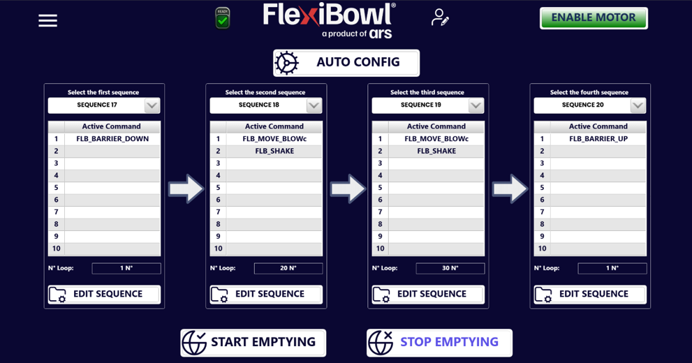
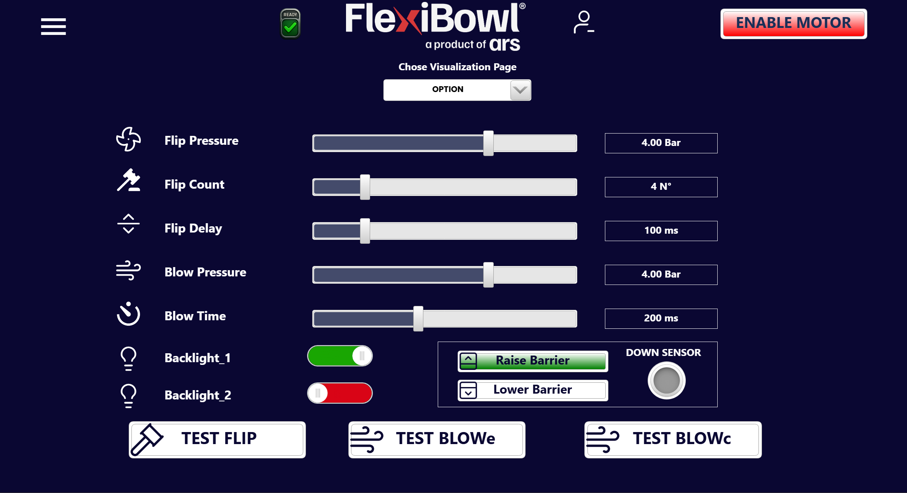

(emptying)=
# **Emptying**

The Emptying page is made available automatically when the Emptying option is purchased.

## Overview

The **Emptying** function allows the FlexiBowl® to be emptied automatically by chaining up to **4 dedicated sequences**, each repeated a configurable number of times (loop). It is designed to quickly clear the disc of residual parts, for example at the end of a shift or during a production changeover, without having to call up the sequences manually one by one.

---

## Configuration via the web interface

The page is organized into **4 columns**, one for each of the sequences that make up the emptying cycle ("Select the first/second/third/fourth sequence"), plus the start/stop commands at the bottom of the page.

### AUTO CONFIG

The **AUTO CONFIG** button, at the top, automatically inserts a default configuration that occupies **Sequences 17, 18, 19 and 20**. Alternatively, these sequences can be freely customized, or others can be selected from the 20 available.

:::{note}
In the default configuration, the first sequence lowers the barrier (**FLB_BARRIER_DOWN**), the two central sequences repeat several times a combined rotation and blow movement followed by a shake (**FLB_MOVE_BLOWc** + **FLB_SHAKE**), while the last one raises the barrier again (**FLB_BARRIER_UP**) at the end of the cycle.
:::

### Elements of each column

| Element | Function |
|---|---|
| **Select the first/second/third/fourth sequence** | Drop-down menu to select which of the 20 programmed sequences is executed in that step of the emptying cycle |
| **Active Command** | List of the active commands in the selected sequence (up to 10 slots, same structure as the Main Command page) |
| **N° Loop** | Number of times the selected sequence is repeated during that step |
| **EDIT SEQUENCE** | Opens the selected sequence to edit the commands that make it up |

### Start and stop

| Command | Function |
|---|---|
| **START EMPTYING** | Starts the emptying cycle: executes the 4 configured sequences in order, each for the set number of loops |
| **STOP EMPTYING** | Interrupts the emptying cycle in progress |

---
## Option page

If the Emptying function is present, the following box will be displayed in the OPTION section of the 'Main Command' page:

This box, containing the two buttons 'Raise Barrier' and 'Lower Barrier', makes it possible to raise and lower the emptying barrier and thus to check that it works correctly. When the barrier is lowered, the sensor in this box is activated.

## Sequence page 

:::{image} ../../../../_shared/media/images/box_emptying.png
:width: 50% 
:align: center
:::

On the Sequence page, ticking the 'Emptying Sequence' box makes it possible to move the FlexiBowl even with the emptying barrier lowered. In fact, if the barrier is lowered and the box on the Sequence page is not ticked, it will not be possible to perform the movement associated with the current sequence.

## Commands via protocol

As with the rest of the software interface, the Emptying cycle can also be started, configured and verified via protocol (TCP Server, EtherNet/IP, Profinet, Modbus), with the same ControlWords regardless of the protocol used — only the transport changes, as described on the [Software Interface](int_software) page.

### EXE Commands

| Command | ControlWord | Busy during execution | ReturnData_1 | Explanation |
|---|---|---|---|---|
| Start Emptying | 45 | YES (Emptying active) | 45 | Starts emptying |
| Stop Emptying | 46 | YES (Emptying active) | 46 | Stops emptying |
| Emptying Active | 47 | NO | 47 | Checks whether emptying is active |

### WRITE Commands

Each Sequence/Loop pair corresponds to one of the 4 columns of the web page:

| Command | ControlWord | Range Data_1 | Busy during execution | ReturnData_1 |
|---|---|---|---|---|
| FirstSequence | 20200 | 1–20 | NO | 20200 |
| FirstLoop | 20201 | 0–500 | NO | 20201 |
| SecondSequence | 20202 | 1–20 | NO | 20202 |
| SecondLoop | 20203 | 0–500 | NO | 20203 |
| ThirdSequence | 20204 | 1–20 | NO | 20204 |
| ThirdLoop | 20205 | 0–500 | NO | 20205 |
| FourthSequence | 20206 | 1–20 | NO | 20206 |
| FourthLoop | 20207 | 0–500 | NO | 20207 |

### READ Commands

| Command | ControlWord | Busy during execution | ReturnData_1 | Range ReturnData_2 |
|---|---|---|---|---|
| FirstSequence | 20300 | NO | 20300 | 1–20 |
| FirstLoop | 20301 | NO | 20301 | 0–500 |
| SecondSequence | 20302 | NO | 20302 | 1–20 |
| SecondLoop | 20303 | NO | 20303 | 0–500 |
| ThirdSequence | 20304 | NO | 20304 | 1–20 |
| ThirdLoop | 20305 | NO | 20305 | 0–500 |
| FourthSequence | 20306 | NO | 20306 | 1–20 |
| FourthLoop | 20307 | NO | 20307 | 0–500 |

:::{tip}
For the complete explanation of the ControlWord logic, the 4-step operation and practical examples via fieldbus/TCP, refer to the section [Emptying Commands](int_software.html#sec-empty) of the Software Interface page.
:::

---

## Usage notes

:::{note}
The 4 sequences called by Emptying (by default 17–20, or customized) remain normal programmable sequences: they can be edited from the **Main Command** page exactly like any other sequence, as well as with the **EDIT SEQUENCE** button on this page.
:::

:::{warning}
Do not send a new **Start Emptying** command while an emptying cycle is already in progress (**Emptying Active** = 1). Check that the previous cycle has finished, or send **Stop Emptying**, before starting a new one.
:::
