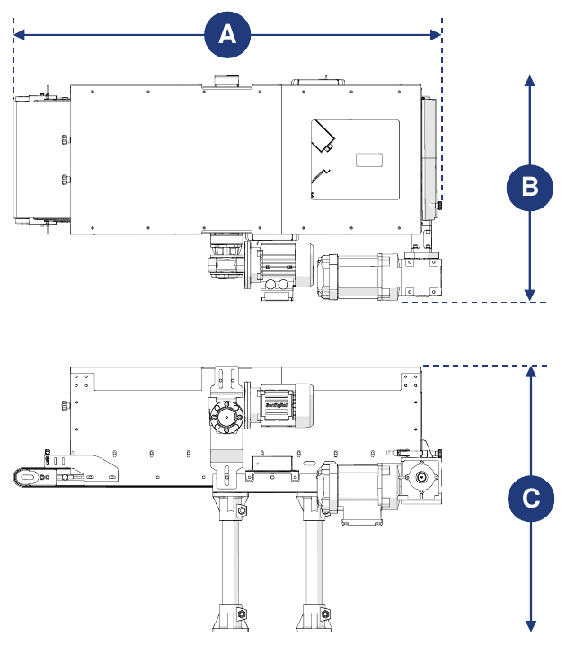
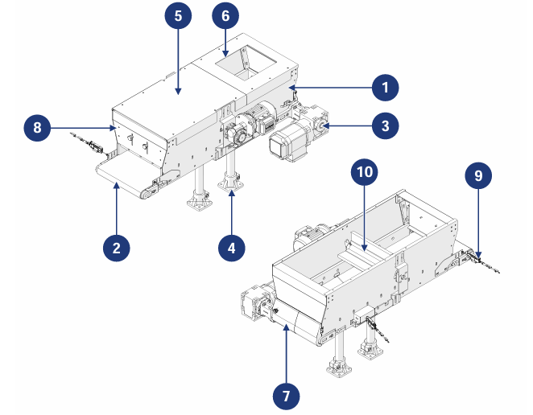

# **Machine Description**

:::{important}
To be used, the partly completed machine must be incorporated into other suitably structured machines/partly completed machines.
:::

## Description

The Conveyor Hopper is designed and built to receive small, medium and large bulk components from an upstream system and transfer them to a downstream system.

It is driven by a gearmotor connected to a drive roller, which moves the conveyor belt located at the base of the hopper. At the rear there is a door for manual emptying at the end of the cycle, while at the front there is a metering barrier to adjust the material outlet.

The machine can be combined with a feeding system (supplied by the customer) which, by connecting to the presence sensors supplied with the machine, automatically manages the loading of material onto the belt.

## Intended Use

| Operation | Permitted | Not permitted | Environment |
|:--- |:--- |:--- |:--- |
| Handling of bulk components of various sizes and characteristics | Yes | Any use other than that permitted | Industrial |

:::{important}
The machine cannot be used to transport:
- objects larger than the dimensions of the hopper;
- objects with adhesive or sticky external surfaces;
- sharp objects that could damage the belt fabric.
:::

The machine has been designed to meet the specific requirements stated in the sales contract and to be used according to the instructions and limits of use given in the manual. It works safely if:
- it is incorporated into a line equipped with adequate safety and protection devices, in accordance with the regulations in force;
- it is used within the limits stated in the contract and in the manual;
- the procedures in the instruction manual are followed;
- routine maintenance is carried out at the times and in the ways indicated;
- extraordinary maintenance is carried out promptly when necessary;
- the safety devices are not removed and/or bypassed.

## Improper Use (Reasonably Foreseeable)

- use of the machine without having first read the instruction manual;
- use of the machine without incorporating it into a line in accordance with the regulations in force;
- use by operators who have not been adequately trained;
- use of the machine as a support point, even when not in operation;
- use to obtain production values above the prescribed limits;
- use in a way not specified in the "Intended use" section.

Any other use not specified must be authorized in advance in writing by the Manufacturer. In the absence of such authorization the use is considered "incorrect": the Manufacturer declines all liability for damage to property or persons and considers any warranty void.

:::{important}
Incorrect use of the machine excludes any liability of the Manufacturer.
:::

## Obligations and Prohibitions

### Obligations of the users

The user (contractor or employer) must:
- take into account the capabilities and conditions of the operators in relation to their health and safety;
- provide PPE suitable for each procedure;
- provide standard lifting means and procedures;
- make sure that workers comply with company safety rules and with the use of the available collective and personal protective devices;
- train the personnel on the procedures to follow in the event of an accident;
- train personnel on the existing residual risks;
- train personnel on the devices provided for operator safety;
- train personnel on the risks due to noise emission in the workplace;
- train personnel on the general accident-prevention rules established by European directives and by the legislation of the country of destination.

Allow only personnel who have read the manual and are adequately trained to work on the machine.

### Obligations of the assigned personnel (operators/maintenance staff/technicians)

Personnel must:
- carry out maintenance work only with the machine switched off;
- tie back long hair to prevent it from getting caught or contaminating the product;
- work on the electrical panel, junction boxes, cables and all electrical components only with the main switch disconnected;
- make sure that no one has direct access to moving parts during operation;
- use correctly the protective devices provided by the employer;
- immediately report to the employer, manager or supervisor any failure of the safety devices.

### Prohibitions for operating personnel

Personnel must not:
- use the machine improperly, i.e. for uses not specified in the "Intended use" section;
- remove or modify safety devices or signs without authorization;
- carry out, on their own initiative, operations or manoeuvres that fall outside their competence or that may compromise their own or others' safety;
- approach the machine while intoxicated or under the influence of drugs;
- replace or change the speed and/or power of the machine components without the authorization of a person in charge;
- modify the machine cycle;
- modify the electrical connections to bypass the internal safety devices;
- use the machine if it has not been installed in accordance with the applicable standards;
- use the machine as a support point, even when it is not in operation (risk of falling and/or damage);
- use the machine outside the permitted environmental conditions (see *Transport and Incorporation*).

:::{attention}
The Manufacturer is not liable for damage to property or persons if:
- it is established that the machine has been used outside the permitted environments;
- the obligations and prohibitions described in the manual have not been complied with.
:::

## Technical Data

```{list-table} Electrical power supply
:header-rows: 0
:widths: 40 60

* - **Voltage**
  - 400 Vac
* - **Power**
  - 0.18 kW (belt drive) · 0.09 kW (brush drive, optional)
* - **Frequency**
  - 50 Hz
```

```{list-table} Limits of use
:header-rows: 0
:widths: 40 60

* - **Maximum transportable weight**
  - 15 kg/m
* - **Maximum belt speed**
  - 8 m/min
```

:::{important}
For further information, refer to the wiring diagram and to the sub-suppliers' manuals, attached to the manual.
:::

## Overall Dimensions



| Dimension | Value |
|:--- |:--- |
| **Length (A)** | 1075 mm (with drive on the left) · 1050 mm (with drive on the right) |
| **Width (B)** | 564 mm (with drive on the left) · 562 mm (with drive on the right) |
| **Height (C)** | 666 mm |

## Main Components



| Pos. | Description |
|:--- |:--- |
| 1 | Hopper tank |
| 2 | Conveyor belt |
| 3 | Drive unit |
| 4 | Support foot |
| 5 | Hopper lid |
| 6 | Material inlet compartment |
| 7 | Rear door |
| 8 | Front door |
| 9 | Material presence sensor |
| 10 | Motorized brush *(optional component)* |

## Work Cycle

| Phase | Description |
|:--- |:--- |
| 1 | The material, coming from the upstream system, is introduced into the hopper through the loading compartment and falls onto the belt. |
| 2 | The belt carries the material towards the exit zone. |
| 3 | The material is discharged to the downstream system according to production requirements. |

:::{important}
The sensors present are used to check for the presence or absence of product on the belt, in the inlet and outlet zones.

During incorporation they must be properly connected, so as to allow the machine to communicate with the upstream and downstream systems (not included in the supply).
:::
