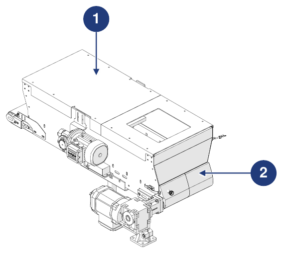
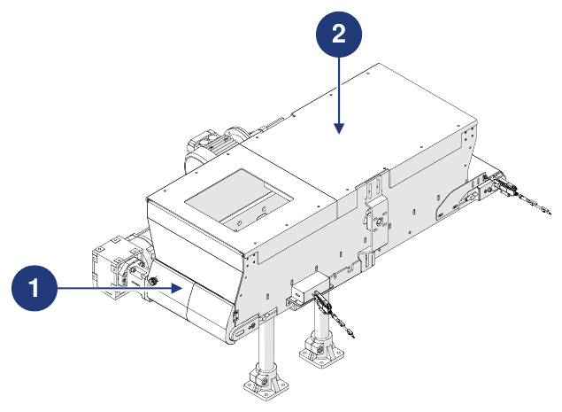

# **Preliminary Information and Safety**

:::{important}
Before installing, using or carrying out maintenance on the machine, carefully read the entire manual and all the attached documentation.

Failure to follow the instructions given may cause:
- damage to the machine;
- loss of safety conditions;
- risks to operators and maintenance personnel;
- loss of the warranty.
:::

## Identification

### Manufacturer

| | |
|:--- |:--- |
| **Manufacturer** | ARS S.r.l. |
| **Address** | Via Aretina Nord, 157 – 52041 Pieve al Toppo (AR), Italy |
| **Contacts** | Tel. +39 0575 398611 · Fax +39 0575 398620 |
| **E-mail / Web** | info@arsautomation.com · www.arsautomation.com |

### Partly completed machine identification

| | |
|:--- |:--- |
| **Type** | Hopper with motorized conveyor belt |
| **Name** | Conveyor Hopper |
| **Model** | CH60 |
| **Capacity** | 60 L |

### Identification Plate

The machine is fitted with an identification plate located on the belt drive side. By giving the Manufacturer the data shown on the plate, the exact identification of the machine can be traced.

:::{warning}
**WARNING — Identification plate**

It is absolutely forbidden to remove the identification plate or replace it with other plates. If the plate is damaged or accidentally removed, the customer is **obliged** to inform the Manufacturer.
:::

## Declaration of Incorporation

The machine is supplied with the **Declaration of Incorporation of partly completed machinery**, drawn up pursuant to Machinery Directive 2006/42/EC (Annex II, part 1, section B).

```{list-table}
:header-rows: 0
:widths: 30 70

* - **Machine**
  - 60-litre belt hopper – Hopper with motorized conveyor belt, 60-litre capacity
* - **Model**
  - CH60, revision 1.0 and following
* - **Function**
  - Belt system for feeding bulk components
* - **Essential requirements applied**
  - 1.1.1, 1.1.2, 1.1.3, 1.3.7, 1.5.1, 1.5.5, 1.5.6, 1.5.8, 1.6.1, 1.7.1, 1.7.3, 1.7.4
* - **Directives**
  - 2006/42/EC (Machinery Directive) · 2014/30/EU (Electromagnetic Compatibility)
* - **Technical documentation**
  - Drawn up in accordance with Annex VII, part B, and made available to the national authorities upon reasoned request
```

:::{attention}
The partly completed machine must not be put into service until the final machine into which it is to be incorporated has been declared in conformity with the provisions of Directive 2006/42/EC.
:::

## Reference Directives

Before placing on the market, the Manufacturer carried out the risk assessment to verify compliance with the essential health and safety requirements, as well as the tests and checks required by the reference standards. The technical construction file is drawn up in accordance with **Annex VII** of Directive 2006/42/EC and is available to the supervisory bodies upon reasoned request.

The machine is placed on the market accompanied by:
- Declaration of Incorporation
- Instruction manual *(point 1.7.4 and Annex VI of Machinery Directive 2006/42/EC)*

| Reference | Description / Scope |
|:--- |:--- |
| **2006/42/CE** | Machinery Directive |
| **2014/30/UE** | Electromagnetic Compatibility Directive |
| **UNI EN ISO 12100:2010** | Safety of machinery – General principles for design – Risk assessment and risk reduction |

## Recipients, Supply and Storage

The manual is intended for the operators in charge of using and managing the machine in **all phases of its technical life**. Together with the Declaration of Incorporation it is an **integral part of the machine** and must accompany it whenever it is moved or resold.

| Aspect | Requirement |
|:--- |:--- |
| **Integrity** | Keep intact in all its parts. If lost or damaged, request a copy from the Manufacturer immediately. |
| **Changes of ownership** | It must accompany the machine until it is demolished (moves, sale, etc.). |
| **Format** | Supplied in paper and electronic format; additional documentation is supplied as attachments. |
| **Attachments** | The attached documents are an integral part; the same requirements apply. |
| **Original language** | Italian. In the event of discrepancies with the translations, the original text prevails. |
| **Updates** | In the event of functional modifications or replacements, the update is the responsibility of the Manufacturer. The user guarantees that only the updated version is available at the points of use. |

:::{attention}
The Manufacturer declines all liability for improper use of the machine and for damage caused by operations not covered in the technical documentation.
:::

## Operator Profiles and Qualifications

| Qualification | Definition |
|:--- |:--- |
| **Operator** | Personnel trained by the Manufacturer, qualified to use the machine for production. Must be able to carry out all the operations needed for regular operation and protect themselves and their colleagues. In case of doubt, reports anomalies to their supervisor. **Not authorized to carry out maintenance work.** |
| **Mechanical maintenance technician** | Technician qualified for preventive and corrective maintenance of all mechanical parts. Can operate the machine like an operator, carry out adjustments, maintenance and mechanical repairs, and read diagrams, technical drawings and spare parts lists. Not qualified to work on live electrical systems. |
| **Electrical maintenance technician** | Technician qualified for preventive and corrective maintenance of all electrical parts. Can operate the machine like an operator, carry out adjustments and work on electrical systems, and read electrical diagrams. When voltage is present, may work in panels and junction boxes only if a designated person (PEI – EN 50110-1). |
| **Lifting equipment operator** | Person in good health, trained and instructed in load handling and in the use of lifting equipment. |

All qualifications must fall within the category of **trained person**: an individual who is informed, instructed and trained on the work and on the hazards arising from improper use, who knows the importance of safety devices, accident-prevention rules and safe working conditions.

## Symbols Used in the Manual

| Symbol | Meaning |
|:--- |:--- |
| **Warning / Danger** | Important warnings for the safety of the operator and/or the machine. |
| **Important / Note** | Important information, also concerning the safety of the personnel involved in using the machine. |

## Glossary

| Term | Definition |
|:--- |:--- |
| **Lifting accessories** | Components or equipment not connected to machines, placed between the machine and the load or on the load itself, which allow it to be gripped. Slings and their components are also lifting accessories. |
| **ATEX** | From *ATmosphères EXplosibles*: conventional name of two EU directives (2014/34/EU for equipment intended for explosive atmospheres; 99/92/EC for the safety and health of workers in explosive atmospheres). |
| **Chains, ropes and belts** | Elements designed and built for lifting as part of machines or lifting accessories. |
| **Forklift** | Operator-driven vehicle for handling goods in warehouses, industrial environments or yards, fitted with wheels and driven by an electric, diesel or gas engine. |
| **Damage** | Any negative consequence resulting from a hazardous event. |
| **DPI** | Personal Protective Equipment: garment or equipment intended to protect the wearer from risks to health and safety. |
| **Failure** | State of an item characterized by the inability to perform the required function. |
| **Machine** | Assembly equipped, or intended to be equipped, with a drive system, consisting of parts or components, at least one of which is movable, joined together rigidly for a specific application. |
| **Partly completed machinery** | Assembly which is almost a machine, but which cannot in itself perform a specific application. |
| **Protective measure** | Measure intended to reduce risk, implemented by the designer (inherently safe design, guards, information for use) and/or by the user (organization, safe working procedures, PPE, training). |
| **Hazard** | Potential source of injury or damage to health. |
| **Exposed person** | Any person who is wholly or partly in a hazardous zone. |
| **Prevention** | The set of provisions or measures necessary, according to the particular nature of the work, experience and technology, to avoid risks or reduce their probability. |
| **Guard** | Physical barrier, designed as part of the machine, to provide protection. |
| **Fixed guard** | Guard kept in position (closed) permanently or by fixing systems (screws, bolts, etc.) that prevent its removal or opening without tools. Easily removable fixing systems (e.g. plastic knobs) are not permitted. |
| **Movable guard** | Guard mechanically connected to the structure (e.g. by hinges or guides) that can be opened without the use of tools. |
| **Risk** | Combination of the probability of harm and its severity. |
| **Residual risk** | Risk remaining after protective and preventive measures have been adopted. |
| **Intended use** | Use of the machine in accordance with the information provided in the instructions for use. |
| **Reasonably foreseeable misuse** | Use of the machine in a way not intended by the designer, but which may result from easily foreseeable human behaviour. |

## Personal Protective Equipment (PPE)

When working near the machine (installation, maintenance, adjustments) it is mandatory to comply with the general accident-prevention rules and to use the PPE required for each operation. The clothing of anyone working on the machine must comply with the essential safety requirements of EU Reg. 2016/425 and the laws in force in the country of installation.

| Obligation | Description |
|:--- |:--- |
| **Gloves** | Safety or insulating gloves for professional use must be worn. |
| **Glasses** | Safety glasses must be worn to protect the eyes. |
| **Footwear** | Safety footwear must be worn to protect the feet. |
| **Hearing protection** | Ear defenders or earplugs must be worn to protect the hearing. |
| **Protective clothing** | The specific protective clothing must be worn. |
| **Reading the manual** | The instructions for use and the safety warnings must be read (and understood) before using the machine. |

## Warranty

:::{important}
The full warranty conditions are given in the sales contract. The contract conditions, if different, prevail over what is stated in this section.
:::

The warranty is subject to the following general conditions:
- the packaging must be opened and the machine incorporated in the presence of technicians authorized by the Manufacturer;
- first start-up and testing must be carried out in the presence and under the guidance of the Manufacturer's technicians, unless otherwise agreed between the parties;
- the machine must be used within the limits stated in the contract and specified in the technical documentation;
- maintenance must be carried out at the times and in the ways indicated in the manual, with original spare parts and by qualified personnel.

The warranty is **void** in the event of:
- failure to comply with safety rules;
- removal or tampering with the control and safety devices (guards, sensors, etc.);
- improper use of the machine;
- use by untrained and/or unauthorized personnel, or personnel lacking the requirements set out in the manual;
- modifications or repairs carried out by the user without the Manufacturer's authorization;
- partial or total failure to follow the instructions;
- power supply anomalies;
- lack of maintenance;
- use of non-original spare parts;
- exceptional events such as floods or fires (if not caused by the machines).

## Safety Measures

### Safety devices

The machine is designed and equipped with safety systems to minimize risks to the operator.



| Pos. | Device | Description |
|:--- |:--- |:--- |
| 1 | **Fixed guard** | Fixed guards (casings) which, in areas accessed only during maintenance, prevent access to hazardous zones. Specific tools are required to remove them. |
| 2 | **Movable guard** | Opening guards (doors) which, in certain situations, allow access to the work area. To open them safely, specific procedures must be followed. |

:::{warning}
For incorporation of the machine into the final line, the external electrical connection must be provided for integrating the machine's safety functions into the line's own control logic.
:::

### Noise

Noise was measured in accordance with standards UNI EN 11200 and UNI EN ISO 3746. During work cycles, personnel are exposed to a noise level:
- below **70 dB(A)** with no parts inside;
- below **75 dB(A)** with parts inside. The value is based on the Manufacturer's experience; some parts/components, because of their relative movement caused by the belt and brush, may produce a higher emission. Assessing the emitted noise, based on the specification, is the responsibility of the integrator/incorporator.

The actual noise level of the machine installed in a production process differs from the measured one, because it is influenced by the type and characteristics of the site and by the other machines operating nearby. The user is responsible for applying the prevention and protection measures required by the legislation of the country of installation.

### Vibrations

The vibration level produced by the machine is negligible and not hazardous to the health of the operators.

:::{warning}
Excessive vibration can only be caused by a mechanical failure, which must be reported and resolved immediately so as not to compromise the safety of the machine and the operators.
:::

### Electromagnetic compatibility

The machine contains electronic components subject to the Electromagnetic Compatibility standards, affected by conducted and radiated emissions. The emission values meet the regulatory requirements thanks to the use of compliant components, proper connections and, where necessary, the installation of filters. The machine therefore complies with the EMC Directive.

:::{warning}
Any non-compliant maintenance on the electrical system or incorrect replacement of components may compromise the effectiveness of the solutions adopted.
:::

### Residual risks

Safety has been integrated as far as possible into the design and construction of the machine; however, some risks remain from which operators must be protected.

| Risk | Description and instructions |
|:--- |:--- |
| **Risks due to transport** | Unloading the packaging, opening the packaging and handling the machine expose to the risk of suspended loads and crushing. The procedures are described on the *Transport and Incorporation* page. These operations may only be carried out by personnel experienced in the use of lifting equipment and suitably trained, with appropriate PPE. |
| **Risk due to live parts** | Maintenance work and access to the machine expose to electrical risk. Work on live systems may only be carried out by experienced and qualified personnel. Pay the utmost attention to the electrical hazard pictograms; do not carry out maintenance until the power supply has been disconnected; consult the manuals of the commercial components for specific instructions; periodically check the equipotential circuit, making sure there are no discontinuities. |
| **Risk due to the presence of dust, fragments, etc.** | At the end of the cycle, material residues or accumulated dust may remain on the machine surfaces. Clean thoroughly after each use, as described on the *Maintenance* page. |

:::{warning}
The final builder of the destination line must provide for the reduction of mechanical risks in the various areas of the machine, based on the general risk analysis of the line itself.
:::

:::{warning}
The safety functions of the ARS S.r.l. supply must be integrated by the builder of the destination line into the safety functions of the other associated partly completed machines or machines.
:::

**The user is responsible for:**
- analysing the risks that may arise during handling and incorporation at its own site (the handling analyses only take into account the characteristics of the machine);
- marking out with floor signage the path of forklifts and/or laser-guided vehicles;
- raising awareness among and training the personnel involved in the operations and in the use of the machine;
- placing visual safety signs around the workstation after assessing the risks in transit or control areas.

### Safety pictograms applied to the machine

The machine is supplied with a series of pictograms that allow the residual risks to be identified immediately.

:::{warning}
It is forbidden to remove and/or replace the pictograms with others of different meaning. The user is obliged to replace any that are missing or hard to read.
:::



| Pos. | Description |
|:--- |:--- |
| 1 | Danger of entanglement / crushing of the hands. |
| 2 | Do not remove the safety devices. |
