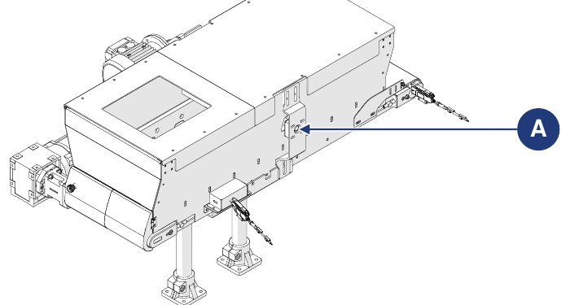

# **Maintenance**

:::{warning}
Carry out maintenance only with the machine switched off and de-energized (main switch on the power supply panel in the "0-OFF" position). Apply the sign "MACHINE UNDER MAINTENANCE – DO NOT SWITCH ON" to the main switch.
:::

:::{warning}
Maintenance operations must be carried out by qualified and authorized personnel.
:::

Maintenance includes the work (inspections, checks, adjustments and replacements) that becomes necessary following normal use.

**Guidelines for correct maintenance:**
- use only original spare parts and tools suitable for the purpose and in good condition;
- comply with the intervention frequencies indicated for scheduled maintenance (preventive and periodic): the interval (expressed in time or work cycles) between one intervention and the next is to be understood as the maximum permissible; it must not be exceeded but may be reduced.

Good preventive maintenance requires constant attention and continuous monitoring of the machine. Immediately check the cause of any anomalies (excessive noise, overheating, fluid leaks, etc.) and remedy them: promptly eliminating the causes of anomalies prevents further damage and ensures operator safety.

Maintenance personnel must be well trained and thoroughly familiar with accident-prevention rules; unauthorized personnel must stay out of the work area during operations. Cleaning and adjustments must also be carried out only during maintenance, with the machine stopped and disconnected from the electrical panel.

:::{warning}
Any repairs or maintenance work not indicated in the manual may only be carried out with the Manufacturer's prior authorization; the Manufacturer is not liable for damage to persons or property resulting from operations other than those described or carried out differently from what is indicated.
:::

| Type | Description |
|:--- |:--- |
| **Routine maintenance** | All the operations that the maintenance technician must carry out preventively to ensure the machine's good operation over time: inspections, checks, adjustments, cleaning and lubrication. |
| **Extraordinary maintenance** | All the operations that the maintenance technician must carry out when the machine requires it: inspections, repairs, restoring nominal operating conditions or replacing a broken, faulty or worn unit. |

## Routine maintenance

Routine maintenance includes the inspections, checks and interventions which, in order to prevent failures, keep the following under control:
- the mechanical condition of the machine;
- lubrication;
- cleaning;
- the electrical power supply system.

The frequencies indicated refer to normal operating conditions, i.e. conditions in accordance with the intended conditions of use.

### Checks and inspections

| Operation | Frequency |
|:--- |:---: |
| Visually check the integrity of all the machine's protection and safety devices. | Daily |
| Visually check the state of wear and the cleanliness of the machine. | Daily |
| Check that the sensors (if used) work correctly. | Weekly |
| Check that the drives work correctly. | Monthly |
| Check the state of wear of the insulation of the connecting cables and electrical connectors. | Monthly |
| Check that the belt fabric is correctly tensioned. | Monthly |
| Check the state of wear of the belt fabric and replace it if necessary. | Six-monthly |

:::{important}
For the description of the maintenance procedures for the belt integrated in the machine, refer to the belt supplier's manual, attached to the documentation.
:::

### Cleaning

:::{warning}
Cleaning operations must be carried out by qualified and authorized personnel. Comply with the regulations in force in the country of installation for the treatment of any washing water.
:::

| Operation | Frequency |
|:--- |:---: |
| General cleaning. | Weekly |

:::{important}
General cleaning must be carried out every time material is loaded into the machine, to remove any residues from the previous process.
:::

:::{warning}
Never direct jets of water or liquids at the electrical parts of the machine. Do not use acids, solvents, flammable substances or abrasive tools for cleaning.
:::

**General cleaning**

| Phase | Action |
|:--- |:--- |
| 1 | Disconnect the machine's power supply. *Note: refer to the manual of the line in which the machine is incorporated.* |
| 2 | With compressed air or a soft cloth soaked in non-aggressive detergent, remove process residues and dirt accumulated on the surfaces. *Note: to make the operation easier, access the belt from the rear door.* |
| 3 | Remove any grease and/or oil residues from the surfaces with a soft cloth soaked in non-aggressive detergent. |
| 4 | Wait until the machine is completely dry before putting it back into operation. |

### Lubrication

:::{important}
None of the machine's drives require lubrication. For lubrication operations use a manual grease pump.
:::

| Operation | Frequency |
|:--- |:---: |
| Greasing of the support (A) of the motorized brush (optional). | Monthly |

## Extraordinary maintenance

:::{warning}
Extraordinary maintenance work and repairs must be carried out only by qualified, trained and authorized technicians, employed by the Manufacturer or by the authorized service centre. These interventions require in-depth, specialist knowledge of the machine, of the operations needed, of the associated risks and of the correct procedures for working safely.
:::

In the event of exceptional events requiring extraordinary maintenance, the user's routine maintenance technicians must:
- check the condition of damaged or out-of-phase units;
- carry out the operations described in this section;
- if the operations to be carried out are not indicated in the manual, send the Manufacturer the report of the incident, the result of the inspection and any observations.

The Manufacturer or the authorized service centre will assess each case and agree with the maintenance personnel on the most suitable solution:
- the Manufacturer sends an authorized, trained and qualified technician to carry out the necessary work;
- or the Manufacturer authorizes the user's routine maintenance technicians to carry out the work and sends any additional instructions.

:::{warning}
Spare parts must be ordered from the Manufacturer. If the customer does not use original spare parts or parts authorized in writing by the Manufacturer, the latter is released from all liability for the operation of the machine and the safety of the operators. Authorizations and/or instructions must always be given in writing: in the absence of written authorization, intervention is forbidden.
:::

:::{important}
If it is necessary to carry out procedures not described in the manual, or in case of doubt, intervention is forbidden. Contact the Manufacturer for clarification.
:::

### Replacing the belt fabric

| | |
|:--- |:--- |
| **Operator qualification** | Electrical maintenance technician |
| **Tools to be used** | Screwdriving tools |

| Phase | Action |
|:--- |:--- |
| 1 | Unscrew the fixing screws (A) of the hopper body to the support plate of the support feet, on both sides of the structure. |
| 2 | Separate the hopper body (B) from the support feet (C): manually, with two operators; or with the aid of a forklift (see the handling information in *Transport and Incorporation*). |
| 3 | Take the hopper body to the workbench. |
| 4 | Remove the screws (D) fixing the belt to the hopper, on both sides of the structure. |
| 5 | Separate the belt (E) from the hopper (F). *Note: this can be done manually by one operator.* |
| 6 | To replace the fabric, follow the instructions in the belt supplier's manual. *Note: the belt supplier's manual is attached to the documentation.* |
| 7 | Reassemble the machine by proceeding in reverse order. |
