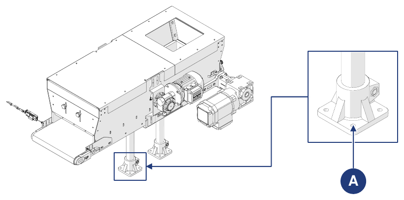

# **Transport and Incorporation**

## Packaging

The machine is shipped by the Manufacturer from the production plant to the Customer's premises. Depending on the distance, the Customer's requests and the length of time in the packaging, shipment takes place with:
- normal protective packaging for short and medium distances;
- special protective packaging for long distances.

Transport must take place in closed or tarpaulin-covered vehicles, depending on the type of load.

Upon receiving the machine, the customer must check that there is no damage caused by transport or by the personnel handling it.
- If damage is found, leave the packaging as found and immediately request an estimate of the damage from the carrier; then send a damage report to inform the carrier's insurance and the point of sale.
- If the machine is delivered in a crate on a pallet or on wooden boards protected by heat-shrink cellophane, first remove the packaging or covering. To free the machine completely, remove the screws and metal straps. Then lift the machine with a crane or forklift and remove the pallet used for transport.

### Removing the packaging

| Phase | Action |
|:--- |:--- |
| 1 | Take the machine to the intended location. |
| 2 | Unpack the parts delivered in a crate: remove the heat-shrink cellophane; remove the straps; remove the crate; remove any fixing systems to the wooden floor. |
| 3 | Unpack the parts delivered on a pallet: remove the straps; remove the heat-shrink cellophane; remove any fixing systems to the wooden floor. |

To handle the machine and/or its parts, see the *Handling* section.

### Disposal of the packaging

The packaging is an integral part of the supply and is not taken back: it must be disposed of by the purchaser. Any disposal or destruction must comply with the regulations in force in the user's country, taking into account the nature of the materials.

## Handling

:::{important}
The handling activities described in this section must be carried out by qualified personnel trained for loading, unloading and handling operations with lifting equipment. The personnel must be authorized, trained in the use of lifting equipment and comply with the regulations in force on personal protection.
:::

:::{warning}
The Manufacturer:
- is not liable for damage to property or persons due to accidents caused by failure to follow the instructions in the manual;
- is not liable for damage to the machine resulting from failure to follow the instructions provided.
:::

### Units and weights

The machine is normally divided and transported in the following groups:

| Unit | Weight |
|:--- |:--- |
| **Hopper body + belt** | See transport document |
| **Support feet** | See transport document |

In some cases the machine can also be transported whole:

| Unit | Weight |
|:--- |:--- |
| **Complete machine (without options)** | 45 kg |

Characteristics of the packaging used for shipment:

| Packaging | |
|:--- |:--- |
| **Type of packaging** | Wooden crate |
| **Crate dimensions** | 1200 x 800 x 650 mm |
| **Weight of the machine with packaging** | 80 kg |

### Handling with a forklift

| | |
|:--- |:--- |
| **Operator qualification** | Lifting equipment operator |
| **Lifting equipment** | Forklift |
| **Tools required** | Ropes, clamps or similar (if necessary) |

:::{danger}
- Use only suitable and approved lifting equipment, compatible with the dimensions and weight of the machine.
- Make sure that no one is within the operating range of the lifting equipment.
:::

**Packaged machine**

| Phase | Action |
|:--- |:--- |
| 1 | Position the forks of the truck under the base of the load to be transported. |
| 2 | Make sure the forks protrude from the front of the load far enough to eliminate the risk of tipping over. |
| 3 | Raise the forks until they touch the load. *Note: if necessary, secure the load to the forks with ropes, clamps or similar devices.* |
| 4 | Slowly lift the load about ten centimetres off the ground and check its stability, making sure the centre of gravity is halfway along the forks. |
| 5 | Adjust the transport speed according to the floor and the type of load, avoiding sudden manoeuvres. |

**Machine without packaging**

| Phase | Action |
|:--- |:--- |
| 1 | Position the forks of the truck under the work surface of the machine. |
| 2 | Make sure the forks protrude from the front of the load far enough to eliminate the risk of tipping over. |
| 3 | Raise the forks until they touch the load. *Note: if necessary, secure the load to the forks with ropes, clamps or similar devices.* |
| 4 | Slowly lift the load about ten centimetres off the ground and check its stability, making sure the centre of gravity is halfway along the forks. |
| 5 | Adjust the transport speed according to the floor and the type of load, avoiding sudden manoeuvres. |

## Incorporation

### Preparations

It is normally up to the user to provide:
- the premises (including any building work, such as foundations or ducting, and lighting);
- the machine's electrical systems, in accordance with the regulations in force in the country of use and based on the operating logic of the line in which the machine will be incorporated;
- the machine's power supply, including the earth conductor;
- auxiliary services suited to the machine's requirements;
- the tools and consumables needed for incorporation;
- any lubricants needed for commissioning;
- suitable lifting and handling equipment.

### Permitted environmental conditions

The operating environment must be indoors, protected from the weather (rain, hail, snow, fog, suspended dust and combustible dust) and from aggressive agents (corrosive vapours, sources of excessive heat), and **must not be classified ATEX**. It is not permitted to use the machine, the associated control systems and the drives under conditions other than those listed.

In particular, the operating environment must not be:
- exposed to corrosive fumes;
- exposed to excessive humidity (above 85%) and to rapid variations in relative humidity (above 0.005 p.u./h);
- exposed to excessive or abrasive dust;
- exposed to oily vapours;
- exposed to explosive mixtures of dust or gases;
- exposed to salty air;
- exposed to abnormal vibrations, shocks or impacts;
- exposed to adverse weather conditions beyond the permitted limits or to dripping water;
- exposed to abnormal transport or storage conditions;
- exposed to high or rapid temperature variations (above 5 K/h);
- exposed to nuclear radiation.

The machine is designed and built to work safely under the following environmental conditions:

| Condition | Value |
|:--- |:--- |
| **Ambient temperature** | min. +5 °C / max. +40 °C |
| **Relative humidity** | min. 5% / max. 90% (non-condensing) |
| **Installation site** | Industrial building |
| **Support surface** | Industrial concrete floor |
| **Lighting** | Light around the machine >100 lux; light available to the operator ≥400 lux (fluorescent) |

:::{warning}
Environmental conditions different from those specified may cause serious damage to the machine. Positioning in environments not compliant with the above voids the warranty on the parts to be replaced.
:::

:::{important}
The work surface must be sufficiently lit. If there are shaded or uneven areas in the workplace, it is up to the user to provide suitable lighting devices. If these requirements are not met, the Manufacturer declines all liability.
:::

### Assembly

If the machine arrives divided into groups, these must be assembled.

| Phase | Action |
|:--- |:--- |
| 1 | Position the support plate of the support feet in line with the holes on the base of the hopper body. |
| 2 | Fasten the two groups together with the appropriate fixing screws. |

### Positioning

:::{important}
The machine must be positioned within the destination line according to the layout agreed with the Manufacturer.
:::

For positioning and the subsequent connections, prepare an area suited to the dimensions of the machine and of the lifting equipment, paying attention to any obstacles (other machines, walls or the like) along the path of the handling equipment.

:::{important}
Once the optimal position of the machine in the workplace has been identified, it must be fixed to the floor with suitable anchors, to be placed in the dedicated holes (A) on the support feet.
:::

## Connections

To start the machine it must be correctly connected to the local networks: **electrical connection** (including the earth connection), in compliance with the regulations in force in the country of installation. It is the user's responsibility to ensure the required connection characteristics.

:::{warning}
The required connections must be made by qualified and authorized personnel.
:::

### Electrical connection

:::{warning}
- Before making any electrical connection, make sure the machine is switched off and that the electrical power supply has already been disconnected.
- The operation must only be carried out by specialized and authorized personnel (electrical maintenance technician).
:::

Before proceeding with the electrical connection, make sure that:
- the maintenance technician is fully familiar with the regulations in force in the country of installation;
- the supply frequency and voltage values of the machine match those of the mains;
- the cross-section of the electrical cables is adequate for the current draw;
- the supply line can withstand the machine's maximum current draw;
- the circuit earthing complies with standard EN 60204-1;
- the materials of the earthing system have adequate resistance or adequate mechanical protection.

:::{warning}
Do not work with wet hands or objects. In the event of fire, do not use water on electrical components.
:::

| | |
|:--- |:--- |
| **Operator qualification** | Electrical maintenance technician |
| **Tools to be used** | Screwdriving tools |

:::{important}
The user must provide for connecting the machine to a supply line equipped with a main switch suitable for isolating the machine's power supply.
:::

| Phase | Action |
|:--- |:--- |
| 1 | Insert the R, S and T cables into the respective terminals inside the motor terminal box. *Note: make sure that the plastic sheath has been removed from the start of the cable.* |
| 2 | Tighten the screws to secure the cables to the terminals. |
| 3 | Fasten the earth cable terminal to the earth plate by tightening the dedicated bolt. *Note: make sure that the plastic sheath has been removed from the start of the cable.* |
| 4 | Use a tester to verify that the expected voltages and the three phases are present at the terminals. |
