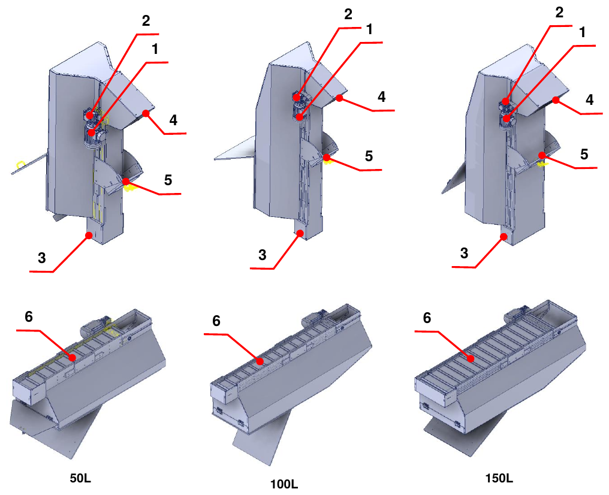
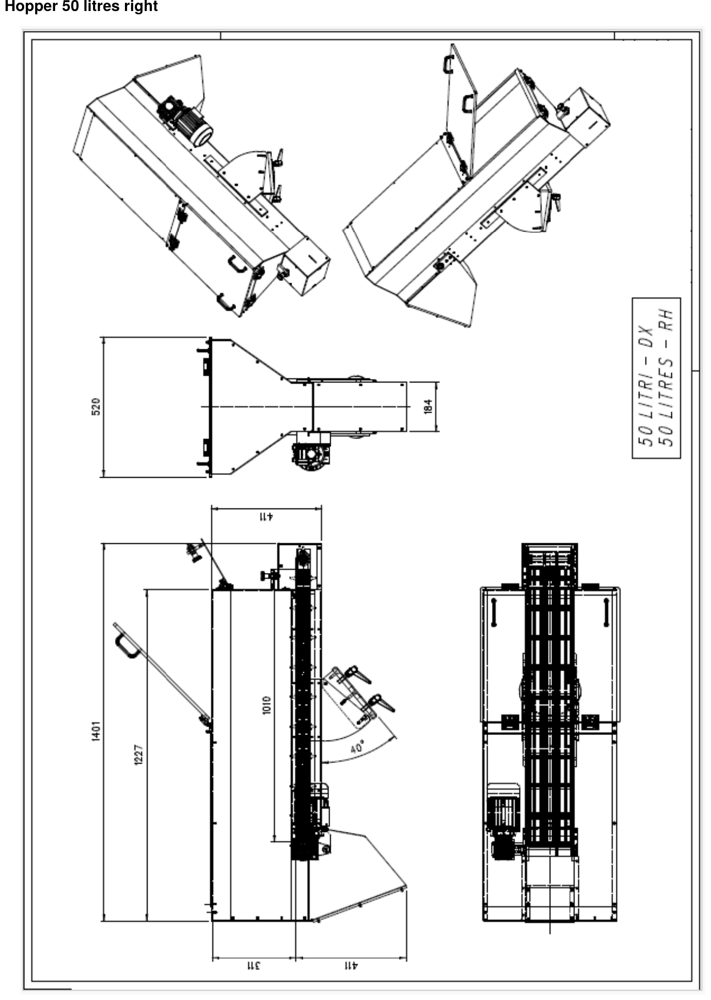
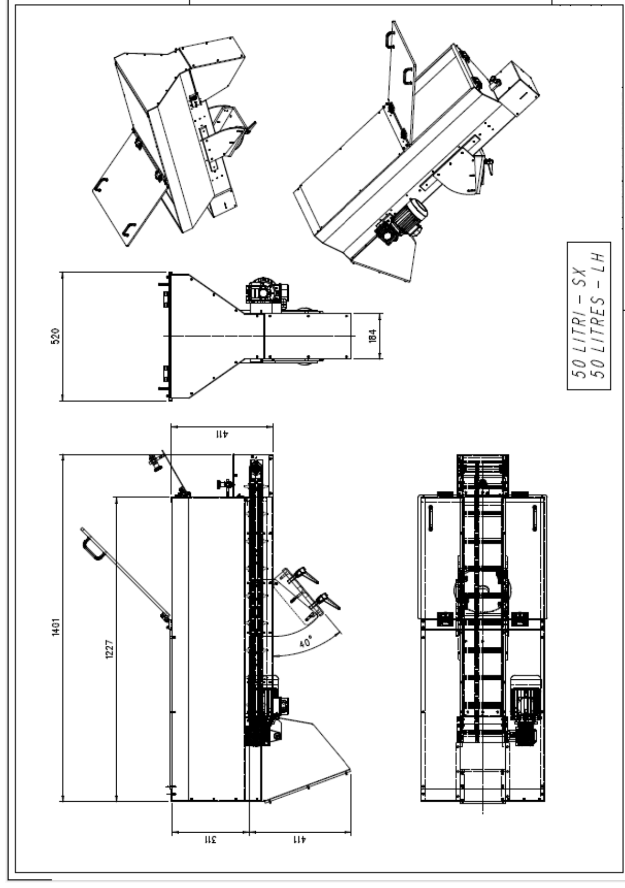
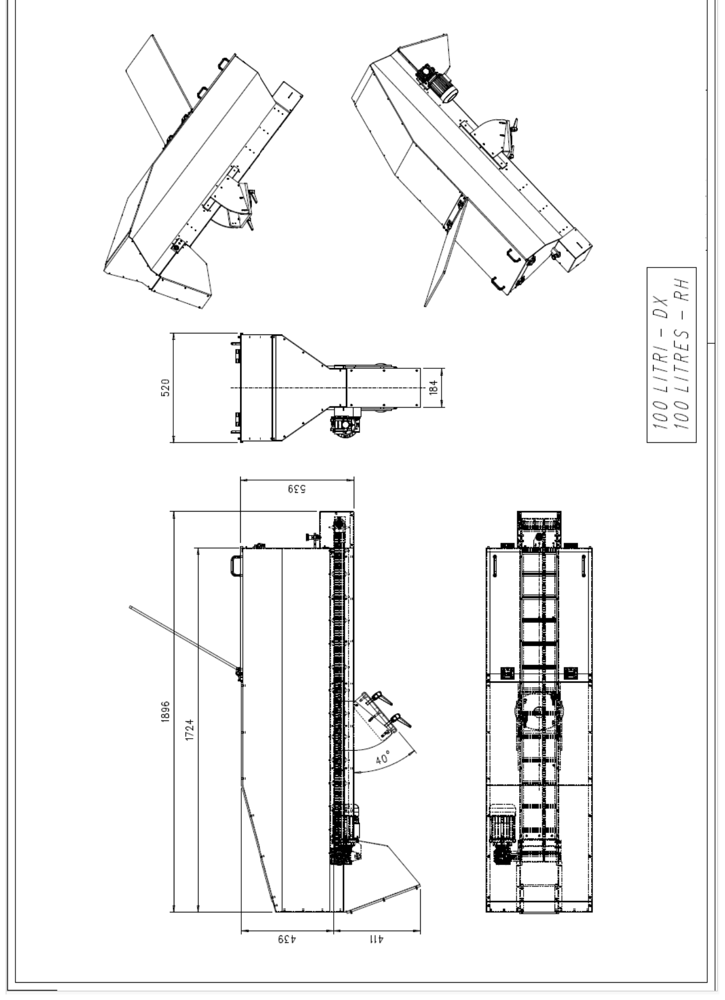
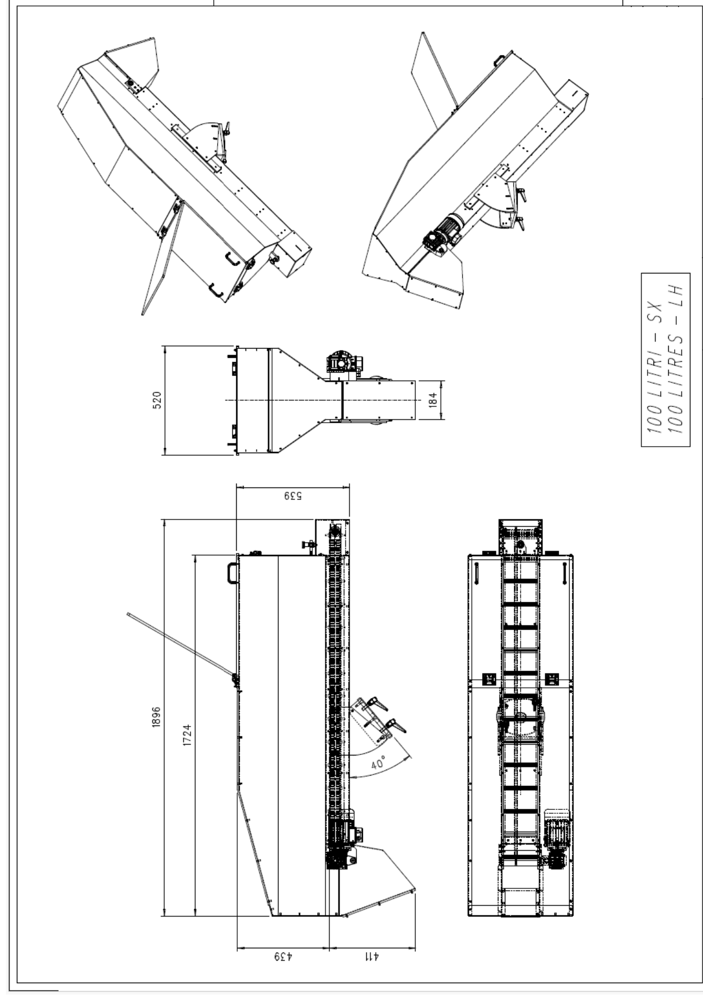
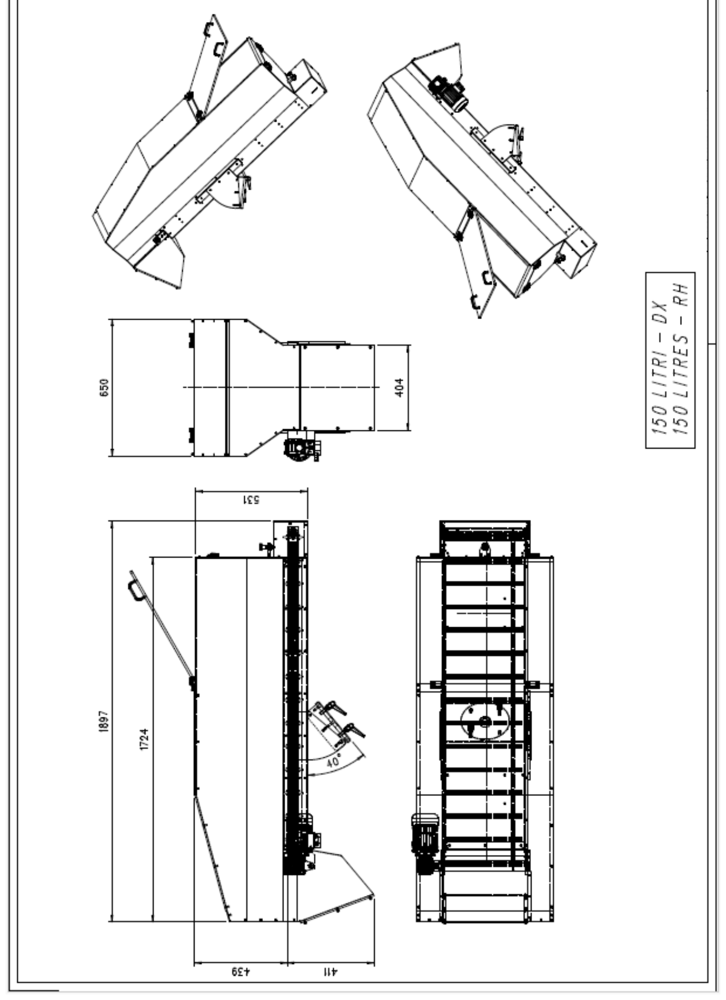
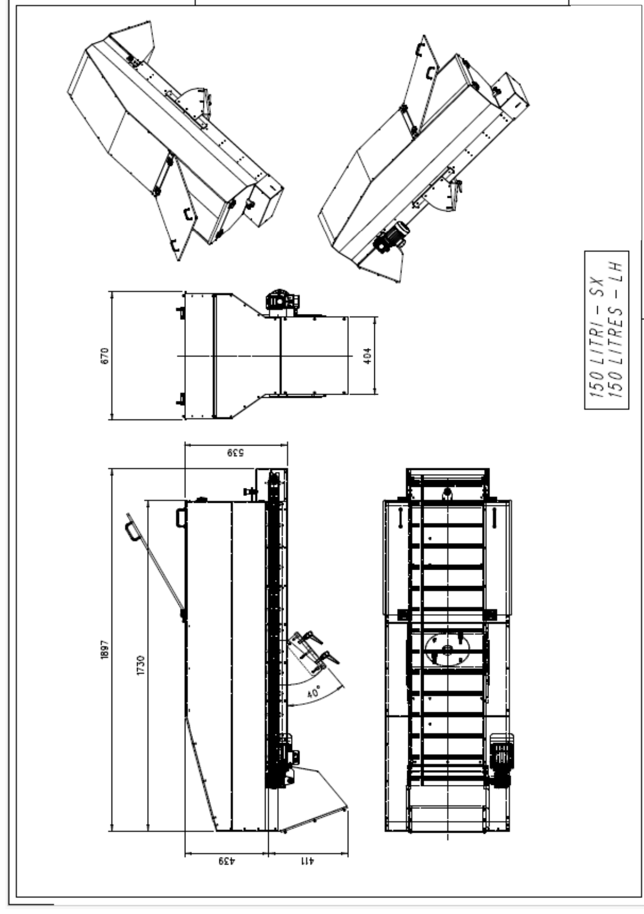
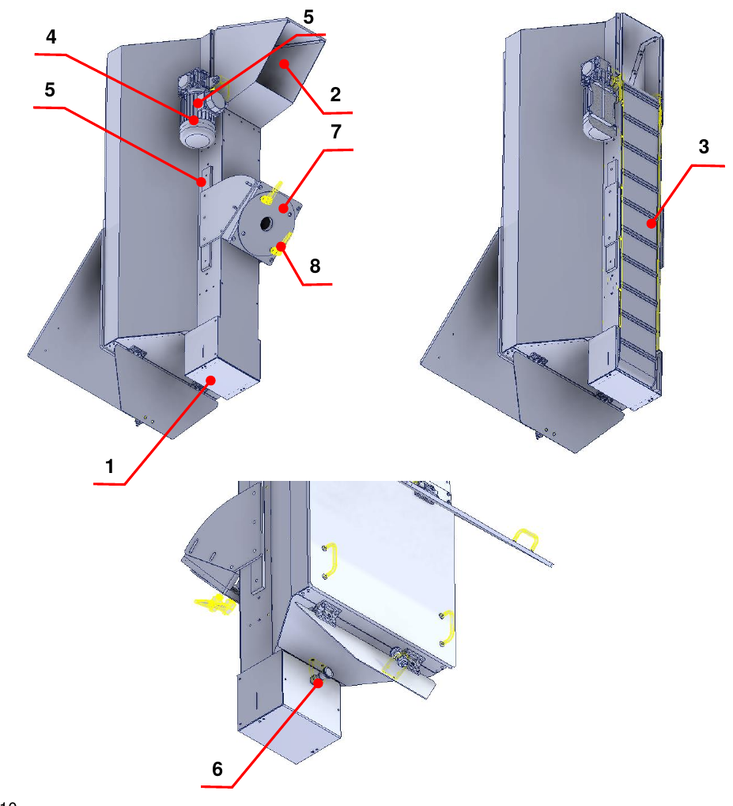

# **Machine Description**

The partly completed machine is designed and built to **transport material from the bottom to the top by means of a paddle belt**.

## Layout

| Pos. | Description | Pos. | Description |
|:--- |:--- |:--- |:--- |
| 1 | Electric motor | 4 | Emptying door |
| 2 | Gearbox | 5 | Adjustable support |
| 3 | Filling door | 6 | Paddle belt |

## Technical Data

The following tables show the main technical characteristics of the partly completed machine.

| | **50 litres** | **100 litres** | **150 litres** |
|:--- |:--- |:--- |:--- |
| **Paddle material** | PVC | PVC | PVC |
| **Maximum / minimum inclination** | 50° / 34° | 50° / 34° | 50° / 34° |
| **Hopper weight** | 75 kg | 100 kg | 125 kg |
| **Belt drive roller diameter** | 50 mm | 50 mm | 50 mm |
| **Belt drive motor** | 0.18 kW, 4 poles, B14 flange – current 0.75 A with star connection, 400 Vac | 0.18 kW, 4 poles, B14 flange – current 0.75 A with star connection, 400 Vac | 0.18 kW, 4 poles, B14 flange – current 0.75 A with star connection, 400 Vac |
| **Rated torque** | 1.2 Nm | 1.2 Nm | 1.2 Nm |
| **Belt drive gearbox** | Worm gear, ratio 1:50 | Worm gear, ratio 1:50 | Worm gear, ratio 1:50 |
| **Maximum permitted load** | Volume 50 litres / weight 30 kg | Volume 100 litres / weight 30 kg | Volume 150 litres / weight 30 kg |

:::{note}
The characteristics indicated may be subject to change: for greater accuracy or checks, refer to the attached diagrams.
:::

## Overall Dimensions

For each size, the right-hand and left-hand drive versions are available.

### 50-litre hopper

### 100-litre hopper

### 150-litre hopper

## Description of the Partly Completed Machine

The partly completed machine has a support structure fitted with a filling door (1), through which the material is introduced, and an emptying door (2) for the material outlet.

Inside the hopper there is a paddle belt (3) driven by an electric motor (4) and a gearbox (5), which moves the material inside the partly completed machine.

The filling door is located in the lower part; its closing and opening is controlled by a dedicated indexing plunger (6). To hold the partly completed machine in position, an adjustable support (7) is provided, operated by means of dedicated handles (8).

