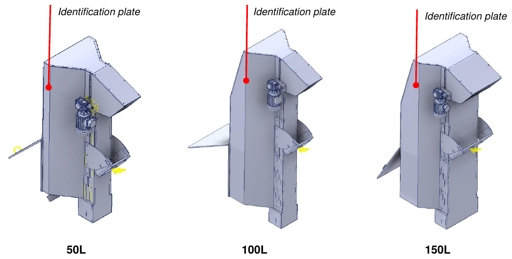
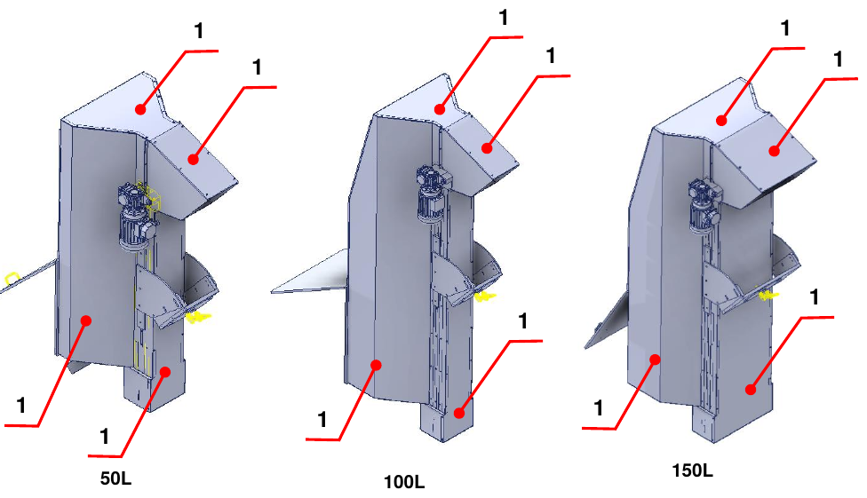
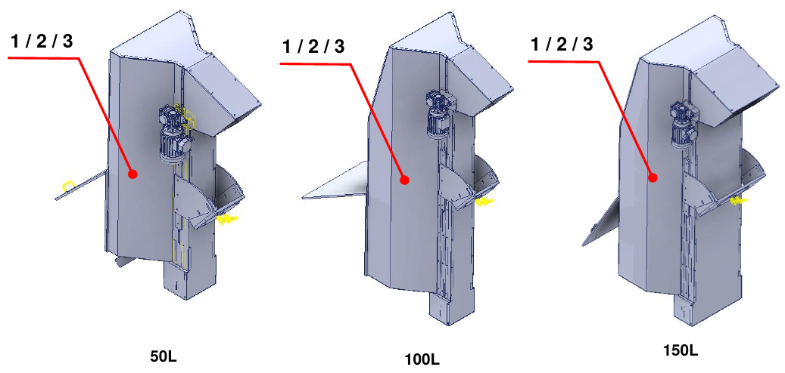

# **Preliminary Information and Safety**

:::{important}
Before installing, using or carrying out maintenance on the machine, carefully read the entire manual and all the attached documentation.

Failure to follow the instructions given may cause:
- damage to the machine;
- loss of safety conditions;
- risks to operators and maintenance personnel;
- loss of the warranty.
:::

## Introduction

The manual contains all the information needed to install, use and maintain the partly completed machine correctly. The Manufacturer requires the document to be read by the personnel in charge of operation and maintenance, as well as by the personnel in charge of transport and assembly.

This document is the instruction manual for the assembly of the **Motorized Hopper 50 L / 100 L / 150 L** (models TRM/MOT 50/100/150 D/S) and is drawn up in accordance with Machinery Directive 2006/42/EC. It is an integral part of the partly completed machine and must be kept until final dismantling, under the care of the person responsible for the partly completed machine after final installation.

:::{note}
ARS S.r.l., the manufacturer of the partly completed machine, is referred to in the manual as the **Manufacturer**. The company that purchases the partly completed machine is referred to as the **Customer**.
:::

## Service and Contacts

The Manufacturer's Technical Office is always available for information or clarification on use, maintenance, installation, etc. Ask questions clearly, with reference to the manual, and always state the data shown on the identification plate of the partly completed machine.

| | |
|:--- |:--- |
| **Manufacturer** | ARS S.r.l. |
| **Address** | Via Aretina Nord, 157 – 52041 Pieve al Toppo (AR), Italy |
| **Contacts** | Tel. +39 0575 398611 · Fax +39 0575 398620 |
| **E-mail / Web** | info@arsautomation.com · www.arsautomation.com |

## Identification

The position of the identification plate, with the main data of the partly completed machine, is shown in the figure for the three sizes.

## Glossary

| Term | Definition |
|:--- |:--- |
| **Emergency stop** | Function intended to prevent the arising of hazards or reduce existing ones to persons, damage to the machine or to the work in progress, activated by a single human action. |
| **Safety component** | Component intended to perform a safety function, placed on the market separately, whose failure and/or malfunction endangers the safety of persons, and which is not essential for the operation of the partly completed machine. |
| **Machinery Directive** | Directive 2006/42/EC of the European Parliament and of the Council on machinery. |
| **Protective device** | Means of protection other than a guard. |
| **Supplier** | Party (manufacturer, installer, system integrator) that supplies equipment or services associated with the partly completed machine. |
| **Safety function** | Function of the partly completed machine whose failure may lead to an immediate increase in risks. |
| **Failure** | Termination of the ability of an item to perform the required function. |
| **Information for use** | Protective measure consisting of communication means (texts, words, signals, symbols, diagrams) used separately or in combination to convey information to the user. |
| **Malfunction** | Inability of a partly completed machine to perform its intended function. |
| **Marking** | Symbol and inscription for the identification of the partly completed machine, applied by the manufacturer. |
| **Material** | Product to be handled. |
| **Safety measure** | Means that eliminates or reduces a hazard. |
| **Operator** | Person in charge of operating the partly completed machine. |
| **Hazard** | Potential source of harm. |
| **Qualified technician / specialized maintenance technician** | Person who has attended specialization courses, vocational training, etc. and is an expert in installation, commissioning, maintenance, repairs, transport and handling of the partly completed machine. |
| **Partly completed machinery** | Assembly which is almost a machine, but which cannot in itself perform a specific application. It is intended exclusively to be incorporated into or assembled with other machines, partly completed machines or equipment to form a machine governed by the directive. |
| **Guard** | Physical barrier, designed as part of the partly completed machine, to provide protection. |
| **Risk** | Combination of the probability of harm and its severity. |
| **Residual risk** | Risk remaining after the adoption of protective measures. |
| **Emergency situation** | Hazardous situation that needs to be urgently ended or avoided. |
| **Transport** | All the operations needed to transfer the partly completed machine from the manufacturer's assembly site to its final location at the customer's premises. |
| **Intended use** | Use of the partly completed machine in accordance with the information for use provided in the instructions. |
| **Reasonably foreseeable misuse** | Use of the partly completed machine in a way not intended by the designer, but which may result from easily foreseeable human behaviour. |
| **User** | Party that uses the partly completed machine and the related electrical equipment. |
| **Working area** | Volume bounded by the safety guards and intended for the operation of the partly completed machine. |
| **Hazardous zone** | Any space inside and/or around the machine in which a person can be exposed to a hazard. |

## Symbols Used in the Manual

| Symbol | Meaning |
|:--- |:--- |
| **DANGER** | Imminent danger situation that, if not avoided, may cause serious injury or death to the operator. Identifies strictly prohibited operations and mandatory procedures to be applied to avoid them. |
| **WARNING** | Potentially hazardous situation that, if not avoided, may cause serious injury or death to the operator. Describes operations that require particular attention. |
| **CAUTION** | Non-immediate or potential danger situation that, if not avoided, may cause even minor injury or damage to the operator's health. |
| **NOTE** | Important information and/or procedures that, if ignored or only partially observed, may damage the partly completed machine or the connected equipment. |
| **ADDITIONAL INFORMATION** | Useful information and/or references to other documentation (attached instruction manuals, technical documents or other sections of the manual). |

## Safety Rules

The requirements, instructions, regulations and related safety notes described in the manual define the behaviours and rules to be followed in the activities that constitute the intended use of the partly completed machine, in order to operate safely for personnel, equipment and the surrounding environment. The safety instructions are addressed to all authorized, trained personnel delegated to the activities of:
- transport;
- installation;
- use;
- management;
- maintenance;
- cleaning;
- decommissioning and dismantling.

## Manufacturer's Liability

The Manufacturer declines all liability arising from incorrect or improper use of the partly completed machine and from damage caused by the use of non-prescribed spare parts, by incorrectly performed maintenance and by tampering with circuits and components.

Responsibility for applying the safety requirements lies with the technical personnel in charge of the activities planned for the partly completed machine, who must ensure that authorized operators are qualified and that they comply with and know the requirements of the manual and the general safety rules. Failure to follow the safety instructions may cause injury to persons and damage to equipment.

## Management of the Partly Completed Machine

Operation is permitted only to authorized persons who are adequately trained or in any case have adequate technical competence. Those who use and maintain the partly completed machine must know that knowledge and application of the safety rules are an integral part of their job.

Before starting the partly completed machine:
- read the manual carefully;
- know which guards and emergency stop devices are present, where they are located and how they work.

Removal, even partial, of guards, safety devices and warning plates applied to the partly completed machine is strictly forbidden. In the event of malfunction or failure of these devices, they must be repaired or replaced immediately.

## Warranty

The Manufacturer guarantees that its machines are free from material and/or manufacturing defects. For any clarification, refer to the contractual conditions.

- The buyer is entitled only to the replacement of the parts recognized as defective; packaging, transport and any installation costs are borne by the buyer. In this case the following must be specified: date and number of the purchase document, model of the partly completed machine, serial number.
- No compensation is granted for loss of production caused by any periods of inactivity of the partly completed machine.
- Damage caused by use other than that indicated in the manual, including maintenance not in accordance with the instructions, is excluded from the warranty.
- The warranty is not recognized for partly completed machines on which unauthorized modifications have been made. Modifications or tampering with the safety devices are strictly forbidden.
- In the event of damage during the warranty period, the warranty is valid only if original spare parts are used.
- Repairs may only be carried out by qualified operators who know the partly completed machine.

## Safety

### General information

The Customer must train the operators on the risk of accidents, on the safety devices installed on the partly completed machine and on the general accident-prevention rules laid down by Community directives and by the legislation of the country of installation. Operators must know the position and function of all the controls and the characteristics of the partly completed machine.

Tampering with or unauthorized replacement of one or more components, the adoption of accessories and the use of parts other than those recommended may result in risk of injury.

:::{warning}
It is absolutely forbidden to bypass or tamper with the safety devices of the partly completed machine. The Manufacturer declines all liability for the safety of the partly completed machine if this prohibition is not complied with.
:::

:::{warning}
It is up to the operator using the partly completed machine to make sure the area is safe and free of persons and/or objects.
:::

### Certification

The partly completed machine is supplied with the Declaration of Incorporation, in compliance with the essential safety requirements specified in Machinery Directive 2006/42/EC (Annex II B) and in the Electromagnetic Compatibility Directive 2014/30/EU.

:::{note}
Any modification made to the partly completed machine immediately voids the Certification of Incorporation issued by the Manufacturer.
:::

### Intended and unintended uses

The partly completed machine is designed and built to **transport material from the bottom to the top by means of a paddle belt**. It cannot be used for purposes other than those intended, nor for processing parts beyond the agreed limits.

:::{danger}
Use of the partly completed machine for processing purposes not described in the manual is **IMPROPER USE**. The Manufacturer declines all liability for damage to property and/or persons, and considers any type of warranty void. The Manufacturer declines all liability in the event of tampering, unauthorized modifications or maintenance carried out by untrained personnel.
:::

:::{warning}
The partly completed machine must be used only by experienced and qualified operators who have read and understood the contents of the manual.
:::

:::{note}
It is forbidden to carry out any movement in the event of abnormal behaviour of the partly completed machine or loss of power, because this is the specific responsibility of the maintenance personnel.
:::

### Operating environmental conditions

The partly completed machine must be installed in a covered environment, equipped with all the safety measures required by the laws in force in the user's country.

| Aspect | Indication |
|:--- |:--- |
| **Fire protection** | The partly completed machine has no fire-fighting system of its own. |
| **Explosive atmosphere** | It is neither designed nor built to work in explosive or partially explosive atmospheres. |
| **Lighting** | It has no lighting system of its own: it is the customer's duty and responsibility to place it in an adequately lit area. |
| **Noise** | Measured in accordance with acoustic standards. Without load, the overall noise generated is below **75 dB(A)**, measured at the operator's position. The actual level depends on the type of processing; measuring workers' noise exposure is the responsibility of the user, in accordance with the legislation in force in their country. |
| **Electromagnetic emissions** | The emission values comply with the standards thanks to the use of EMC-compatible components, proper connections and, where necessary, filters. Non-compliant maintenance of the electrical system or incorrect replacement of components may compromise their effectiveness. |
| **Vibrations** | The partly completed machine does not produce vibrations hazardous to the health of personnel. Excessive vibration can only be caused by a mechanical failure, which must be reported and eliminated immediately. |

### Safety functions

| Type of device | Function |
|:--- |:--- |
| **Fixed guards** | Segregation of the hazardous zones of the partly completed machine. |

**Fixed guards:** prevent access to moving parts during operation. They are not monitored and must be removed only for maintenance operations, with the energy sources of the partly completed machine disconnected.

:::{warning}
The Manufacturer is in no way liable if the partly completed machine is used with incomplete, open and/or uninstalled guards.
:::

### Personal Protective Equipment (PPE)

The operator must use personal protective equipment to minimize the possibility of risks.

:::{warning}
Personnel must wear suitable work clothing to prevent accidents. To avoid mechanical risks (entanglement, trapping, etc.) keep hair tied back and do not wear bracelets, watches, rings or necklaces.
:::

:::{note}
The clothing of anyone working on or performing maintenance on the partly completed machine must comply with the essential safety requirements laid down by EU directives and by the laws of the country of installation.
:::

### Residual risks

During the design phase all high-risk areas or parts were assessed and the necessary precautions were taken to avoid risks to persons and damage to the components of the partly completed machine. The risk analysis carried out, kept in the Manufacturer's Technical File, shows no residual risks.

:::{warning}
Periodically check the operation of all safety devices. Do not remove the installed guards.
:::

### Plates applied to the partly completed machine

The Manufacturer has installed on the partly completed machine a series of warning plates, defined in accordance with European standards on the graphic symbols to be used and placed in a clearly visible position. The maintenance service must immediately replace all plates that become illegible due to wear.

:::{warning}
It is absolutely forbidden to remove the warning plates applied to the partly completed machine. The Manufacturer declines all liability for the safety of the partly completed machine if this prohibition is not complied with.
:::

:::{note}
For information on the warning plates installed on the incorporated parts of the partly completed machine, consult the specific manuals.
:::

| Plate | Description |
|:--- |:--- |
| 1 | Do not touch moving parts. |
| 2 | Do not remove the safety devices. |
| 3 | Mandatory: read the operation and maintenance manual. |
