# **Maintenance**

## General safety precautions

Maintenance, troubleshooting and repairs are reserved exclusively for authorized personnel. The personnel in charge of operation and maintenance must be well trained and fully familiar with the accident-prevention rules; unauthorized personnel must stay out of the work area during operations. The safety precautions in this section must always be observed. At the end of every intervention it is mandatory to restore the protections, checking that they work correctly.

### General hazard warnings

- High voltages can cause death on contact. Always work with the utmost caution and in accordance with the safety regulations in force in the country.
- On the partly completed machine in operation there are moving parts that can cause serious harm to persons. Specialist cleaning and maintenance operations involving the removal or replacement of components or control units must be carried out with the power disconnected and with the systems not under pressure.
- The main power switches must be in the OFF position and locked with a safety padlock.
- Apply suitable warning signs ("PARTLY COMPLETED MACHINE UNDER MAINTENANCE – DO NOT POWER") on the electrical panel and on the air treatment unit.
- Keep away from vent holes and taps during system pressure relief operations.
- Always wear protective glasses and gloves when working on the equipment.
- Make sure the tools in use are in perfect condition and fitted with insulated handles, where required.
- Check that the insulation of the cables and conductors of the test equipment shows no breakage or damage whatsoever.
- Equipment that is not earthed can cause serious personal injury. Always make sure the earth connections are present and comply with the standards.
- In the event of fire never use jets of water on the equipment: disconnect all power supplies and use CO2 extinguishers.
- Before making the connections, check them carefully and make sure there are no defects or dirt on the threads.
- Before pressurizing the system after a repair, check the tightness of fittings and joints.
- Before starting the equipment always make sure the maintenance personnel are outside the protected space and that no tools or materials have been left nearby.
- Troubleshooting must be carried out, as far as possible, while staying outside the protected area; when it is necessary to work with the control unit and the system powered, take all the precautions required by the safety standards for working in the presence of hazardous voltages and live moving units.
- Do not wear anything that could get caught in the equipment or act as a conductor (necklaces, bracelets, etc.).
- Maintenance, repair and troubleshooting must end with a check that the partly completed machine is working correctly and with the restoration of all safety devices.

### General warnings

- Maximum reliability and lowest maintenance costs are the result of a maintenance and inspection programme that is planned and followed scrupulously throughout the life of the partly completed machine. Comply with the maintenance intervals indicated and schedule interventions according to the specific needs of the production cycle.
- If interventions of a certain scale are required, contact the Manufacturer for any doubts or technical assistance.
- Before starting any checking and maintenance operation, remove dirt from the partly completed machine.
- For cleaning always use perfectly dry air at a pressure not exceeding 0.2 MPa.
- Always use tools in perfect condition and specifically designed for the operation to be performed: unsuitable or inefficient tools can cause serious damage.
- During disassembly, mark the individual parts with a tag to ensure they are refitted correctly.
- After any maintenance involving the disconnection of wiring and/or fixed and moving parts, check that the numbering of the fixed and moving parts matches.
- Before putting the equipment back into operation after a failure, inspect and check it carefully to identify any damage.
- In addition to traditional maintenance activities, the maintenance technician must also carry out, when required, predictive maintenance operations consisting of instrumental analyses and specialist checks, aimed at predicting in time the occurrence of failures of certain components.

## Qualification of maintenance personnel

:::{warning}
The Safety Manager must ensure that all persons working on the partly completed machine have received all the instructions contained in the manual, including the initial installation and commissioning operations.
:::

Maintenance personnel must:
- know the directives in force on accident prevention when working on machines and be able to apply them;
- have read and understood the safety chapter;
- know the basic construction and functions of the handling systems;
- know how to use and consult the construction documents and the documentation of the partly completed machine;
- take responsibility for their own decisions on interventions on the partly completed machine;
- be willing to adapt to technological changes on the partly completed machine;
- observe irregularities in the production process and, if necessary, take appropriate measures.

## Safety check plan

:::{warning}
Periodically check the efficiency of the safety systems of the partly completed machine. This procedure must be repeated as normal maintenance practice.
:::

Maintenance personnel are obliged to periodically check the operation of the safety devices. The operation must be carried out by competent personnel with specific knowledge of the use of safety devices.

:::{warning}
Carry out the functional, tightening and positioning checks of the safety systems indicated in the *Safety functions* section.
:::

## Stopping procedure for the partly completed machine

Before carrying out the maintenance procedures described below, the operator must stop the partly completed machine and put it in maintenance state by following this procedure:
- check for any residual energy and, if necessary, discharge it before working on the devices;
- apply the sign "DO NOT MOVE – MACHINE UNDER MAINTENANCE" near the main switch;
- after the maintenance work, restore the energy sources previously deactivated;
- before resuming normal operation, check the entire system again, as described in the manual.

## Safety rules for maintenance

The main precautions to be taken during maintenance work:
- complex operations on the partly completed machine are permitted only to specialized operators;
- never touch bare terminals or electrical devices before disconnecting the power supply (main switch in OFF position);
- disconnect the electrical power before removing any fixed guard or replacing any electrical component;
- do not wear rings, watches, necklaces or bracelets during maintenance;
- place a high-impedance rubber mat under the feet during interventions; do not work on wet floors or in very humid environments; avoid the build-up of static electricity that could damage electrical components;
- always wear gloves and protective clothing covering as many parts of the body as possible;
- do not use open flames, pointed tools or pins for cleaning;
- do not smoke.

## Maintenance table

To guarantee the reliability of the partly completed machine, regular and effective maintenance and constant monitoring of the indicating instrument parameters must be ensured. Maintenance, troubleshooting and repairs are permitted only to authorized personnel.

| Frequency | Description | Means |
|:--- |:--- |:--- |
| Daily | Carry out a thorough cleaning of the partly completed machine. | Cloth + alcohol |
| Monthly | Check that the paddle belt is correctly tensioned. | Manual |
| Monthly | Check the tightening of screws and nuts on the moving parts. | Torque wrench |
| Monthly | Check the wear of the moving parts. | Visual check |

## Lubrication table

| Component | Recommended lubricant |
|:--- |:--- |
| Rotating discs | Gear oil, ISO VG 320 |
| Hydraulic brakes | Hydraulic oil, ISO VG 46 |
| Moving parts in general | Multipurpose EP grease |

## Mechanical adjustments

### Belt tensioning and adjustment

The partly completed machine includes a paddle belt that lifts the parts from the loading tank to the outlet chute. For the belt to run correctly it must be tensioned and adjusted by means of the screws.

**Tensioning** serves to prevent any slipping between the belt and the drive roller, while **adjustment** ensures that the belt stays in the correct position during travel and does not drift to the left or right.

Tensioning and adjustment are carried out by tightening or loosening the M8 screws **while the belt is moving**, then checking the behaviour of the belt on both sides of the roller. The adjustment must be carried out simultaneously on the left and right side, because the right balance between the two screws must be found.

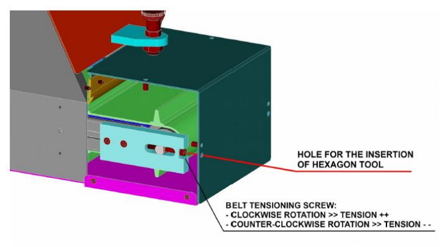

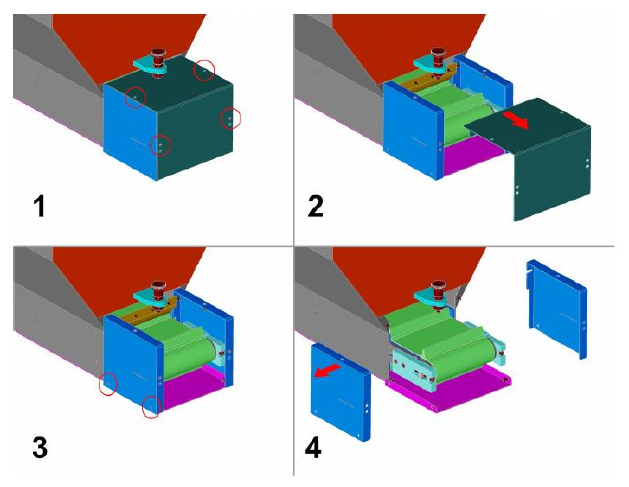

### Replacing the paddle belt

:::{warning}
This operation must only be carried out by experienced technicians, with adequate knowledge and tools. If in doubt, contact ARS technicians.
:::

| Phase | Action |
|:--- |:--- |
| 1 | Disconnect the hopper from the power sources, to avoid unintentional movement of the belt. |
| 2 | Separate the hopper from the support structure (not included in the supply): it is recommended to use suitable lifting equipment (e.g. slings) to avoid sudden movements of the load during handling. Once separated, rest the hopper on a flat surface, lying on one side with the motor facing down. To keep it in position, insert a block between the floor and the side of the hopper. |
| 3 | Separate the side plate from the hopper body. |
| 4 | Separate the lower cover (made up of 3 parts: central part + right side + left side) from the hopper body. |
| 5 | Separate the emptying door from the hopper body. |
| 6 | Separate the fixed guard on the upper side of the hopper from the main body. |
| 7 | Separate the outlet chute from the hopper body. First remove the 4 highlighted screws (two on the upper side + two on the lower side); then remove the other screws joining the outer parts of the sheet metal. |
| 8 | Separate the transparent guard from the upper side of the hopper body. |
| 9 | Separate the filling door from the hopper body. |
| 10 | Separate the side sheet from the hopper body. |
| 11 | Completely loosen the belt as described in *Belt tensioning and adjustment*. |
| 12 | Remove the belt by pulling it upwards. If loosening is not enough to clear the side plates that guide the belt, it will be necessary to remove them. |
| 13 | Insert the new belt, letting it drop in from above. |
| 14 | Carry out a first tensioning of the belt, to ensure good grip between the drive roller and the belt. Fine tension adjustment will be carried out later, when it is possible to run the belt. |
| 15 | Refit the side sheet on the hopper body (see step 10). |
| 16 | Refit the filling door on the hopper body (see step 9). |
| 17 | Refit the transparent guard on the upper side of the hopper (see step 8). |
| 18 | Refit the discharge chute on the hopper body (see step 7). First reinsert the screws between the outer parts of the sheet metal, then the four highlighted screws (two from above + two from below). |
| 19 | Refit the upper fixed guard on the hopper body (see step 6). |
| 20 | Refit the emptying door on the hopper body (see step 5). |
| 21 | Refit the lower cover (3 parts: central part + right side + left side) on the hopper body (see step 4). |
| 22 | Refit the side plate on the hopper body (see step 3). |
| 23 | Refit the hopper on the support structure. It is recommended to use suitable lifting equipment (e.g. slings) to avoid sudden movements of the load during handling. |
| 24 | Reconnect the hopper to the power sources. |
| 25 | Start the hopper with no parts inside and carry out the fine adjustment of the belt tension. |

**Reference figures (steps 2–12)**

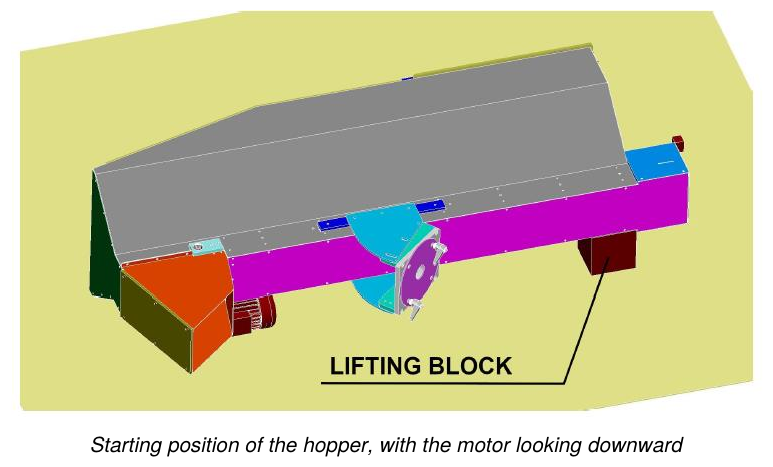

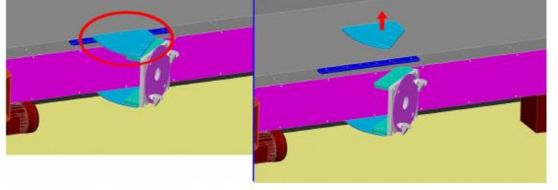

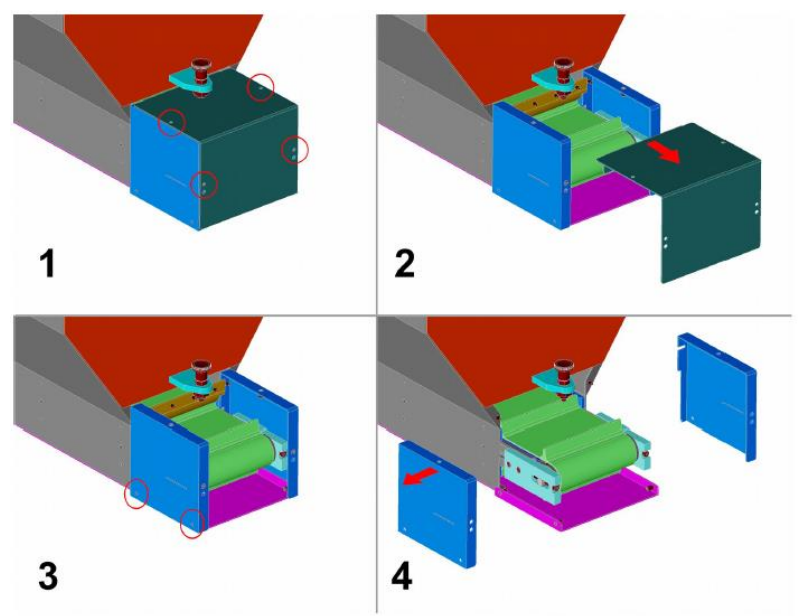

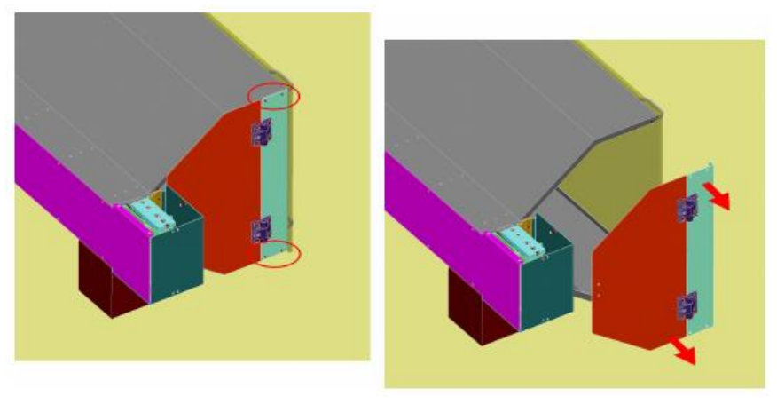

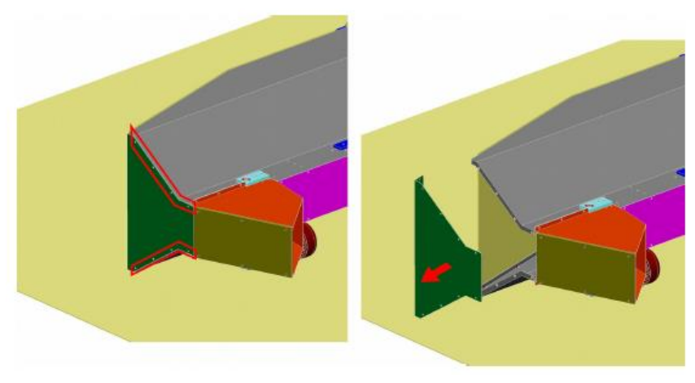

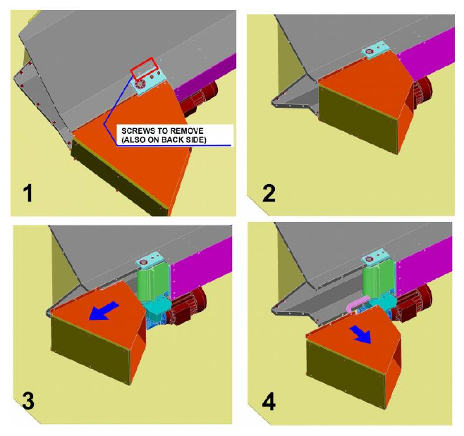

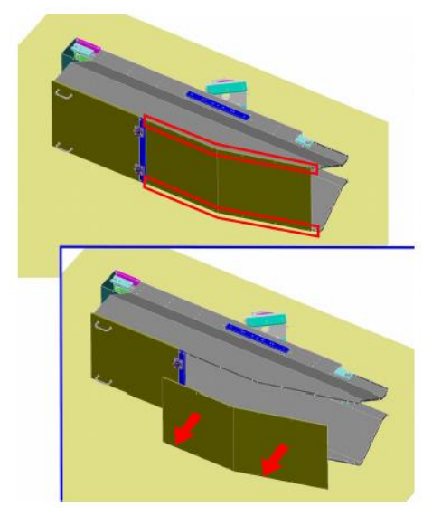

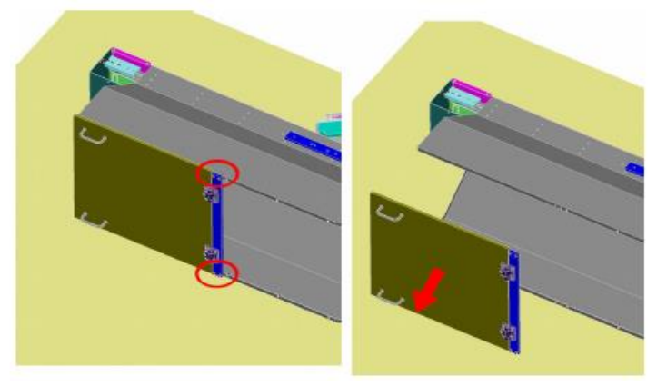

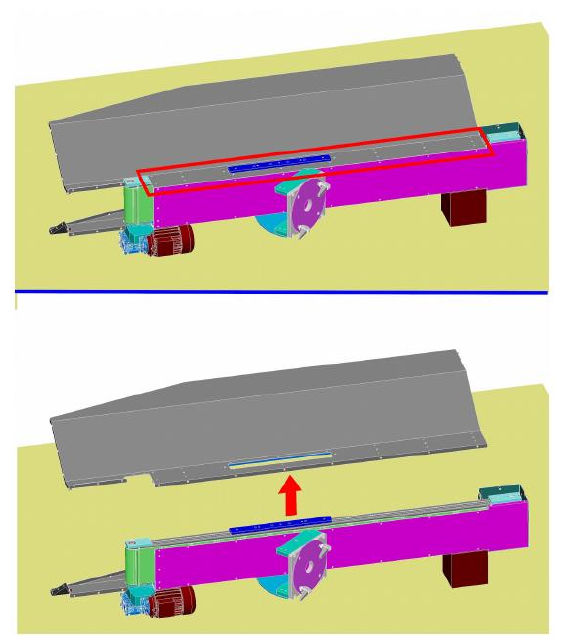

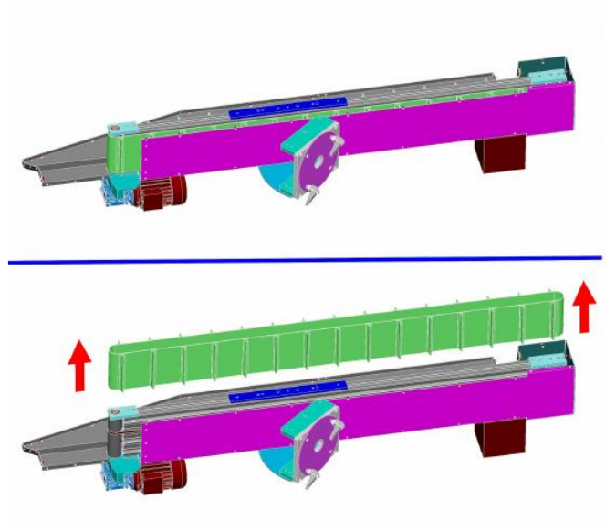

## Diagnosis of mechanical faults

| Fault | Causes | Solutions |
|:--- |:--- |:--- |
| **Lubricating oil leak** | 1. Worn seal. 2. Excessive amount of lubricating oil. | 1. Replace the worn component. 2. Reduce the amount of lubricating oil. |
| **Scratches or play in the guide systems (rods, bushings, guides)** | 1. Wear of the components. 2. Need for adjustment. 3. Insufficient lubrication. | 1. Replace the worn component. 2. Adjust the component. 3. Restore the correct lubricant level. |

## Extraordinary maintenance

Extraordinary maintenance work is non-routine work, relating to the replacement of components subject to wear/breakage and to the disassembly of parts of the partly completed machine. Moreover, such work:
- may extend the useful life and/or, secondarily, improve efficiency, reliability, productivity, maintainability and inspection procedures;
- do not change the original characteristics (plate data, sizing, construction values, etc.) or the essential structure;
- do not create changes in the intended use.

:::{warning}
Extraordinary maintenance work must be carried out only by qualified technicians, experts in the various fields (electrical or mechanical).
:::

:::{note}
To proceed with extraordinary maintenance work, contact the Manufacturer, as indicated in the *Service and Contacts* section.
:::

## Maintenance work record sheet

| Date | Operator | Description of the work |
|:--- |:--- |:--- |
| | | |
| | | |
| | | |
