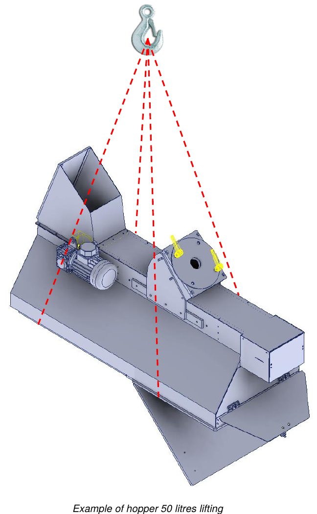

# **Packaging, Transport and Installation**

## Packaging

The partly completed machine is shipped by the Manufacturer from the production plant to the Customer's premises packed in **cellophane film**.

The packaging does not protect against external weather such as rain, snow, hail, etc.: if the partly completed machine remains exposed to the elements it must be kept in closed containers until final storage. All external parts subject to oxidation (machined surfaces, unpainted parts, etc.) are protected by a film of anti-oxidation oil.

:::{note}
The load must always be kept in an upright position.
:::

## Transport

The anchoring points for lifting are indicated on the shipped packaging. All the information for identifying the contents and for safe handling is also shown on the outside of the packages:
- address of the recipient and the sender;
- dimensions (length, width, height);
- gross weight, net weight and tare;
- centre of gravity;
- notes and symbols (e.g. fragile, this way up, etc.);
- document pocket with the packing list.

## Lifting and Handling

Before any handling and/or lifting, it is important to know the weight.

:::{note}
- All handling and lifting operations must be carried out by qualified operators who know and comply with the rules on the lifting and handling of loads.
- Use lifting equipment suited to the weight and dimensions of the load.
- Always check that the load is correctly balanced. If it is unbalanced, immediately set it down on the ground and reposition the forks/slings.
- For long-distance transport it is recommended to place the hopper on a pallet and secure it with suitable straps. The pallet must then be moved with a pallet truck or forklifts.
:::

:::{warning}
When the load is lifted more than 50 cm off the ground, operators must stay at a safe distance, more than 2 m from the perimeter. An uncontrolled movement of the load is in fact a serious danger to the safety of the operators.
:::

| Description | Weight |
|:--- |:--- |
| **50-litre hopper** | approx. 75 kg |
| **100-litre hopper** | approx. 100 kg |
| **150-litre hopper** | approx. 125 kg |

### Lifting with an overhead crane

To lift and move the partly completed machine, proceed as follows:
- sling the partly completed machine appropriately at the points indicated;
- fasten the straps to the hooks of the lifting equipment;
- lift the load slowly, avoiding sudden movements, and transfer it keeping it as close to the ground as possible;
- once at the destination, lower the load slowly and gradually;
- remove the straps only after the load rests perfectly on the ground.

## Installation

Before installing the partly completed machine, the protective packaging and any fixing restraints used for transport must be removed.

### Integrity check

Check that the partly completed machine has not been damaged during transport. In the event of accidents or visible damage (signs or traces of impact) proceed as follows:
- note the damage on the transport document;
- inform the carrier and the Manufacturer of the damage found by registered letter, within 48 hours of receiving the partly completed machine.

### General safety precautions

The operations described in this chapter must be carried out by authorized personnel. Unauthorized persons must stay outside the installation area.

:::{warning}
Make sure that during installation there are no elements (cables, pipes, etc.) in the surrounding area that could cause interference or hazards to operators.
:::

:::{note}
The operators in charge of installation, connection, checks and inspections must be well trained, to avoid incorrect operations that could damage the partly completed machine. For information on the incorporated devices, consult the specific manuals.
:::

### Choosing the place of use and checking the installation requirements

The Customer **MUST** provide:
- a sufficiently large area free of obstacles, equipped in accordance with the safety regulations in force in the user's country;
- proper ventilation and lighting;
- operating spaces;
- walkways;
- escape routes;
- flooring able to support the weight of the partly completed machine;
- general electrical power supply, including the earth conductor, according to the characteristics and tolerances required;
- pneumatic supply according to the characteristics and tolerances required.

### Positioning

Before starting to operate, mount the partly completed machine on a stable support structure of sufficient rigidity and strength. The maximum load of the support structure must be **at least 2 times** the weight shown on the plate of the partly completed machine.

Then check the correct levelling by placing a spirit level on a flat surface, both lengthwise and crosswise. For further information, contact the Manufacturer's technical service.

### Connections

:::{warning}
The power supply connection operations must be carried out only by experienced technicians, who must use the necessary personal protective equipment.
:::

:::{note}
All connections of the external power supply of the partly completed machine must be made during installation under the supervision of the Manufacturer. It is strictly forbidden to connect the partly completed machine to external power sources before the Manufacturer's technicians arrive. The electrical connection required for the operation of the partly completed machine is the Customer's responsibility.
:::

## Checks and Inspections

Before start-up, carry out a series of general checks and inspections, to avoid problems during operation of the partly completed machine.

:::{warning}
The first start-up must be carried out by an experienced technician of the Manufacturer.
:::

:::{note}
Before starting any movement, make sure there are no failures, to avoid damage to the partly completed machine. The checks and inspections listed below are to be considered normal maintenance operations.
:::

### General checks on the mechanical units

- Carry out a general visual inspection of the various groups that make up the partly completed machine, making sure there are no particular mechanical anomalies or foreign bodies.
- Check that the parts of the partly completed machine and the related guards are correctly anchored.
- Check the tightening of screws and nuts on the main components.

In case of problems, contact the Manufacturer immediately.

### Tightening torques

The following table gives the tightening torques for each screw size. Use a torque wrench for tightening.

| Screw Ø | Pitch | Pre-tightening torque [kgm] | Tightening torque [kgm] |
|:---: |:---: |:---: |:---: |
| M6 | 1 | 0.75 | 1 |
| M8 | 1.25 | 1.8 | 2.4 |
| M10 | 1.5 | 3.6 | 4.8 |
| M12 | 1.75 | 6.5 | 8.5 |
| M14 | 2 | 10 | 13 |
| M16 | 2 | 15 | 20.5 |
| M18 | 2.5 | 22 | 29 |
| M20 | 2.5 | 30 | 40 |
| M22 | 2.5 | 42 | 56 |
| M24 | 3 | 50 | 70 |
| M27 | 3 | 80 | 105 |
| M30 | 3.5 | 95 | 130 |

### Checking the commercial devices

In general, check the installed commercial units, in particular:
- correct connection to the power sources;
- that they are correctly installed and work correctly.

For further information consult the attached documentation of each device.

### Checking the safety systems

Check that the installed guards and safety devices are correctly fitted and working.

:::{warning}
The safety of the partly completed machine cannot be guaranteed if the safety devices are removed or tampered with.
:::

:::{note}
Carry out the functional, tightening and positioning checks of the safety systems indicated in the *Safety functions* section. This procedure is to be adopted as a normal maintenance procedure.
:::

## International Recycling Codes

| Code | Description |
|:--- |:--- |
| **Plastics** | |
| #1 PET / PETE | Polyethylene terephthalate: water bottles, soft drinks, shampoo |
| #2 HDPE | High-density polyethylene: yoghurt containers, detergent bottles |
| #3 PVC | Polyvinyl chloride: food containers |
| #4 LDPE | Low-density polyethylene: frozen food bags, squeezable bottles |
| #5 PP | Polypropylene: bottles |
| #6 PS | Polystyrene: disposable cups |
| #7–#19 | Other plastics |
| **Paper** | |
| #20 PAP | Corrugated cardboard: boxes of flat-pack furniture |
| #21 PAP | Non-corrugated cardboard: sandwich packaging in fast-food restaurants |
| #22 PAP | Paper: crisp packets in fast-food restaurants, newspapers, paper bags |
| #23–#39 | Other types of paper |
| **Metals** | |
| #40 FE | Steel |
| #41 ALU | Aluminium: cans |
| #42–#49 | Other types of metal |
| **Wood** | |
| #50 FOR | Wood |
| #51 FOR | Cork |
| #52–#59 | Other types |
| **Textiles** | |
| #60 TEX | Cotton |
| #61 TEX | Jute |
| #60–#69 | Other textile materials |
| **Glass** | |
| #70 | Clear / colourless glass: water bottles |
| #71 | Green glass: wine bottles |
| #72 | Brown glass: beer bottles |
| #73–#79 | Other glass materials and cans |
| **Composite materials** | |
| #80 | Paper and cardboard / various metals |
| #81 | Paper and cardboard / plastic |
| #82 | Paper and cardboard / aluminium: biscuit bags |
| #83 | Paper and cardboard / tinplate |
| #84 | Paper and cardboard / plastic / aluminium |
| #85 | Paper and cardboard / plastic / aluminium / tinplate |
| #86–#89 | Other composite materials |
| #90 | Plastic / aluminium |
| #91 | Plastic / tinplate |
| #92 | Plastic / various metals |
| #93–#94 | Other composite materials |
| #95 | Glass / plastic |
| #96 | Glass / aluminium |
| #97 | Glass / tinplate |
| #98 | Glass / various metals |
| #99 | Other composite materials |
