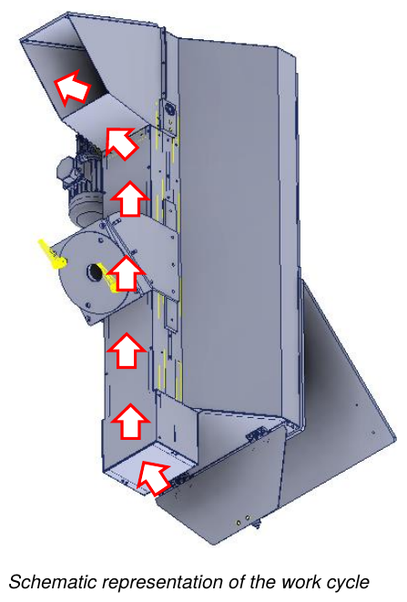

# **Use**

## Initial checks

Before starting the partly completed machine, the operator must check that:
- all power sources are correctly connected to their respective lines;
- there are no foreign bodies inside the partly completed machine;
- the safety devices present work correctly;
- the partly completed machine is not in repair / cleaning state;
- all guards are correctly positioned and secured.

## Work cycle

After the partly completed machine has been started, following the checks carried out by the operator, the work cycle is as follows:
- the material is lifted by the paddle belt, driven by the electric motor, up to the outlet.

