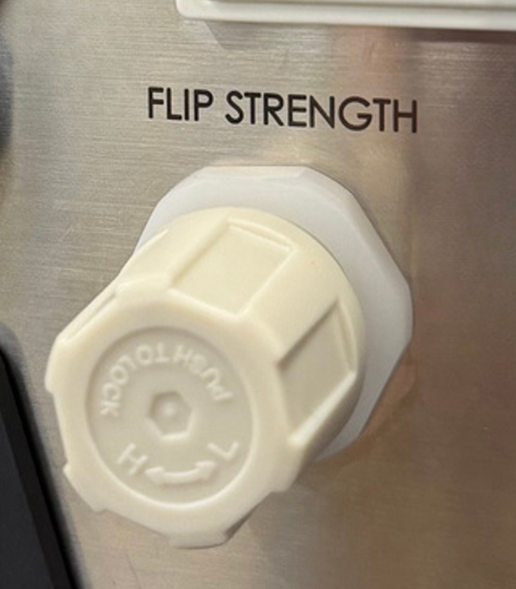
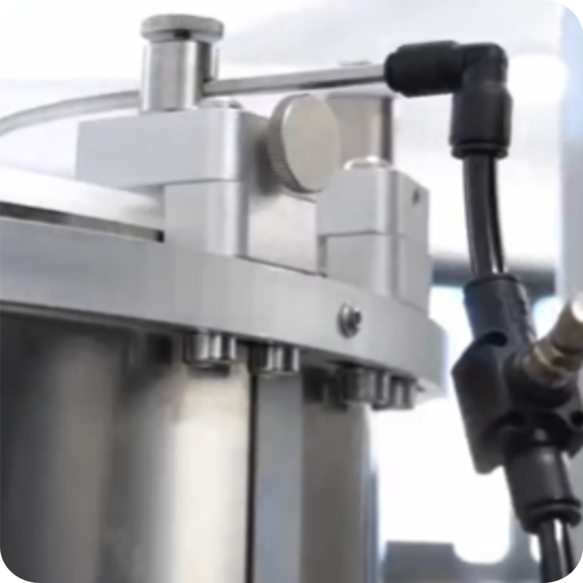
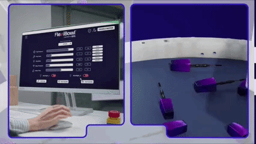

<style>
.compare-grid {
  display: grid;
  grid-template-columns: 1fr 1fr;
  gap: 1rem;
  margin: 1rem 0 1.5rem;
}
@media (max-width: 680px) {
  .compare-grid { grid-template-columns: 1fr; }
}
.compare-card {
  border: 1px solid #5a9fd4;
  border-radius: 7px;
  overflow: hidden;
  font-size: 0.92rem;
}
.compare-card-header {
  padding: 0.5rem 1rem;
  font-weight: 700;
  font-size: 0.82rem;
  letter-spacing: 0.05em;
  color: #ffffff;
}
.v20 .compare-card-header { background: #1a4a7a; }
.v30 .compare-card-header { background: #1e6fbf; }
.compare-card-body {
  padding: 0.85rem 1rem;
  text-align: center;
}
.compare-card-body p, .compare-card-body li { margin: 0.25rem 0; text-align: left; }
.compare-card-body ul, .compare-card-body ol { padding-left: 1.2rem; margin: 0.4rem 0; }
.compare-card-body table {
  width: 100%;
  border-collapse: collapse;
  margin: 0.5rem 0;
  font-size: 0.88rem;
}
.compare-card-body table th {
  padding: 0.35rem 0.6rem;
  text-align: left;
  font-size: 0.78rem;
  font-weight: 700;
  border-bottom: 2px solid #5a9fd4;
  opacity: 0.75;
}
.compare-card-body table td {
  padding: 0.35rem 0.6rem;
  border-bottom: 1px solid rgba(90, 159, 212, 0.3);
}
.compare-card-body table tr:last-child td { border-bottom: none; }
.compare-card-body video { border-radius: 4px; }
</style>

# **Comparativa neumática**

Esta página compara las principales diferencias neumáticas entre el **FlexiBowl® 2.0** y el **FlexiBowl® 3.0**.

:::{important}
Antes de leer el contenido de esta página, es recomendable tener claras las informaciones recogidas en la página [Especificaciones neumáticas](datipneum)
:::

---

## 1. Características del aire comprimido

```{list-table}
:header-rows: 1
:widths: 30 35 35

* -
  - FlexiBowl® 2.0
  - FlexiBowl® 3.0
* - **Presión de aire requerida**
  - 6 Bar
  - 7 Bar
* - **Características del aire**
  - Filtrado y secado
  - Aire comprimido limpio según ISO 8573-1:2010, clase 1.3.2
```

---

## 2. Regulación y lectura de la presión

<div class="compare-grid">
<div class="compare-card v20">
<div class="compare-card-header">FlexiBowl® 2.0</div>
<div class="compare-card-body">



La fuerza del impulso se regula mediante el **regulador de aire comprimido** situado en el panel de control. El indicador de presión correspondiente está **integrado en el panel**.

</div>
</div>
<div class="compare-card v30">
<div class="compare-card-header">FlexiBowl® 3.0</div>
<div class="compare-card-body">


La regulación y la lectura de la presión se pueden configurar **directamente desde la interfaz de software**.

</div>
</div>
</div>

---

## 3. Control del soplado (Blow)

<div class="compare-grid">
<div class="compare-card v20">
<div class="compare-card-header">FlexiBowl® 2.0</div>
<div class="compare-card-body">



Regulación mediante componentes neumáticos físicos (racores y reguladores en la unidad).

</div>
</div>
<div class="compare-card v30">
<div class="compare-card-header">FlexiBowl® 3.0</div>
<div class="compare-card-body">



Control nativo del soplado (**Native Blow Control**) directamente desde la interfaz de software: Flip Pressure, Flip Count, Flip Delay, Blow Pressure, Blow Time.

</div>
</div>
</div>

:::{note}
Para los detalles sobre la conexión de la alimentación de aire, consulte la página [Interfaz neumática](datipneum).
:::

---

## 4. Resumen

El FlexiBowl® 3.0 requiere una presión de aire ligeramente superior (7 Bar frente a 6 Bar) y especifica una clase de limpieza ISO 8573-1:2010 1.3.2, no definida en la generación anterior. La diferencia más relevante desde el punto de vista de la usabilidad es el traslado de la regulación y la lectura de la presión, del flip y del soplado desde los componentes físicos del panel a la interfaz de software.
