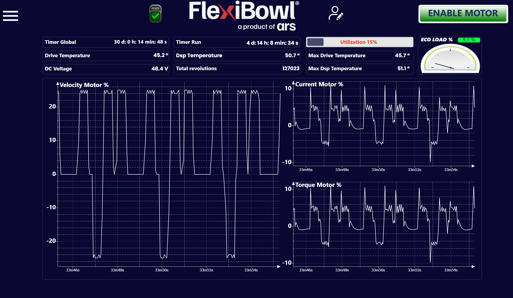

# **Graphs**

## Descripción general

La página **Graphs** ofrece un panel de supervisión en tiempo real de las magnitudes eléctricas y térmicas del driver del motor del FlexiBowl®. En esta página, el operador puede comprobar el rendimiento del sistema y detectar posibles anomalías durante el funcionamiento.

---

## Barra de contadores e indicadores

La parte superior de la página reúne los principales parámetros de estado del sistema, divididos en tres columnas.

### Columna izquierda

| Campo | Valor de ejemplo | Descripción |
|---|---|---|
| **Timer Global** | 30 d: 0 h: 14 min: 48 s | Tiempo total de encendido del sistema desde el último reinicio del contador global |
| **Drive Temperature** | 45.2 °C | Temperatura actual del driver del motor |
| **DC Voltage** | 48.4 V | Tensión del bus DC que alimenta el driver del motor |

### Columna central

| Campo | Valor de ejemplo | Descripción |
|---|---|---|
| **Timer Run** | 4 d: 14 h: 8 min: 34 s | Tiempo total de funcionamiento del motor (tiempo efectivo de movimiento) desde el último reinicio |
| **Dsp Temperature** | 50.7 °C | Temperatura del procesador DSP interno del driver |
| **Total Revolutions** | 127023 | Número total de vueltas realizadas por el FlexiBowl® desde el último reinicio del contador |

### Columna derecha

| Campo | Valor de ejemplo | Descripción |
|---|---|---|
| **Utilization** | 15 % | Porcentaje de utilización actual del motor respecto a la capacidad máxima. Se muestra mediante una barra de progreso acompañada del valor porcentual en texto de color |
| **Max Drive Temperature** | 45.7 °C | Temperatura máxima alcanzada por el driver del motor desde el último reinicio |
| **Max Dsp Temperature** | 51.1 °C | Temperatura máxima alcanzada por el DSP desde el último reinicio |

### ECO LOAD %

El indicador **ECO LOAD %** de la parte superior derecha muestra la carga media del motor en porcentaje. El valor mostrado en el ejemplo es **9,1 %**, lo que indica una carga reducida — condición típica de sistemas con ciclos de trabajo cortos o velocidades no elevadas.

:::{tip}
El valor **ECO LOAD %** es un indicador útil para evaluar la eficiencia operativa del sistema a lo largo del tiempo. Valores constantemente elevados pueden indicar una sobrecarga mecánica o parámetros de velocidad demasiado agresivos.
:::

---

## Gráficos en tiempo real

La parte inferior de la página muestra tres gráficos de tipo osciloscopio que trazan la evolución en el tiempo de las magnitudes del motor. El eje horizontal indica el tiempo transcurrido desde el inicio, en el formato `Xh Ym Zs` (los campos iguales a cero, como las horas, pueden no mostrarse — p. ej. `33m46s`).

### Velocity Motor %

Gráfico de la **velocidad del motor** expresada como porcentaje de la velocidad máxima.

| Eje | Descripción |
|---|---|
| **Y** | Velocidad en **porcentaje** de la velocidad máxima, con signo: los valores **negativos** indican rotación en sentido **antihorario**, los valores **positivos** rotación en sentido **horario**. El valor **0** corresponde al motor detenido |
| **X** | Tiempo de ejecución |

:::{note}
Un valor de velocidad negativo indica rotación en sentido **antihorario**; un valor positivo indica rotación en sentido **horario**. Esto es coherente con el parámetro **Speed** de la página Jog Motor.
:::

### Current Motor %

Gráfico de la **corriente absorbida por el motor** expresada como porcentaje de la corriente nominal máxima.

| Eje | Descripción |
|---|---|
| **Y** | Corriente normalizada en porcentaje. Puede tomar valores tanto **positivos** como **negativos** según la fase de funcionamiento (p. ej. aceleración/deceleración); los picos corresponden a las variaciones más bruscas de velocidad |
| **X** | Tiempo de ejecución |

:::{tip}
Los picos de corriente elevados y recurrentes pueden indicar rampas de aceleración demasiado agresivas. En ese caso, aumente los valores de **Acceleration** y **Deceleration** para distribuir el esfuerzo en un intervalo de tiempo más largo.
:::

### Torque Motor %

Gráfico del **par suministrado por el motor** expresado como porcentaje del par nominal máximo.

| Eje | Descripción |
|---|---|
| **Y** | Par normalizado en porcentaje. Al igual que la corriente, puede tomar valores tanto **positivos** como **negativos** según la fase de movimiento |
| **X** | Tiempo de ejecución |

:::{note}
Los gráficos **Current Motor %** y **Torque Motor %** muestran normalmente una evolución muy similar, ya que en un motor de corriente continua el par es directamente proporcional a la corriente. Diferencias significativas entre ambos pueden indicar anomalías en el driver.
:::

---

## Notas de uso

:::{warning}
Valores de **Drive Temperature** o **Dsp Temperature** constantemente superiores a 70 °C pueden reducir la vida útil del driver y provocar paradas por protección térmica. Compruebe las condiciones de ventilación del armario y el ciclo de trabajo del sistema.
:::

:::{warning}
Un valor de **DC Voltage** fuera del rango nominal (normalmente 48 V ± 10 %) puede indicar problemas en la fuente de alimentación. Interrumpa el funcionamiento y póngase en contacto con el servicio técnico.
:::
