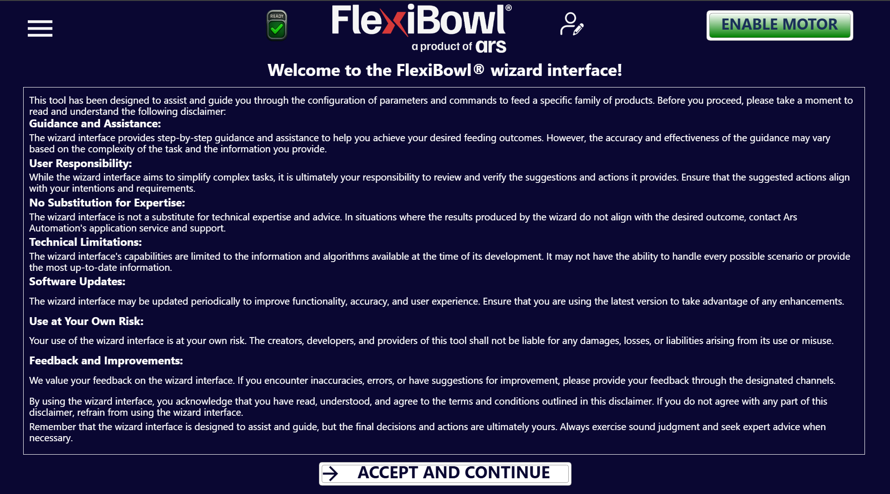
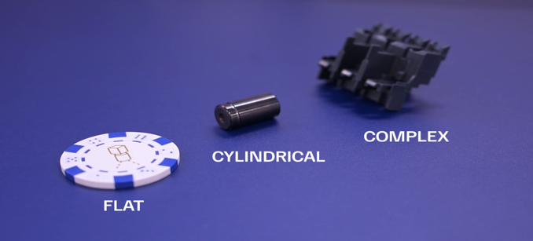

# **FlexiBowl® Wizard**


La interfaz **FlexiBowl® Wizard** es una herramienta interactiva diseñada para guiar al usuario en la configuración de los parámetros de alimentación según la familia de productos específica que se va a gestionar.



## Paso 0: Acceso al Wizard

:::{list-table}
* - **1**
  - Para acceder a la configuración guiada de los parámetros del FlexiBowl®, basta con hacer clic en la página **Wizard** del menú lateral.
:::

:::{note}
El modelo y el sentido de giro del FlexiBowl® son detectados automáticamente por el software.
:::

## Paso 1: Caracterización del componente

El sistema solicita información sobre la morfología de las piezas para optimizar la separación.
````{list-table}
* - **2**
  - Seleccione el tamaño del componente:

    **Para los modelos FlexiBowl 200, 350, 500, 650:**

    :::{card}
    <= 150mm
    :::

    :::{card}
    &gt; 150mm
    :::

    **Para los modelos FlexiBowl 800 y 1200:**

    :::{card}
    <= 250mm
    :::

    :::{card}
    &gt; 250mm
    :::

* - **3**
  - Seleccione la geometría que mejor describa el componente:
      * **FLAT**: Componentes planos.
      * **CYLINDRICAL**: Componentes cilíndricos.
      * **COMPLEX**: Geometrías articuladas o irregulares

      

      *Ejemplos de geometrías: Flat, Cylindrical y Complex.*

* - **4**
  - Definir cómo interactúan los componentes entre sí sobre la superficie:
      * **Overlapping**: Las piezas tienden a solaparse.
      * **Not Overlapping**: Las piezas no se solapan.
      * **Tangling / Stacking**: Las piezas tienden a engancharse o apilarse.
      * **Not Tangling / Not Stacking**: Las piezas permanecen separadas y no se encajan.

      

      *Not Overlapping: las piezas no se solapan sobre la superficie.*

      ::::{grid} 2
      :::{grid-item}
      

      *Stacking: las piezas se apilan.*
      :::
      :::{grid-item}
      

      *Tangling: las piezas se enganchan entre sí.*
      :::
      ::::
````

## Paso 2: Prueba de los accesorios

```{list-table}
* - **5**
  - Seleccione en el menú desplegable si el FlexiBowl® está equipado con el módulo **Air-blow**.
* - **6**
  - Haga clic en **TEST Air-blow** para comprobar el funcionamiento.
* - **7**
  - Seleccione **USE** para habilitarlo en la aplicación actual; en caso contrario, haga clic en **DON'T USE**.
* - **8**
  - Haga clic en **TEST FLIP** para verificar la activación efectiva del percutor. El «Flip» es la unidad que genera el impulso mecánico para voltear las piezas y es fundamental para separar, desenredar o dar la vuelta a los componentes durante el ciclo de alimentación.
 
      :::{important}
      Si el impulso no se percibe, compruebe que el aire comprimido esté conectado y actúe sobre el regulador de presión mecánico situado en el panel de control.
      :::
* - **9**
  - Al finalizar el Wizard, haga clic en **FINISH**: el sistema calculará automáticamente los parámetros:
    - Parámetros de movimiento (velocidad, aceleración, ángulo)
    - Parámetros de sacudida (shake)
    - Temporizaciones de los accesorios (flip, blow)
* - **10**
  - En el menú desplegable, seleccione la **secuencia** en la que desea guardar los parámetros calculados.
* - **11**
  - Haga clic en **UPDATE SEQUENCE** para guardar los parámetros en la secuencia seleccionada.
* - **12**
  - Después podrá afinar los parámetros en la página **Sequence**.
```

```{list-table} Visión general de los parámetros
   :widths: 20 30 50
   :header-rows: 1

   * - Grupo
     - Parámetro
     - Descripción
   * - **Move**
     - Accel, Decel, Speed, Angle
     - Parámetros del movimiento principal del disco.
   * - **Option**
     - Flip Count, Flip Delay, Blow Time
     - Gestión de los tiempos de activación de los accesorios.
   * - **Shake**
     - Accel, Speed, Angle CW/CCW
     - Parámetros de la vibración de sacudida (separación).
```

## Paso 3: Validación de la secuencia

Abra la página **Sequence** y utilice el botón **TEST SEQUENCE** para verificar que el ciclo cumple los siguientes criterios de eficiencia:

```{list-table}
:widths: 5 95
:header-rows: 0

* - **Sincronización**
  - El impulso de Flip debe terminar exactamente en el mismo instante en que termina el movimiento (*Move*). Ajuste los valores de *Flip Count* y *Delay* para alinearlos.

* - **Estabilidad de la imagen**
  - Los componentes deben estar inmóviles en el momento de la captura de la cámara.
    - Si las piezas se mueven, reduzca la velocidad/aceleración o inserte una pausa (p. ej. `pause 200ms`).

* - **Posicionamiento de las piezas durante la secuencia**
  - Durante el movimiento, las piezas deben conducirse hacia el centro del radio del FlexiBowl® para maximizar la eficacia del Flip. Al final de la secuencia, las piezas deben quedar dispuestas aproximadamente en el centro del área de visión.
```

:::{warning}
Haga clic siempre en **Synchronize Parameters** después de cada modificación manual para que los cambios se activen en el controlador.
:::
