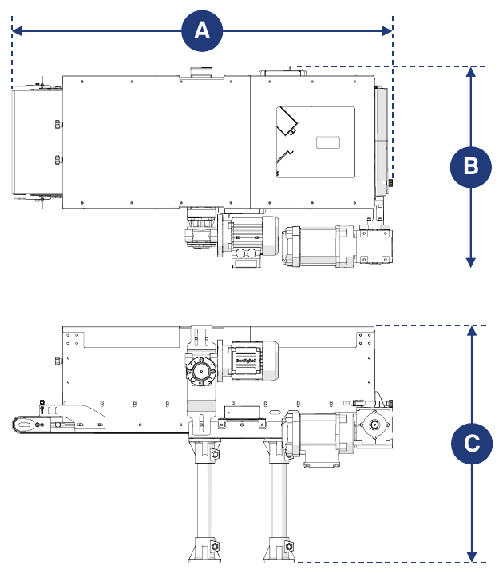
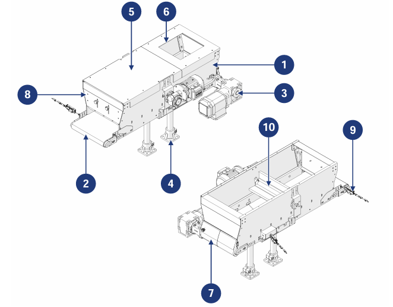

# **Descripción de la máquina**

:::{important}
Para poder utilizarse, la cuasi máquina debe incorporarse a otras máquinas/cuasi máquinas adecuadamente estructuradas.
:::

## Descripción

La Conveyor Hopper está diseñada y construida para recibir componentes a granel de tamaño pequeño, mediano y grande de un sistema aguas arriba y transferirlos a un sistema aguas abajo.

Está accionada por un motorreductor conectado a un rodillo de tracción, que mueve la cinta transportadora situada en la base de la tolva. En la parte trasera hay una compuerta para el vaciado manual al final del ciclo, mientras que en la parte frontal hay una barrera dosificadora para regular la salida del material.

La máquina puede combinarse con un sistema de alimentación (suministrado por el cliente) que, al conectarse a los sensores de presencia suministrados con la máquina, gestiona automáticamente la carga del material sobre la cinta.

## Uso previsto

| Operación | Permitido | No permitido | Entorno |
|:--- |:--- |:--- |:--- |
| Manipulación de componentes a granel de diversos tamaños y características | Sí | Cualquier uso distinto del permitido | Industrial |

:::{important}
La máquina no puede utilizarse para transportar:
- objetos más grandes que las dimensiones de la tolva;
- objetos con superficies externas adhesivas o pegajosas;
- objetos cortantes que podrían dañar el tejido de la cinta.
:::

La máquina ha sido diseñada para satisfacer los requisitos específicos indicados en el contrato de venta y para utilizarse conforme a las instrucciones y a los límites de uso indicados en el manual. Funciona de forma segura si:
- está incorporada a una línea dotada de dispositivos de seguridad y protección adecuados, conforme a la normativa vigente;
- se utiliza dentro de los límites indicados en el contrato y en el manual;
- se respetan los procedimientos del manual de instrucciones;
- el mantenimiento ordinario se realiza en los plazos y de la forma indicados;
- el mantenimiento extraordinario se realiza con prontitud cuando es necesario;
- los dispositivos de seguridad no se retiran y/o puentean.

## Uso incorrecto (razonablemente previsible)

- uso de la máquina sin haber leído antes el manual de instrucciones;
- uso de la máquina sin incorporarla a una línea conforme a la normativa vigente;
- uso por parte de operadores no adecuadamente formados;
- uso de la máquina como punto de apoyo, incluso cuando no está en funcionamiento;
- uso para obtener valores de producción superiores a los límites prescritos;
- uso de una forma no especificada en la sección «Uso previsto».

Cualquier otro uso no especificado debe ser autorizado previamente por escrito por el Fabricante. En ausencia de dicha autorización, el uso se considera «incorrecto»: el Fabricante declina toda responsabilidad por daños a bienes o personas y considera anulada cualquier garantía.

:::{important}
El uso incorrecto de la máquina excluye cualquier responsabilidad del Fabricante.
:::

## Obligaciones y prohibiciones

### Obligaciones de los usuarios

El usuario (contratista o empleador) debe:
- tener en cuenta las capacidades y las condiciones de los operadores en relación con su salud y seguridad;
- proporcionar EPI adecuados para cada procedimiento;
- proporcionar medios y procedimientos de elevación estándar;
- asegurarse de que los trabajadores respeten las normas de seguridad de la empresa y el uso de los dispositivos de protección colectiva e individual disponibles;
- instruir al personal sobre los procedimientos en caso de accidente;
- instruir al personal sobre los riesgos residuales existentes;
- instruir al personal sobre los dispositivos previstos para la seguridad del operador;
- instruir al personal sobre los riesgos debidos a la emisión de ruido en el lugar de trabajo;
- instruir al personal sobre las normas generales de prevención de accidentes establecidas por las directivas europeas y por la legislación del país de destino.

Permitir trabajar en la máquina únicamente a personal que haya leído el manual y esté adecuadamente formado.

### Obligaciones del personal asignado (operadores/técnicos de mantenimiento/técnicos)

El personal debe:
- realizar las intervenciones de mantenimiento solo con la máquina apagada;
- recoger el cabello largo para evitar que quede atrapado o contamine el producto;
- intervenir en el cuadro eléctrico, las cajas de derivación, los cables y todos los componentes eléctricos solo con el interruptor general desconectado;
- asegurarse de que nadie tenga acceso directo a las partes en movimiento durante el funcionamiento;
- utilizar correctamente los dispositivos de protección proporcionados por el empleador;
- comunicar de inmediato al empleador, al directivo o al encargado cualquier fallo de los dispositivos de seguridad.

### Prohibiciones para el personal encargado

El personal no debe:
- utilizar la máquina de forma inadecuada, es decir, para usos no especificados en la sección «Uso previsto»;
- retirar o modificar dispositivos o señales de seguridad sin autorización;
- realizar por iniciativa propia operaciones o maniobras que no sean de su competencia o que puedan comprometer su seguridad o la de otras personas;
- acercarse a la máquina en estado de embriaguez o bajo los efectos de drogas;
- sustituir o modificar la velocidad y/o la potencia de los componentes de la máquina sin autorización de un responsable;
- modificar el ciclo de la máquina;
- modificar las conexiones eléctricas para puentear los dispositivos de seguridad internos;
- utilizar la máquina si no se ha instalado conforme a las normas aplicables;
- utilizar la máquina como punto de apoyo, incluso cuando no está en funcionamiento (riesgo de caída y/o de daños);
- utilizar la máquina fuera de las condiciones ambientales permitidas (véase *Transporte e incorporación*).

:::{attention}
El Fabricante no se hace responsable de los daños a bienes o personas si:
- se comprueba que la máquina se ha utilizado fuera de los entornos permitidos;
- no se han respetado las obligaciones y prohibiciones descritas en el manual.
:::

## Datos técnicos

```{list-table} Alimentación eléctrica
:header-rows: 0
:widths: 40 60

* - **Tensión**
  - 400 Vac
* - **Potencia**
  - 0,18 kW (accionamiento de la cinta) · 0,09 kW (accionamiento del cepillo, opcional)
* - **Frecuencia**
  - 50 Hz
```

```{list-table} Límites de uso
:header-rows: 0
:widths: 40 60

* - **Peso máximo transportable**
  - 15 kg/m
* - **Velocidad máxima de la cinta**
  - 8 m/min
```

:::{important}
Para más información, consultar el esquema eléctrico y los manuales de los subproveedores, adjuntos al manual.
:::

## Dimensiones de ocupación



| Dimensión | Valor |
|:--- |:--- |
| **Longitud (A)** | 1075 mm (con accionamiento a la izquierda) · 1050 mm (con accionamiento a la derecha) |
| **Anchura (B)** | 564 mm (con accionamiento a la izquierda) · 562 mm (con accionamiento a la derecha) |
| **Altura (C)** | 666 mm |

## Componentes principales



| Pos. | Descripción |
|:--- |:--- |
| 1 | Cuba de la tolva |
| 2 | Cinta transportadora |
| 3 | Grupo de accionamiento |
| 4 | Pie de apoyo |
| 5 | Tapa de la tolva |
| 6 | Compartimento de entrada del material |
| 7 | Compuerta trasera |
| 8 | Compuerta delantera |
| 9 | Sensor de presencia de material |
| 10 | Cepillo motorizado *(componente opcional)* |

## Ciclo de trabajo

| Fase | Descripción |
|:--- |:--- |
| 1 | El material, procedente del sistema aguas arriba, se introduce en la tolva a través del compartimento de carga y cae sobre la cinta. |
| 2 | La cinta transporta el material hacia la zona de salida. |
| 3 | El material se descarga hacia el sistema aguas abajo según las necesidades de producción. |

:::{important}
Los sensores presentes tienen la función de verificar la presencia o ausencia de producto sobre la cinta, en las zonas de entrada y de salida.

Durante la incorporación deben conectarse correctamente, de modo que la máquina pueda comunicarse con los sistemas aguas arriba y aguas abajo (no incluidos en el suministro).
:::
