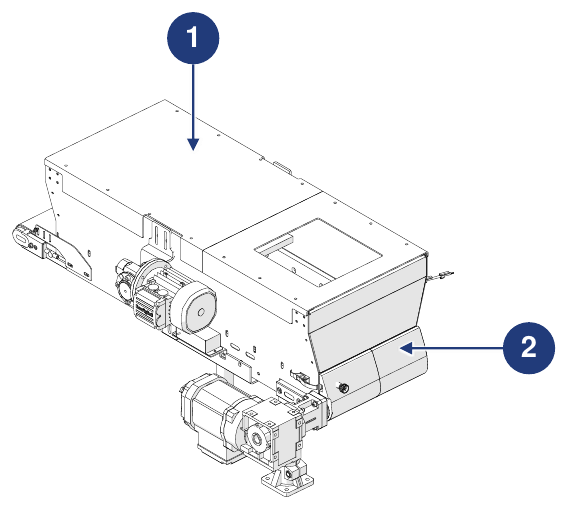
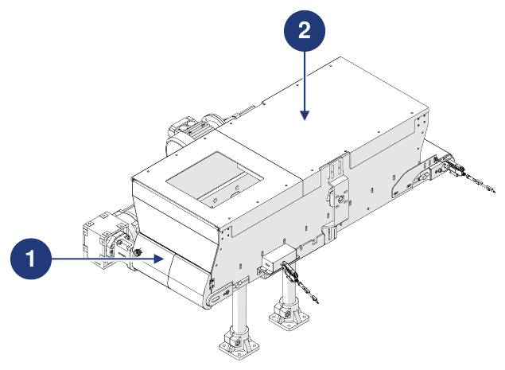

# **Información preliminar y seguridad**

:::{important}
Antes de instalar, utilizar o realizar el mantenimiento de la máquina, lea atentamente todo el manual y toda la documentación adjunta.

El incumplimiento de las instrucciones indicadas puede causar:
- daños a la máquina;
- pérdida de las condiciones de seguridad;
- riesgos para operadores y personal de mantenimiento;
- la pérdida de la garantía.
:::

## Identificación

### Fabricante

| | |
|:--- |:--- |
| **Fabricante** | ARS S.r.l. |
| **Dirección** | Via Aretina Nord, 157 – 52041 Pieve al Toppo (AR), Italia |
| **Contactos** | Tel. +39 0575 398611 · Fax +39 0575 398620 |
| **Correo electrónico / Web** | info@arsautomation.com · www.arsautomation.com |

### Identificación de la cuasi máquina

| | |
|:--- |:--- |
| **Tipo** | Tolva con cinta transportadora motorizada |
| **Denominación** | Conveyor Hopper |
| **Modelo** | CH60 |
| **Capacidad** | 60 L |

### Placa de identificación

La máquina está dotada de una placa de identificación situada en el lado del accionamiento de la cinta. Comunicando al Fabricante los datos que figuran en la placa es posible conocer la identificación exacta de la máquina.

:::{warning}
**ATENCIÓN — Placa de identificación**

Está absolutamente prohibido retirar la placa de identificación o sustituirla por otras placas. Si la placa se daña o se retira accidentalmente, el cliente está **obligado** a informar al Fabricante.
:::

## Declaración de incorporación

La máquina se suministra con la **Declaración de incorporación de cuasi máquina**, redactada con arreglo a la Directiva de Máquinas 2006/42/CE (Anexo II, parte 1, sección B).

```{list-table}
:header-rows: 0
:widths: 30 70

* - **Máquina**
  - Tolva de cinta de 60 litros – Tolva con cinta transportadora motorizada, capacidad 60 litros
* - **Modelo**
  - CH60, revisión 1.0 y posteriores
* - **Función**
  - Sistema de cinta para la alimentación de componentes a granel
* - **Requisitos esenciales aplicados**
  - 1.1.1, 1.1.2, 1.1.3, 1.3.7, 1.5.1, 1.5.5, 1.5.6, 1.5.8, 1.6.1, 1.7.1, 1.7.3, 1.7.4
* - **Directivas**
  - 2006/42/CE (Directiva de Máquinas) · 2014/30/UE (Compatibilidad Electromagnética)
* - **Documentación técnica**
  - Redactada conforme al Anexo VII, parte B, y puesta a disposición de las autoridades nacionales previa solicitud motivada
```

:::{attention}
La cuasi máquina no debe ponerse en servicio hasta que la máquina final en la que deba incorporarse haya sido declarada conforme a las disposiciones de la Directiva 2006/42/CE.
:::

## Directivas de referencia

Antes de su comercialización, el Fabricante ha realizado la evaluación de riesgos para verificar el cumplimiento de los requisitos esenciales de seguridad y salud, así como los ensayos y controles previstos por las normas de referencia. El expediente técnico de construcción está redactado conforme al **Anexo VII** de la Directiva 2006/42/CE y está a disposición de los organismos de vigilancia previa solicitud motivada.

La máquina se comercializa acompañada de:
- Declaración de incorporación
- Manual de instrucciones *(punto 1.7.4 y Anexo VI de la Directiva de Máquinas 2006/42/CE)*

| Referencia | Descripción / Ámbito |
|:--- |:--- |
| **2006/42/CE** | Directiva de Máquinas |
| **2014/30/UE** | Directiva de Compatibilidad Electromagnética |
| **UNI EN ISO 12100:2010** | Seguridad de las máquinas – Principios generales de diseño – Evaluación del riesgo y reducción del riesgo |

## Destinatarios, suministro y conservación

El manual está destinado a los operadores encargados de utilizar y gestionar la máquina en **todas las fases de su vida técnica**. Junto con la Declaración de incorporación es **parte integrante de la máquina** y debe acompañarla en cada traslado o reventa.

| Aspecto | Prescripción |
|:--- |:--- |
| **Integridad** | Conservar íntegro en todas sus partes. En caso de pérdida o deterioro, solicitar de inmediato una copia al Fabricante. |
| **Cambios de propiedad** | Debe acompañar a la máquina hasta su desguace (traslados, venta, etc.). |
| **Formato** | Se suministra en formato papel y electrónico; la documentación adicional se entrega como anexo. |
| **Anexos** | Los documentos adjuntos son parte integrante; se aplican las mismas prescripciones. |
| **Idioma original** | Italiano. En caso de incongruencias con las traducciones, prevalece el texto original. |
| **Actualizaciones** | En caso de modificaciones o sustituciones funcionales, la actualización corre a cargo del Fabricante. El usuario garantiza que en los puntos de uso solo esté disponible la versión actualizada. |

:::{attention}
El Fabricante declina toda responsabilidad por el uso indebido de la máquina y por los daños causados por operaciones no contempladas en la documentación técnica.
:::

## Perfiles de los operadores y cualificaciones

| Cualificación | Definición |
|:--- |:--- |
| **Operario** | Personal formado por el Fabricante, cualificado para utilizar la máquina en producción. Debe saber realizar todas las operaciones necesarias para el correcto funcionamiento y proteger a sí mismo y a sus compañeros. En caso de duda, comunica las anomalías a su responsable. **No está autorizado a realizar intervenciones de mantenimiento.** |
| **Técnico de mantenimiento mecánico** | Técnico cualificado para el mantenimiento preventivo y correctivo de todas las partes mecánicas. Puede manejar la máquina como un operario, intervenir en ajustes, mantenimientos y reparaciones mecánicas, y leer esquemas, planos técnicos y listas de repuestos. No está cualificado para intervenir en instalaciones eléctricas bajo tensión. |
| **Técnico de mantenimiento eléctrico** | Técnico cualificado para el mantenimiento preventivo y correctivo de todas las partes eléctricas. Puede manejar la máquina como un operario, intervenir en ajustes e instalaciones eléctricas y leer los esquemas eléctricos. En presencia de tensión, solo puede trabajar en los cuadros y cajas de derivación si es una persona designada (PEI – EN 50110-1). |
| **Operador de equipos de elevación** | Persona en buen estado de salud, formada e instruida en la manipulación de cargas y en el uso de equipos de elevación. |

Todas las cualificaciones deben entrar en la categoría de **persona formada**: individuo informado, instruido y formado sobre el trabajo y sobre los peligros derivados de un uso indebido, que conoce la importancia de los dispositivos de seguridad, de las normas de prevención de accidentes y de las condiciones de trabajo seguras.

## Símbolos utilizados en el manual

| Símbolo | Significado |
|:--- |:--- |
| **Atención / Peligro** | Advertencias importantes para la seguridad del operador y/o de la máquina. |
| **Importante / Nota** | Información importante, también relativa a la seguridad del personal que interviene en el uso de la máquina. |

## Glosario

| Término | Definición |
|:--- |:--- |
| **Accesorios de elevación** | Componentes o equipos no conectados a las máquinas, situados entre la máquina y la carga o sobre la propia carga, que permiten su sujeción. Las eslingas y sus componentes también son accesorios de elevación. |
| **ATEX** | De *ATmosphères EXplosibles*: nombre convencional de dos directivas de la UE (2014/34/UE para los aparatos destinados a atmósferas explosivas; 99/92/CE para la seguridad y la salud de los trabajadores en atmósferas explosivas). |
| **Cadenas, cables y correas** | Elementos diseñados y construidos para la elevación como parte de máquinas o de accesorios de elevación. |
| **Carretilla elevadora** | Vehículo conducido por un operador para la manipulación de mercancías en almacenes, entornos industriales o patios, dotado de ruedas y accionado por un motor eléctrico, diésel o de gas. |
| **Daño** | Cualquier consecuencia negativa derivada de un evento peligroso. |
| **EPI** | Equipo de Protección Individual: prenda o equipo destinado a proteger a quien lo lleva de los riesgos para la salud y la seguridad. |
| **Fallo** | Estado de una entidad caracterizado por la incapacidad de realizar la función requerida. |
| **Máquina** | Conjunto equipado, o destinado a ser equipado, con un sistema de accionamiento, compuesto por partes o componentes, de los cuales al menos uno es móvil, unidos entre sí de forma solidaria para una aplicación bien determinada. |
| **Cuasi máquina** | Conjunto que constituye casi una máquina, pero que no puede por sí solo garantizar una aplicación determinada. |
| **Medida de protección** | Medida destinada a reducir el riesgo, aplicada por el diseñador (diseño intrínsecamente seguro, resguardos, información para el uso) y/o por el usuario (organización, procedimientos de trabajo seguros, EPI, formación). |
| **Peligro** | Fuente potencial de lesión o de daño a la salud. |
| **Persona expuesta** | Cualquier persona que se encuentre total o parcialmente en una zona peligrosa. |
| **Prevención** | Conjunto de disposiciones o medidas necesarias, según la particularidad del trabajo, la experiencia y la técnica, para evitar los riesgos o reducir su probabilidad. |
| **Resguardo** | Barrera física, diseñada como parte de la máquina, para garantizar la protección. |
| **Resguardo fijo** | Resguardo mantenido en posición (cerrado) de forma permanente o mediante sistemas de fijación (tornillos, pernos, etc.) que impiden su retirada o apertura sin herramientas. No se admiten sistemas de fijación fáciles de retirar (p. ej. pomos de plástico). |
| **Resguardo móvil** | Resguardo conectado mecánicamente a la estructura (p. ej. mediante bisagras o guías) que puede abrirse sin el uso de herramientas. |
| **Riesgo** | Combinación de la probabilidad de un daño y de su gravedad. |
| **Riesgo residual** | Riesgo que permanece tras la adopción de medidas de protección y prevención. |
| **Uso previsto** | Uso de la máquina de conformidad con la información facilitada en las instrucciones de uso. |
| **Uso incorrecto razonablemente previsible** | Uso de la máquina de una forma no prevista por el diseñador, pero que puede derivarse de un comportamiento humano fácilmente previsible. |

## Equipos de protección individual (EPI)

Al trabajar cerca de la máquina (instalación, mantenimiento, ajustes) es obligatorio respetar las normas generales de prevención de accidentes y utilizar los EPI previstos para cada operación. La indumentaria de quien opera en la máquina debe cumplir los requisitos esenciales de seguridad del Reglamento UE 2016/425 y las leyes vigentes en el país de instalación.

| Obligación | Descripción |
|:--- |:--- |
| **Guantes** | Es obligatorio llevar guantes de seguridad o aislantes de uso profesional. |
| **Gafas** | Es obligatorio llevar gafas de seguridad para proteger los ojos. |
| **Calzado** | Es obligatorio llevar calzado de seguridad para proteger los pies. |
| **Protección auditiva** | Es obligatorio llevar orejeras o tapones para proteger el oído. |
| **Ropa de protección** | Es obligatorio llevar la ropa de protección específica. |
| **Lectura del manual** | Es obligatorio leer (y comprender) las instrucciones de uso y las advertencias de seguridad antes de utilizar la máquina. |

## Garantía

:::{important}
Las condiciones completas de garantía figuran en el contrato de venta. Las condiciones del contrato, si difieren, prevalecen sobre lo indicado en esta sección.
:::

La garantía está sujeta a las siguientes condiciones generales:
- la apertura del embalaje y la incorporación deben realizarse en presencia de técnicos autorizados por el Fabricante;
- la primera puesta en marcha y las pruebas deben realizarse en presencia y bajo la dirección de los técnicos del Fabricante, salvo acuerdo distinto entre las partes;
- la máquina debe utilizarse dentro de los límites declarados en el contrato y especificados en la documentación técnica;
- el mantenimiento debe realizarse en los plazos y de la forma indicados en el manual, con repuestos originales y por personal cualificado.

La garantía **queda anulada** en caso de:
- incumplimiento de las normas de seguridad;
- retirada o manipulación de los dispositivos de mando y seguridad (resguardos, sensores, etc.);
- uso indebido de la máquina;
- uso por parte de personal no formado y/o no autorizado, o que no reúna los requisitos previstos en el manual;
- modificaciones o reparaciones realizadas por el usuario sin autorización del Fabricante;
- incumplimiento, parcial o total, de las instrucciones;
- anomalías en la alimentación eléctrica;
- falta de mantenimiento;
- uso de repuestos no originales;
- eventos excepcionales como inundaciones o incendios (si no los han causado las máquinas).

## Medidas de seguridad

### Dispositivos de seguridad

La máquina está diseñada y dotada de sistemas de seguridad para reducir al mínimo los riesgos para el operador.



| Pos. | Dispositivo | Descripción |
|:--- |:--- |:--- |
| 1 | **Resguardo fijo** | Resguardos fijos (cárteres) que, en las áreas de acceso exclusivo durante el mantenimiento, impiden el acceso a las zonas peligrosas. Para retirarlos se necesitan herramientas específicas. |
| 2 | **Resguardo móvil** | Resguardos de apertura (portillos) que permiten, en determinadas situaciones, el acceso al área de trabajo. Para abrirlos de forma segura es necesario seguir procedimientos específicos. |

:::{warning}
Para la incorporación de la máquina a la línea final debe preverse la conexión eléctrica externa para integrar las funciones de seguridad de la máquina en la lógica de control de la propia línea.
:::

### Ruido

El ruido se ha medido conforme a las normas UNI EN 11200 y UNI EN ISO 3746. Durante los ciclos de trabajo, el personal está expuesto a un nivel de ruido:
- inferior a **70 dB(A)** sin piezas en el interior;
- inferior a **75 dB(A)** con piezas en el interior. El valor se basa en la experiencia del Fabricante; algunas piezas/componentes, por su movimiento relativo provocado por la cinta y el cepillo, pueden producir una emisión superior. La evaluación del ruido emitido, según la especificación, corresponde al integrador/incorporador.

El nivel de ruido real de la máquina instalada en un proceso productivo difiere del medido, porque está influido por el tipo y las características del emplazamiento y por las demás máquinas en funcionamiento en las proximidades. El usuario es responsable de aplicar las medidas de prevención y protección previstas por la legislación del país de instalación.

### Vibraciones

El nivel de vibraciones producido por la máquina es insignificante y no peligroso para la salud de los operarios.

:::{warning}
Las vibraciones excesivas solo pueden deberse a una avería mecánica, que debe comunicarse y resolverse de inmediato para no comprometer la seguridad de la máquina y de los operarios.
:::

### Compatibilidad electromagnética

La máquina contiene componentes electrónicos sujetos a las normas de Compatibilidad Electromagnética, afectados por emisiones conducidas y radiadas. Los valores de emisión cumplen los requisitos normativos gracias al uso de componentes conformes, a conexiones adecuadas y, cuando es necesario, a la instalación de filtros. La máquina es, por tanto, conforme a la directiva CEM.

:::{warning}
Cualquier mantenimiento no conforme en la instalación eléctrica o la sustitución incorrecta de componentes puede comprometer la eficacia de las soluciones adoptadas.
:::

### Riesgos residuales

La seguridad se ha integrado en la medida de lo posible en el diseño y la construcción de la máquina; no obstante, subsisten algunos riesgos frente a los cuales deben protegerse los operarios.

| Riesgo | Descripción e indicaciones |
|:--- |:--- |
| **Riesgos debidos al transporte** | La descarga del embalaje, su apertura y la manipulación de la máquina exponen al riesgo de cargas suspendidas y aplastamiento. Los procedimientos se describen en la página *Transporte e incorporación*. Estas operaciones solo pueden ser realizadas por personal experto en el uso de equipos de elevación y adecuadamente formado, con EPI idóneos. |
| **Riesgo debido a partes bajo tensión** | Las intervenciones de mantenimiento y el acceso a la máquina exponen al riesgo eléctrico. El trabajo en instalaciones bajo tensión solo puede ser realizado por personal experto y cualificado. Prestar la máxima atención a los pictogramas de riesgo eléctrico; no realizar mantenimientos hasta que se haya desconectado la alimentación; consultar los manuales de los componentes comerciales para las indicaciones específicas; controlar periódicamente el circuito equipotencial, asegurándose de que no haya discontinuidades. |
| **Riesgo debido a la presencia de polvo, fragmentos, etc.** | Al final del ciclo pueden quedar residuos de material o acumulación de polvo en las superficies de la máquina. Limpiar a fondo después de cada uso, como se describe en la página *Mantenimiento*. |

:::{warning}
El fabricante final de la línea de destino debe encargarse de reducir los riesgos mecánicos en las distintas zonas de la máquina, a partir del análisis general de riesgos de la propia línea.
:::

:::{warning}
Las funciones de seguridad del suministro de ARS S.r.l. deben ser integradas por el fabricante de la línea de destino en las funciones de seguridad de las demás cuasi máquinas o máquinas asociadas.
:::

**Corresponde al usuario:**
- analizar los riesgos que puedan presentarse durante la manipulación y la incorporación en su propia sede (los análisis sobre la manipulación solo tienen en cuenta las características de la máquina);
- delimitar con señalización en el suelo el recorrido de las carretillas elevadoras y/o de los vehículos de guiado láser;
- sensibilizar e instruir al personal que participa en las operaciones y en el uso de la máquina;
- colocar señales de seguridad visuales alrededor del puesto de trabajo tras haber evaluado los riesgos en las zonas de tránsito o de control.

### Pictogramas de seguridad aplicados a la máquina

La máquina se suministra con una serie de pictogramas que permiten identificar de inmediato los riesgos residuales.

:::{warning}
Está prohibido retirar y/o sustituir los pictogramas por otros de significado distinto. El usuario tiene la obligación de sustituir los que falten o sean poco legibles.
:::



| Pos. | Descripción |
|:--- |:--- |
| 1 | Peligro de arrastre / aplastamiento de las manos. |
| 2 | Prohibido retirar los dispositivos de seguridad. |
