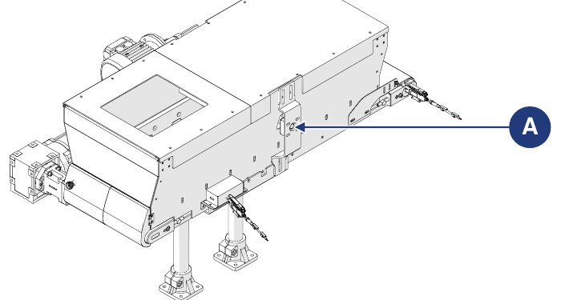

# **Mantenimiento**

:::{warning}
Realizar el mantenimiento solo con la máquina apagada y sin tensión (interruptor general del cuadro de alimentación en posición «0-OFF»). Colocar en el interruptor general el cartel «MÁQUINA EN MANTENIMIENTO – NO ENCENDER».
:::

:::{warning}
Las operaciones de mantenimiento deben ser realizadas por personal cualificado y autorizado.
:::

El mantenimiento comprende las intervenciones (inspecciones, controles, ajustes y sustituciones) que resultan necesarias tras el uso normal.

**Directrices para un mantenimiento correcto:**
- utilizar solo repuestos originales y herramientas adecuadas para el fin y en buen estado;
- respetar las frecuencias de intervención indicadas para el mantenimiento programado (preventivo y periódico): el intervalo (indicado en tiempo o en ciclos de trabajo) entre una intervención y la siguiente debe entenderse como el máximo admisible; no debe superarse, pero puede reducirse.

Un buen mantenimiento preventivo requiere atención constante y una supervisión continua de la máquina. Comprobar de inmediato la causa de cualquier anomalía (ruido excesivo, sobrecalentamiento, fugas de fluidos, etc.) y subsanarla: la eliminación a tiempo de las causas de anomalía evita daños mayores y garantiza la seguridad del operario.

El personal encargado del mantenimiento debe estar bien formado y conocer a fondo las normas de prevención de accidentes; el personal no autorizado debe permanecer fuera del área de trabajo durante las operaciones. También la limpieza y los ajustes deben realizarse solo durante el mantenimiento, con la máquina parada y desconectada del cuadro eléctrico.

:::{warning}
Las posibles reparaciones o intervenciones de mantenimiento no indicadas en el manual solo pueden realizarse previa autorización del Fabricante, que no responde de los daños a personas o bienes derivados de operaciones distintas de las descritas o realizadas de forma distinta a la indicada.
:::

| Tipo | Descripción |
|:--- |:--- |
| **Mantenimiento ordinario** | Todas las operaciones que el técnico de mantenimiento debe realizar de forma preventiva para garantizar con el tiempo el buen funcionamiento de la máquina: inspecciones, controles, ajustes, limpieza y lubricación. |
| **Mantenimiento extraordinario** | Todas las operaciones que el técnico de mantenimiento debe realizar cuando la máquina lo requiere: inspecciones, reparaciones, restablecimiento de las condiciones nominales de funcionamiento o sustitución de una unidad rota, averiada o desgastada. |

## Mantenimiento ordinario

El mantenimiento ordinario comprende las inspecciones, los controles y las intervenciones que, para prevenir las averías, mantienen bajo control:
- el estado mecánico de la máquina;
- la lubricación;
- la limpieza;
- la instalación de alimentación eléctrica.

Las frecuencias indicadas se refieren a las condiciones normales de funcionamiento, es decir, conformes a las condiciones de uso previstas.

### Controles e inspecciones

| Operación | Frecuencia |
|:--- |:---: |
| Comprobar visualmente la integridad de todos los dispositivos de protección y seguridad de la máquina. | Diaria |
| Comprobar visualmente el estado de desgaste y la limpieza de la máquina. | Diaria |
| Comprobar el correcto funcionamiento de los sensores (si se utilizan). | Semanal |
| Comprobar el correcto funcionamiento de los accionamientos. | Mensual |
| Comprobar el estado de desgaste del aislamiento de los cables de conexión y de los conectores eléctricos. | Mensual |
| Comprobar la correcta tensión del tejido de la cinta. | Mensual |
| Comprobar el estado de desgaste del tejido de la cinta y sustituirlo si es necesario. | Semestral |

:::{important}
Para la descripción de los procedimientos de mantenimiento de la cinta integrada en la máquina, consultar el manual del proveedor de la cinta, adjunto a la documentación.
:::

### Limpieza

:::{warning}
Las operaciones de limpieza deben ser realizadas por personal cualificado y autorizado. Respetar la normativa vigente en el país de instalación para el tratamiento de las posibles aguas de lavado.
:::

| Operación | Frecuencia |
|:--- |:---: |
| Limpieza general. | Semanal |

:::{important}
La limpieza general debe realizarse cada vez que se introduce material en la máquina, para eliminar los posibles residuos del proceso anterior.
:::

:::{warning}
No dirigir nunca chorros de agua o de líquidos hacia las partes eléctricas de la máquina. No utilizar ácidos, disolventes, sustancias inflamables ni herramientas abrasivas para la limpieza.
:::

**Limpieza general**

| Fase | Acción |
|:--- |:--- |
| 1 | Desconectar la alimentación de la máquina. *Nota: consultar el manual de la línea en la que está incorporada la máquina.* |
| 2 | Con aire comprimido o con un paño suave empapado en detergente no agresivo, eliminar los residuos de proceso y la suciedad acumulada en las superficies. *Nota: para facilitar la operación, acceder a la cinta por la compuerta trasera.* |
| 3 | Eliminar los posibles residuos de grasa y/o aceite de las superficies con un paño suave empapado en detergente no agresivo. |
| 4 | Esperar a que la máquina esté completamente seca antes de volver a ponerla en funcionamiento. |

### Lubricación

:::{important}
Ninguno de los accionamientos de la máquina requiere lubricación. Para las operaciones de lubricación utilizar una bomba de engrase manual.
:::

| Operación | Frecuencia |
|:--- |:---: |
| Engrase del soporte (A) del cepillo motorizado (opcional). | Mensual |

## Mantenimiento extraordinario

:::{warning}
Las intervenciones de mantenimiento extraordinario y las reparaciones deben ser realizadas únicamente por técnicos cualificados, formados y autorizados, empleados del Fabricante o del centro de asistencia autorizado. Estas intervenciones requieren un conocimiento profundo y especializado de la máquina, de las operaciones necesarias, de los riesgos asociados y de los procedimientos correctos para trabajar con seguridad.
:::

En caso de eventos excepcionales que requieran un mantenimiento extraordinario, los técnicos de mantenimiento ordinario del usuario deben:
- comprobar el estado de las unidades dañadas o desfasadas;
- realizar las operaciones descritas en esta sección;
- si las operaciones que deben realizarse no están indicadas en el manual, enviar al Fabricante el informe de lo ocurrido, el resultado de la inspección y las posibles observaciones.

El Fabricante o el centro de asistencia autorizado valorará cada caso y acordará con el personal de mantenimiento la solución más idónea:
- el Fabricante envía a un técnico autorizado, formado y cualificado para realizar los trabajos necesarios;
- o el Fabricante autoriza a los técnicos de mantenimiento ordinario del usuario a realizar los trabajos y envía las posibles instrucciones adicionales.

:::{warning}
Los repuestos deben pedirse al Fabricante. Si el cliente no utiliza repuestos originales o autorizados por escrito por el Fabricante, este queda exento de toda responsabilidad sobre el funcionamiento de la máquina y la seguridad de los operarios. Las autorizaciones y/o instrucciones deben proporcionarse siempre por escrito: en ausencia de autorización escrita está prohibido intervenir.
:::

:::{important}
Si es necesario realizar procedimientos no recogidos en el manual, o en caso de duda, está prohibido intervenir. Contactar con el Fabricante para aclaraciones.
:::

### Sustitución del tejido de la cinta

| | |
|:--- |:--- |
| **Cualificación del operador** | Mantenedor eléctrico |
| **Herramientas que deben utilizarse** | Herramientas de atornillado |

| Fase | Acción |
|:--- |:--- |
| 1 | Desenroscar los tornillos de fijación (A) del cuerpo de la tolva a la placa de soporte de los pies de apoyo, en ambos lados de la estructura. |
| 2 | Separar el cuerpo de la tolva (B) de los pies de apoyo (C): manualmente, con dos operarios; o con la ayuda de una carretilla elevadora (véase la información sobre la manipulación en *Transporte e incorporación*). |
| 3 | Llevar el cuerpo de la tolva al banco de trabajo. |
| 4 | Retirar los tornillos de fijación (D) de la cinta a la tolva, en ambos lados de la estructura. |
| 5 | Separar la cinta (E) de la tolva (F). *Nota: puede realizarlo manualmente un operario.* |
| 6 | Para la sustitución del tejido, seguir las instrucciones del manual del proveedor de la cinta. *Nota: el manual del proveedor de la cinta está adjunto a la documentación.* |
| 7 | Volver a montar la máquina procediendo en sentido inverso. |
