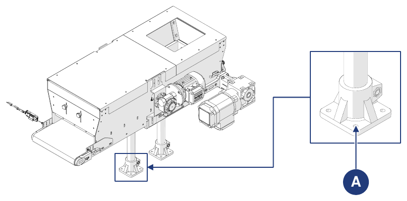

# **Transporte e incorporación**

## Embalaje

La máquina es enviada por el Fabricante desde la planta de producción hasta las instalaciones del Cliente. Según la distancia, las solicitudes del Cliente y el tiempo de permanencia en el embalaje, el envío se realiza con:
- embalaje protector normal para distancias cortas y medias;
- embalaje protector especial para largas distancias.

El transporte debe realizarse en vehículos cerrados o con lona, según el tipo de carga.

Al recibir la máquina, el cliente debe comprobar que no existan daños causados por el transporte o por el personal encargado de las operaciones.
- Si se detectan daños, dejar el embalaje tal como se encuentra y solicitar de inmediato la estimación de los daños al transportista; a continuación, enviar un acta de daños para informar al seguro del transportista y al punto de venta.
- Si la máquina se entrega en jaula sobre palé o sobre tablas de madera protegidas con film retráctil, retirar primero el embalaje o la cubierta. Para liberar completamente la máquina, retirar los tornillos y los flejes metálicos. A continuación, levantar la máquina con una grúa o una carretilla elevadora y retirar el palé utilizado para el transporte.

### Retirada del embalaje

| Fase | Acción |
|:--- |:--- |
| 1 | Llevar la máquina al lugar previsto. |
| 2 | Desembalar las partes entregadas en jaula: retirar el film retráctil; retirar los flejes; retirar la jaula; retirar los posibles sistemas de fijación al suelo de madera. |
| 3 | Desembalar las partes entregadas sobre palé: retirar los flejes; retirar el film retráctil; retirar los posibles sistemas de fijación al suelo de madera. |

Para manipular la máquina y/o sus partes, véase la sección *Manipulación*.

### Eliminación del embalaje

El embalaje es parte integrante del suministro y no se retira: debe ser eliminado por el comprador. Cualquier eliminación o destrucción debe realizarse respetando la normativa vigente en el país del usuario, teniendo en cuenta la naturaleza de los materiales.

## Manipulación

:::{important}
Las actividades de manipulación descritas en esta sección deben ser realizadas por personal cualificado y formado para las operaciones de carga, descarga y manipulación con medios de elevación. El personal debe estar autorizado, formado en el uso de los medios de elevación y respetar la normativa vigente en materia de protección individual.
:::

:::{warning}
El Fabricante:
- no responde de los daños a bienes o personas debidos a accidentes causados por el incumplimiento de las instrucciones del manual;
- no responde de los daños a la máquina derivados del incumplimiento de las instrucciones facilitadas.
:::

### Unidades y pesos

La máquina normalmente se divide y se transporta en los siguientes grupos:

| Unidad | Peso |
|:--- |:--- |
| **Cuerpo de la tolva + cinta** | Véase el documento de transporte |
| **Pies de apoyo** | Véase el documento de transporte |

En algunos casos la máquina también puede transportarse entera:

| Unidad | Peso |
|:--- |:--- |
| **Máquina completa (sin opciones)** | 45 kg |

Características del embalaje utilizado para el envío:

| Embalaje | |
|:--- |:--- |
| **Tipo de embalaje** | Jaula de madera |
| **Dimensiones de la jaula** | 1200 x 800 x 650 mm |
| **Peso de la máquina con embalaje** | 80 kg |

### Manipulación con carretilla elevadora

| | |
|:--- |:--- |
| **Cualificación del operador** | Operador de equipos de elevación |
| **Medio de elevación** | Carretilla elevadora |
| **Herramientas necesarias** | Cuerdas, abrazaderas o similares (si es necesario) |

:::{danger}
- Utilizar únicamente medios de elevación idóneos y homologados, compatibles con las dimensiones y el peso de la máquina.
- Asegurarse de que nadie se encuentre en el radio de acción del medio de elevación.
:::

**Máquina embalada**

| Fase | Acción |
|:--- |:--- |
| 1 | Colocar las horquillas de la carretilla bajo la base de la carga que se va a transportar. |
| 2 | Asegurarse de que las horquillas sobresalgan por el frente de la carga lo suficiente como para eliminar el riesgo de vuelco. |
| 3 | Elevar las horquillas hasta tocar la carga. *Nota: si es necesario, fijar la carga a las horquillas con cuerdas, abrazaderas o dispositivos similares.* |
| 4 | Levantar lentamente la carga unos diez centímetros del suelo y comprobar su estabilidad, verificando que el centro de gravedad esté a la mitad de las horquillas. |
| 5 | Regular la velocidad de transporte según el suelo y el tipo de carga, evitando maniobras bruscas. |

**Máquina sin embalaje**

| Fase | Acción |
|:--- |:--- |
| 1 | Colocar las horquillas de la carretilla bajo el plano de trabajo de la máquina. |
| 2 | Asegurarse de que las horquillas sobresalgan por el frente de la carga lo suficiente como para eliminar el riesgo de vuelco. |
| 3 | Elevar las horquillas hasta tocar la carga. *Nota: si es necesario, fijar la carga a las horquillas con cuerdas, abrazaderas o dispositivos similares.* |
| 4 | Levantar lentamente la carga unos diez centímetros del suelo y comprobar su estabilidad, verificando que el centro de gravedad esté a la mitad de las horquillas. |
| 5 | Regular la velocidad de transporte según el suelo y el tipo de carga, evitando maniobras bruscas. |

## Incorporación

### Preparativos

Normalmente corresponde al usuario preparar:
- los locales (incluidas las posibles obras, como cimentaciones o canalizaciones, y la iluminación);
- las instalaciones eléctricas de la máquina, conforme a la normativa vigente en el país de uso y según la lógica de funcionamiento de la línea en la que se incorporará la máquina;
- la alimentación de la máquina, incluido el conductor de tierra;
- los servicios auxiliares adecuados a las necesidades de la máquina;
- las herramientas y los consumibles necesarios para la incorporación;
- los posibles lubricantes necesarios para la puesta en servicio;
- los medios de elevación y manipulación idóneos.

### Condiciones ambientales admitidas

El entorno de uso debe ser cerrado, estar protegido de los agentes atmosféricos (lluvia, granizo, nieve, niebla, polvo en suspensión y polvos combustibles) y de los agentes agresivos (vapores corrosivos, fuentes de calor excesivo), y **no debe estar clasificado como ATEX**. No está permitido utilizar la máquina, los sistemas de control asociados ni los accionamientos en condiciones distintas de las enumeradas.

En particular, el entorno de uso no debe estar:
- expuesto a humos corrosivos;
- expuesto a humedad excesiva (superior al 85 %) y a variaciones rápidas de la humedad relativa (superiores a 0,005 p.u./h);
- expuesto a polvo excesivo o abrasivo;
- expuesto a vapores oleosos;
- expuesto a mezclas explosivas de polvo o gases;
- expuesto a aire salino;
- expuesto a vibraciones, choques o golpes anómalos;
- expuesto a condiciones atmosféricas adversas superiores a los límites admitidos o a goteo;
- expuesto a condiciones anómalas de transporte o almacenamiento;
- expuesto a variaciones de temperatura elevadas o rápidas (superiores a 5 K/h);
- expuesto a radiaciones nucleares.

La máquina está diseñada y construida para funcionar de forma segura en las siguientes condiciones ambientales:

| Condición | Valor |
|:--- |:--- |
| **Temperatura ambiente** | mín. +5 °C / máx. +40 °C |
| **Humedad relativa** | mín. 5 % / máx. 90 % (sin condensación) |
| **Lugar de instalación** | Nave industrial |
| **Superficie de apoyo** | Suelo industrial de hormigón |
| **Iluminación** | Luz alrededor de la máquina >100 lux; luz a disposición del operador ≥400 lux (fluorescente) |

:::{warning}
Unas condiciones ambientales distintas de las especificadas pueden causar graves daños a la máquina. La colocación en entornos no conformes con lo anterior conlleva la anulación de la garantía sobre las piezas que haya que sustituir.
:::

:::{important}
El plano de trabajo debe estar suficientemente iluminado. Si existen zonas de sombra o irregulares en el lugar de trabajo, corresponde al usuario instalar dispositivos de iluminación adecuados. Si no se cumplen estos requisitos, el Fabricante declina toda responsabilidad.
:::

### Montaje

Si la máquina llega dividida en grupos, estos deben ensamblarse.

| Fase | Acción |
|:--- |:--- |
| 1 | Colocar la placa de soporte de los pies de apoyo en correspondencia con los orificios de la base del cuerpo de la tolva. |
| 2 | Fijar los dos grupos con los tornillos de fijación adecuados. |

### Posicionamiento

:::{important}
El posicionamiento de la máquina dentro de la línea de destino debe realizarse según el layout acordado con el Fabricante.
:::

Para el posicionamiento y las conexiones posteriores, preparar un área adecuada a las dimensiones de la máquina y de los medios de elevación, prestando atención a los posibles obstáculos (otras máquinas, paredes o similares) a lo largo del recorrido de los medios de manipulación.

:::{important}
Una vez determinada la posición óptima de la máquina en el lugar de trabajo, esta debe fijarse al suelo con tacos adecuados, que se colocarán en los orificios previstos (A) de los pies de apoyo.
:::

## Conexiones

Para poner en marcha la máquina es necesario conectarla correctamente a las redes locales: **conexión eléctrica** (incluida la conexión a tierra), conforme a la normativa vigente en el país de instalación. Es responsabilidad del usuario garantizar las características de conexión requeridas.

:::{warning}
Las conexiones requeridas deben ser realizadas por personal cualificado y autorizado.
:::

### Conexión eléctrica

:::{warning}
- Antes de realizar cualquier conexión eléctrica, asegurarse de que la máquina esté apagada y de que la alimentación eléctrica ya esté desconectada.
- La operación debe ser realizada únicamente por personal especializado y autorizado (técnico de mantenimiento eléctrico).
:::

Antes de proceder a la conexión eléctrica, asegurarse de que:
- el técnico de mantenimiento conozca perfectamente la normativa vigente en el país de instalación;
- los valores de frecuencia y tensión de alimentación de la máquina correspondan a los de la red;
- la sección de los cables eléctricos sea adecuada para el consumo;
- la línea de alimentación soporte los consumos máximos de la máquina;
- la puesta a tierra del circuito sea conforme a la norma EN 60204-1;
- los materiales de la instalación de puesta a tierra tengan una resistencia adecuada o una protección mecánica adecuada.

:::{warning}
No trabajar con las manos o con objetos mojados. En caso de incendio, no utilizar agua sobre los componentes eléctricos.
:::

| | |
|:--- |:--- |
| **Cualificación del operador** | Técnico de mantenimiento eléctrico |
| **Herramientas que deben utilizarse** | Herramientas de atornillado |

:::{important}
El usuario debe prever la conexión de la máquina a una línea de alimentación dotada de un interruptor general idóneo para seccionar la alimentación energética de la máquina.
:::

| Fase | Acción |
|:--- |:--- |
| 1 | Introducir los cables R, S y T en los bornes respectivos dentro de la caja de bornes del motor. *Nota: asegurarse de que se haya retirado la funda de plástico del extremo inicial del cable.* |
| 2 | Apretar los tornillos para fijar los cables a los bornes. |
| 3 | Fijar el terminal del cable de tierra a la placa de tierra apretando el perno previsto. *Nota: asegurarse de que se haya retirado la funda de plástico del extremo inicial del cable.* |
| 4 | Comprobar con un polímetro la presencia de las tensiones previstas y de las tres fases en los bornes. |
