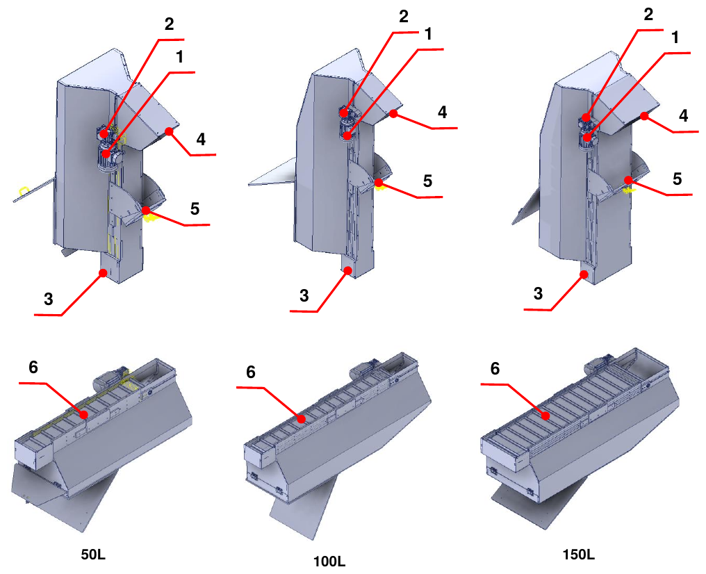
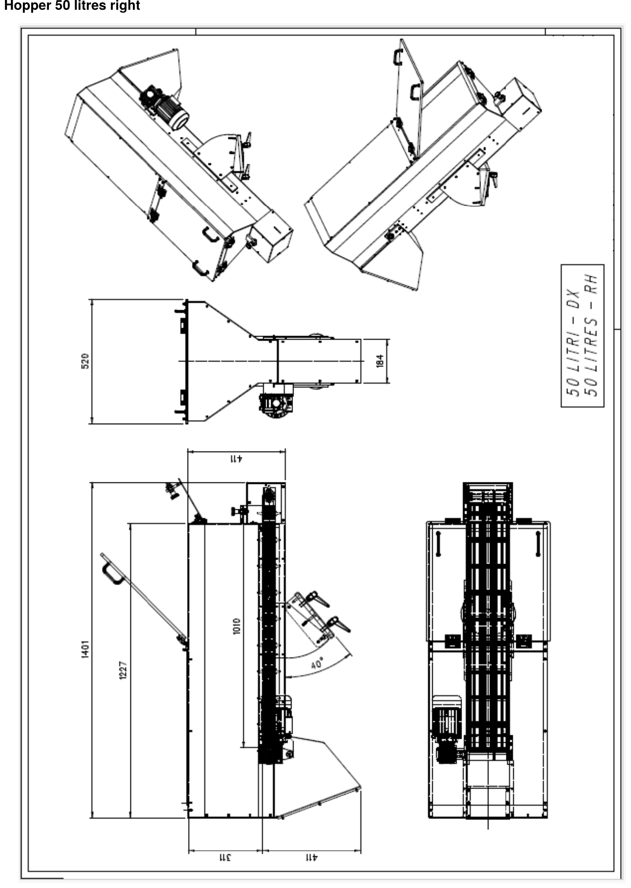
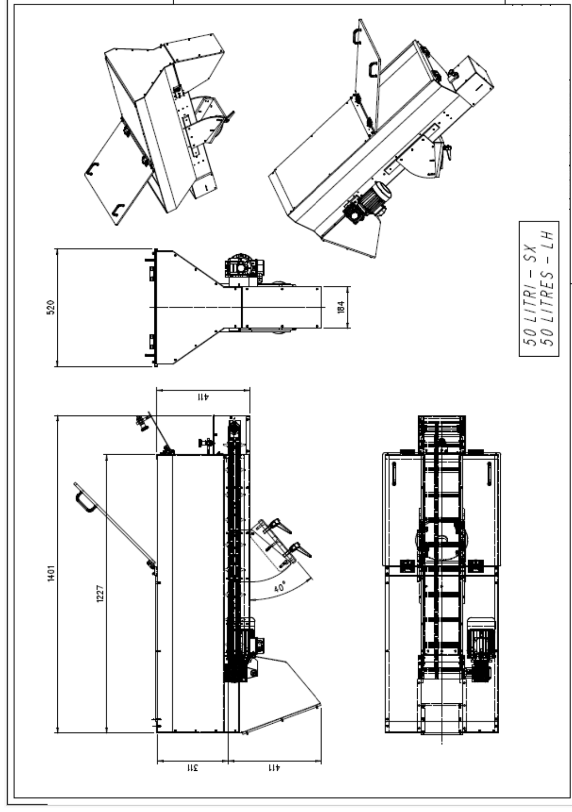
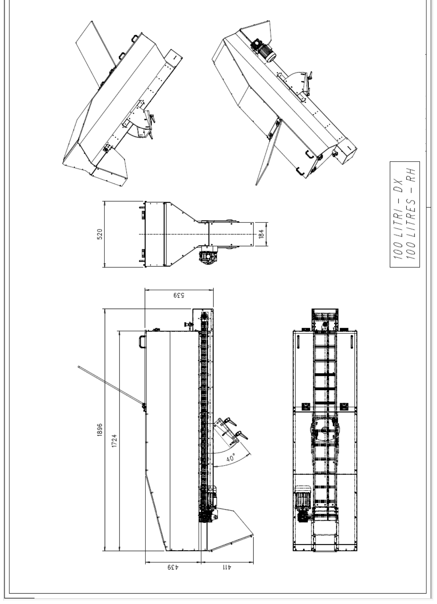
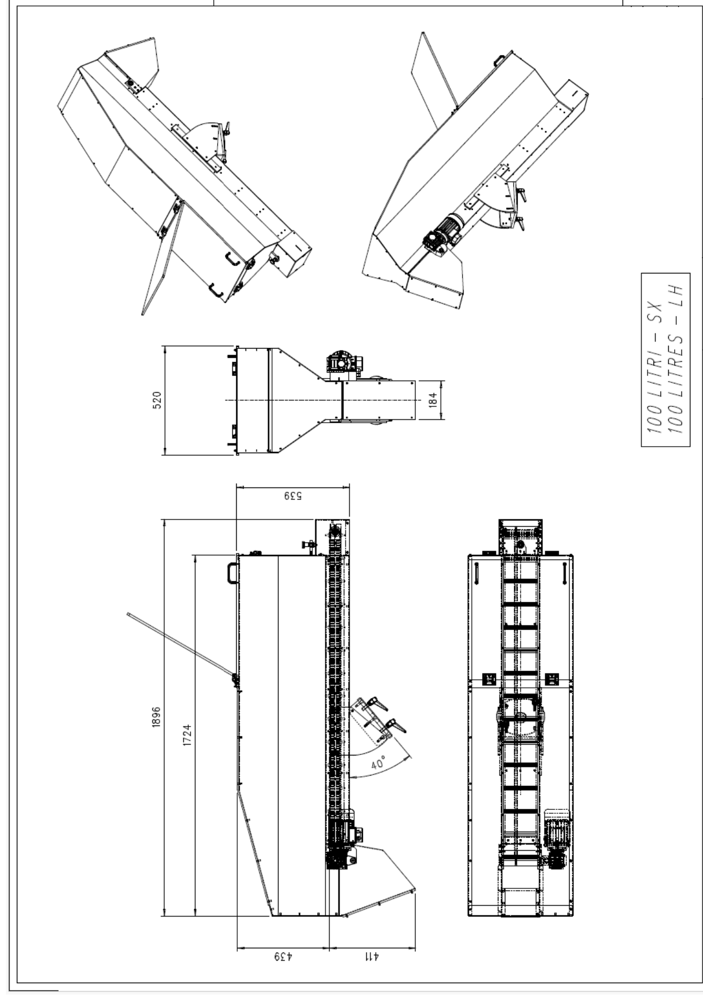
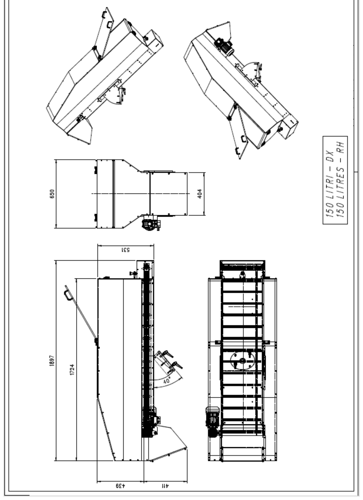
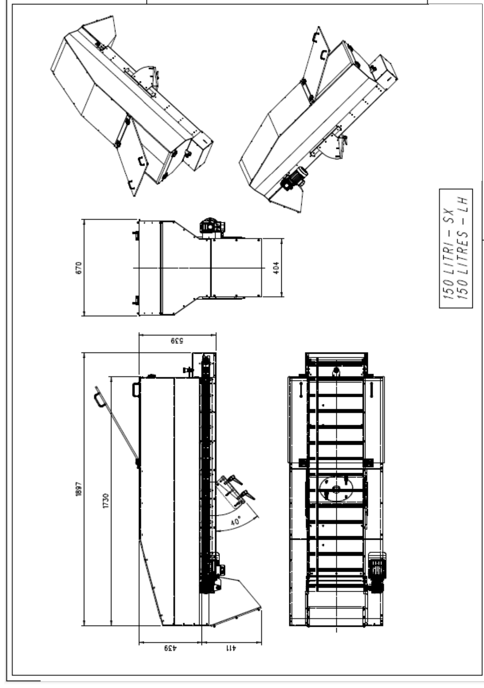
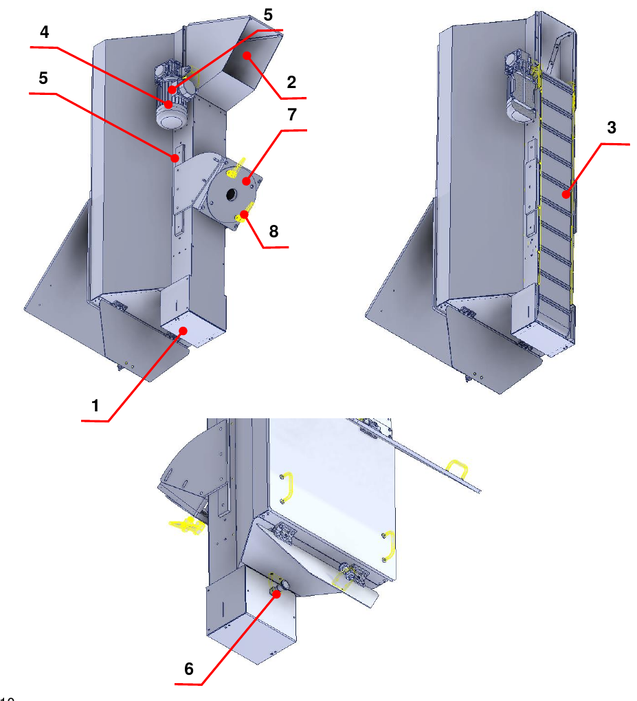

# **Descripción de la máquina**

La cuasi máquina está diseñada y construida para **transportar material de abajo arriba mediante una cinta de paletas**.

## Layout

| Pos. | Descripción | Pos. | Descripción |
|:--- |:--- |:--- |:--- |
| 1 | Motor eléctrico | 4 | Compuerta de vaciado |
| 2 | Reductor | 5 | Soporte regulable |
| 3 | Compuerta de llenado | 6 | Cinta de paletas |

## Datos técnicos

Las tablas siguientes recogen las principales características técnicas de la cuasi máquina.

| | **50 litros** | **100 litros** | **150 litros** |
|:--- |:--- |:--- |:--- |
| **Material de las paletas** | PVC | PVC | PVC |
| **Inclinación máxima / mínima** | 50° / 34° | 50° / 34° | 50° / 34° |
| **Peso de la tolva** | 75 kg | 100 kg | 125 kg |
| **Diámetro del rodillo de arrastre de la cinta** | 50 mm | 50 mm | 50 mm |
| **Motor de arrastre de la cinta** | 0,18 kW, 4 polos, brida B14 – corriente 0,75 A con conexión en estrella, 400 Vac | 0,18 kW, 4 polos, brida B14 – corriente 0,75 A con conexión en estrella, 400 Vac | 0,18 kW, 4 polos, brida B14 – corriente 0,75 A con conexión en estrella, 400 Vac |
| **Par nominal** | 1,2 Nm | 1,2 Nm | 1,2 Nm |
| **Reductor de arrastre de la cinta** | De tornillo sin fin, relación 1:50 | De tornillo sin fin, relación 1:50 | De tornillo sin fin, relación 1:50 |
| **Carga máxima admitida** | Volumen 50 litros / peso 30 kg | Volumen 100 litros / peso 30 kg | Volumen 150 litros / peso 30 kg |

:::{note}
Las características indicadas pueden sufrir modificaciones: para mayor precisión o verificaciones, consultar los esquemas adjuntos.
:::

## Dimensiones de ocupación

Para cada tamaño está disponible la versión con accionamiento a la derecha y a la izquierda.

### Tolva de 50 litros

### Tolva de 100 litros

### Tolva de 150 litros

## Descripción de la cuasi máquina

La cuasi máquina dispone de una estructura de soporte en la que se encuentran una compuerta de llenado (1), por la que se introduce el material, y una compuerta de vaciado (2) para la salida del material.

En el interior de la tolva hay una cinta de paletas (3) accionada por un motor eléctrico (4) y un reductor (5), que desplaza el material dentro de la cuasi máquina.

En la parte inferior se encuentra la compuerta de llenado, cuyo cierre y apertura se regulan mediante un pasador de indexación específico (6). Para mantener la cuasi máquina en posición se ha previsto un soporte regulable (7) accionable mediante las asas correspondientes (8).

