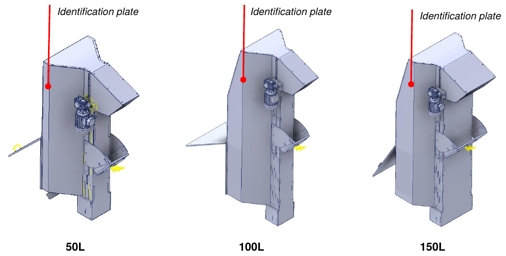
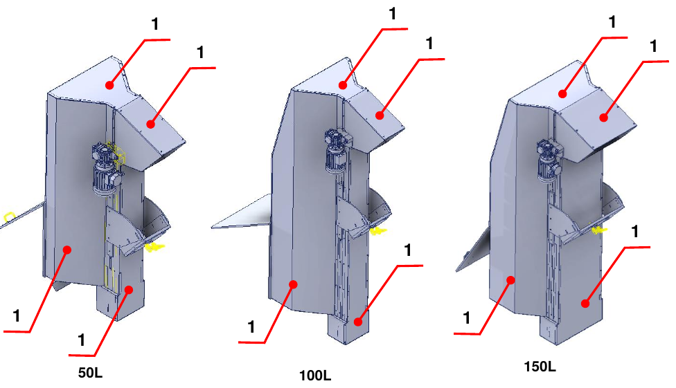
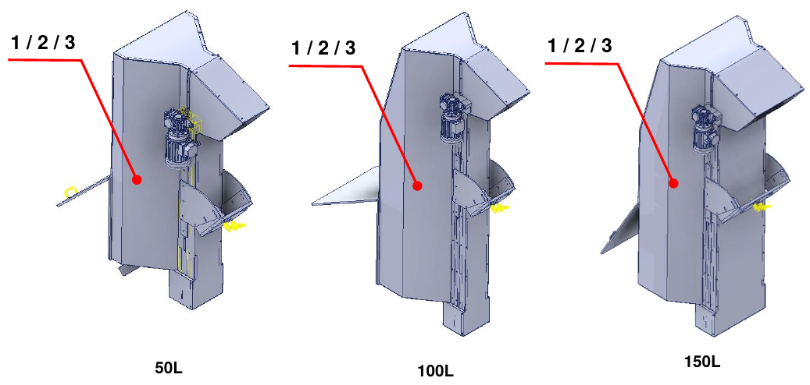

# **Información preliminar y seguridad**

:::{important}
Antes de instalar, utilizar o realizar el mantenimiento de la máquina, lea atentamente todo el manual y toda la documentación adjunta.

El incumplimiento de las instrucciones indicadas puede causar:
- daños a la máquina;
- pérdida de las condiciones de seguridad;
- riesgos para operadores y personal de mantenimiento;
- la pérdida de la garantía.
:::

## Introducción

El manual contiene toda la información necesaria para instalar, utilizar y mantener correctamente la cuasi máquina. El Fabricante exige la lectura del documento al personal encargado de la conducción y del mantenimiento, así como al personal encargado del transporte y del montaje.

Este documento es el manual de instrucciones para el montaje de las **Motorized Hopper 50 L / 100 L / 150 L** (modelos TRM/MOT 50/100/150 D/S) y está redactado de conformidad con la Directiva de Máquinas 2006/42/CE. Es parte integrante de la cuasi máquina y debe conservarse hasta su desmantelamiento definitivo, a cargo del responsable de la cuasi máquina tras la instalación final.

:::{note}
ARS S.r.l., fabricante de la cuasi máquina, se indica en el manual como el **Fabricante**. La empresa que adquiere la cuasi máquina se indica como el **Cliente**.
:::

## Asistencia y contactos

La Oficina Técnica del Fabricante está siempre a disposición para información o aclaraciones sobre uso, mantenimiento, instalación, etc. Formular las preguntas de forma clara, con referencia al manual e indicando siempre los datos que figuran en la placa de identificación de la cuasi máquina.

| | |
|:--- |:--- |
| **Fabricante** | ARS S.r.l. |
| **Dirección** | Via Aretina Nord, 157 – 52041 Pieve al Toppo (AR), Italia |
| **Contactos** | Tel. +39 0575 398611 · Fax +39 0575 398620 |
| **Correo electrónico / Web** | info@arsautomation.com · www.arsautomation.com |

## Identificación

La posición de la placa de identificación, con los datos principales de la cuasi máquina, se indica en la figura para los tres tamaños.

## Glosario

| Término | Definición |
|:--- |:--- |
| **Parada de emergencia** | Función destinada a evitar la aparición de peligros o a reducir los existentes para las personas, los daños a la máquina o al trabajo en curso, activada por una única acción humana. |
| **Componente de seguridad** | Componente destinado a desempeñar una función de seguridad, comercializado por separado, cuyo fallo y/o mal funcionamiento pone en peligro la seguridad de las personas y que no es indispensable para el funcionamiento de la cuasi máquina. |
| **Directiva de Máquinas** | Directiva 2006/42/CE del Parlamento Europeo y del Consejo relativa a las máquinas. |
| **Dispositivo de protección** | Medio de protección distinto de un resguardo. |
| **Proveedor** | Sujeto (fabricante, instalador, integrador de sistemas) que suministra equipos o servicios asociados a la cuasi máquina. |
| **Función de seguridad** | Función de la cuasi máquina cuyo fallo puede provocar un aumento inmediato de los riesgos. |
| **Fallo** | Cese de la aptitud de un elemento para realizar la función requerida. |
| **Información para el uso** | Medida de protección consistente en medios de comunicación (textos, palabras, señales, símbolos, diagramas) utilizados por separado o en combinación para transmitir información al usuario. |
| **Fallo de funcionamiento** | Incapacidad de una cuasi máquina para realizar la función prevista. |
| **Marcado** | Símbolo e inscripción para la identificación de la cuasi máquina, aplicados por el fabricante. |
| **Material** | Producto que se debe manipular. |
| **Medida de seguridad** | Medio que elimina o reduce un peligro. |
| **Operario** | Persona encargada de manejar la cuasi máquina. |
| **Peligro** | Fuente potencial de daño. |
| **Técnico cualificado / técnico de mantenimiento especializado** | Persona que ha realizado cursos de especialización, formación profesional, etc., y es experta en instalación, puesta en servicio, mantenimiento, reparaciones, transporte y manipulación de la cuasi máquina. |
| **Cuasi máquina** | Conjunto que constituye casi una máquina, pero que no puede por sí solo garantizar una aplicación determinada. Está destinada exclusivamente a ser incorporada o ensamblada con otras máquinas, cuasi máquinas o equipos para constituir una máquina regulada por la directiva. |
| **Resguardo** | Barrera física, diseñada como parte de la cuasi máquina, para garantizar la protección. |
| **Riesgo** | Combinación de la probabilidad de un daño y de su gravedad. |
| **Riesgo residual** | Riesgo que permanece tras la adopción de medidas de protección. |
| **Situación de emergencia** | Situación peligrosa que requiere ser terminada o evitada con urgencia. |
| **Transporte** | Conjunto de las operaciones para trasladar la cuasi máquina desde el lugar de montaje del fabricante hasta el lugar definitivo en las instalaciones del cliente. |
| **Uso previsto** | Uso de la cuasi máquina de conformidad con la información para el uso facilitada en las instrucciones. |
| **Uso incorrecto razonablemente previsible** | Uso de la cuasi máquina de una forma no prevista por el diseñador, pero que puede derivarse de un comportamiento humano fácilmente previsible. |
| **Usuario** | Sujeto que utiliza la cuasi máquina y los equipos eléctricos relacionados. |
| **Zona de trabajo** | Volumen delimitado por los resguardos de seguridad y destinado al funcionamiento de la cuasi máquina. |
| **Zona peligrosa** | Cualquier espacio dentro y/o alrededor de la máquina en el que una persona pueda estar expuesta a un peligro. |

## Símbolos utilizados en el manual

| Símbolo | Significado |
|:--- |:--- |
| **PELIGRO** | Situación de peligro inminente que, si no se evita, puede causar lesiones graves o la muerte del operador. Identifica operaciones estrictamente prohibidas y procedimientos obligatorios que deben aplicarse para evitarlas. |
| **ADVERTENCIA** | Situación de peligro potencial que, si no se evita, puede causar lesiones graves o la muerte del operador. Describe operaciones que requieren especial atención. |
| **ATENCIÓN** | Situación de peligro no inmediato o potencial que, si no se evita, puede causar lesiones, incluso leves, o daños a la salud del operador. |
| **NOTA** | Información importante y/o procedimientos que, si se ignoran o se respetan solo parcialmente, pueden dañar la cuasi máquina o los equipos conectados. |
| **INFORMACIÓN ADICIONAL** | Información útil y/o referencias a otra documentación (manuales de instrucciones adjuntos, documentos técnicos u otras secciones del manual). |

## Normas de seguridad

Las prescripciones, instrucciones, reglamentos y notas de seguridad relacionadas descritos en el manual definen los comportamientos y las reglas que deben seguirse en las actividades que constituyen el uso previsto de la cuasi máquina, para operar con seguridad para el personal, los equipos y el entorno circundante. Las instrucciones de seguridad van dirigidas a todo el personal autorizado, formado y delegado para las actividades de:
- transporte;
- instalación;
- uso;
- gestión;
- mantenimiento;
- limpieza;
- puesta fuera de servicio y desmantelamiento.

## Responsabilidad del Fabricante

El Fabricante declina toda responsabilidad derivada del uso erróneo o indebido de la cuasi máquina y de los daños causados por el uso de repuestos no prescritos, por mantenimientos realizados incorrectamente y por manipulaciones de circuitos y componentes.

La responsabilidad de la aplicación de los requisitos de seguridad corresponde al personal técnico responsable de las actividades previstas para la cuasi máquina, que debe asegurarse de que los operadores autorizados estén cualificados y respeten y conozcan las prescripciones del manual y las normas de seguridad de carácter general. El incumplimiento de las instrucciones de seguridad puede causar lesiones a las personas y daños a los equipos.

## Gestión de la cuasi máquina

La gestión solo está permitida a personas autorizadas y adecuadamente formadas, o en todo caso con competencia técnica adecuada. Quien utilice y mantenga la cuasi máquina debe saber que el conocimiento y la aplicación de las normas de seguridad forman parte integrante de su trabajo.

Antes de poner en marcha la cuasi máquina:
- leer atentamente el manual;
- saber qué resguardos y dispositivos de parada de emergencia hay, dónde se encuentran y cómo funcionan.

Está estrictamente prohibido retirar, incluso parcialmente, los resguardos, los dispositivos de seguridad y las placas de advertencia aplicados a la cuasi máquina. En caso de mal funcionamiento o fallo de dichos dispositivos, deben repararse o sustituirse de inmediato.

## Garantía

El Fabricante garantiza que sus máquinas están exentas de defectos de material y/o de fabricación. Para cualquier aclaración, consultar las condiciones contractuales.

- El comprador solo tiene derecho a la sustitución de las piezas reconocidas como defectuosas; los gastos de embalaje, transporte y, en su caso, instalación corren por su cuenta. En ese caso deben especificarse: fecha y número del documento de compra, modelo de la cuasi máquina, número de serie.
- No se reconoce ninguna indemnización por la pérdida de producción causada por los posibles periodos de inactividad de la cuasi máquina.
- Quedan excluidos de la garantía los daños causados por un uso distinto del indicado en el manual, incluido el mantenimiento no conforme con las instrucciones.
- La garantía no se reconoce para las cuasi máquinas en las que se hayan realizado modificaciones no autorizadas. Están estrictamente prohibidas las modificaciones o manipulaciones de los dispositivos de seguridad.
- En caso de daños durante el periodo de garantía, esta solo es válida con el uso de repuestos originales.
- Las reparaciones solo pueden ser realizadas por operarios cualificados que conozcan la cuasi máquina.

## Seguridad

### Información general

El Cliente debe instruir a los operadores sobre los riesgos de accidente, sobre los dispositivos de seguridad instalados en la cuasi máquina y sobre las normas generales de prevención de accidentes previstas por las directivas comunitarias y por la legislación del país de instalación. Los operadores deben conocer la posición y el funcionamiento de todos los mandos y las características de la cuasi máquina.

La manipulación o la sustitución no autorizada de uno o varios componentes, la adopción de accesorios y el uso de piezas distintas de las recomendadas pueden conllevar riesgos de lesión.

:::{warning}
Está absolutamente prohibido puentear o manipular los dispositivos de seguridad de la cuasi máquina. El Fabricante declina toda responsabilidad sobre la seguridad de la cuasi máquina en caso de incumplimiento de esta prohibición.
:::

:::{warning}
Corresponde al operador que utiliza la cuasi máquina asegurarse de que la zona sea segura y esté libre de personas y/u objetos.
:::

### Certificación

La cuasi máquina se suministra con la Declaración de incorporación, conforme a los requisitos esenciales de seguridad especificados en la Directiva de Máquinas 2006/42/CE (Anexo II B) y en la Directiva de Compatibilidad Electromagnética 2014/30/UE.

:::{note}
Cualquier modificación realizada en la cuasi máquina anula de inmediato la Certificación de incorporación emitida por el Fabricante.
:::

### Usos previstos y no previstos

La cuasi máquina está diseñada y construida para **transportar material de abajo arriba mediante una cinta de paletas**. No puede utilizarse para fines distintos de los previstos ni para el procesamiento de piezas que superen los límites acordados.

:::{danger}
El uso de la cuasi máquina para fines de procesamiento no descritos en el manual es **USO INDEBIDO**. El Fabricante declina toda responsabilidad por daños a bienes y/o personas y considera anulada cualquier tipo de garantía. El Fabricante declina toda responsabilidad en caso de manipulación, modificaciones no autorizadas o intervenciones de mantenimiento realizadas por personal no formado.
:::

:::{warning}
La cuasi máquina debe ser utilizada únicamente por operadores expertos y cualificados que hayan leído y comprendido el contenido del manual.
:::

:::{note}
Está prohibido realizar cualquier movimiento en caso de comportamiento anómalo de la cuasi máquina o de falta de alimentación, porque es competencia específica del personal de mantenimiento.
:::

### Condiciones ambientales de funcionamiento

La cuasi máquina debe instalarse en un entorno cubierto, dotado de todas las medidas de seguridad previstas por las leyes vigentes en el país del usuario.

| Aspecto | Indicación |
|:--- |:--- |
| **Protección contra incendios** | La cuasi máquina no dispone de un sistema contra incendios propio. |
| **Atmósfera explosiva** | No está diseñada ni construida para trabajar en atmósferas explosivas o parcialmente explosivas. |
| **Iluminación** | No dispone de un sistema de iluminación propio: es deber y responsabilidad del cliente colocarla en una zona adecuadamente iluminada. |
| **Ruido** | Medido conforme a las normas acústicas. Sin carga, el ruido global generado es inferior a **75 dB(A)**, medido en el puesto del operador. El nivel real depende del tipo de procesamiento; la medición de la exposición de los trabajadores al ruido corresponde al usuario, conforme a la legislación vigente en su país. |
| **Emisiones electromagnéticas** | Los valores de emisión cumplen las normas gracias al uso de componentes compatibles con CEM, conexiones adecuadas y, cuando es necesario, filtros. Un mantenimiento no conforme de la instalación eléctrica o una sustitución incorrecta de componentes puede comprometer su eficacia. |
| **Vibraciones** | La cuasi máquina no produce vibraciones peligrosas para la salud del personal. Las vibraciones excesivas solo pueden deberse a una avería mecánica, que debe comunicarse y eliminarse de inmediato. |

### Funciones de seguridad

| Tipo de dispositivo | Función |
|:--- |:--- |
| **Resguardos fijos** | Segregación de las zonas peligrosas de la cuasi máquina. |

**Resguardos fijos:** impiden el acceso a las partes en movimiento durante el funcionamiento. No están controlados y su retirada solo debe realizarse para operaciones de mantenimiento, con las fuentes de energía de la cuasi máquina desconectadas.

:::{warning}
El Fabricante no es en modo alguno responsable si la cuasi máquina se utiliza con resguardos incompletos, abiertos y/o no instalados.
:::

### Equipos de protección individual (EPI)

El operador debe utilizar los equipos de protección individual para reducir al mínimo la posibilidad de riesgos.

:::{warning}
El personal debe llevar ropa de trabajo adecuada para prevenir accidentes. Para evitar riesgos mecánicos (arrastre, atrapamiento, etc.), llevar el cabello recogido y no llevar pulseras, relojes, anillos ni cadenas.
:::

:::{note}
La indumentaria de quien trabaje o realice el mantenimiento en la cuasi máquina debe cumplir los requisitos esenciales de seguridad establecidos por las directivas de la UE y por las leyes del país de instalación.
:::

### Riesgos residuales

En la fase de diseño se evaluaron todas las zonas o partes de alto riesgo y se adoptaron las precauciones necesarias para evitar riesgos a las personas y daños a los componentes de la cuasi máquina. Del análisis de riesgos realizado, conservado en el Expediente Técnico del Fabricante, no resultan riesgos residuales.

:::{warning}
Comprobar periódicamente el funcionamiento de todos los dispositivos de seguridad. No retirar los resguardos instalados.
:::

### Placas aplicadas a la cuasi máquina

El Fabricante ha instalado en la cuasi máquina una serie de placas de advertencia, definidas conforme a las normas europeas sobre los símbolos gráficos que deben utilizarse y colocadas en posición bien visible. El servicio de mantenimiento debe sustituir de inmediato todas las placas que, por desgaste, se vuelvan ilegibles.

:::{warning}
Está absolutamente prohibido retirar las placas de advertencia aplicadas a la cuasi máquina. El Fabricante declina toda responsabilidad sobre la seguridad de la cuasi máquina en caso de incumplimiento de esta prohibición.
:::

:::{note}
Para la información sobre las placas de advertencia instaladas en las partes incorporadas de la cuasi máquina, consultar los manuales específicos.
:::

| Placa | Descripción |
|:--- |:--- |
| 1 | Prohibido intervenir en órganos en movimiento. |
| 2 | Prohibido retirar los dispositivos de seguridad. |
| 3 | Obligatorio leer el manual de uso y mantenimiento. |
