# **Mantenimiento**

## Precauciones generales de seguridad

El mantenimiento, la localización de averías y las reparaciones están reservados exclusivamente al personal autorizado. El personal encargado de la conducción y del mantenimiento debe estar bien formado y conocer plenamente las normas de prevención de accidentes; el personal no autorizado debe permanecer fuera del área de trabajo durante las operaciones. Las precauciones de seguridad de esta sección deben respetarse siempre. Al terminar cada intervención es obligatorio restablecer las protecciones, comprobando su correcto funcionamiento.

### Advertencias generales de peligro

- Las altas tensiones pueden causar la muerte por contacto. Operar siempre con la máxima precaución y conforme a las normas de seguridad vigentes en el país.
- En la cuasi máquina en funcionamiento hay partes en movimiento que pueden causar graves daños a las personas. Las operaciones especializadas de limpieza y mantenimiento relativas a la retirada o sustitución de componentes o de las unidades de control deben realizarse con la alimentación desconectada y con las instalaciones sin presión.
- Los interruptores generales de alimentación deben estar en posición OFF y bloqueados con un candado de seguridad.
- Colocar carteles de advertencia adecuados («CUASI MÁQUINA EN MANTENIMIENTO – NO ALIMENTAR») en el cuadro eléctrico y en el grupo de tratamiento de aire.
- Mantenerse alejado de los orificios de purga y de los grifos durante las operaciones de descarga de la presión de la instalación.
- Llevar siempre gafas y guantes de protección durante las intervenciones en los equipos.
- Asegurarse de que las herramientas utilizadas estén en perfecto estado y dotadas de empuñaduras aislantes, cuando se requiera.
- Comprobar que el aislamiento de los cables y conductores de los equipos de prueba no presente la menor rotura o daño.
- Los equipos sin conexión a tierra pueden causar graves lesiones personales. Asegurarse siempre de la presencia de las conexiones a tierra y de su conformidad con las normas.
- En caso de incendio, no utilizar nunca chorros de agua sobre el equipo: desconectar toda alimentación y utilizar extintores de CO2.
- Antes de realizar las conexiones, revisarlas atentamente y asegurarse de que no haya defectos ni suciedad en las roscas.
- Antes de poner en presión la instalación tras una reparación, comprobar la estanqueidad de los racores y las uniones.
- Antes de poner en marcha el equipo, asegurarse siempre de que el personal de mantenimiento esté fuera del espacio protegido y de que no se hayan dejado herramientas ni materiales en las proximidades.
- La localización de averías debe realizarse, en la medida de lo posible, permaneciendo fuera del área protegida; cuando sea necesario intervenir con la unidad de control y la instalación alimentadas, adoptar todas las precauciones previstas por las normas de seguridad para operar en presencia de tensiones peligrosas y de grupos móviles bajo tensión.
- No llevar nada que pueda engancharse en los equipos o actuar como conductor (collares, pulseras, etc.).
- El mantenimiento, la reparación y la localización de averías deben finalizar con la verificación del correcto funcionamiento de la cuasi máquina y con el restablecimiento de todos los dispositivos de seguridad.

### Advertencias generales

- La máxima fiabilidad y los menores costes de mantenimiento son el resultado de un programa de mantenimiento e inspección planificado y seguido escrupulosamente durante toda la vida de la cuasi máquina. Respetar los intervalos de mantenimiento indicados y programar las intervenciones según las necesidades específicas del ciclo productivo.
- Si se requieren intervenciones de cierta envergadura, ponerse en contacto con el Fabricante para cualquier duda o asistencia técnica.
- Antes de iniciar cualquier operación de control y mantenimiento, eliminar la suciedad de la cuasi máquina.
- Para la limpieza utilizar siempre aire perfectamente seco con una presión no superior a 0,2 MPa.
- Utilizar siempre herramientas en perfecto estado de conservación y específicamente fabricadas para la operación que se vaya a realizar: las herramientas inadecuadas o ineficaces pueden causar graves daños.
- Durante el desmontaje, marcar las distintas partes con una etiqueta para garantizar su correcta recolocación.
- Tras cualquier mantenimiento que implique la desconexión de cableados y/o de partes fijas y móviles, verificar la correspondencia de la numeración de las partes fijas y móviles.
- Antes de volver a poner en funcionamiento el equipo tras una avería, inspeccionarlo y comprobarlo atentamente para detectar posibles daños.
- Además de las actividades de mantenimiento tradicionales, el técnico de mantenimiento debe realizar, cuando esté previsto, operaciones de mantenimiento predictivo consistentes en análisis instrumentales y controles especializados, destinados a prever a tiempo la aparición de fallos en determinados componentes.

## Cualificación del personal de mantenimiento

:::{warning}
El Responsable de seguridad debe asegurarse de que todas las personas que operan en la cuasi máquina hayan recibido todas las instrucciones contenidas en el manual, incluidas las operaciones iniciales de instalación y puesta en servicio.
:::

El personal de mantenimiento debe:
- conocer las directivas vigentes sobre prevención de accidentes durante los trabajos en máquinas y ser capaz de aplicarlas;
- haber leído y comprendido el capítulo de seguridad;
- conocer la construcción básica y las funciones de los sistemas de manipulación;
- saber utilizar y consultar los documentos de construcción y la documentación de la cuasi máquina;
- asumir la responsabilidad de sus propias decisiones sobre las intervenciones en la cuasi máquina;
- estar dispuesto a adaptarse a los cambios tecnológicos en la cuasi máquina;
- observar las irregularidades en el proceso productivo y, si es necesario, adoptar las medidas oportunas.

## Plan de controles de seguridad

:::{warning}
Comprobar periódicamente la eficacia de los sistemas de seguridad de la cuasi máquina. Este procedimiento debe repetirse como práctica normal de mantenimiento.
:::

El personal de mantenimiento tiene la obligación de comprobar periódicamente el funcionamiento de los dispositivos de seguridad. La operación debe ser realizada por personal competente, con conocimiento específico del uso de los dispositivos de seguridad.

:::{warning}
Realizar los controles funcionales, de apriete y de posicionamiento de los sistemas de seguridad indicados en la sección *Funciones de seguridad*.
:::

## Procedimiento de parada de la cuasi máquina

Antes de realizar los procedimientos de mantenimiento descritos a continuación, el operador debe parar la cuasi máquina y ponerla en estado de mantenimiento siguiendo este procedimiento:
- comprobar la posible presencia de energía residual y, si es necesario, descargarla antes de intervenir en los dispositivos;
- colocar el cartel «NO REALIZAR MOVIMIENTOS – MÁQUINA EN MANTENIMIENTO» cerca del interruptor general;
- tras las intervenciones de mantenimiento, restablecer las fuentes de energía previamente desactivadas;
- antes de reanudar el funcionamiento normal, comprobar de nuevo todo el sistema, como se describe en el manual.

## Normas de seguridad para el mantenimiento

Las principales precauciones que deben adoptarse durante las intervenciones de mantenimiento:
- las operaciones complejas en la cuasi máquina solo se permiten a operadores especializados;
- no tocar nunca bornes desnudos ni dispositivos eléctricos antes de haber desconectado la alimentación (interruptor general en posición OFF);
- desconectar la alimentación eléctrica antes de retirar cualquier resguardo fijo o sustituir cualquier componente eléctrico;
- no llevar anillos, relojes, collares ni pulseras durante el mantenimiento;
- colocar bajo los pies una alfombrilla de goma de alta impedancia durante las intervenciones; no trabajar sobre suelos mojados ni en ambientes muy húmedos; evitar la acumulación de electricidad estática que podría dañar los componentes eléctricos;
- llevar siempre guantes y ropa de protección que cubran el mayor número posible de partes del cuerpo;
- no utilizar llamas abiertas, herramientas puntiagudas ni alfileres para la limpieza;
- no fumar.

## Tabla de mantenimiento

Para garantizar la fiabilidad de la cuasi máquina es necesario asegurar un mantenimiento regular y eficaz y el control constante de los parámetros de los instrumentos indicadores. El mantenimiento, la localización de averías y las reparaciones solo están permitidos al personal autorizado.

| Frecuencia | Descripción | Medio |
|:--- |:--- |:--- |
| Diaria | Realizar una limpieza a fondo de la cuasi máquina. | Paño + alcohol |
| Mensual | Comprobar el correcto tensado de la cinta de paletas. | Manual |
| Mensual | Comprobar el apriete de los tornillos y las tuercas de las partes en movimiento. | Llave dinamométrica |
| Mensual | Comprobar el desgaste de las partes en movimiento. | Control visual |

## Tabla de lubricación

| Componente | Lubricante recomendado |
|:--- |:--- |
| Discos giratorios | Aceite para engranajes, ISO VG 320 |
| Frenos hidráulicos | Aceite hidráulico, ISO VG 46 |
| Partes en movimiento en general | Grasa multiuso EP |

## Ajustes mecánicos

### Tensado y ajuste de la cinta

La cuasi máquina incluye una cinta de paletas que eleva las piezas desde la cuba de carga hasta el canal de salida. Para que la cinta corra correctamente es necesario tensarla y ajustarla actuando sobre los tornillos.

El **tensado** sirve para evitar cualquier deslizamiento entre la cinta y el rodillo de arrastre, mientras que el **ajuste** garantiza que la cinta permanezca en la posición correcta durante el recorrido y no se desvíe hacia la izquierda o la derecha.

El tensado y el ajuste se realizan apretando o aflojando los tornillos M8 **con la cinta en movimiento**, controlando después el comportamiento de la cinta en ambos lados del rodillo. El ajuste debe realizarse simultáneamente en el lado izquierdo y en el derecho, porque es necesario encontrar el equilibrio adecuado entre los dos tornillos.

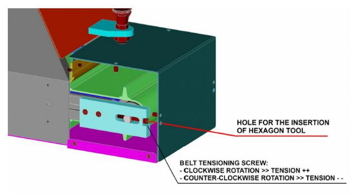

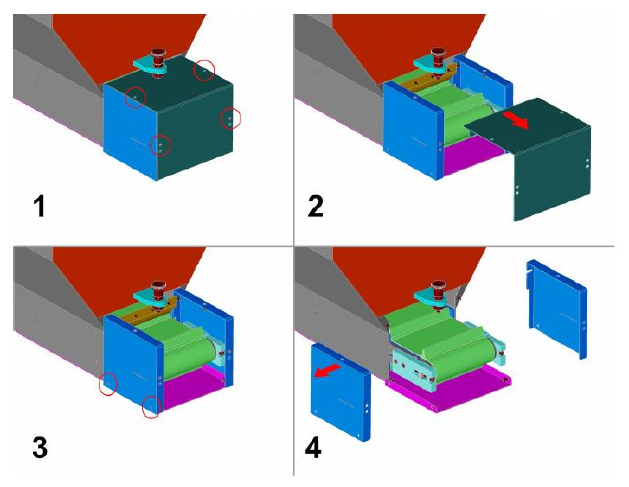

### Sustitución de la cinta de paletas

:::{warning}
Esta operación debe ser realizada únicamente por técnicos expertos, con los conocimientos y las herramientas adecuados. En caso de duda, contactar con los técnicos de ARS.
:::

| Fase | Acción |
|:--- |:--- |
| 1 | Desconectar la tolva de las fuentes de alimentación, para evitar movimientos involuntarios de la cinta. |
| 2 | Separar la tolva de la estructura de soporte (no incluida en el suministro): se recomienda utilizar medios de elevación adecuados (p. ej. eslingas) para evitar movimientos bruscos de la carga durante la manipulación. Una vez separada, apoyar la tolva sobre una superficie plana, tumbada sobre un lado y con el motor orientado hacia abajo. Para mantenerla en posición, colocar un taco entre el suelo y el costado de la tolva. |
| 3 | Separar la placa lateral del cuerpo de la tolva. |
| 4 | Separar la tapa inferior (compuesta por 3 partes: parte central + lado derecho + lado izquierdo) del cuerpo de la tolva. |
| 5 | Separar la compuerta de vaciado del cuerpo de la tolva. |
| 6 | Separar el resguardo fijo del lado superior de la tolva del cuerpo principal. |
| 7 | Separar el canal de salida del cuerpo de la tolva. Retirar primero los 4 tornillos resaltados (dos en el lado superior + dos en el inferior); a continuación, retirar los demás tornillos que unen las partes exteriores de las chapas. |
| 8 | Separar el resguardo transparente del lado superior del cuerpo de la tolva. |
| 9 | Separar la compuerta de llenado del cuerpo de la tolva. |
| 10 | Separar la chapa lateral del cuerpo de la tolva. |
| 11 | Aflojar completamente la cinta como se describe en *Tensado y ajuste de la cinta*. |
| 12 | Retirar la cinta tirando de ella hacia arriba. Si el aflojado no basta para superar las placas laterales que guían la cinta, será necesario retirarlas. |
| 13 | Introducir la nueva cinta dejándola caer desde arriba. |
| 14 | Realizar un primer tensado de la cinta, para garantizar un buen agarre entre el rodillo de arrastre y la cinta. El ajuste fino del tensado se realizará más tarde, cuando sea posible hacer correr la cinta. |
| 15 | Volver a montar la chapa lateral en el cuerpo de la tolva (véase el paso 10). |
| 16 | Volver a montar la compuerta de llenado en el cuerpo de la tolva (véase el paso 9). |
| 17 | Volver a montar el resguardo transparente en el lado superior de la tolva (véase el paso 8). |
| 18 | Volver a montar el canal de descarga en el cuerpo de la tolva (véase el paso 7). Volver a colocar primero los tornillos entre las partes exteriores de las chapas y después los cuatro tornillos resaltados (dos desde arriba + dos desde abajo). |
| 19 | Volver a montar el resguardo fijo superior en el cuerpo de la tolva (véase el paso 6). |
| 20 | Volver a montar la compuerta de vaciado en el cuerpo de la tolva (véase el paso 5). |
| 21 | Volver a montar la tapa inferior (3 partes: parte central + lado derecho + lado izquierdo) en el cuerpo de la tolva (véase el paso 4). |
| 22 | Volver a montar la placa lateral en el cuerpo de la tolva (véase el paso 3). |
| 23 | Volver a montar la tolva en la estructura de soporte. Se recomienda utilizar medios de elevación adecuados (p. ej. eslingas) para evitar movimientos bruscos de la carga durante la manipulación. |
| 24 | Volver a conectar la tolva a las fuentes de alimentación. |
| 25 | Poner en marcha la tolva sin piezas en el interior y realizar el ajuste fino del tensado de la cinta. |

**Figuras de referencia (pasos 2–12)**

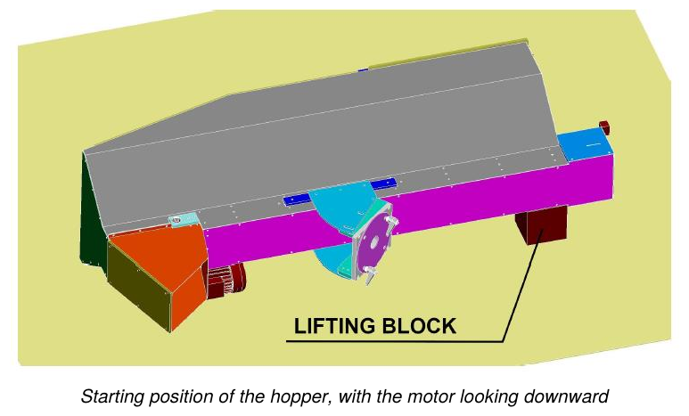

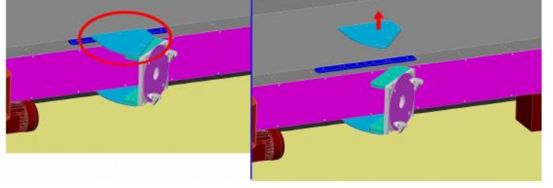

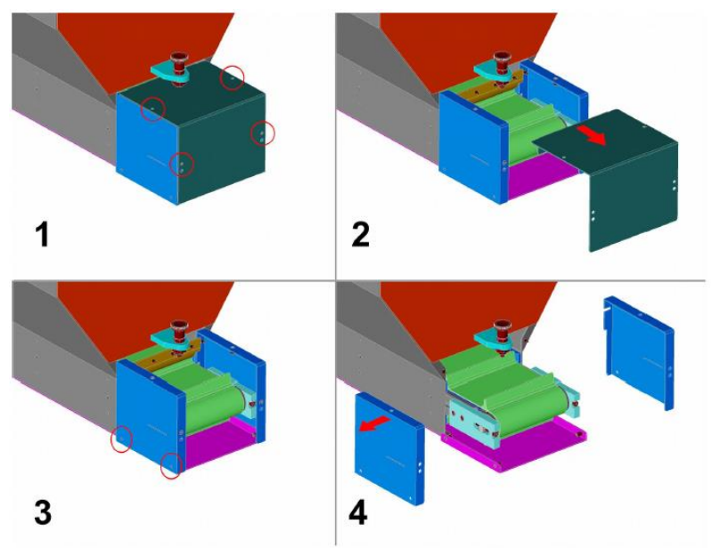

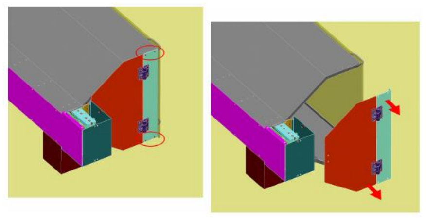

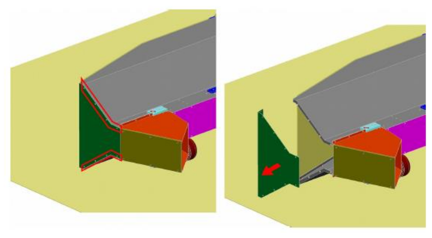

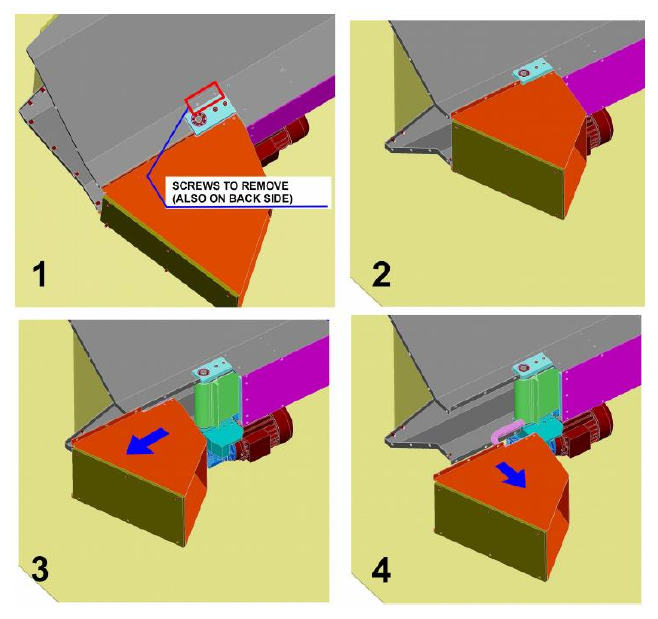

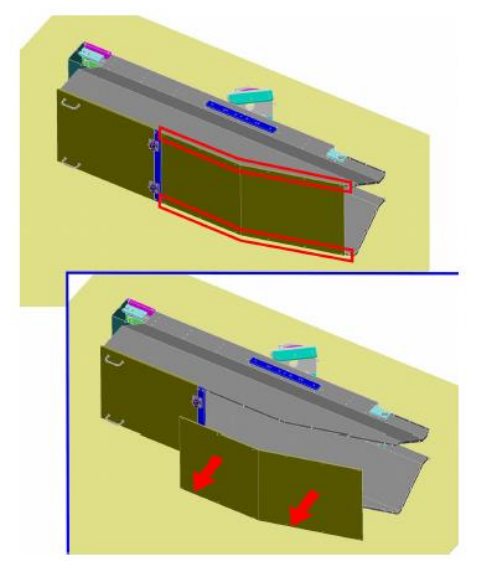

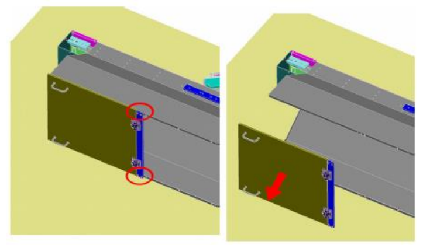

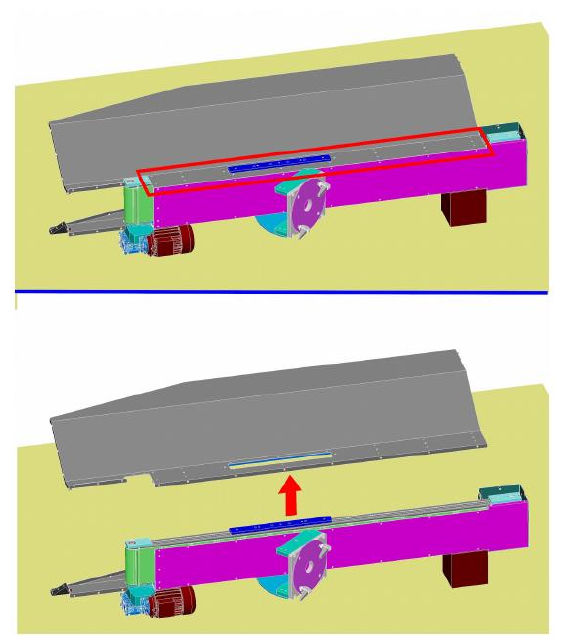

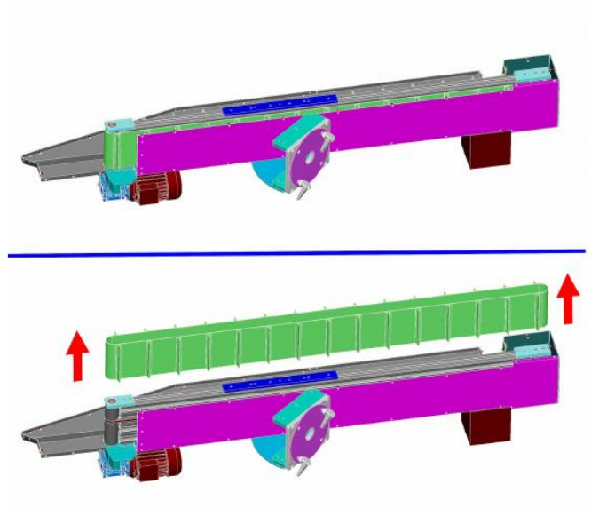

## Diagnóstico de averías mecánicas

| Avería | Causas | Soluciones |
|:--- |:--- |:--- |
| **Fuga de aceite lubricante** | 1. Desgaste de la junta. 2. Cantidad excesiva de aceite lubricante. | 1. Sustituir el componente desgastado. 2. Reducir la cantidad de aceite lubricante. |
| **Arañazos o holguras en los sistemas de guía (varillas, casquillos, guías)** | 1. Desgaste de los componentes. 2. Necesidad de ajuste. 3. Lubricación insuficiente. | 1. Sustituir el componente desgastado. 2. Ajustar el componente. 3. Restablecer el nivel correcto de lubricante. |

## Mantenimiento extraordinario

Las intervenciones de mantenimiento extraordinario son intervenciones no ordinarias, relativas a la sustitución de componentes sujetos a desgaste/rotura y al desmontaje de partes de la cuasi máquina. Además, dichas intervenciones:
- pueden prolongar la vida útil y/o mejorar, de forma subordinada, la eficiencia, la fiabilidad, la productividad, la mantenibilidad y los procedimientos de inspección;
- no modifican las características originales (datos de placa, dimensionamiento, valores constructivos, etc.) ni la estructura esencial;
- no generan variaciones en el destino de uso.

:::{warning}
Las intervenciones de mantenimiento extraordinario deben ser realizadas únicamente por técnicos cualificados, expertos en los distintos ámbitos (eléctrico o mecánico).
:::

:::{note}
Para proceder con las intervenciones de mantenimiento extraordinario, contactar con el Fabricante, como se indica en la sección *Asistencia y contactos*.
:::

## Ficha de las intervenciones de mantenimiento

| Fecha | Operador | Descripción de la intervención |
|:--- |:--- |:--- |
| | | |
| | | |
| | | |
