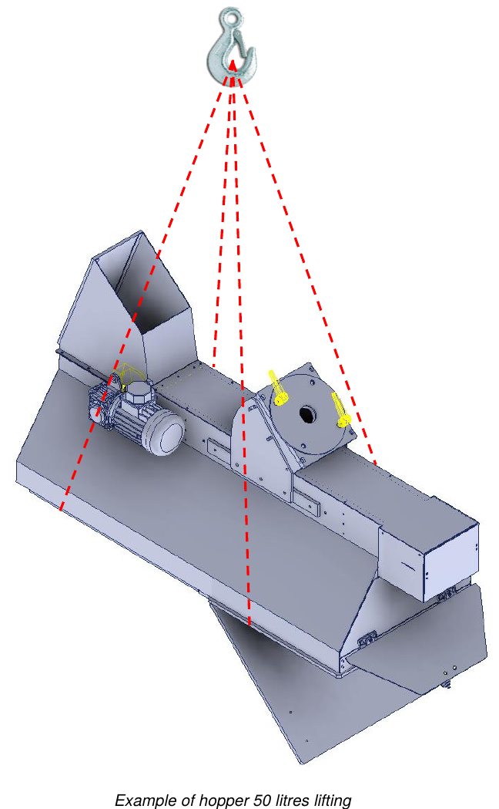

# **Embalaje, transporte e instalación**

## Embalaje

La cuasi máquina es enviada por el Fabricante desde la planta de producción hasta las instalaciones del Cliente embalada en **film de celofán**.

El embalaje no protege de los agentes atmosféricos externos como lluvia, nieve, granizo, etc.: si la cuasi máquina permanece expuesta a la intemperie, debe conservarse en contenedores cerrados hasta el almacenamiento final. Todas las partes externas sujetas a oxidación (superficies mecanizadas, partes sin pintar, etc.) están protegidas por una película de aceite antioxidante.

:::{note}
La carga debe mantenerse siempre en posición vertical.
:::

## Transporte

Los puntos de anclaje para la elevación están indicados en el embalaje enviado. En el exterior de los embalajes figuran además todas las indicaciones para identificar el contenido y para la manipulación segura:
- dirección del destinatario y del remitente;
- dimensiones (longitud, anchura, altura);
- peso bruto, neto y tara;
- centro de gravedad;
- notas y símbolos (p. ej. frágil, arriba, etc.);
- bolsillo portadocumentos con la packing list.

## Elevación y manipulación

Antes de cualquier manipulación y/o elevación es importante conocer el peso.

:::{note}
- Todas las operaciones de manipulación y elevación deben ser realizadas por operadores cualificados, que conozcan y respeten las normas sobre elevación y manipulación de cargas.
- Utilizar medios de elevación adecuados al peso y a las dimensiones de la carga.
- Comprobar siempre el correcto equilibrio de la carga. Si está desequilibrada, apoyarla de inmediato en el suelo y reposicionar las horquillas/eslingas.
- Para el transporte a larga distancia se recomienda colocar la tolva sobre un palé y fijarla con correas adecuadas. El palé debe moverse después con una transpaleta o con carretillas elevadoras.
:::

:::{warning}
Cuando la carga esté elevada a más de 50 cm del suelo, los operadores deben mantenerse a una distancia de seguridad, a más de 2 m del perímetro. Un movimiento incontrolado de la carga supone, en efecto, un grave peligro para la seguridad de los operadores.
:::

| Descripción | Peso |
|:--- |:--- |
| **Tolva de 50 litros** | aprox. 75 kg |
| **Tolva de 100 litros** | aprox. 100 kg |
| **Tolva de 150 litros** | aprox. 125 kg |

### Elevación con puente grúa

Para elevar y desplazar la cuasi máquina, proceder como se indica a continuación:
- eslingar adecuadamente la cuasi máquina en los puntos indicados;
- fijar las correas a los ganchos del medio de elevación;
- elevar lentamente la carga evitando movimientos bruscos y trasladarla manteniéndola lo más cerca posible del suelo;
- una vez en el destino, bajar la carga lenta y gradualmente;
- retirar las correas solo cuando la carga esté perfectamente apoyada en el suelo.

## Instalación

Antes de instalar la cuasi máquina es necesario retirar el embalaje protector y los posibles elementos de sujeción utilizados para el transporte.

### Control de la integridad

Comprobar que la cuasi máquina no haya sufrido daños durante el transporte. En caso de accidentes o daños visibles (marcas o huellas de golpes), proceder como se indica a continuación:
- anotar el daño en el documento de transporte;
- informar del daño detectado al transportista y al Fabricante mediante carta certificada, en un plazo de 48 horas desde la recepción de la cuasi máquina.

### Precauciones generales de seguridad

Las operaciones descritas en este capítulo deben ser realizadas por personal autorizado. Las personas no autorizadas deben permanecer fuera del área de instalación.

:::{warning}
Asegurarse de que durante la instalación no haya en la zona circundante elementos (cables, tubos, etc.) que puedan causar interferencias o peligros para los operadores.
:::

:::{note}
Los operadores encargados de la instalación, la conexión, los controles y las inspecciones deben estar bien formados, para evitar operaciones erróneas que podrían dañar la cuasi máquina. Para la información sobre los dispositivos incorporados, consultar los manuales específicos.
:::

### Elección del lugar de uso y verificación de los requisitos de instalación

El Cliente **DEBE** preparar:
- un área suficientemente amplia y libre de obstáculos, equipada conforme a las normas de seguridad vigentes en el país del usuario;
- ventilación e iluminación correctas;
- espacios operativos;
- pasillos de paso;
- vías de evacuación;
- pavimento capaz de soportar el peso de la cuasi máquina;
- alimentación eléctrica general, incluido el conductor de tierra, según las características y tolerancias requeridas;
- alimentación neumática según las características y tolerancias requeridas.

### Posicionamiento

Antes de empezar a operar, montar la cuasi máquina sobre una estructura de soporte estable, de rigidez y resistencia suficientes. La carga máxima de la estructura de soporte debe ser **al menos 2 veces** el peso indicado en la placa de la cuasi máquina.

Comprobar a continuación el correcto nivelado apoyando un nivel de burbuja sobre una superficie plana, tanto en sentido longitudinal como transversal. Para más información, contactar con el servicio técnico del Fabricante.

### Conexiones

:::{warning}
Las operaciones de conexión de las alimentaciones deben ser realizadas únicamente por técnicos expertos, que deben utilizar los equipos de protección individual necesarios.
:::

:::{note}
Todas las conexiones de la alimentación externa de la cuasi máquina deben realizarse durante la instalación bajo la supervisión del Fabricante. Está estrictamente prohibido conectar la cuasi máquina a fuentes de alimentación externas antes de la llegada de los técnicos del Fabricante. La conexión eléctrica necesaria para el funcionamiento de la cuasi máquina corre a cargo del Cliente.
:::

## Controles e inspecciones

Antes del arranque, realizar una serie de controles e inspecciones generales, para evitar problemas durante el funcionamiento de la cuasi máquina.

:::{warning}
La primera puesta en marcha debe ser realizada por un técnico experto del Fabricante.
:::

:::{note}
Antes de iniciar cualquier movimiento, asegurarse de que no haya fallos, para evitar daños en la cuasi máquina. Los controles y las inspecciones enumerados a continuación deben considerarse operaciones de mantenimiento normal.
:::

### Controles generales de las unidades mecánicas

- Realizar una inspección visual general de los distintos grupos que componen la cuasi máquina, asegurándose de que no haya anomalías mecánicas particulares ni cuerpos extraños.
- Verificar que las partes de la cuasi máquina y sus resguardos estén correctamente anclados.
- Comprobar el apriete de los tornillos y las tuercas de los componentes principales.

En caso de problemas, contactar inmediatamente con el Fabricante.

### Pares de apriete

La tabla siguiente indica los pares de apriete para cada tamaño de tornillo. Para apretar, utilizar una llave dinamométrica.

| Ø del tornillo | Paso | Par de pre-apriete [kgm] | Par de apriete [kgm] |
|:---: |:---: |:---: |:---: |
| M6 | 1 | 0,75 | 1 |
| M8 | 1,25 | 1,8 | 2,4 |
| M10 | 1,5 | 3,6 | 4,8 |
| M12 | 1,75 | 6,5 | 8,5 |
| M14 | 2 | 10 | 13 |
| M16 | 2 | 15 | 20,5 |
| M18 | 2,5 | 22 | 29 |
| M20 | 2,5 | 30 | 40 |
| M22 | 2,5 | 42 | 56 |
| M24 | 3 | 50 | 70 |
| M27 | 3 | 80 | 105 |
| M30 | 3,5 | 95 | 130 |

### Control de los dispositivos comerciales

En general, comprobar los grupos comerciales instalados, en particular:
- la correcta conexión a las fuentes de alimentación;
- que estén correctamente instalados y funcionen correctamente.

Para más información, consultar la documentación adjunta de cada dispositivo.

### Control de los sistemas de seguridad

Verificar que los resguardos y los dispositivos de seguridad instalados estén correctamente montados y funcionen.

:::{warning}
No es posible garantizar la seguridad de la cuasi máquina en caso de retirada o manipulación de los dispositivos de seguridad.
:::

:::{note}
Realizar los controles funcionales, de apriete y de posicionamiento de los sistemas de seguridad indicados en la sección *Funciones de seguridad*. Este procedimiento debe adoptarse como procedimiento normal de mantenimiento.
:::

## Códigos internacionales de reciclaje

| Código | Descripción |
|:--- |:--- |
| **Plásticos** | |
| #1 PET / PETE | Tereftalato de polietileno: botellas de agua, refrescos, champú |
| #2 HDPE | Polietileno de alta densidad: envases de yogur, botes de detergente |
| #3 PVC | Policloruro de vinilo: envases para alimentos |
| #4 LDPE | Polietileno de baja densidad: bolsas para congelados, botes flexibles |
| #5 PP | Polipropileno: botellas |
| #6 PS | Poliestireno: vasos desechables |
| #7–#19 | Otros plásticos |
| **Papel** | |
| #20 PAP | Cartón ondulado: cajas de muebles para montar |
| #21 PAP | Cartón no ondulado: envases de bocadillos en los restaurantes de comida rápida |
| #22 PAP | Papel: envases de patatas fritas en los restaurantes de comida rápida, periódicos, bolsas de papel |
| #23–#39 | Otros tipos de papel |
| **Metales** | |
| #40 FE | Acero |
| #41 ALU | Aluminio: latas |
| #42–#49 | Otros tipos de metal |
| **Madera** | |
| #50 FOR | Madera |
| #51 FOR | Corcho |
| #52–#59 | Otros tipos |
| **Textiles** | |
| #60 TEX | Algodón |
| #61 TEX | Yute |
| #60–#69 | Otros materiales textiles |
| **Vidrio** | |
| #70 | Vidrio transparente / incoloro: botellas de agua |
| #71 | Vidrio verde: botellas de vino |
| #72 | Vidrio marrón: botellas de cerveza |
| #73–#79 | Otros materiales de vidrio y latas |
| **Materiales compuestos** | |
| #80 | Papel y cartón / metales diversos |
| #81 | Papel y cartón / plástico |
| #82 | Papel y cartón / aluminio: bolsas de galletas |
| #83 | Papel y cartón / hojalata |
| #84 | Papel y cartón / plástico / aluminio |
| #85 | Papel y cartón / plástico / aluminio / hojalata |
| #86–#89 | Otros materiales compuestos |
| #90 | Plástico / aluminio |
| #91 | Plástico / hojalata |
| #92 | Plástico / metales diversos |
| #93–#94 | Otros materiales compuestos |
| #95 | Vidrio / plástico |
| #96 | Vidrio / aluminio |
| #97 | Vidrio / hojalata |
| #98 | Vidrio / metales diversos |
| #99 | Otros materiales compuestos |
