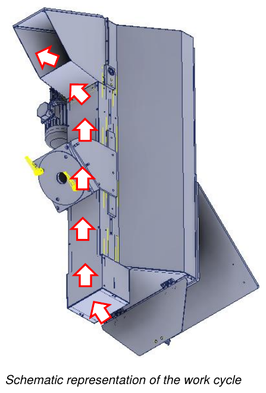

# **Uso**

## Controles iniciales

Antes de poner en marcha la cuasi máquina, el operador debe verificar que:
- todas las fuentes de alimentación estén correctamente conectadas a sus líneas correspondientes;
- no haya cuerpos extraños en el interior de la cuasi máquina;
- los dispositivos de seguridad presentes funcionen correctamente;
- la cuasi máquina no esté en estado de reparación / limpieza;
- todos los resguardos estén correctamente colocados y fijados.

## Ciclo de trabajo

Tras la puesta en marcha de la cuasi máquina, una vez realizados los controles por parte del operador, el ciclo de trabajo es el siguiente:
- el material es elevado por la cinta de paletas, accionada por el motor eléctrico, hasta la salida.

