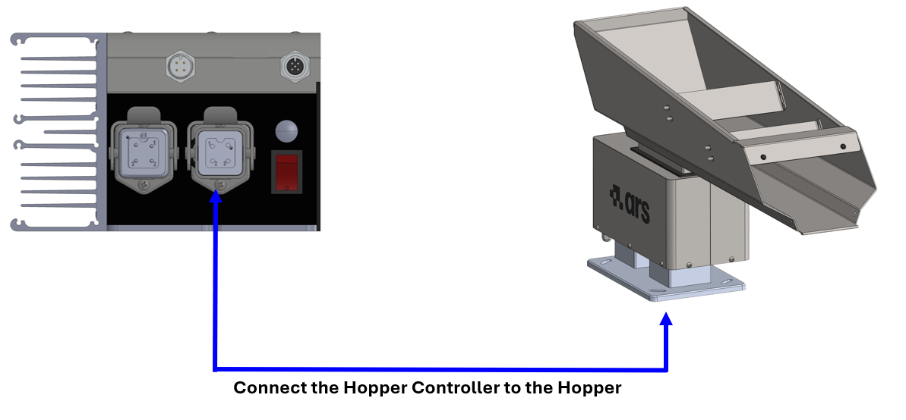
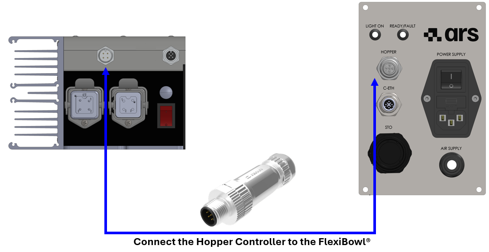
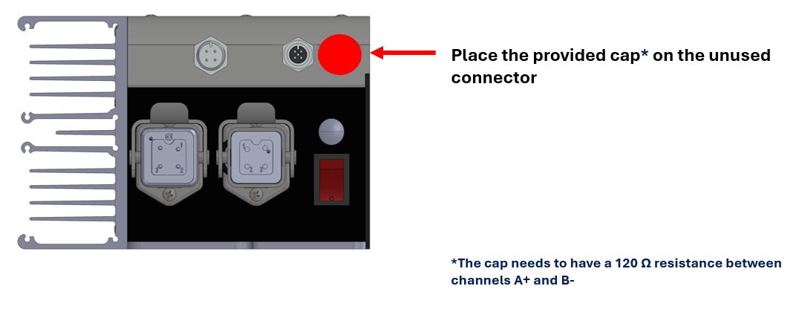
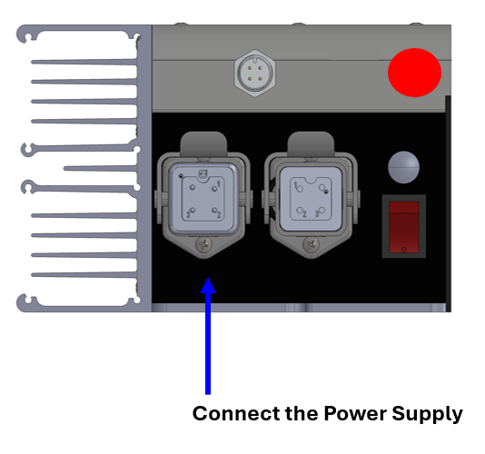
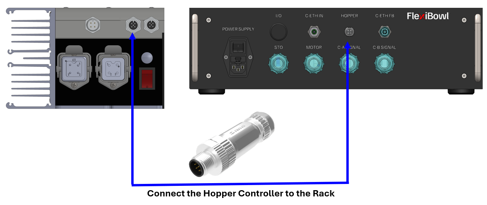
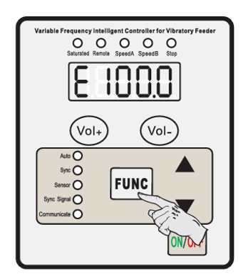
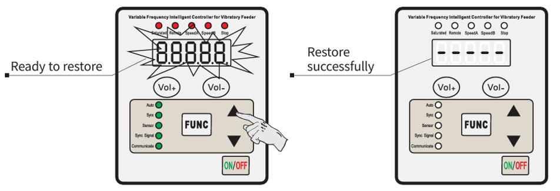

# **Controlador y cableado**

Durante el funcionamiento, la máquina no requiere la presencia continua de un operador.

:::{attention}
Utilizar la máquina para un fin distinto del previsto por el Fabricante podría causar graves daños a personas y/o bienes y/o animales. La empresa ARS S.r.l. no se hace responsable de los daños causados por un uso indebido de la máquina.
:::

## Descripción del controlador

El **controlador digital** (mod. SDVC34-XLRH) es un controlador de frecuencia variable dotado de microprocesador, pantalla **LED** y teclado de mando (pulsadores **Vol+/Vol-** para la tensión de salida, pulsadores **▲/▼** para los parámetros, tecla **FUNC** para la selección, tecla **ON/OFF** para el encendido/apagado y el bloqueo del teclado).

**Por defecto, el controlador no genera ninguna salida al encenderse** y permanece en estado de parada: para habilitar la salida principal es necesario aplicar una **señal PNP** en el **Enable Output Port** (conector de 4 pines).

El controlador integra protecciones automáticas:

- **Cortocircuito** → parada inmediata de la salida, error `Err01`
- **Sobrecorriente** → parada inmediata de la salida, error `Err02`
- **Sobretemperatura** → parada de la salida por encima de 65 °C, rearme automático por debajo de 60 °C, error `Err03`

La comunicación se realiza a través del puerto **RS485** (protocolo **Modbus**), con una dirección de red configurable de 1 a 31 y velocidad de transmisión (baud rate) configurable.


### Datos técnicos del controlador

| Característica técnica | Mín | Típico | Máx | Unidad | Notas |
| :--- | :--- | :--- | :--- | :--- | :--- |
| **Tensión de entrada** | 85 | 220 | 250 | V | AC RMS |
| **Rango de tensión de salida ajustable** | 0 | — | 260 | V | Inferior al 150 % de la tensión de entrada |
| **Precisión de la regulación de tensión** | — | 1 | — | V | — |
| **Precisión de la regulación de tensión (ΔVout/ΔVin)** | 0 | — | 10 | % | ΔVout/ΔVin |
| **Rango de corriente de salida ajustable** | 0 | — | 6 | A | — |
| **Potencia de salida** | 0 | — | 1320 | VA | — |
| **Frecuencia de salida** | 30,0 | — | 130,0 | Hz | — |
| **Precisión de la regulación de frecuencia** | — | 0,1 | — | Hz | — |
| **Forma de onda de salida** | — | Senoidal | — | — | — |
| **Temperatura de activación de la protección contra sobretemperatura** | 60 | 65 | 65 | °C | — |
| **Comunicación digital** | — | ModBus 485 | — | — | — |
| **Método de ajuste** | — | 6 | — | Pulsadores | — |
| **Consumo en espera** | — | 7 | — | W | — |
| **Método de visualización** | — | 5 | — | Dígitos | LED |
| **Temperatura ambiente** | 0 | 25 | 40 | °C | Sin condensación |
| **Humedad ambiente** | 10 | 60 | 85 | % | Sin condensación |
| **Temperatura ambiente de almacenamiento** | -20 | 25 | 65 | °C | Sin condensación |

:::{attention}
Es posible integrar controladores distintos del suministrado por el Fabricante, siempre que este haya validado previamente sus características técnicas. La empresa ARS s.r.l. no se hace responsable de los daños causados por el uso de un controlador no validado o no compatible con la máquina.
:::

#### Mandos del panel frontal

```{image} ../../../../../_shared/media/images/controller_digitale_pannello.jpeg
:alt: Panel frontal del controlador digital CUH SDVC34-XLRH
:width: 90%
:align: center
```

| Elemento | Función |
|---|---|
| **Pantalla LED** | Muestra el parámetro actual y su valor |
| **Indicador Saturated** | Señala la saturación de la señal de salida |
| **Indicador Remote** | Señala que el control remoto está activo |
| **Indicadores Speed A / Speed B** | Señalan la velocidad/salida activa |
| **Indicador Stop** | Señala el estado de parada |
| **Pulsadores Vol+ / Vol-** | Ajustan los **Parámetros comunes** (véase abajo) en cualquier momento |
| **Pulsador FUNC** | Entrada/salida y navegación entre los **Parámetros básicos** |
| **Pulsadores ▲ / ▼** | Aumentan/disminuyen el valor del parámetro seleccionado |
| **Indicadores Auto / Sync / Sensor / Sync Signal / Communicate** | Estado del funcionamiento y de la comunicación RS485 |
| **Pulsador ON/OFF** | Encendido/apagado del controlador |

#### Conectores traseros

```{image} ../../../../../_shared/media/images/controller_digitale_connettori.png
:alt: Panel de conectores trasero del controlador digital
:width: 85%
:align: center
```

```{list-table}
:widths: 30 45 25
:header-rows: 1

* - Conector
  - Función
  - Pinout
* - **Mains Power** (alimentación)
  - Alimentación de red
  - <details class="ars-dropdown"><summary>Pinout del conector</summary><div class="ars-dropdown-body">

    | Pin | Descripción |
    |---|---|
    | PE-PE | ⏚ Tierra |
    | 1 | L |
    | 2 | N |
    | 3 | NC |

    </div></details>
* - **Enable Output Port** (4 pines)
  - Salida de habilitación para el control externo del Bulk Feeder, utilizada cuando este se adquiere por separado y debe ser accionado por un dispositivo externo. Cable disponible como opción: {ref}`cavo-input`.
  - <details class="ars-dropdown"><summary>Pinout del conector de 4 pines</summary><div class="ars-dropdown-body">

    | Pin | Descripción |
    |---|---|
    | 1 | +24V |
    | 2 | NC |
    | 3 | GND |
    | 4 | Entrada |

    </div></details>
* - **RS485 Port** (2× 5 pines)
  - Dos conectores RS485 idénticos: uno conecta el controlador al FlexiBowl®, el otro permite la conexión en **daisy chain** entre varios Bulk Feeder. Cable disponible como opción: {ref}`cavo-modbus`.
    
    :::{important}
    En una configuración con un solo Bulk Feeder, el conector no utilizado debe cerrarse con el **tapón de terminación** suministrado, dotado de una resistencia de **120 Ω** entre A+ y B-
    :::
  
  - <details class="ars-dropdown"><summary>Pinout del conector de 5 pines</summary><div class="ars-dropdown-body">

    | Pin | Descripción |
    |---|---|
    | 1 | A+ |
    | 2 | NC |
    | 3 | B- |
    | 4 | GND |
    | 5 | NC |

    </div></details>
* - **Power Output to Feeder** (salida hacia el Bulk Feeder)
  - Alimentación hacia el Bulk Feeder
  - <details class="ars-dropdown"><summary>Pinout del conector</summary><div class="ars-dropdown-body">

    | Pin | Descripción |
    |---|---|
    | PE-PE | ⏚ Tierra |
    | 1 | Salida |
    | 2 | Salida |
    | 3 | NC |

    </div></details>
* - **Power Switch**
  - Interruptor de encendido/apagado
  - —
```

## Procedimientos de uso

### Comprobaciones preliminares

Antes de proceder a la puesta en marcha de la máquina, deben realizarse las siguientes comprobaciones:

<div class="isw-symbol-grid">
  <div class="isw-symbol-item">
    <div>
      <div class="isw-symbol-label">Estabilidad</div>
      <div class="isw-symbol-desc">Compruebe que la máquina esté colocada sobre una superficie capaz de soportar su peso.</div>
    </div>
  </div>
  <div class="isw-symbol-item">
    <div>
       <div class="isw-symbol-label">Seguridad</div>
      <div class="isw-symbol-desc">Compruebe el funcionamiento de los dispositivos de seguridad y asegúrese de que todos los resguardos abatibles estén bien cerrados.</div>
    </div>
  </div>
  <div class="isw-symbol-item">
    <div>
      <div class="isw-symbol-label">Espacio operativo</div>
      <div class="isw-symbol-desc"> Compruebe que el espacio alrededor de la máquina esté libre de obstáculos y/o trampas.</div>
    </div>
  </div>
  <div class="isw-symbol-item">
    <div>
     <div class="isw-symbol-label">Alimentación</div>
      <div class="isw-symbol-desc">Compruebe que la máquina esté conectada a la red eléctrica y que las fases de alimentación sean correctas.</div>
    </div>
  </div>
  <div class="isw-symbol-item">
    <div>
       <div class="isw-symbol-label">Mecánica</div>
      <div class="isw-symbol-desc">Compruebe que la cubeta pueda vibrar con total libertad.</div>
    </div>
  </div>
  <div class="isw-symbol-item">
    <div>
      <div class="isw-symbol-label">Estado de la máquina</div>
      <div class="isw-symbol-desc">Compruebe que la máquina no se encuentre en estado «Mantenimiento».</div>
    </div>
  </div>
</div>

### Secuencia de conexión eléctrica

Independientemente del tipo de controlador utilizado (estándar, analógico o digital), la conexión eléctrica entre el Bulk Feeder, el controlador y el FlexiBowl® sigue una secuencia precisa. La secuencia difiere ligeramente según el modelo: los **FlexiBowl® 500/650/800/1200** disponen de un panel estándar con conector HOPPER integrado, mientras que los **FlexiBowl® 200/350** utilizan un rack externo con su propio conector HOPPER.

#### FlexiBowl® 500 / 650 / 800 / 1200 — panel estándar

<div style="display: flex; flex-direction: column; gap: 12px; margin: 20px 0;">
  <div style="display: flex; background-color: #f8f9fa; border-radius: 6px; border: 1px solid #e9ecef; overflow: hidden;">
    <div style="background-color: #0f766e; color: #ffffff; display: flex; align-items: center; justify-content: center; width: 45px; font-weight: bold; flex-shrink: 0;">1</div>
    <div style="padding: 12px 15px; color: #2c3e50; font-size: 0.95em;">
      Conecte el <strong>controlador</strong> al <strong>Bulk Feeder</strong> (base vibratoria).
    </div>
    
  </div>
  <div style="display: flex; background-color: #f8f9fa; border-radius: 6px; border: 1px solid #e9ecef; overflow: hidden;">
    <div style="background-color: #0f766e; color: #ffffff; display: flex; align-items: center; justify-content: center; width: 45px; font-weight: bold; flex-shrink: 0;">2</div>
    <div style="padding: 12px 15px; color: #2c3e50; font-size: 0.95em;">
      Conecte el <strong>controlador</strong> al conector <strong>HOPPER</strong> del panel estándar del FlexiBowl®.
    </div>
    
  </div>
  <div style="display: flex; background-color: #f8f9fa; border-radius: 6px; border: 1px solid #e9ecef; overflow: hidden;">
    <div style="background-color: #0f766e; color: #ffffff; display: flex; align-items: center; justify-content: center; width: 45px; font-weight: bold; flex-shrink: 0;">3</div>
    <div style="padding: 12px 15px; color: #2c3e50; font-size: 0.95em;">
      Si no se utiliza el conector Hopper del FlexiBowl®, coloque el <strong>capuchón de terminación</strong>* correspondiente.
    </div>
    
  </div>
  <div style="display: flex; background-color: #f8f9fa; border-radius: 6px; border: 1px solid #e9ecef; overflow: hidden;">
    <div style="background-color: #0f766e; color: #ffffff; display: flex; align-items: center; justify-content: center; width: 45px; font-weight: bold; flex-shrink: 0;">4</div>
    <div style="padding: 12px 15px; color: #2c3e50; font-size: 0.95em;">
      Conecte el cable de <strong>alimentación</strong> al controlador, verificando que el interruptor de encendido esté en posición <strong>OFF</strong>.
    </div>
    
  </div>
  <div style="display: flex; background-color: #f8f9fa; border-radius: 6px; border: 1px solid #e9ecef; overflow: hidden;">
    <div style="background-color: #0f766e; color: #ffffff; display: flex; align-items: center; justify-content: center; width: 45px; font-weight: bold; flex-shrink: 0;">5</div>
    <div style="padding: 12px 15px; color: #2c3e50; font-size: 0.95em;">
      Enchufe el cable de alimentación a la <strong>toma de corriente</strong> solo después de confirmar que el interruptor del controlador esté en OFF.
    </div>
  </div>
</div>

:::{attention}
*El capuchón debe garantizar una resistencia de **120 Ω** entre los canales A+ y B-.
:::

:::{important}
Conecte siempre **primero el lado del controlador** del cable de alimentación y solo después enchufe la clavija a la toma de corriente.
:::

```{image} ../../../../../_shared/media/images/controller_side.png
:alt: Conecte siempre primero el lado del controlador
:width: 70%
:align: center
```

```{image} ../../../../../_shared/media/images/power_outlet.png
:alt: Conexión de la clavija a la toma de corriente
:width: 70%
:align: center
```

#### **Conexión en cascada de varios Bulk Feeder**

En los modelos con panel estándar es posible conectar varias unidades Hopper Controller en cascada, alimentando cada controlador por separado y conectando los conectores de una unidad a la siguiente.

```{image} ../../../../../_shared/media/images/daisy_chain.png
:alt: Conexión en cascada de varios Hopper Controller
:width: 100%
:align: center
```

#### FlexiBowl® 200 / 350 — panel rack

<div style="display: flex; flex-direction: column; gap: 12px; margin: 20px 0;">
  <div style="display: flex; background-color: #f8f9fa; border-radius: 6px; border: 1px solid #e9ecef; overflow: hidden;">
    <div style="background-color: #0f766e; color: #ffffff; display: flex; align-items: center; justify-content: center; width: 45px; font-weight: bold; flex-shrink: 0;">1</div>
    <div style="padding: 12px 15px; color: #2c3e50; font-size: 0.95em;">
      Conecte el <strong>controlador</strong> al <strong>Bulk Feeder</strong> (base vibratoria).
    </div>
    
  </div>
  <div style="display: flex; background-color: #f8f9fa; border-radius: 6px; border: 1px solid #e9ecef; overflow: hidden;">
    <div style="background-color: #0f766e; color: #ffffff; display: flex; align-items: center; justify-content: center; width: 45px; font-weight: bold; flex-shrink: 0;">2</div>
    <div style="padding: 12px 15px; color: #2c3e50; font-size: 0.95em;">
      Conecte el <strong>controlador</strong> al conector <strong>HOPPER</strong> del panel del <strong>rack</strong>.
    </div>
    
  </div>
  <div style="display: flex; background-color: #f8f9fa; border-radius: 6px; border: 1px solid #e9ecef; overflow: hidden;">
    <div style="background-color: #0f766e; color: #ffffff; display: flex; align-items: center; justify-content: center; width: 45px; font-weight: bold; flex-shrink: 0;">3</div>
    <div style="padding: 12px 15px; color: #2c3e50; font-size: 0.95em;">
      Si no se utiliza el conector Hopper del rack, coloque el <strong>capuchón de terminación</strong>* correspondiente.
    </div>
    
  </div>
  <div style="display: flex; background-color: #f8f9fa; border-radius: 6px; border: 1px solid #e9ecef; overflow: hidden;">
    <div style="background-color: #0f766e; color: #ffffff; display: flex; align-items: center; justify-content: center; width: 45px; font-weight: bold; flex-shrink: 0;">4</div>
    <div style="padding: 12px 15px; color: #2c3e50; font-size: 0.95em;">
      Conecte el cable de <strong>alimentación</strong> al controlador, verificando que el interruptor de encendido esté en posición <strong>OFF</strong>.
    </div>
    
  </div>
  <div style="display: flex; background-color: #f8f9fa; border-radius: 6px; border: 1px solid #e9ecef; overflow: hidden;">
    <div style="background-color: #0f766e; color: #ffffff; display: flex; align-items: center; justify-content: center; width: 45px; font-weight: bold; flex-shrink: 0;">5</div>
    <div style="padding: 12px 15px; color: #2c3e50; font-size: 0.95em;">
      Enchufe el cable de alimentación a la <strong>toma de corriente</strong> solo después de confirmar que el interruptor del controlador esté en OFF.
    </div>
  </div>
</div>

:::{attention}
*El capuchón debe garantizar una resistencia de **120 Ω** entre los canales A+ y B-.
:::

:::{important}
Conecte siempre **primero el lado del controlador** del cable de alimentación y solo después enchufe la clavija a la toma de corriente.
:::

```{image} ../../../../../_shared/media/images/controller_side.png
:alt: Conecte siempre primero el lado del controlador
:width: 70%
:align: center
```

```{image} ../../../../../_shared/media/images/power_outlet.png
:alt: Conexión de la clavija a la toma de corriente
:width: 70%
:align: center
```

:::{note}
Alimentación estándar del controlador: **115 Vac** o **230 Vac ±5 %**. Compruebe siempre que el conductor de tierra esté correctamente instalado e íntegro antes de alimentar el sistema.
:::

---

#### Ajuste de la dirección de comunicación

Una vez completado el cableado eléctrico, el siguiente paso es establecer una **dirección de comunicación única** en cada controlador, mediante el parámetro **Communication Address** (`r`).

:::{note}
El parámetro `r` representa el **ID del controlador** en la red de comunicación **RS485**. Cuando hay varios controladores conectados a la misma red (p. ej., varios Bulk Feeder), es **obligatorio** asignar a cada uno una dirección distinta, dentro del rango **1–31**, para poder distinguirlos y controlarlos individualmente.
:::

<div style="display: flex; flex-direction: column; gap: 12px; margin: 20px 0;">
  <div style="display: flex; background-color: #f8f9fa; border-radius: 6px; border: 1px solid #e9ecef; overflow: hidden;">
    <div style="background-color: #7c3aed; color: #ffffff; display: flex; align-items: center; justify-content: center; width: 45px; font-weight: bold; flex-shrink: 0;">1</div>
    <div style="padding: 12px 15px; color: #2c3e50; font-size: 0.95em;">
      Mantenga pulsado <strong>FUNC</strong> durante 2 segundos para entrar en el modo de ajuste de los Parámetros básicos.
    </div>
  </div>
  <div style="display: flex; background-color: #f8f9fa; border-radius: 6px; border: 1px solid #e9ecef; overflow: hidden;">
    <div style="background-color: #7c3aed; color: #ffffff; display: flex; align-items: center; justify-content: center; width: 45px; font-weight: bold; flex-shrink: 0;">2</div>
    <div style="padding: 12px 15px; color: #2c3e50; font-size: 0.95em;">
      Pulse <strong>FUNC</strong> repetidamente para desplazarse hasta el parámetro <code>r</code>.
    </div>
  </div>
  <div style="display: flex; background-color: #f8f9fa; border-radius: 6px; border: 1px solid #e9ecef; overflow: hidden;">
    <div style="background-color: #7c3aed; color: #ffffff; display: flex; align-items: center; justify-content: center; width: 45px; font-weight: bold; flex-shrink: 0;">3</div>
    <div style="padding: 12px 15px; color: #2c3e50; font-size: 0.95em;">
      Pulse <strong>▲</strong> o <strong>▼</strong> para modificar el valor (1–31).
    </div>
  </div>
</div>

---

#### Interfaz de software Hopper

Una vez asignada la dirección única a cada controlador, los Bulk Feeder quedan **integrados en el software FlexiBowl®** y pueden controlarse directamente desde su interfaz, sin necesidad de actuar manualmente sobre cada controlador.

```{image} ../../../../../_shared/media/images/hopper.png
:alt: Interfaz de software FlexiBowl — gestión de los Bulk Feeder (Hopper 1–4)
:width: 100%
:align: center
```

Desde la interfaz de software es posible, para cada Bulk Feeder conectado:

| Campo | Función |
|---|---|
| **ID** | Dirección de comunicación del controlador (debe coincidir con la establecida manualmente) |
| **ENABLE** | Habilita el Bulk Feeder para el funcionamiento |
| **Set New ID** | Asigna una nueva dirección de comunicación desde el software |
| **STATUS** | Estado actual del Bulk Feeder (p. ej., Disabled) |
| **Amplitude** | Amplitud de vibración |
| **Frequency** | Frecuencia de vibración |
| **Activation Time** | Tiempo de activación del Bulk Feeder (ms) |
| **Start Hopper** | Arranca manualmente el Bulk Feeder |

:::{note}
Todos los ajustes disponibles a través de la interfaz de software también pueden realizarse **directamente desde el controlador**, mediante los Parámetros comunes y básicos descritos a continuación.
:::

---
#### Parámetros comunes

Los **Parámetros comunes** se pueden ajustar en cualquier momento mediante los pulsadores **Vol+ / Vol-**, incluso mientras se muestra otro parámetro en la pantalla: al terminar el ajuste, el controlador vuelve automáticamente a mostrar el parámetro anterior.

```{image} ../../../../../_shared/media/images/controller_changing_common_parameters.png
:alt: Controlador digital — ajuste de los Parámetros comunes con Vol+/Vol-
:width: 50%
:align: center
```

| Definición | Símbolo | Rango | Predeterminado |
|---|---|---|---|
| Output Voltage (tensión de salida) | `U` | 0–260 (V) | 50 |

#### Parámetros básicos

<div style="display: flex; flex-direction: column; gap: 12px; margin: 20px 0;">
  <div style="display: flex; background-color: #f8f9fa; border-radius: 6px; border: 1px solid #e9ecef; overflow: hidden;">
    <div style="background-color: #34495e; color: #ffffff; display: flex; align-items: center; justify-content: center; width: 45px; font-weight: bold; flex-shrink: 0;">1</div>
    <div style="padding: 12px 15px; color: #2c3e50; font-size: 0.95em;">
      Mantenga pulsado <strong>FUNC</strong> durante 2 segundos para entrar en el modo de ajuste de los Parámetros básicos.
    </div>
  </div>
  <div style="display: flex; background-color: #f8f9fa; border-radius: 6px; border: 1px solid #e9ecef; overflow: hidden;">
    <div style="background-color: #34495e; color: #ffffff; display: flex; align-items: center; justify-content: center; width: 45px; font-weight: bold; flex-shrink: 0;">2</div>
    <div style="padding: 12px 15px; color: #2c3e50; font-size: 0.95em;">
      Pulse repetidamente <strong>FUNC</strong> para recorrer cíclicamente los distintos parámetros.
    </div>
  </div>
  <div style="display: flex; background-color: #f8f9fa; border-radius: 6px; border: 1px solid #e9ecef; overflow: hidden;">
    <div style="background-color: #34495e; color: #ffffff; display: flex; align-items: center; justify-content: center; width: 45px; font-weight: bold; flex-shrink: 0;">3</div>
    <div style="padding: 12px 15px; color: #2c3e50; font-size: 0.95em;">
      Pulse <strong>▲</strong> o <strong>▼</strong> para modificar el valor del parámetro.
    </div>
  </div>
  <div style="display: flex; background-color: #f8f9fa; border-radius: 6px; border: 1px solid #e9ecef; overflow: hidden;">
    <div style="background-color: #34495e; color: #ffffff; display: flex; align-items: center; justify-content: center; width: 45px; font-weight: bold; flex-shrink: 0;">4</div>
    <div style="padding: 12px 15px; color: #2c3e50; font-size: 0.95em;">
      Mantenga pulsado de nuevo <strong>FUNC</strong> durante 2 segundos para salir del modo de ajuste de los Parámetros básicos.
      
    </div>
  </div>
</div>

| Definición | Símbolo | Rango | Predeterminado |
|---|---|---|---|
| Output Frequency (frecuencia de salida) | `E` | 40,0–200,0 (Hz) | 100,0 |
| Max Adjustable Output Voltage (tensión máxima ajustable) | `h` | 0–260 (V) | 260 |
| Communication Address (dirección RS485) | `r` | 1–31 | 1 |
| Communication Baud Rate (velocidad de comunicación) | `c` | 0,3–115,2 kbps | 115,2 |
| Controller Reset | `88888` | — | — |

#### Procedimiento de Controller Reset

<div style="display: flex; flex-direction: column; gap: 12px; margin: 20px 0;">
  <div style="display: flex; background-color: #f8f9fa; border-radius: 6px; border: 1px solid #e9ecef; overflow: hidden;">
    <div style="background-color: #7c3aed; color: #ffffff; display: flex; align-items: center; justify-content: center; width: 45px; font-weight: bold; flex-shrink: 0;">1</div>
    <div style="padding: 12px 15px; color: #2c3e50; font-size: 0.95em;">
      Mantenga pulsado <strong>FUNC</strong> durante 2 segundos para entrar en el modo de ajuste de los Parámetros básicos.
    </div>
  </div>
  <div style="display: flex; background-color: #f8f9fa; border-radius: 6px; border: 1px solid #e9ecef; overflow: hidden;">
    <div style="background-color: #7c3aed; color: #ffffff; display: flex; align-items: center; justify-content: center; width: 45px; font-weight: bold; flex-shrink: 0;">2</div>
    <div style="padding: 12px 15px; color: #2c3e50; font-size: 0.95em;">
      Pulse <strong>FUNC</strong> hasta que el parámetro <code>88888</code> parpadee en la pantalla.
    </div>
  </div>
  <div style="display: flex; background-color: #f8f9fa; border-radius: 6px; border: 1px solid #e9ecef; overflow: hidden;">
    <div style="background-color: #7c3aed; color: #ffffff; display: flex; align-items: center; justify-content: center; width: 45px; font-weight: bold; flex-shrink: 0;">3</div>
    <div style="padding: 12px 15px; color: #2c3e50; font-size: 0.95em;">
      Mantenga pulsado <strong>▲</strong> hasta que la pantalla muestre <code>-----</code> («Ready to restore»).
    </div>
  </div>
  <div style="display: flex; background-color: #f8f9fa; border-radius: 6px; border: 1px solid #e9ecef; overflow: hidden;">
    <div style="background-color: #7c3aed; color: #ffffff; display: flex; align-items: center; justify-content: center; width: 45px; font-weight: bold; flex-shrink: 0;">4</div>
    <div style="padding: 12px 15px; color: #2c3e50; font-size: 0.95em;">
      Suelte <strong>▲</strong> para completar el reinicio («Restore successfully»): la pantalla muestra <code>U 50</code> para confirmar que la restauración se ha realizado.
      
    </div>
  </div>
</div>

:::{warning}
El **Controller Reset** restablece todos los Parámetros comunes y básicos a sus valores predeterminados (Output Voltage 50, Output Frequency 100,0 Hz, Max Output Voltage 260, Communication Address 1, Baud Rate 115,2 kbps). Úselo con precaución si existen configuraciones personalizadas — en particular la dirección de comunicación, que deberá volver a establecerse.
:::


---

## **Puesta en marcha del Bulk Feeder**

:::{important}
- Si el sistema incluye **FlexiVision One**, la configuración de los parámetros del Bulk Feeder se guía en la sección [Configuración del Bulk Feeder]().
- De lo contrario, consulte la sección [Hopper](hopper) de este manual.
:::

