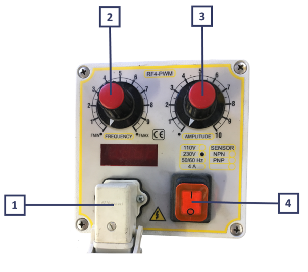
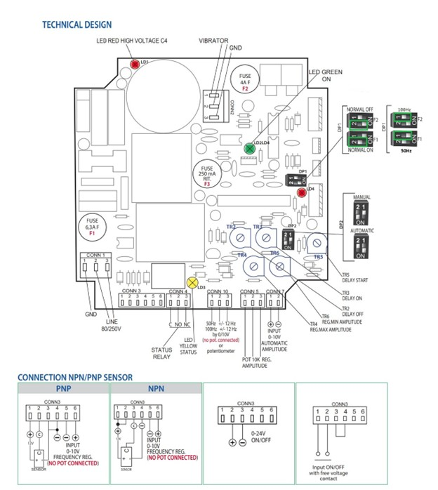
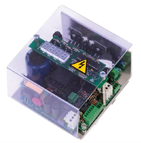
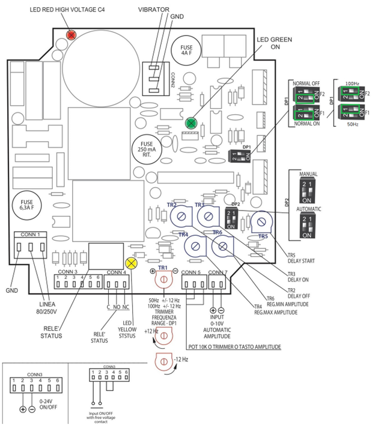

# **Controlador antiguo**
## Controlador estándar

#### Conexiones eléctricas y configuración del controlador

:::{attention}
Antes de encender el controlador, enchufe la clavija Schuko a la toma de corriente verificando que la instalación disponga de un sistema de puesta a tierra adecuado.
:::

Para efectuar el arranque, proceda como se describe:

  

    
1

    

      Conecte el cable de la base lineal al conector de salida del controlador (es decir, conecte el vibrador al conector de salida <strong>(1)</strong>).
    

  

  

    
2

    

      Gire el mando de ajuste de frecuencia <strong>(2)</strong> y el de ajuste de amplitud <strong>(3)</strong> del controlador a la posición «•».
    

  

  

    
3

    

      Encienda el controlador con el pulsador ON/OFF (pulsador en posición 1 <strong>(4)</strong>).
    

  

  

    
4

    

      Gire lentamente los mandos de ajuste <strong>(2 y 3)</strong>. Antes de llevar la vibración al máximo (potenciómetro Amplitude <strong>(3)</strong>), se recomienda buscar con el potenciómetro Frequency <strong>(2)</strong> la frecuencia de resonancia correcta (50 Hertz).
    

  

Para cumplir la normativa EMC, el circuito está dotado de un filtro con corrientes de fuga a tierra inferiores a 1 mA.
 El circuito suministra al vibrador una señal PWM (modulación por ancho de pulso) ajustable en amplitud y frecuencia, compensada frente a las variaciones de la tensión de línea.
  La sección de control está aislada galvánicamente de la sección de potencia.
   Al encenderse, el circuito espera unos segundos antes de habilitar el vibrador.

El circuito está controlado por microprocesador y dispone de limitación de la corriente de salida mediante el fusible F4 (4 A).

**Protecciones mediante fusibles**

| Fusible | Valor | Posición |
| :--- | :--- | :--- |
| **F1** | 6,3 A | Entrada de línea |
| **F3** | 250 mA | Entrada ON/OFF — limita la corriente disponible para el sensor NPN/PNP y la posible electroválvula |
| **F4** | 4 A | Salida del vibrador |

**Indicadores LED en el interior de la placa**

| LED | Color | Estado: encendido |
| :--- | :--- | :--- |
| **LD1** | Rojo | Alta tensión presente en los condensadores de filtrado (hasta más de 300 V con línea de 230 V) |
| **LD2** | Verde | Tensión presente en el circuito de control. Apagado si F1, F2 o F3 están fundidos |
| **LD3** | Verde | Relé ON/OFF conmutado — vibrador en marcha o parado |
| **LD4** | Amarillo | Relé conmutado por superarse el tiempo de falta de piezas |

:::{attention}
Evite terminantemente tocar el circuito con el LED rojo (LD1) encendido.
:::

Los relés asociados a LD3 y LD4 ofrecen un contacto conmutado en los conectores **CONN4** y **CONN5**: **CONN4** permite el accionamiento en cascada de un módulo adicional y **CONN5** la activación de una alarma de flujo de piezas.

**Ajustes disponibles**

Los trimmers de la placa permiten adaptar el comportamiento del vibrador a la aplicación:

- **TR2** — retardo a la parada del vibrador (0 ÷ 10 s)
- **TR3** — retardo al arranque del vibrador (0 ÷ 10 s)
- **TR4** — amplitud máxima
- **TR5** — retardo adicional en el arranque
- **TR6** — amplitud mínima

El vibrador puede detenerse y reiniciarse mediante un mando externo en **CONN3**, compatible con contacto libre de potencial, sensor NPN/PNP o salida 0–24 V, con o sin los retardos configurados.
 Mediante **DP1** es posible seleccionar la lógica directa o negada de la señal ON/OFF.

**Configuración estándar recomendada por ARS**

| Componente | Ajuste |
| :--- | :--- |
| **DP1** | Ambos interruptores en posición ON |
| **DP2** | Interruptor 2 ON — Interruptor 1 OFF |
| **TR2 e TR3** | Tornillo de ajuste girado en sentido antihorario hasta el tope |
| **CONN3** | Arranque de un Bulk Feeder con contacto libre de potencial |

---

### Controlador analógico

#### Conexiones eléctricas y configuración del controlador

Para efectuar el arranque, proceda como se describe y consulte la imagen al final del apartado:

  

    
1

    

      Conecte la alimentación de 80/250 Vac al conector <strong>CONN 1</strong>.
    

  

  

    
2

    

      Conecte el cable procedente de la base vibratoria al conector <strong>CONN 2</strong>.
    

  

  

    
3

    

      Conecte el mando de accionamiento al conector <strong>CONN 3</strong>.
    

  

  

    
4

    

      Conecte la entrada analógica al conector <strong>CONN 7</strong>.
    

  

  

    
5

    

      Ajuste el trimmer <strong>TR1</strong> para que la frecuencia sea igual a 50 Hertz.
    

  

Para cumplir la normativa EMC, el circuito está dotado de un filtro con corrientes de fuga a tierra inferiores a 1 mA.
 El circuito suministra al vibrador una señal PWM ajustable en amplitud mediante una señal analógica y en frecuencia mediante el trimmer **TR1**.
  La señal está compensada frente a las variaciones de la tensión de línea. La sección de control está aislada galvánicamente de la sección de potencia.
   Al encenderse, el circuito espera unos segundos antes de habilitar el vibrador.

El circuito está controlado por microprocesador y dispone de limitación de la corriente de salida mediante el fusible F4 (4 A).

**Protecciones mediante fusibles**

| Fusible | Valor | Posición |
| :--- | :--- | :--- |
| **F1–F2** | 6,3 A | Entrada de línea |
| **F3** | 250 mA | Entrada ON/OFF — limita la corriente disponible para el sensor NPN/PNP y la posible electroválvula |
| **F4** | 4 A | Salida del vibrador |

**Indicadores LED en el interior de la placa**

| LED | Color | Estado: encendido |
| :--- | :--- | :--- |
| **LD1** | Rojo | Alta tensión presente en los condensadores de filtrado (hasta más de 300 V con línea de 230 V) |
| **LD2** | Verde | Tensión presente en el circuito de control. Apagado si F1, F2 o F3 están fundidos |
| **LD3** | Verde | Relé ON/OFF conmutado — vibrador en marcha o parado |
| **LD4** | Amarillo | Relé conmutado por superarse el tiempo de falta de piezas |

:::{attention}
Evite terminantemente tocar el circuito con el LED rojo (LD1) encendido.
:::

Los relés asociados a LD3 y LD4 ofrecen un contacto conmutado en los conectores **CONN4** y **CONN5**: **CONN4** permite el accionamiento en cascada de un módulo adicional y **CONN5** la activación de una alarma de flujo de piezas.

**Ajustes disponibles**

Los trimmers de la placa permiten adaptar el comportamiento del vibrador a la aplicación:

- **TR2** — retardo a la parada del vibrador (0 ÷ 10 s)
- **TR3** — retardo al arranque del vibrador (0 ÷ 10 s)
- **TR4** — retardo tras el cual se activa la alarma de falta de piezas (0 ÷ 10 s)
- **TR5** — tiempo adicional de activación de la electroválvula de soplado de aire tras la parada del vibrador (0 ÷ 3 s)
- **TR6** — rampa al encender el vibrador (0 ÷ 3 s)
- **TR7** — amplitud máxima en el vibrador

El vibrador puede detenerse y reiniciarse mediante un mando externo en **CONN3**, compatible con contacto libre de potencial, sensor NPN/PNP o salida 0–24 V, con o sin los retardos configurados.
 Mediante **DP1** es posible seleccionar la lógica NC o NO de la señal ON/OFF.
 La amplitud de vibración se ajusta estableciendo la tensión analógica adecuada en **CONN7**.

**Configuración estándar recomendada por ARS**

| Componente | Ajuste |
| :--- | :--- |
| **DP1** | Ambos interruptores en posición ON |
| **DP2** | Interruptor 1 ON — Interruptor 2 OFF |
| **TR2 e TR3** | Tornillo de ajuste girado en sentido antihorario hasta el tope |
| **CONN3** | Arranque de un Bulk Feeder con contacto libre de potencial |

