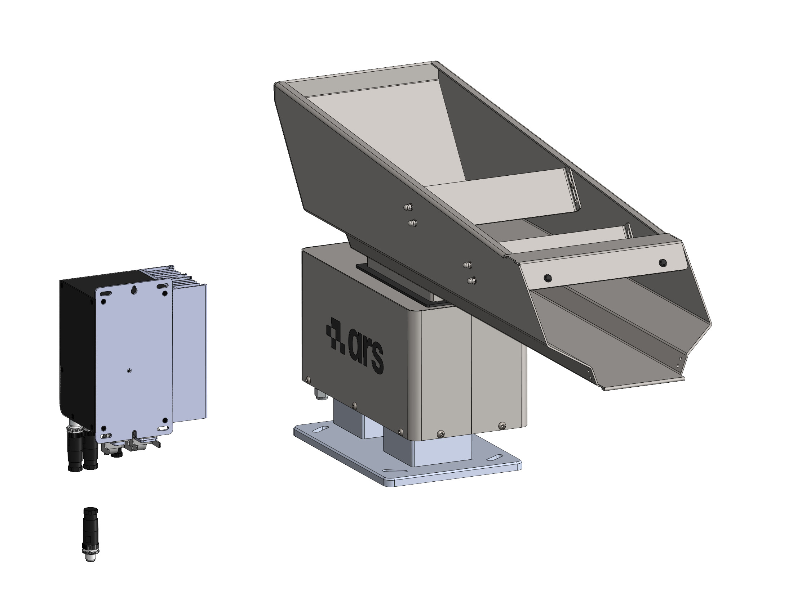
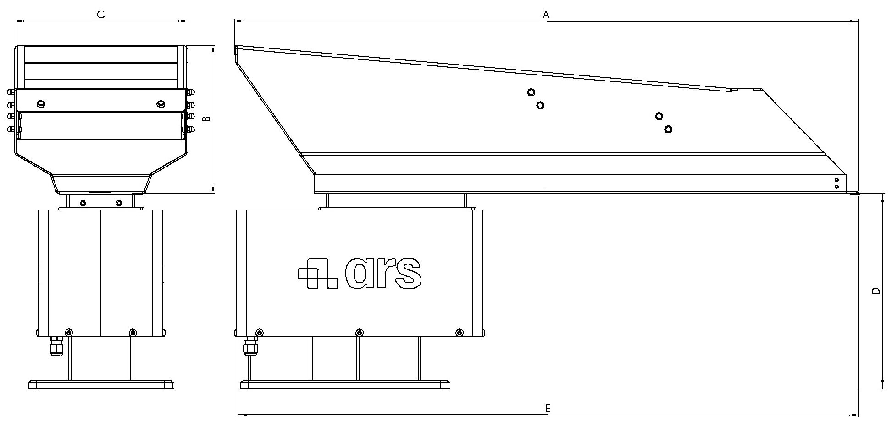

# **Descripción de la máquina**

<p style="line-height: 1.6; border-left: 4px solid #34495e; padding-left: 15px; margin-bottom: 25px;">
  Los Bulk Feeder son especialmente adecuados para alimentar y predosificar piezas de tamaño pequeño, mediano y grande. Son accionados por una base lineal vibratoria, cuyo modelo varía según el tamaño del propio Bulk Feeder.
</p>

La máquina estándar se compone de las siguientes partes fundamentales:

:::{raw} html
<style>
*{box-sizing:border-box;margin:0;padding:0}
:root{
  --acc:#1a6fc4;--acc-dk:#0d4a8a;--acc-bg:#e8f1fb;
  --bd:#e0e0e0;--bg-p:#ffffff;--bg-s:#f7f8f9;--bg-h:#f0f4fa;
  --tx1:#1a1a1a;--tx2:#555;--tx3:#888;
  --r:10px;--tr:0.35s cubic-bezier(.4,0,.2,1);
}

/* ── Tab bar ── */
.tr-tabs{display:flex;gap:6px;margin-bottom:12px}
.tr-tab{padding:5px 14px;border-radius:6px;border:1.5px solid var(--bd);background:#fff;font-size:13px;font-weight:600;color:var(--tx2);cursor:pointer;transition:background var(--tr),color var(--tr),border-color var(--tr)}
.tr-tab:hover{background:var(--bg-h)}
.tr-tab.on{background:var(--acc-bg);color:var(--acc-dk);border-color:var(--acc)}

/* ── Panel ── */
.tr-panel{display:none}
.tr-panel.on{display:block}
.tr-wrap{border:1px solid var(--bd);border-radius:var(--r);overflow:hidden;background:var(--bg-p);box-shadow:0 2px 12px rgba(0,0,0,0.07)}
.tr-img-outer{position:relative;width:100%;padding-top:70.71%}
.tr-img-outer img{position:absolute;inset:0;width:100%;height:100%;object-fit:contain;padding:0;transition:opacity var(--tr)}
.tr-img-base{opacity:1;z-index:1}
.tr-img-hl{opacity:0;z-index:2}
.tr-badge{position:absolute;top:12px;left:14px;z-index:3;background:var(--acc);color:#fff;font-size:12px;font-weight:600;padding:4px 10px;border-radius:20px;opacity:0;transform:translateY(-4px);transition:opacity var(--tr),transform var(--tr);pointer-events:none;white-space:nowrap}
.tr-badge.on{opacity:1;transform:translateY(0)}
.tr-hint{position:absolute;bottom:14px;left:50%;z-index:3;transform:translateX(-50%);font-size:13px;color:#fff;background:rgba(0,0,0,0.38);padding:6px 16px;border-radius:20px;pointer-events:none;transition:opacity var(--tr);white-space:nowrap}
.tr-list-panel{border-top:1px solid var(--bd);background:var(--bg-p)}
.tr-list-head{display:grid;grid-template-columns:40px 160px 1fr;gap:8px;padding:8px 14px;background:var(--bg-s);border-bottom:1px solid var(--bd);font-size:11px;font-weight:600;text-transform:uppercase;letter-spacing:.05em;color:var(--tx3)}
.tr-row{display:grid;grid-template-columns:40px 160px 1fr;gap:8px;align-items:center;padding:9px 14px;border-bottom:1px solid var(--bd);cursor:pointer;transition:background var(--tr);user-select:none}
.tr-row:last-child{border-bottom:none}
.tr-row:hover{background:var(--bg-h)}
.tr-row.on{background:var(--acc-bg)}
.tr-bubble{width:26px;height:26px;border-radius:50%;border:1.5px solid var(--bd);background:#fff;display:flex;align-items:center;justify-content:center;font-size:12px;font-weight:600;color:var(--tx2);flex-shrink:0;transition:background var(--tr),color var(--tr),border-color var(--tr)}
.tr-row.on .tr-bubble{background:var(--acc);color:#fff;border-color:var(--acc)}
.tr-name{font-size:13px;font-weight:500;color:var(--tx1);transition:color var(--tr)}
.tr-row.on .tr-name{color:var(--acc-dk)}
.tr-desc{font-size:12px;color:var(--tx2);line-height:1.55}
.tr-desc a{color:var(--acc);text-decoration:underline}
</style>

<!-- Tab bar -->
<div class="tr-tabs">
  <button class="tr-tab on"    onclick="trSwitchTab('Bulk Feeder',this)">Bulk Feeder vibratorio</button>
</div>

<!-- ══════════ TRAMOGGIA ══════════ -->
<div class="tr-panel on" id="tr-panel-tramoggia">
  <div class="tr-wrap">
    <div class="tr-img-outer">
      
      
      <div class="tr-badge" id="tramoggia-badge"></div>
      <div class="tr-hint"  id="tramoggia-hint">Seleccione un componente de la lista</div>
    </div>
    <div class="tr-list-panel">
      <div class="tr-list-head"><span>N.º</span><span>Componente</span><span>Descripción</span></div>
      <div id="tramoggia-list"></div>
    </div>
  </div>
</div>

<script>
(function(){

  /* ── dati componenti ── */
  var models = {
    tramoggia: {
      imgPath: '../../../../../_shared/media/images/tramoggia',
      imgExt: '.PNG',
      comps: [
        {n:1,  name:'Soporte',        desc:'Es el componente que se fija a la máquina y sobre el que se coloca el Bulk Feeder.'},
        {n:2,  name:'Base vibrante',    desc:'Es el componente principal del Bulk Feeder; mediante un electroimán genera la vibración que permite el avance de las piezas por la cubeta.'},
        {n:3,  name:'Cubeta',            desc:'Puede ser de 1,5 l, 5 l, 10 l, 20 l o 40 l según el componente a procesar. Bajo pedido también se fabrican tamaños personalizados. La cubeta de 1,5 l es de material plástico, mientras que las demás son de acero INOX.'},
        {n:4,  name:'Controller',       desc:'Se utiliza para regular la vibración del Bulk Feeder.'},
        {n:5,  name:'Carter',           desc:'Componentes de protección de la base vibrante frente a golpes, suciedad y polvo.'},
      ]
    },
  };

  /* ── stato per modello ── */
  var state = {};
  Object.keys(models).forEach(function(id){ state[id]={activeN:null,activeRow:null}; });

  /* ── costruisce le liste ── */
  Object.keys(models).forEach(function(id){
    var m   = models[id];
    var el  = document.getElementById(id+'-list');
    m.comps.forEach(function(c){
      var row = document.createElement('div');
      row.className = 'tr-row';
      row.innerHTML = '<div class="tr-bubble">'+c.n+'</div>'
                    + '<div class="tr-name">'+c.name+'</div>'
                    + '<div class="tr-desc">'+c.desc+'</div>';
      row.addEventListener('click', function(){ toggle(id, c, row); });
      el.appendChild(row);
    });
  });

  /* ── toggle componente ── */
  function toggle(id, c, row){
    var s       = state[id];
    var m       = models[id];
    var imgBase = document.getElementById(id+'-img-base');
    var imgHl   = document.getElementById(id+'-img-hl');
    var badge   = document.getElementById(id+'-badge');
    var hint    = document.getElementById(id+'-hint');

    if(s.activeN === c.n){ reset(id); return; }
    if(s.activeRow) s.activeRow.classList.remove('on');
    row.classList.add('on');
    s.activeRow = row; s.activeN = c.n;

    badge.textContent = c.n + ' \u2014 ' + c.name;
    badge.classList.add('on');
    hint.style.opacity = '0';

    var newImg = new Image();
    newImg.onload = function(){
      imgHl.src = newImg.src;
      imgHl.style.opacity = '1';
      imgBase.style.opacity = '0';
    };
    newImg.onerror = function(){
      imgBase.style.opacity = '1';
      imgHl.style.opacity = '0';
    };
    newImg.src = m.imgPath + c.n + m.imgExt;
  }

  /* ── reset ── */
  function reset(id){
    var s       = state[id];
    var imgBase = document.getElementById(id+'-img-base');
    var imgHl   = document.getElementById(id+'-img-hl');
    var badge   = document.getElementById(id+'-badge');
    var hint    = document.getElementById(id+'-hint');

    if(s.activeRow) s.activeRow.classList.remove('on');
    s.activeRow = null; s.activeN = null;
    imgBase.style.opacity = '1';
    imgHl.style.opacity = '0';
    setTimeout(function(){ imgHl.src = ''; }, 350);
    badge.classList.remove('on');
    hint.style.opacity = '1';
  }

  /* ── switch tab ── */
  window.trSwitchTab = function(id, btn){
    document.querySelectorAll('.tr-panel.on').forEach(function(p){
      var oldId = p.id.replace('tr-panel-','');
      reset(oldId);
    });
    document.querySelectorAll('.tr-tab').forEach(function(b){ b.classList.remove('on'); });
    document.querySelectorAll('.tr-panel').forEach(function(p){ p.classList.remove('on'); });
    btn.classList.add('on');
    document.getElementById('tr-panel-'+id).classList.add('on');
  };

})();
</script>
:::

:::{attention}
En el caso de modelos personalizados, los componentes pueden diferir, parcial o totalmente, de los indicados. Para este tipo de modelos es necesario consultar el expediente técnico del proyecto.
:::

## Componentes y funcionamiento

* **Estructura de la base:** La base lineal vibratoria se compone de dos cuerpos unidos entre sí mediante ballestas.
* **Mecanismo de vibración:** El funcionamiento se basa en un electroimán solidario con el cuerpo fijo que atrae y libera el cuerpo móvil. Esta acción genera la vibración que permite el avance de las piezas contenidas en la cubeta (colocada sobre el cuerpo móvil y sujeta mediante mordazas).
* **Control eléctrico:** Para ello, los vibradores necesitan un controlador que convierta la corriente alterna en corriente de impulsos, además de regular la velocidad del propio sistema.

---

## Uso previsto 

El Bulk Feeder está disponible en seis modelos base. Pueden realizarse modelos personalizados, derivados de los básicos pero distintos en dimensiones y prestaciones, previa consulta con las necesidades del usuario.

:::{note} 
**Nota de validez:** La información contenida en este manual debe considerarse válida también para los modelos personalizados.
:::

**Capacidad de los modelos estándar disponibles:**

| Modelo base | Capacidad de la cubeta | Capacidad de carga |
|:--- |:--- | :--- | 
| **Modelo 1** | 1,5 litros | 1 kg | 
| **Modelo 2** | 3 litros | 1,5 kg | 
| **Modelo 3** | 5 litros | 6 kg |
| **Modelo 4** | 10 litros | 6 kg |
| **Modelo 5** | 20 litros | 6 kg |
| **Modelo 6** | 40 litros | 15 kg |


La máquina en cuestión está destinada a un uso industrial para:

::::{list-table}
:widths: 25 25 25 25
:header-rows: 1
:class: custom-safety-table

* - <span style="font-weight: bold; color: #2c3e50;">Operación</span>
  - <span style="font-weight: bold; color: #27ae60;">Permitido</span>
  - <span style="font-weight: bold; color: #c0392b;">No permitido</span>
  - <span style="font-weight: bold; color: #2c3e50;">Entorno de trabajo</span>

* - <div style="padding: 8px 0;"><span style="font-weight: 600; text-transform: uppercase; font-size: 0.9em; ">Manipulación destinada a la alimentación de:</span></div>
  - <div style="background-color: #e8f8f5; border-left: 4px solid #2ecc71; padding: 10px; margin: 5px 0; border-radius: 4px; font-size: 0.95em; color: #117a65;">
      Componentes cuyo peso y dimensiones máximos varían según el modelo de máquina.
    </div>
  - <div style="background-color: #fdf2f2; border-left: 4px solid #e74c3c; padding: 10px; margin: 5px 0; border-radius: 4px; font-size: 0.95em; color: #78281f;">
      Cualquier otro componente no comprendido dentro del rango de peso y dimensiones máximos permitidos.
    </div>
  - <div style="background-color: #f4f6f7; padding: 10px; margin: 5px 0; border-radius: 4px; font-size: 0.95em; text-align: center; font-weight: 500; color: #566573;">
      Industrial
    </div>
::::

:::{IMPORTANT}
Para más información sobre el tipo de componentes permitidos, consulte el apartado «Datos técnicos» de este manual.
:::

<div style="display: flex; flex-direction: column; gap: 20px; margin: 20px 0;">

  <!-- Card 1: Destinazione d'Uso -->
  <div style="border-left: 5px solid #2980b9; background-color: #ebf5fb; padding: 20px; border-radius: 4px 8px 8px 4px; box-shadow: 0 2px 8px rgba(0,0,0,0.05);">
    <h3 style="color: #2980b9; margin-top: 0; font-size: 1.2em; border-bottom: none;"> Destino de uso</h3>
    <p style="margin-bottom: 10px; color: #2c3e50;">La máquina ha sido creada para:</p>
    <ul style="color: #34495e; margin-bottom: 0; padding-left: 20px;">
      <li style="margin-bottom: 5px;">satisfacer las <strong>necesidades específicas</strong> mencionadas en el contrato de venta;</li>
      <li>utilizarse de acuerdo con las <strong>instrucciones y los límites de uso</strong> indicados en este manual.</li>
    </ul>
  </div>

  <!-- Card 2: Condizioni per la Sicurezza -->
  <div style="border-left: 5px solid #27ae60; background-color: #eafaf1; padding: 20px; border-radius: 4px 8px 8px 4px; box-shadow: 0 2px 8px rgba(0,0,0,0.05);">
    <h3 style="color: #27ae60; margin-top: 0; font-size: 1.2em; border-bottom: none;"> Condiciones de seguridad</h3>
    <p style="margin-bottom: 10px; color: #2c3e50;">La máquina está diseñada y construida para trabajar con seguridad <strong>únicamente si</strong>:</p>
    <ul style="color: #34495e; margin-bottom: 0; padding-left: 20px;">
      <li style="margin-bottom: 5px;">se utiliza dentro de los límites declarados en el contrato y en este manual;</li>
      <li style="margin-bottom: 5px;">se siguen escrupulosamente los procedimientos del manual de uso;</li>
      <li style="margin-bottom: 5px;">se realiza el mantenimiento ordinario en los plazos y de la manera indicados;</li>
      <li style="margin-bottom: 5px;">se hace efectuar con prontitud el mantenimiento extraordinario en caso de necesidad;</li>
      <li><strong style="color: #c0392b;">los dispositivos de seguridad NUNCA se retiran y/o puentean.</strong></li>
    </ul>
  </div>

</div>

## Uso incorrecto (razonablemente previsible)

<div style="border-left: 5px solid #c0392b; background-color: #fdf2f2; padding: 20px; border-radius: 4px; margin: 15px 0; box-shadow: 0 2px 5px rgba(0,0,0,0.03);">
  <ul style="color: #2c3e50; margin: 0; padding-left: 20px; line-height: 1.6;">
    <li style="margin-bottom: 8px;">Procesar componentes líquidos y granalla fina;</li>
    <li style="margin-bottom: 8px;">Modificar los parámetros de trabajo de forma que se comprometa la seguridad;</li>
    <li style="margin-bottom: 8px;">Transportar personas;</li>
    <li style="margin-bottom: 8px;">Utilizar la máquina como punto de apoyo;</li>
    <li style="margin-bottom: 8px;">Utilizar la máquina para obtener valores de producción superiores a los límites prescritos;</li>
    <li style="margin-bottom: 8px;">Modificar / manipular las conexiones eléctricas y neumáticas de la máquina o cualquier otro de sus componentes;</li>
    <li style="margin-bottom: 8px;">Utilizar la máquina con un producto distinto del indicado en «Uso previsto (correcto)»;</li>
    <li style="margin-bottom: 0;">Utilizar la máquina de forma distinta a la prevista en el apartado «Uso previsto (correcto)».</li>
  </ul>
</div>

:::{warning}
Cualquier otro uso de la máquina distinto del previsto debe ser autorizado previamente por escrito por el Fabricante. A falta de dicha autorización escrita, el uso se considerará «uso indebido»; por lo tanto, el Fabricante declina toda responsabilidad por los daños que pudieran causarse a bienes o personas y considera anulada cualquier garantía sobre la máquina.
:::

:::{important}
Un uso indebido de la máquina excluye cualquier responsabilidad del Fabricante.
:::

## Obligaciones y prohibiciones 

### Obligaciones de los usuarios 

El usuario (empresario o empleador) debe:

<div style="border-left: 5px solid #2980b9; background-color: #ebf5fb; padding: 20px; border-radius: 4px; margin: 15px 0; box-shadow: 0 2px 5px rgba(0,0,0,0.03);">
  <ul style="color: #2c3e50; margin: 0; padding-left: 20px; line-height: 1.6;">
    <li style="margin-bottom: 8px;">Tener en cuenta las capacidades y condiciones de los operadores en relación con su salud y su seguridad;</li>
    <li style="margin-bottom: 8px;">Proporcionar los equipos de protección individual (EPI) adecuados a cada procedimiento;</li>
    <li style="margin-bottom: 8px;">Proporcionar medios y procedimientos de elevación conformes a la normativa;</li>
    <li style="margin-bottom: 8px;">Exigir a cada trabajador el cumplimiento de las normas y disposiciones de la empresa en materia de seguridad y de uso de los medios de protección colectiva e individual puestos a su disposición;</li>
    <li style="margin-bottom: 8px;">Instruir al personal sobre los procedimientos que deben seguirse en caso de accidente;</li>
    <li style="margin-bottom: 8px;">Instruir al personal sobre los riesgos residuales presentes;</li>
    <li style="margin-bottom: 8px;">Instruir al personal sobre los dispositivos previstos para la seguridad de los operadores;</li>
    <li style="margin-bottom: 8px;">Instruir al personal sobre los riesgos de emisión de ruido en el entorno de trabajo;</li>
    <li style="margin-bottom: 0;">Instruir al personal sobre las normas generales de prevención de accidentes previstas por las directivas europeas y por la legislación del país de destino de la máquina.</li>
  </ul>
</div>

:::{note} 
Permitir operar la máquina únicamente a personal que haya leído este manual y haya recibido la formación adecuada.
:::

### Obligaciones del personal asignado (operarios/mantenedores/técnicos)

El personal debe:

<div style="border-left: 5px solid #27ae60; background-color: #eafaf1; padding: 20px; border-radius: 4px; margin: 15px 0; box-shadow: 0 2px 5px rgba(0,0,0,0.03);">
  <ul style="color: #2c3e50; margin: 0; padding-left: 20px; line-height: 1.6;">
    <li style="margin-bottom: 8px;"><strong>Realizar siempre las intervenciones de mantenimiento con la máquina apagada.</strong> No lubricar nunca órganos en movimiento;</li>
    <li style="margin-bottom: 8px;">Cuando la máquina esté en funcionamiento, evitar trabajar cerca llevando cadenas, pulseras, corbatas u otras prendas que puedan engancharse en los mecanismos;</li>
    <li style="margin-bottom: 8px;">Recoger obligatoriamente el pelo largo para evitar el riesgo de arrastre;</li>
    <li style="margin-bottom: 8px;">Realizar intervenciones en el cuadro eléctrico, cajas de derivación, cables y componentes eléctricos <strong>exclusivamente con el interruptor general apagado</strong>;</li>
    <li style="margin-bottom: 8px;">Asegurarse de que no haya nadie dentro de las zonas peligrosas antes de arrancar la máquina;</li>
    <li style="margin-bottom: 8px;">Prestar la máxima atención durante el funcionamiento para que nadie pueda acceder directamente a las partes en movimiento;</li>
    <li style="margin-bottom: 8px;">Utilizar de forma adecuada los dispositivos de protección puestos a disposición por el empleador;</li>
    <li style="margin-bottom: 0;">Comunicar inmediatamente al empleador, al directivo o al encargado cualquier deficiencia o anomalía en los dispositivos de seguridad.</li>
  </ul>
</div>

### Prohibiciones para el personal encargado 

En particular, el personal no debe:

<div style="border-left: 5px solid #c0392b; background-color: #fdf2f2; padding: 20px; border-radius: 4px; margin: 15px 0; box-shadow: 0 2px 5px rgba(0,0,0,0.03);">
  <ul style="color: #2c3e50; margin: 0; padding-left: 20px; line-height: 1.6;">
    <li style="margin-bottom: 8px;">Utilizar la máquina de forma indebida (es decir, para usos distintos de los indicados en el apartado «Uso previsto»);</li>
    <li style="margin-bottom: 8px;">Retirar o modificar sin autorización previa los dispositivos de seguridad o de señalización;</li>
    <li style="margin-bottom: 8px;">Realizar por iniciativa propia operaciones o maniobras fuera de su competencia o que puedan comprometer su propia seguridad o la de otros trabajadores;</li>
    <li style="margin-bottom: 8px;">Llevar pulseras, anillos o cadenas que puedan colgar y ser arrastrados por órganos en movimiento;</li>
    <li style="margin-bottom: 8px;">Sustituir o modificar las velocidades de los componentes de la máquina sin el consentimiento explícito de un responsable;</li>
    <li style="margin-bottom: 8px;">Modificar de cualquier modo el ciclo programado de la máquina;</li>
    <li style="margin-bottom: 8px;">Modificar las conexiones eléctricas con el fin de excluir o puentear las seguridades internas;</li>
    <li style="margin-bottom: 8px;">Utilizar la máquina si no ha sido instalada en total conformidad con la normativa vigente;</li>
    <li style="margin-bottom: 8px;">Utilizar la máquina como punto de apoyo, aunque no esté en funcionamiento (con riesgo de caída del operador y/o de daños en la estructura);</li>
    <li style="margin-bottom: 0;">Utilizar la máquina fuera de las condiciones ambientales permitidas (consulte el «Capítulo 5»).</li>
  </ul>
</div>

:::{attention}
ARS S.r.l. no responde de los daños causados a bienes o personas en el caso de que:
•	se compruebe que la máquina se ha utilizado en uno de los entornos no permitidos;
•	no se han respetado las obligaciones y prohibiciones aquí descritas.
:::

## Datos técnicos 

```{list-table}
:header-rows: 1
:widths: 20 30 25 25

* - Tamaño del Bulk Feeder
  - Alimentación eléctrica
  - Frecuencia / Fase
  - Consumo de corriente (A)
* - 1,5 l
  - 230 Vac ±5 % ({ref}`115 Vac bajo petición <tramoggia-110v>`)
  - 50-60 Hz / monofásico
  - 0,1
* - 3 l
  - 230 Vac ±5 % ({ref}`115 Vac bajo petición <tramoggia-110v>`)
  - 50-60 Hz / monofásico
  - 0,1
* - 5 l
  - 230 Vac ±5 % ({ref}`115 Vac bajo petición <tramoggia-110v>`)
  - 50-60 Hz / monofásico
  - 0,25
* - 10 l
  - 230 Vac ±5 % ({ref}`115 Vac bajo petición <tramoggia-110v>`)
  - 50-60 Hz / monofásico
  - 0,25
* - 20 l
  - 230 Vac ±5 % ({ref}`115 Vac bajo petición <tramoggia-110v>`)
  - 50-60 Hz / monofásico
  - 0,25
* - 40 l
  - 230 Vac ±5 % ({ref}`115 Vac bajo petición <tramoggia-110v>`)
  - 50-60 Hz / monofásico
  - 0,45
```

| Tamaño del Bulk Feeder | 1,5 l | 3 l | 5 l | 10 l | 20 l | 40 l |
|------------------------------|--------|------|------|-------|-------|-------|
| Peso neto correspondiente | 2 kg | 11 kg | 24 kg | 26 kg | 28 kg | 38 kg |

:::{attention}
En el caso de modelos personalizados, los valores indicados pueden diferir de los de la tabla. Para este tipo de modelos es necesario consultar el expediente técnico del proyecto.
:::

## Layout 



| Dimensiones | 1,5 l | 3 l | 5 l | 10 l | 20 l | 40 l |
|------------|--------|------|------|-------|-------|-------|
| A | 350 mm | 450 mm | 480 mm | 670 mm | 780 mm | 780 mm |
| B | 65 mm | 100 mm | 130 mm | 155 mm | 183 mm | 208 mm |
| C | 90 mm | 120 mm | 150 mm | 160 mm | 215 mm | 315 mm |
| D | 211 mm | 215 mm | 247 mm | 247 mm | 247 mm | 290 mm |
| E | 350 mm | 515 mm | 515 mm | 690 mm | 780 mm | 780 mm |

:::{attention}
En el caso de modelos personalizados, los valores indicados pueden diferir de los de la tabla. Para este tipo de modelos es necesario consultar el expediente técnico del proyecto.
:::


## Componentes estándar y opcionales 

```{list-table} Accesorios y equipamiento de los Bulk Feeder
:widths: 20 40 25 15
:header-rows: 1

* - **Elemento**
  - **Descripción**
  - **Foto**
  - **Estándar / Opcional**

* - Barrera dosificadora
  - Dosificador de barrera para regulación del flujo (regulable). Véase {ref}`barriera`.
  - 
    :::{image} ../../../../../_shared/media/images/barriera_dosatrice.jpg
    :alt: Barrera dosificadora
    :width: 120px
    :align: center
    :::
  - OPCIONAL (excepto Bulk Feeder de 1,5 l)

* - Protección de seguridad
  - Protección de seguridad para las manos. Véase {ref}`hand-guard`.
  - 
    :::{image} ../../../../../_shared/media/images/protezione_sicurezza.jpg
    :alt: Protección de seguridad
    :width: 120px
    :align: center
    :::
  - OPCIONAL (excepto Bulk Feeder de 1,5 l)

* - Recubrimiento
  - Recubrimiento de poliuretano de la cubeta. Véase {ref}`tramoggia-pu`.
  - 
    :::{image} ../../../../../_shared/media/images/rivestimento.png
        :alt: Recubrimiento
        :width: 120px
        :align: center
    :::
  - OPCIONAL (excepto Bulk Feeder de 1,5 l)

* - Fotocélula frontal
  - Su función es verificar la presencia de componentes en la zona frontal de la cubeta vibratoria durante el proceso de alimentación. Véase {ref}`fotocellula-frontale`.
  - 
    :::{image} ../../../../../_shared/media/images/fotocellula_frontale.png
        :alt: Fotocélula frontal
        :width: 120px
        :align: center
    :::
  - OPCIONAL (excepto Bulk Feeder de 1,5 l)

* - Fotocélula trasera
  - Su función es supervisar el nivel de piezas presentes dentro de la cubeta. Véase {ref}`fotocellula-posteriore`.
  - 
    :::{image} ../../../../../_shared/media/images/fotocellula_posteriore.png
        :alt: Fotocélula trasera
        :width: 120px
        :align: center
    :::
  - OPCIONAL (excepto Bulk Feeder de 1,5 l)

```

:::{note}
La lista completa de variantes, accesorios y opciones disponibles en la lista de precios (incluidas las versiones de 110 V, los kits antivibratorios y los cables del controlador) se encuentra en la página {ref}`Accesorios y opciones <tramoggia-accessori>`.
:::

### Ciclo de trabajo 

A continuación se describe de forma simplificada el ciclo de trabajo, dividido en las siguientes fases operativas:

<div style="display: flex; flex-direction: column; gap: 15px; margin: 20px 0; position: relative;">

  <!-- Fase 1 -->
  <div style="display: flex; background-color: #f8f9fa; border-radius: 8px; border: 1px solid #e9ecef; overflow: hidden; box-shadow: 0 2px 4px rgba(0,0,0,0.02);">
    <div style="background-color: #2c3e50; color: #ffffff; display: flex; align-items: center; justify-content: center; width: 60px; font-size: 1.4em; font-weight: bold; flex-shrink: 0;">
      1
    </div>
    <div style="padding: 15px 20px; display: flex; align-items: center; color: #2c3e50; line-height: 1.5;">
      <span>El operador coloca el producto que se va a procesar dentro de la cubeta, manualmente o mediante un sistema de carga automático.</span>
    </div>
  </div>

  <!-- Fase 2 -->
  <div style="display: flex; background-color: #f8f9fa; border-radius: 8px; border: 1px solid #e9ecef; overflow: hidden; box-shadow: 0 2px 4px rgba(0,0,0,0.02);">
    <div style="background-color: #34495e; color: #ffffff; display: flex; align-items: center; justify-content: center; width: 60px; font-size: 1.4em; font-weight: bold; flex-shrink: 0;">
      2
    </div>
    <div style="padding: 15px 20px; display: flex; align-items: center; color: #2c3e50; line-height: 1.5;">
      <span>El Bulk Feeder realiza cíclicamente vibraciones (ajustadas por el operador) para permitir el avance de las piezas, de modo que se garantice constantemente su presencia en el alimentador.</span>
    </div>
  </div>

</div>