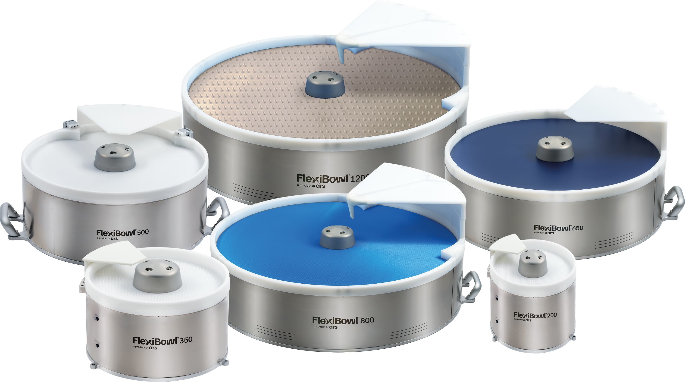

# **Manual FlexiBowl**

## **¡Bienvenido al manual de FlexiBowl®!**  
¡Estamos encantados de darle la bienvenida a su nueva guía de FlexiBowl®! Este manual se ha creado específicamente para ser su punto de referencia claro y fiable. Esperamos que, al consultarlo, pueda disfrutar plenamente de todas las ventajas de nuestro sistema. Su opinión es fundamental para nosotros: no dude en enviarnos sus comentarios [contactándonos](https://www.arsautomation.com/contact)!

*- El equipo de Ars Automation*
<a href="https://www.arsautomation.com" target="_blank">
  
  
</a>
  
## **¿Qué es FlexiBowl?**  
El FlexiBowl® es un sistema de alimentación flexible de disco giratorio para el posicionamiento y la orientación de componentes con vistas a su recogida robotizada.



## **Visión general del sistema** 
El área de trabajo del FlexiBowl® está dividida virtualmente en cuatro partes, cada una dedicada a una fase del ciclo de trabajo:

:::{list-table}
:widths: 20 50
:header-rows: 1

* - Fase
  - Descripción

* - **Liberación**
  - Una tolva descarga los componentes sobre el área de trabajo del FlexiBowl®.

* - **Separación**
  - Una acción combinada del {ref}`grupo flip <panoramica>` y del movimiento de la superficie o del disco rígido separa los componentes y los voltea para tener siempre al menos uno en la posición correcta para la recogida.

* - **Recogida**
  - El sistema de visión reconoce las piezas recogibles y envía sus coordenadas al robot, que procede con las operaciones de pick and place.

* - **Recirculación**
  - Los componentes no recogidos reinician su recorrido en el FlexiBowl® hasta que el robot los recoge.

:::

:::{figure} ../../_shared/media/images/Funz-standard.PNG
:align: center
:width: 50%

Esquema de ejemplo del sistema FlexiBowl® en funcionamiento estándar.
:::

:::{note}
El ciclo {ref}`Circular Tracking <tracking>` es sustancialmente igual al tradicional, con la diferencia de que todas las fases se producen simultánea y continuamente.
:::


## **Cómo leer el manual**  
Este manual se ha concebido para dar soporte tanto a la fase de diseño e integración del sistema como a la fase de instalación y puesta en marcha en campo. Por este motivo, se divide en macrosecciones con destinatarios y finalidades distintos.
  
## **¿Qué sección está buscando?**  
```{list-table}
:widths: 40 60
:header-rows: 1

* - Si necesita...
  - La información se encuentra en...

* - Verificar dimensiones, pesos, requisitos eléctricos y protocolos de comunicación
  - [**REFERENCIA TÉCNICA Y ESPECIFICACIONES**](specifiche_tecniche)

* - Instalar los componentes, cablear el sistema, configurar la red o calibrar la cámara/el robot
  - [**INSTALACIÓN DEL SISTEMA**](Installazione_Meccanica) y [**QUICKSTART**](quickstart)

* - Programar un nuevo modelo de pieza o configurar el sistema de alimentación
  - [**QUICKSTART**](quickstart)

* - Resolver problemas o solicitar asistencia
  - [**RESOLUCIÓN DE PROBLEMAS**](troubleshooting) y [**SOPORTE**](support)
```

## **Convenciones y símbolos utilizados**

En todo el manual se utilizan banners informativos para destacar contenidos importantes:

```{list-table}
:widths: 20 80
:header-rows: 1

* - Tipo
  - Significado

* - ```{warning}
    Advertencia
    ```
  - Indica una situación potencialmente peligrosa o un procedimiento crítico que, si no se ejecuta correctamente, podría provocar daños en el equipo o fallos de funcionamiento graves del sistema.

* - ```{important}
    Importante
    ```
  - Destaca información fundamental que no debe ignorarse para garantizar el correcto funcionamiento del sistema o la seguridad de la operación.

* - ```{note}
    Nota informativa
    ```
  - Proporciona información esencial para la correcta ejecución del procedimiento, aclaraciones técnicas o remisiones a capítulos relacionados.

* - ```{tip}
    Sugerencia
    ```
  - Sugiere una práctica óptima, una alternativa o un consejo que puede simplificar la instalación o mejorar las prestaciones del sistema.

* - ```{error}
    Error
    ```
  - Indica un error crítico o una condición de fallo que requiere intervención inmediata. Señala situaciones que comprometen el funcionamiento del sistema y requieren una acción correctiva.
```


:::{toctree}
:hidden:
:caption: ANTES DE EMPEZAR 
FlexiBowl_manual/PRIMA DI INIZIARE/01_informazioni_preliminari.md
FlexiBowl_manual/PRIMA DI INIZIARE/02_informazioni_sicurezza.md
FlexiBowl_manual/PRIMA DI INIZIARE/03_trasporto.md
FlexiBowl_manual/PRIMA DI INIZIARE/04_cond-util.md
FlexiBowl_manual/PRIMA DI INIZIARE/05_glossario.md
FlexiBowl_manual/PRIMA DI INIZIARE/06_support.md
FlexiBowl_manual/PRIMA DI INIZIARE/07_garanzia.md
:::
  
:::{toctree}
:hidden:
:caption: DATOS TÉCNICOS
FlexiBowl_manual/DATI TECNICI/01_panoramica.md
FlexiBowl_manual/DATI TECNICI/02_dati-tecnici-meccanici.md
FlexiBowl_manual/DATI TECNICI/03_dati-tecnici-elettrici.md
FlexiBowl_manual/DATI TECNICI/04_dati-tecnici-pneumatici.md
FlexiBowl_manual/DATI TECNICI/05_dati-tecnici-applicativi.md
:::

:::{toctree}
:hidden:
:caption: INSTALACIÓN
FlexiBowl_manual/INSTALLAZIONE/01_interfaccia-meccanica.md
FlexiBowl_manual/INSTALLAZIONE/02_interfaccia-elettrica.md
FlexiBowl_manual/INSTALLAZIONE/03_interfaccia-pneumatica.md
FlexiBowl_manual/INSTALLAZIONE/04_interfaccia-software.md
:::

:::{toctree}
:hidden:
:caption: VISIÓN GENERAL DEL SOFTWARE
FlexiBowl_manual/INTERFACCIA SOFTWARE/04_home.md
FlexiBowl_manual/INTERFACCIA SOFTWARE/04b_maincommand.md
FlexiBowl_manual/INTERFACCIA SOFTWARE/04c_sequence.md
FlexiBowl_manual/INTERFACCIA SOFTWARE/04d_monitor.md
FlexiBowl_manual/INTERFACCIA SOFTWARE/04e_jogmotor.md
FlexiBowl_manual/INTERFACCIA SOFTWARE/04f_wizard.md
FlexiBowl_manual/INTERFACCIA SOFTWARE/04h_graphs.md
FlexiBowl_manual/INTERFACCIA SOFTWARE/04i_filetransfer.md
FlexiBowl_manual/INTERFACCIA SOFTWARE/04l_setup.md
FlexiBowl_manual/INTERFACCIA SOFTWARE/04m_hopper.md
FlexiBowl_manual/INTERFACCIA SOFTWARE/04n_emptying.md
:::

:::{toctree}  
:hidden:
:caption: QUICKSTART
FlexiBowl_manual/QUICKSTART/panoramica.md
FlexiBowl_manual/QUICKSTART/installazione_meccanica.md
FlexiBowl_manual/QUICKSTART/cablaggio_FB.md
FlexiBowl_manual/QUICKSTART/conf_interfaccia.md
FlexiBowl_manual/QUICKSTART/FB_wizard.md
FlexiBowl_manual/QUICKSTART/conf_tramoggia.md
:::

:::{toctree}  
:hidden:
:caption: MODOS DE FUNCIONAMIENTO 
FlexiBowl_manual/MODALITA FUNZIONAMENTO/modalita_standard.md
FlexiBowl_manual/MODALITA FUNZIONAMENTO/modalita_mix.md
FlexiBowl_manual/MODALITA FUNZIONAMENTO/modalita_tracking.md
:::

:::{toctree}  
:hidden:
:caption: PLUG-IN 
FlexiBowl_manual/PLUG-IN/01_PlugIn.md
:::

<!--
:::{toctree}
:hidden:
:caption: LAYOUT BEST PRACTICE
FlexiBowl_manual/LAYOUT BEST PRACTICE/01_layoutbp.md
:::
--> 

:::{toctree}
:hidden:
:caption: ACCESORIOS
FlexiBowl_manual/ACCESSORI/00_ACCESSORI.md
FlexiBowl_manual/ACCESSORI/01_SUPERFICI.md
FlexiBowl_manual/ACCESSORI/02_DISCHI_RIGIDI.md
FlexiBowl_manual/ACCESSORI/03_04_illuminazione.md
FlexiBowl_manual/ACCESSORI/05_DEVIATORE.md
FlexiBowl_manual/ACCESSORI/06_SOFFI.md
FlexiBowl_manual/ACCESSORI/07_BRUSH_DIVERTER.md
FlexiBowl_manual/ACCESSORI/08_WEDGE.md
FlexiBowl_manual/ACCESSORI/09_SVUOTAMENTO.md
FlexiBowl_manual/ACCESSORI/11_CAVI.md
FlexiBowl_manual/ACCESSORI/12_KIT_FILTRAGGIO.md
:::

:::{toctree}  
:hidden:
:caption: MANTENIMIENTO 
FlexiBowl_manual/MANUTENZIONE/01_ordinaria.md
FlexiBowl_manual/MANUTENZIONE/02_straordinaria.md
:::

:::{toctree}  
:hidden:
:caption: GARANTÍA 
FlexiBowl_manual/Garanzia.md
:::

<!--  
:::{toctree}  
:hidden:
:caption: TROUBLESHOOTING
FlexiBowl_manual/TROUBLESHOOTING/01_risoluzione-problemi.md
FlexiBowl_manual/TROUBLESHOOTING/02_problemi_meccanici.md
FlexiBowl_manual/TROUBLESHOOTING/03_problemi_elettrici.md
FlexiBowl_manual/TROUBLESHOOTING/04_problemi_pneumatici.md
FlexiBowl_manual/TROUBLESHOOTING/05_problemi_software.md
:::
-->

:::{toctree}  
:hidden:
:caption: ELIMINACIÓN
FlexiBowl_manual/SMALTIMENTO/smaltimento.md
:::

<!-- 
:::{toctree}  
:hidden:
:caption: CERTIFICAZIONI 
FlexiBowl_manual/CERTIFICAZIONI/01_certificazioni.md
:::
-->

:::{toctree}  
:hidden:
:caption: TOLVAS
FlexiBowl_manual/TRAMOGGE/TRAMOGGE VIBRANTI/tramogge_vibranti.md
<!--FlexiBowl_manual/TRAMOGGE/MOTORIZZATE/00_MOTORIZZATE.md
FlexiBowl_manual/TRAMOGGE/CONVEYOR/00_CONVEYOR.md--->
:::

:::{toctree}
:hidden:
:caption: APÉNDICES
FlexiBowl_manual/NOTE RILASCIO/release_notes.md
:::

:::{toctree}
:hidden:
:caption: FLEXIBOWL 2.0 VS FLEXIBOWL 3.0
FlexiBowl_manual/COMPARATIVA/panoramica.md
FlexiBowl_manual/COMPARATIVA/comparativa_meccanica.md
FlexiBowl_manual/COMPARATIVA/comparativa_elettrica.md
FlexiBowl_manual/COMPARATIVA/comparativa_pneumatica.md
FlexiBowl_manual/COMPARATIVA/comparativa_software.md
:::