(superfici)=
# **Surfaces**

## **Compatibilité générale**

Chaque ✓ renvoie à la fiche produit du catalogue.

:::{list-table}
:header-rows: 1
:widths: 44 8 8 8 8 8 8 8

* - **Surface / Disque rigide**
  - **FB200**
  - **FB350**
  - **FB500E**
  - **FB500**
  - **FB650**
  - **FB800**
  - **FB1200**

* - [**SURFACES**](superfici)
  - 
  - 
  - 
  - 
  - 
  - 
  - 

* - Flexi Disc Smooth White FDA
  - 
  - 
  - 
  - [✓](smooth-white)
  - [✓](smooth-white)
  - [✓](smooth-white)
  - [✓](smooth-white)

* - Flexi Disc Smooth Blue FDA
  - 
  - 
  - 
  - [✓](smooth-blue)
  - [✓](smooth-blue)
  - [✓](smooth-blue)
  - [✓](smooth-blue)

* - Flexi Disc Smooth Transparent FDA
  - 
  - 
  - 
  - [✓](smooth-transparent)
  - [✓](smooth-transparent)
  - [✓](smooth-transparent)
  - 

* - Flexi Disc Smooth Black
  - 
  - 
  - 
  - [✓](smooth-black)
  - [✓](smooth-black)
  - [✓](smooth-black)
  - [✓](smooth-black)

* - Flexi Disc Anti-Stick Blue FDA
  - 
  - 
  - 
  - [✓](anti-stick-blue)
  - [✓](anti-stick-blue)
  - [✓](anti-stick-blue)
  - [✓](anti-stick-blue)

* - Flexi Disc Anti-Roll Small White FDA
  - 
  - 
  - 
  - [✓](anti-roll-1-3-white)
  - 
  - 
  - 

* - Flexi Disc Anti-Roll Medium White FDA
  - 
  - 
  - 
  - [✓](anti-roll-3-6-white)
  - [✓](anti-roll-3-6-white)
  - [✓](anti-roll-3-6-white)
  - 

* - Flexi Disc Anti-Roll Transparent FDA
  - 
  - 
  - 
  - [✓](anti-roll-6-14-spike-grey)
  - [✓](anti-roll-6-14-spike-grey)
  - [✓](anti-roll-6-14-spike-grey)
  - 

* - Flexi Disc Anti-Roll Beige FDA
  - 
  - 
  - 
  - [✓](anti-roll-14-35-spike-beige)
  - [✓](anti-roll-14-35-spike-beige)
  - [✓](anti-roll-14-35-spike-beige)
  - [✓](anti-roll-14-35-spike-beige)

* - Flexi Disc Anti-Roll Blue FDA
  - 
  - 
  - 
  - [✓](anti-roll-14-35-spike-blue)
  - [✓](anti-roll-14-35-spike-blue)
  - [✓](anti-roll-14-35-spike-blue)
  - [✓](anti-roll-14-35-spike-blue)

* - Flexi Disc Silicone White FDA
  - 
  - 
  - 
  - [✓](anti-roll-silicone-white)
  - [✓](anti-roll-silicone-white)
  - [✓](anti-roll-silicone-white)
  - [✓](anti-roll-silicone-white)

* - Flexi Disc Anti-Cut FDA
  - 
  - 
  - 
  - [✓](anti-cut-grey)
  - [✓](anti-cut-grey)
  - [✓](anti-cut-grey)
  - [✓](anti-cut-grey)

* - Custom Disc
  - 
  - 
  - 
  - [✓](custom)
  - [✓](custom)
  - [✓](custom)
  - 

* - Lift Support for Custom Disc
  - 
  - 
  - 
  - [✓](lift-support)
  - [✓](lift-support)
  - [✓](lift-support)
  - 

* - [**DISQUES RIGIDES**](dischi-rigidi)
  - 
  - 
  - 
  - 
  - 
  - 
  - 

* - Rigid Disc Flat White FDA
  - [✓](rd200-flat-white)
  - [✓](rd350-flat-white)
  - [✓](rd500e-flat-white)
  - 
  - 
  - 
  - 

* - Rigid Disc Flat Black FDA
  - [✓](rd200-flat-black)
  - [✓](rd350-flat-black)
  - [✓](rd500e-flat-black)
  - 
  - 
  - 
  - 

* - Rigid Disc Anti-Roll White FDA
  - [✓](rd200-anti-roll-1-5-white)
  - 
  - 
  - 
  - 
  - 
  - 

* - Rigid Disc Anti-Roll Black FDA
  - [✓](rd200-anti-roll-1-5-black)
  - 
  - 
  - 
  - 
  - 
  - 

* - Rigid Disc Anti-Roll Small White FDA
  - 
  - [✓](rd350-anti-roll-1-5-white)
  - [✓](rd500e-anti-roll-6-8-white)
  - 
  - 
  - 
  - 

* - Rigid Disc Anti-Roll Small Black FDA
  - 
  - [✓](rd350-anti-roll-1-5-black)
  - [✓](rd500e-anti-roll-6-8-black)
  - 
  - 
  - 
  - 

* - Rigid Disc Anti-Roll Medium White FDA
  - 
  - [✓](rd350-anti-roll-6-8-white)
  - [✓](rd500e-anti-roll-9-15-white)
  - 
  - 
  - 
  - 

* - Rigid Disc Anti-Roll Medium Black FDA
  - 
  - [✓](rd350-anti-roll-6-8-black)
  - [✓](rd500e-anti-roll-9-15-black)
  - 
  - 
  - 
  - 

* - Rigid Disc Anti-Roll Large White FDA
  - 
  - [✓](rd350-anti-roll-9-15-white)
  - [✓](rd500e-anti-roll-23-30-white)
  - 
  - 
  - 
  - 

* - Rigid Disc Anti-Roll Large Black FDA
  - 
  - [✓](rd350-anti-roll-9-15-black)
  - [✓](rd500e-anti-roll-23-30-black)
  - 
  - 
  - 
  - 

* - Custom Disc
  - [✓](rd200-application-specific)
  - [✓](rd350-application-specific)
  - [✓](rd500e-round-edged-custom-grooved)
  - 
  - 
  - 
  - 

:::

## **Surfaces disponibles**

Les surfaces sont des tapis circulaires en matériau toilé et flexible et constituent la solution standard pour les **FlexiBowl® 500, 650, 800 et 1200**. Les caractéristiques de chaque surface sont les mêmes pour toutes les tailles : chaque fiche indique les codes catalogue disponibles pour chaque taille.

(smooth-white)=
### Flexi Disc Smooth White FDA

:::{list-table}
:header-rows: 1
:widths: 20 80

* - **Taille**
  - **Code catalogue**
* - FlexiBowl® 500
  - Flexi Disc Smooth White FDA 500
* - FlexiBowl® 650
  - Flexi Disc Smooth White FDA 650
* - FlexiBowl® 800
  - Flexi Disc Smooth White FDA 800
* - FlexiBowl® 1200
  - Flexi Disc Smooth White FDA 1200
:::

    <strong>Caractéristiques principales :</strong> Recommandée pour les pièces plates et propres. Efficace aussi bien avec un éclairage par le dessous (backlight) que par le dessus (toplight).

    <table class="sphinx-styled-table">
        <thead>
            <tr>
                <th style="width: 30%;">Propriété</th>
                <th style="width: 70%;">Spécification / Niveau</th>
            </tr>
        </thead>
        <tbody>
            <tr>
                <td><strong>Matériau</strong></td>
                <td>Polyuréthane - FDA</td>
            </tr>
            <tr>
                <td><strong>Filaments antistatiques</strong></td>
                <td>Oui</td>
            </tr>
            <tr>
                <td><strong>Backlight</strong></td>
                <td>
                    

                        

                        

                        

                    

                </td>
            </tr>
            <tr>
                <td><strong>Toplight</strong></td>
                <td>
                    

                        

                        

                        

                    

                </td>
            </tr>
            <tr>
                <td><strong>Cleaning</strong></td>
                <td>
                    

                        

                        

                        

                    

                </td>
            </tr>
            <tr>
                <td><strong>Grip</strong></td>
                <td>
                    

                        

                        

                        

                    

                </td>
            </tr>
        </tbody>
    </table>

#### Compatibilité des composants (Flexi Disc Smooth White FDA)

    <table class="sphinx-styled-table">
        <thead>
            <tr>
                <th style="width: 30%;">Type de composant</th>
                <th style="width: 70%;">Compatibilité</th>
            </tr>
        </thead>
        <tbody>
            <tr>
                <td><strong>Dirty/Oily</strong></td>
                <td>
                    

                        

                        

                        

                    

                </td>
            </tr>
            <tr>
                <td><strong>Cylindrical</strong></td>
                <td>
                    

                        

                        

                        

                    

                </td>
            </tr>
            <tr>
                <td><strong>Sticky</strong></td>
                <td>
                    

                        

                        

                        

                    

                </td>
            </tr>
            <tr>
                <td><strong>Transparent</strong></td>
                <td>
                    

                        

                        

                        

                    

                </td>
            </tr>
            <tr>
                <td><strong>Sharp</strong></td>
                <td>
                    

                        

                        

                        

                    

                </td>
            </tr>
        </tbody>
    </table>

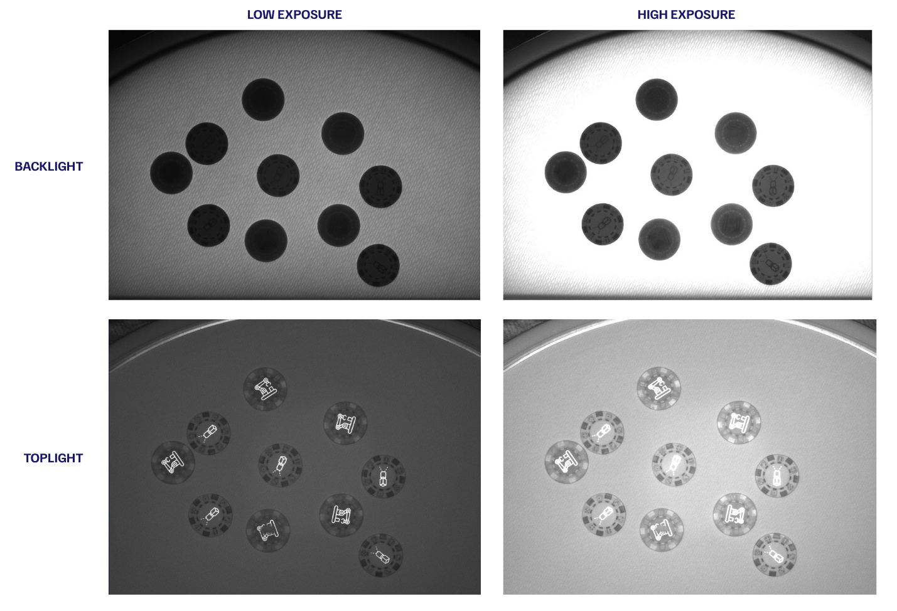

(smooth-blue)=
### Flexi Disc Smooth Blue FDA

:::{list-table}
:header-rows: 1
:widths: 20 80

* - **Taille**
  - **Code catalogue**
* - FlexiBowl® 500
  - Flexi Disc Smooth Blue FDA 500
* - FlexiBowl® 650
  - Flexi Disc Smooth Blue FDA 650
* - FlexiBowl® 800
  - Flexi Disc Smooth Blue FDA 800
* - FlexiBowl® 1200
  - Flexi Disc Smooth Blue FDA 1200
:::

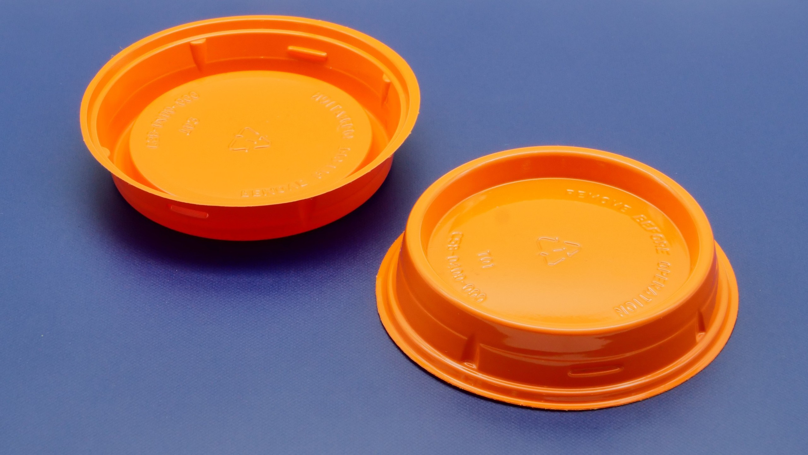

    <strong>Caractéristiques principales :</strong> Recommandée pour les composants de couleur claire et pour l'éclairage par le dessus (toplight). Très peu sujette à l'accumulation de saleté.

    <table class="sphinx-styled-table">
        <thead>
            <tr>
                <th style="width: 30%;">Propriété</th>
                <th style="width: 70%;">Spécification / Niveau</th>
            </tr>
        </thead>
        <tbody>
            <tr>
                <td><strong>Matériau</strong></td>
                <td>Silicone - FDA</td>
            </tr>
            <tr>
                <td><strong>Filaments antistatiques</strong></td>
                <td>Oui</td>
            </tr>
            <tr>
                <td><strong>Backlight</strong></td>
                <td>
                    

                        

                        

                        

                    

                </td>
            </tr>
            <tr>
                <td><strong>Toplight</strong></td>
                <td>
                    

                        

                        

                        

                    

                </td>
            </tr>
            <tr>
                <td><strong>Cleaning</strong></td>
                <td>
                    

                        

                        

                        

                    

                </td>
            </tr>
            <tr>
                <td><strong>Grip</strong></td>
                <td>
                    

                        

                        

                        

                    

                </td>
            </tr>
        </tbody>
    </table>

#### Compatibilité des composants (Flexi Disc Smooth Blue FDA)

    <table class="sphinx-styled-table">
        <thead>
            <tr>
                <th style="width: 30%;">Type de composant</th>
                <th style="width: 70%;">Compatibilité</th>
            </tr>
        </thead>
        <tbody>
            <tr>
                <td><strong>Dirty/Oily</strong></td>
                <td>
                    

                        

                        

                        

                    

                </td>
            </tr>
            <tr>
                <td><strong>Cylindrical</strong></td>
                <td>
                    

                        

                        

                        

                    

                </td>
            </tr>
            <tr>
                <td><strong>Sticky</strong></td>
                <td>
                    

                        

                        

                        

                    

                </td>
            </tr>
            <tr>
                <td><strong>Transparent</strong></td>
                <td>
                    

                        

                        

                        

                    

                </td>
            </tr>
            <tr>
                <td><strong>Sharp</strong></td>
                <td>
                    

                        

                        

                        

                    

                </td>
            </tr>
        </tbody>
    </table>

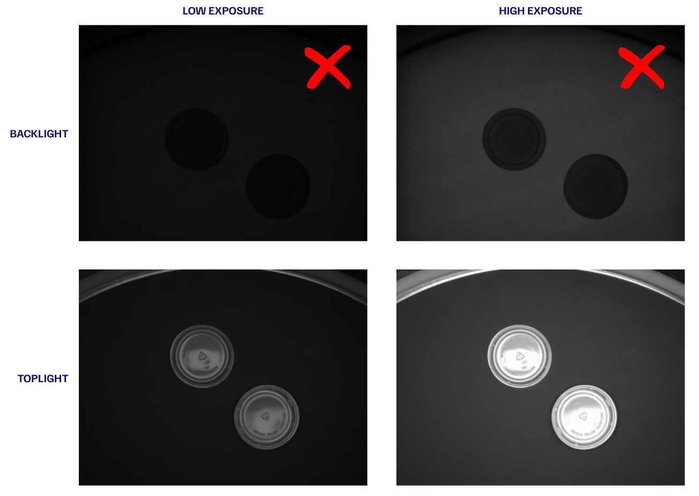

(smooth-transparent)=
### Flexi Disc Smooth Transparent FDA

:::{list-table}
:header-rows: 1
:widths: 20 80

* - **Taille**
  - **Code catalogue**
* - FlexiBowl® 500
  - Flexi Disc Smooth Transparent FDA 500
* - FlexiBowl® 650
  - Flexi Disc Smooth Transparent FDA 650
* - FlexiBowl® 800
  - Flexi Disc Smooth Transparent FDA 800
:::

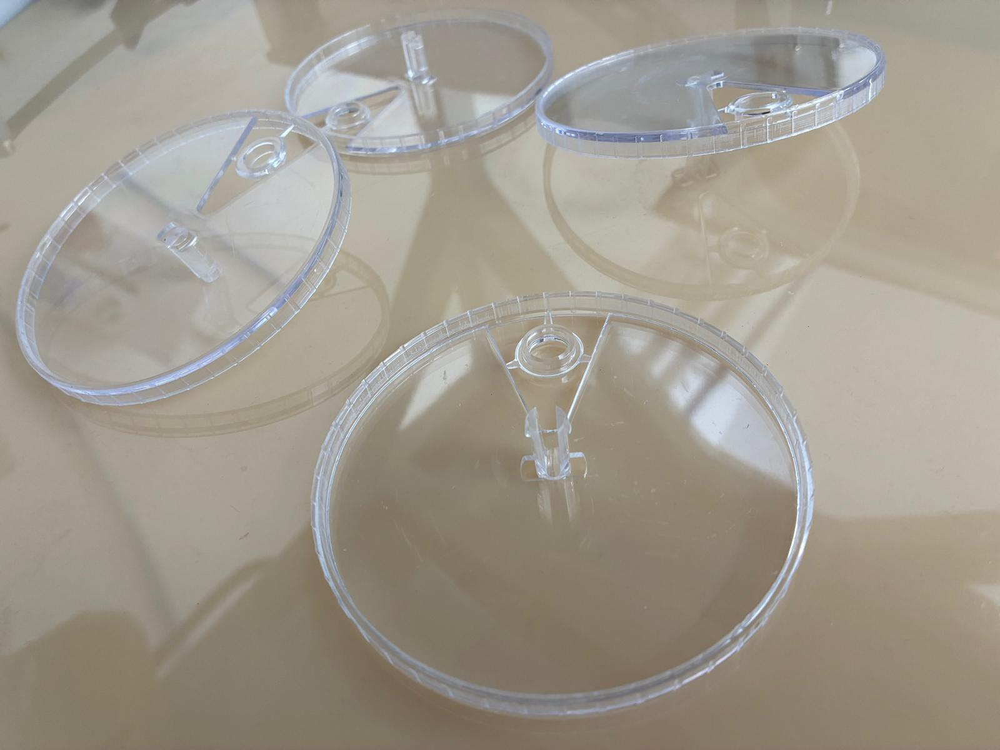

    <strong>Caractéristiques principales :</strong> Recommandée pour les composants transparents, optimale avec un éclairage par le dessous (backlight).

    <table class="sphinx-styled-table">
        <thead>
            <tr>
                <th style="width: 30%;">Propriété</th>
                <th style="width: 70%;">Spécification / Niveau</th>
            </tr>
        </thead>
        <tbody>
            <tr>
                <td><strong>Matériau</strong></td>
                <td>Silicone - FDA</td>
            </tr>
            <tr>
                <td><strong>Filaments antistatiques</strong></td>
                <td>Oui</td>
            </tr>
            <tr>
                <td><strong>Backlight</strong></td>
                <td>
                    

                        

                        

                        

                    

                </td>
            </tr>
            <tr>
                <td><strong>Toplight</strong></td>
                <td>
                    

                        

                        

                        

                    

                </td>
            </tr>
            <tr>
                <td><strong>Cleaning</strong></td>
                <td>
                    

                        

                        

                        

                    

                </td>
            </tr>
            <tr>
                <td><strong>Grip</strong></td>
                <td>
                    

                        

                        

                        

                    

                </td>
            </tr>
        </tbody>
    </table>

#### Compatibilité des composants (Flexi Disc Smooth Transparent FDA)

    <table class="sphinx-styled-table">
        <thead>
            <tr>
                <th style="width: 30%;">Type de composant</th>
                <th style="width: 70%;">Compatibilité</th>
            </tr>
        </thead>
        <tbody>
            <tr>
                <td><strong>Dirty/Oily</strong></td>
                <td>
                    

                        

                        

                        

                    

                </td>
            </tr>
            <tr>
                <td><strong>Cylindrical</strong></td>
                <td>
                    

                        

                        

                        

                    

                </td>
            </tr>
            <tr>
                <td><strong>Sticky</strong></td>
                <td>
                    

                        

                        

                        

                    

                </td>
            </tr>
            <tr>
                <td><strong>Transparent</strong></td>
                <td>
                    

                        

                        

                        

                    

                </td>
            </tr>
            <tr>
                <td><strong>Sharp</strong></td>
                <td>
                    

                        

                        

                        

                    

                </td>
            </tr>
        </tbody>
    </table>

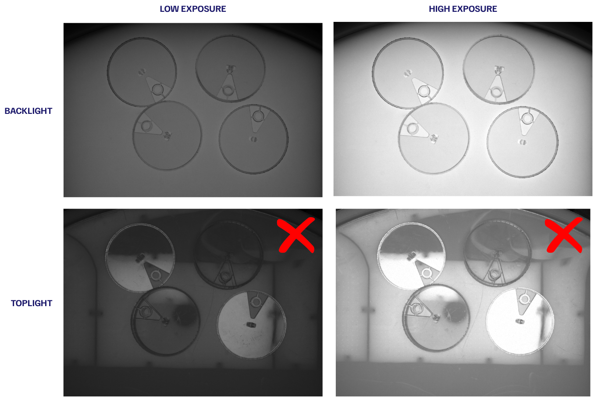

(smooth-black)=
### Flexi Disc Smooth Black

:::{list-table}
:header-rows: 1
:widths: 20 80

* - **Taille**
  - **Code catalogue**
* - FlexiBowl® 500
  - Flexi Disc Smooth Black 500
* - FlexiBowl® 650
  - Flexi Disc Smooth Black 650
* - FlexiBowl® 800
  - Flexi Disc Smooth Black 800
* - FlexiBowl® 1200
  - Flexi Disc Smooth Black 1200
:::

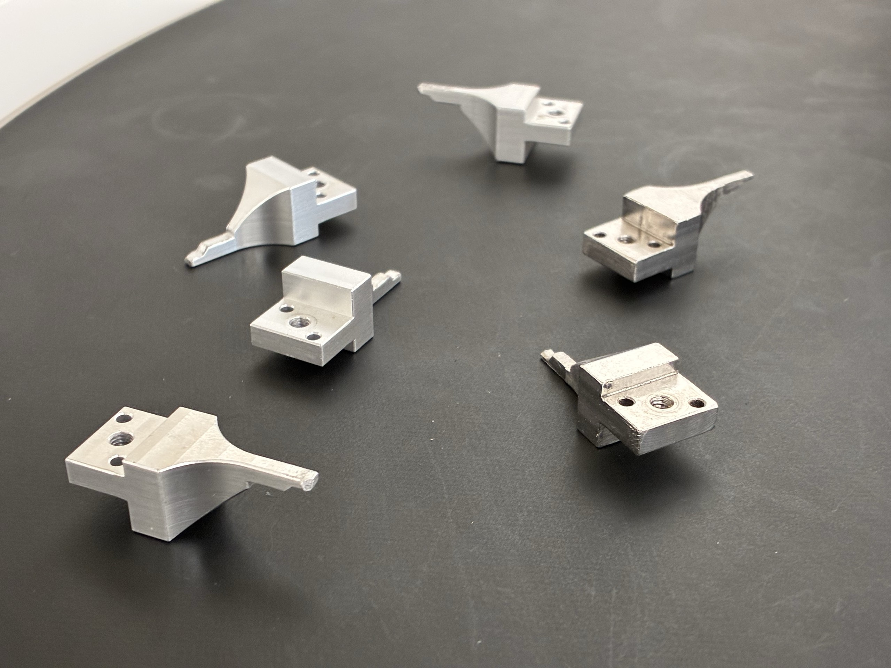

    <strong>Caractéristiques principales :</strong> Recommandée pour les composants de couleur claire et pour l'éclairage par le dessus (toplight). Très peu sujette à l'accumulation de saleté.

    <table class="sphinx-styled-table">
        <thead>
            <tr>
                <th style="width: 30%;">Propriété</th>
                <th style="width: 70%;">Spécification / Niveau</th>
            </tr>
        </thead>
        <tbody>
            <tr>
                <td><strong>Matériau</strong></td>
                <td>Polyuréthane</td>
            </tr>
            <tr>
                <td><strong>Filaments antistatiques</strong></td>
                <td>Oui</td>
            </tr>
            <tr>
                <td><strong>Backlight</strong></td>
                <td>
                    

                        

                        

                        

                    

                </td>
            </tr>
            <tr>
                <td><strong>Toplight</strong></td>
                <td>
                    

                        

                        

                        

                    

                </td>
            </tr>
            <tr>
                <td><strong>Cleaning</strong></td>
                <td>
                    

                        

                        

                        

                    

                </td>
            </tr>
            <tr>
                <td><strong>Grip</strong></td>
                <td>
                    

                        

                        

                        

                    

                </td>
            </tr>
        </tbody>
    </table>

#### Compatibilité des composants (Flexi Disc Smooth Black)

    <table class="sphinx-styled-table">
        <thead>
            <tr>
                <th style="width: 30%;">Type de composant</th>
                <th style="width: 70%;">Compatibilité</th>
            </tr>
        </thead>
        <tbody>
            <tr>
                <td><strong>Dirty/Oily</strong></td>
                <td>
                    

                        

                        

                        

                    

                </td>
            </tr>
            <tr>
                <td><strong>Cylindrical</strong></td>
                <td>
                    

                        

                        

                        

                    

                </td>
            </tr>
            <tr>
                <td><strong>Sticky</strong></td>
                <td>
                    

                        

                        

                        

                    

                </td>
            </tr>
            <tr>
                <td><strong>Transparent</strong></td>
                <td>
                    

                        

                        

                        

                    

                </td>
            </tr>
            <tr>
                <td><strong>Sharp</strong></td>
                <td>
                    

                        

                        

                        

                    

                </td>
            </tr>
        </tbody>
    </table>

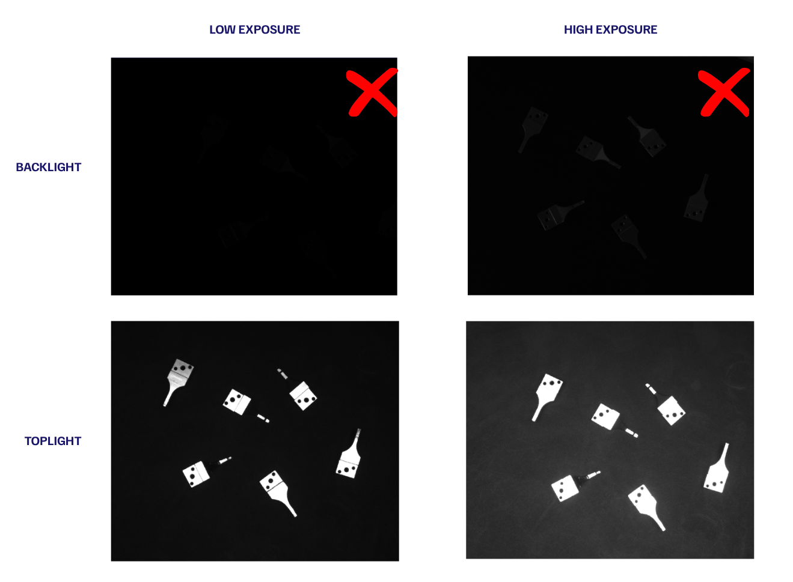

(anti-stick-blue)=
### Flexi Disc Anti-Stick Blue FDA

:::{list-table}
:header-rows: 1
:widths: 20 80

* - **Taille**
  - **Code catalogue**
* - FlexiBowl® 500
  - Flexi Disc Anti-Stick Blue FDA 500
* - FlexiBowl® 650
  - Flexi Disc Anti-Stick Blue FDA 650
* - FlexiBowl® 800
  - Flexi Disc Anti-Stick Blue FDA 800
* - FlexiBowl® 1200
  - Flexi Disc Anti-Stick Blue FDA 1200
:::

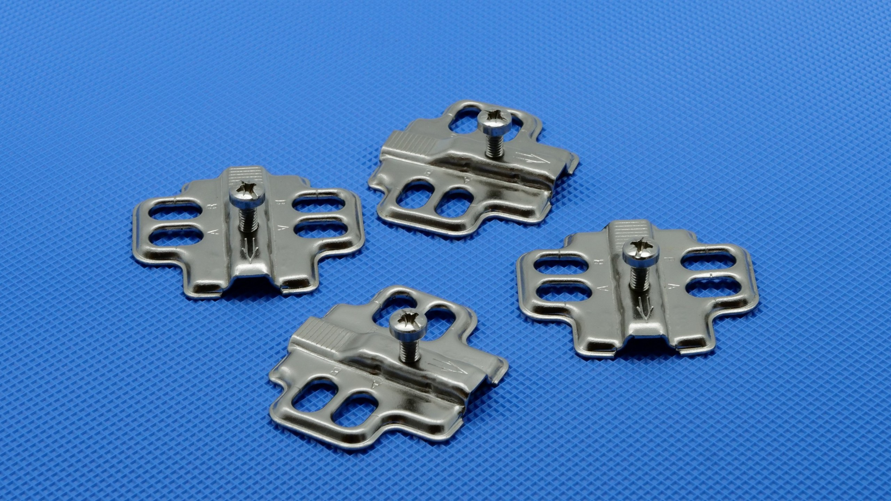

    <strong>Caractéristiques principales :</strong> Surface très largement utilisée, recommandée pour de nombreuses applications différentes. Excellente également pour les pièces sales ou huileuses.

    <table class="sphinx-styled-table">
        <thead>
            <tr>
                <th style="width: 30%;">Propriété</th>
                <th style="width: 70%;">Spécification / Niveau</th>
            </tr>
        </thead>
        <tbody>
            <tr>
                <td><strong>Matériau</strong></td>
                <td>Silicone - FDA</td>
            </tr>
            <tr>
                <td><strong>Filaments antistatiques</strong></td>
                <td>Oui</td>
            </tr>
            <tr>
                <td><strong>Backlight</strong></td>
                <td>
                    

                        

                        

                        

                    

                </td>
            </tr>
            <tr>
                <td><strong>Toplight</strong></td>
                <td>
                    

                        

                        

                        

                    

                </td>
            </tr>
            <tr>
                <td><strong>Cleaning</strong></td>
                <td>
                    

                        

                        

                        

                    

                </td>
            </tr>
            <tr>
                <td><strong>Grip</strong></td>
                <td>
                    

                        

                        

                        

                    

                </td>
            </tr>
        </tbody>
    </table>

#### Compatibilité des composants (Flexi Disc Anti-Stick Blue FDA)

    <table class="sphinx-styled-table">
        <thead>
            <tr>
                <th style="width: 30%;">Type de composant</th>
                <th style="width: 70%;">Compatibilité</th>
            </tr>
        </thead>
        <tbody>
            <tr>
                <td><strong>Dirty/Oily</strong></td>
                <td>
                    

                        

                        

                        

                    

                </td>
            </tr>
            <tr>
                <td><strong>Cylindrical</strong></td>
                <td>
                    

                        

                        

                        

                    

                </td>
            </tr>
            <tr>
                <td><strong>Sticky</strong></td>
                <td>
                    

                        

                        

                        

                    

                </td>
            </tr>
            <tr>
                <td><strong>Transparent</strong></td>
                <td>
                    

                        

                        

                        

                    

                </td>
            </tr>
            <tr>
                <td><strong>Sharp</strong></td>
                <td>
                    

                        

                        

                        

                    

                </td>
            </tr>
        </tbody>
    </table>

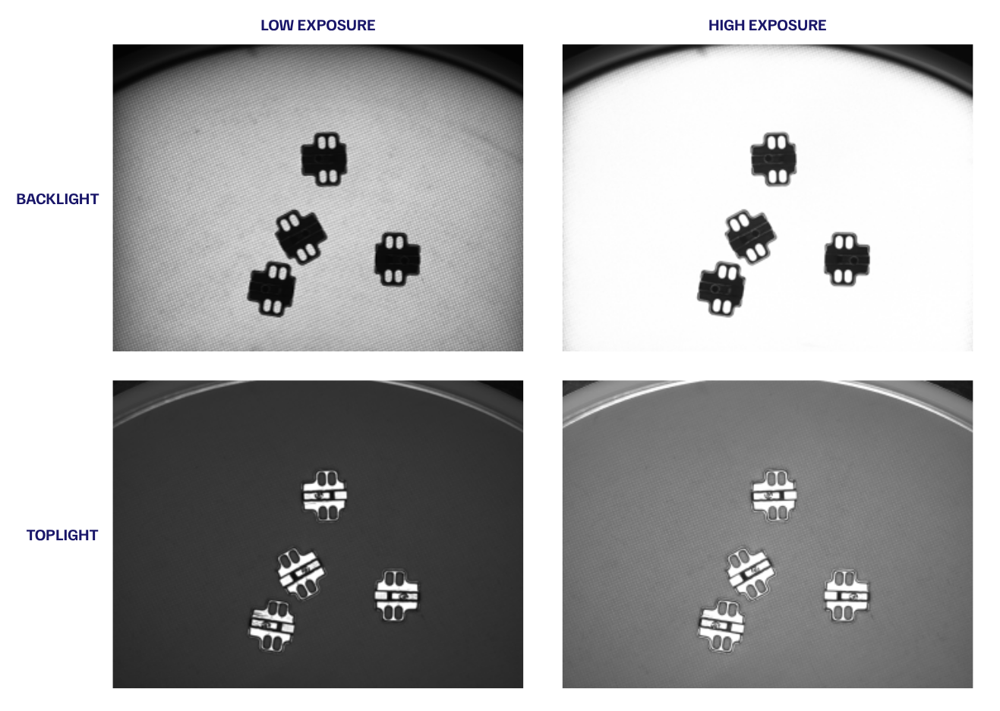

(anti-roll-1-3-white)=
### Flexi Disc Anti-Roll Small White FDA

:::{list-table}
:header-rows: 1
:widths: 20 80

* - **Taille**
  - **Code catalogue**
* - FlexiBowl® 500
  - Flexi Disc Anti-Roll Small White FDA 500
:::

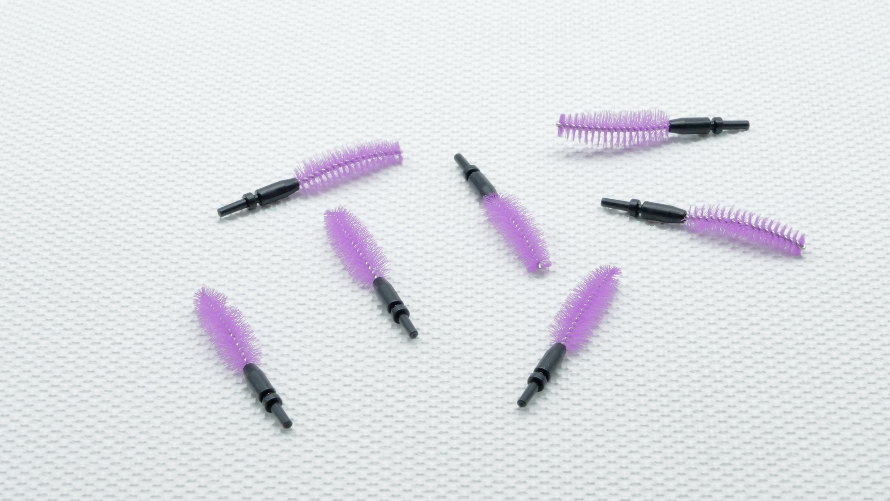

    <strong>Caractéristiques principales :</strong> Recommandée pour les pièces propres et stables (même collantes/sticky) et pour les composants cylindriques de très petites dimensions.

    <table class="sphinx-styled-table">
        <thead>
            <tr>
                <th style="width: 30%;">Propriété</th>
                <th style="width: 70%;">Spécification / Niveau</th>
            </tr>
        </thead>
        <tbody>
            <tr>
                <td><strong>Matériau</strong></td>
                <td>Silicone - FDA</td>
            </tr>
            <tr>
                <td><strong>Filaments antistatiques</strong></td>
                <td>Oui</td>
            </tr>
            <tr>
                <td><strong>Diamètre des composants</strong></td>
                <td>1-3 mm</td>
            </tr>
            <tr>
                <td><strong>Backlight</strong></td>
                <td>
                    

                        

                        

                        

                    

                </td>
            </tr>
            <tr>
                <td><strong>Toplight</strong></td>
                <td>
                    

                        

                        

                        

                    

                </td>
            </tr>
            <tr>
                <td><strong>Cleaning</strong></td>
                <td>
                    

                        

                        

                        

                    

                </td>
            </tr>
            <tr>
                <td><strong>Grip</strong></td>
                <td>
                    

                        

                        

                        

                    

                </td>
            </tr>
        </tbody>
    </table>

#### Compatibilité des composants (Flexi Disc Anti-Roll Small White FDA)

    <table class="sphinx-styled-table">
        <thead>
            <tr>
                <th style="width: 30%;">Type de composant</th>
                <th style="width: 70%;">Compatibilité</th>
            </tr>
        </thead>
        <tbody>
            <tr>
                <td><strong>Dirty/Oily</strong></td>
                <td>
                    

                        

                        

                        

                    

                </td>
            </tr>
            <tr>
                <td><strong>Cylindrical</strong></td>
                <td>
                    

                        

                        

                        

                    

                </td>
            </tr>
            <tr>
                <td><strong>Sticky</strong></td>
                <td>
                    

                        

                        

                        

                    

                </td>
            </tr>
            <tr>
                <td><strong>Transparent</strong></td>
                <td>
                    

                        

                        

                        

                    

                </td>
            </tr>
            <tr>
                <td><strong>Sharp</strong></td>
                <td>
                    

                        

                        

                        

                    

                </td>
            </tr>
        </tbody>
    </table>

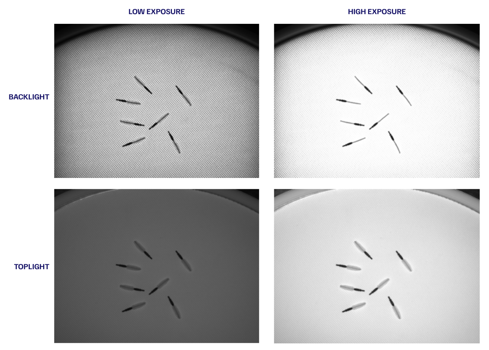

(anti-roll-3-6-white)=
### Flexi Disc Anti-Roll Medium White FDA

:::{list-table}
:header-rows: 1
:widths: 20 80

* - **Taille**
  - **Code catalogue**
* - FlexiBowl® 500
  - Flexi Disc Anti-Roll Medium White FDA 500
* - FlexiBowl® 650
  - Flexi Disc Anti-Roll Medium White FDA 650
* - FlexiBowl® 800
  - Flexi Disc Anti-Roll Medium White FDA 800
:::

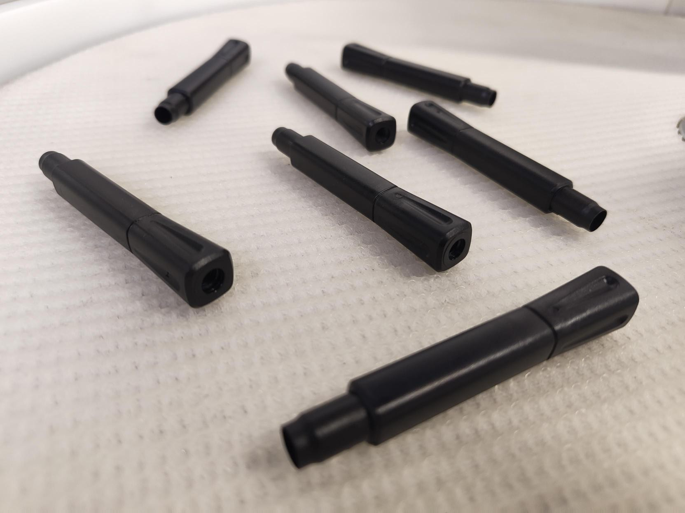

    <strong>Caractéristiques principales :</strong> Recommandée pour les composants dotés d'un collet circulaire ou pour les petits cylindres.

    <table class="sphinx-styled-table">
        <thead>
            <tr>
                <th style="width: 30%;">Propriété</th>
                <th style="width: 70%;">Spécification / Niveau</th>
            </tr>
        </thead>
        <tbody>
            <tr>
                <td><strong>Matériau</strong></td>
                <td>Silicone - FDA</td>
            </tr>
            <tr>
                <td><strong>Filaments antistatiques</strong></td>
                <td>Oui</td>
            </tr>
            <tr>
                <td><strong>Diamètre des composants</strong></td>
                <td>3-6 mm</td>
            </tr>
            <tr>
                <td><strong>Backlight</strong></td>
                <td>
                    

                        

                        

                        

                    

                </td>
            </tr>
            <tr>
                <td><strong>Toplight</strong></td>
                <td>
                    

                        

                        

                        

                    

                </td>
            </tr>
            <tr>
                <td><strong>Cleaning</strong></td>
                <td>
                    

                        

                        

                        

                    

                </td>
            </tr>
            <tr>
                <td><strong>Grip</strong></td>
                <td>
                    

                        

                        

                        

                    

                </td>
            </tr>
        </tbody>
    </table>

#### Compatibilité des composants (Flexi Disc Anti-Roll Medium White FDA)

    <table class="sphinx-styled-table">
        <thead>
            <tr>
                <th style="width: 30%;">Type de composant</th>
                <th style="width: 70%;">Compatibilité</th>
            </tr>
        </thead>
        <tbody>
            <tr>
                <td><strong>Dirty/Oily</strong></td>
                <td>
                    

                        

                        

                        

                    

                </td>
            </tr>
            <tr>
                <td><strong>Cylindrical</strong></td>
                <td>
                    

                        

                        

                        

                    

                </td>
            </tr>
            <tr>
                <td><strong>Sticky</strong></td>
                <td>
                    

                        

                        

                        

                    

                </td>
            </tr>
            <tr>
                <td><strong>Transparent</strong></td>
                <td>
                    

                        

                        

                        

                    

                </td>
            </tr>
            <tr>
                <td><strong>Sharp</strong></td>
                <td>
                    

                        

                        

                        

                    

                </td>
            </tr>
        </tbody>
    </table>

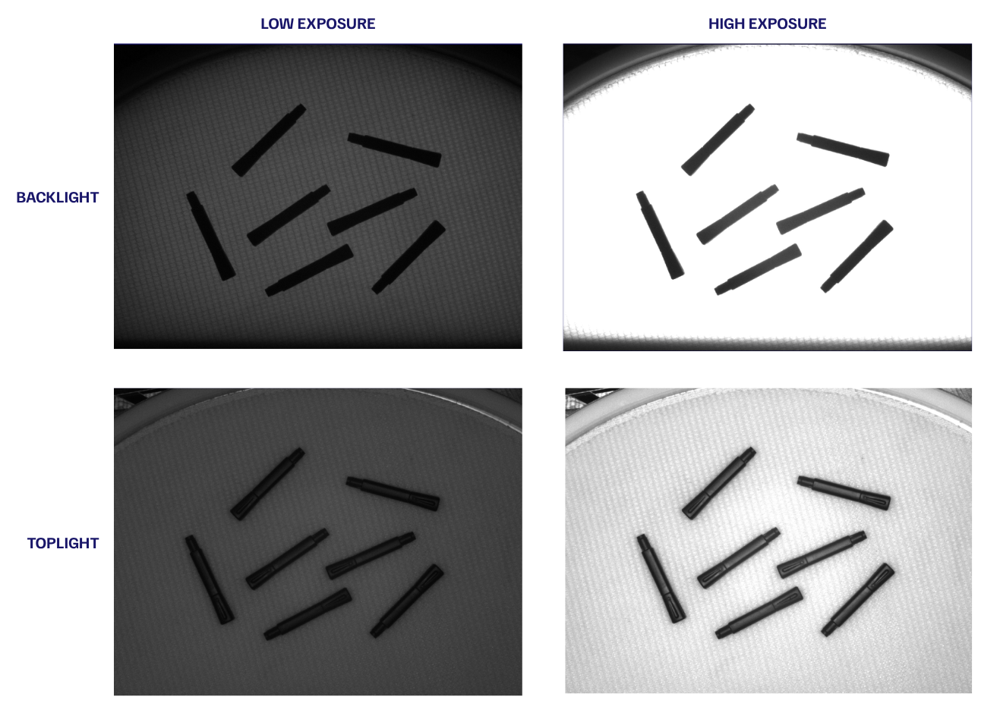

(anti-roll-6-14-spike-grey)=
### Flexi Disc Anti-Roll Transparent FDA

:::{list-table}
:header-rows: 1
:widths: 20 80

* - **Taille**
  - **Code catalogue**
* - FlexiBowl® 500
  - Flexi Disc Anti-Roll Transparent FDA 500
* - FlexiBowl® 650
  - Flexi Disc Anti-Roll Transparent FDA 650
* - FlexiBowl® 800
  - Flexi Disc Anti-Roll Transparent FDA 800
:::

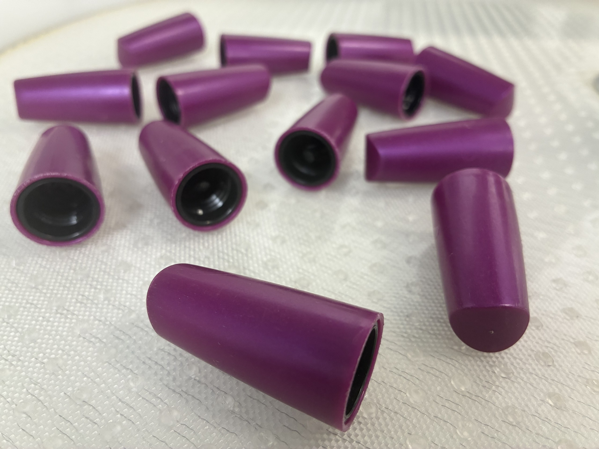

    <strong>Caractéristiques principales :</strong> Recommandée pour les composants cylindriques d'un diamètre inférieur à 15 mm.

    <table class="sphinx-styled-table">
        <thead>
            <tr>
                <th style="width: 30%;">Propriété</th>
                <th style="width: 70%;">Spécification / Niveau</th>
            </tr>
        </thead>
        <tbody>
            <tr>
                <td><strong>Matériau</strong></td>
                <td>Silicone - FDA</td>
            </tr>
            <tr>
                <td><strong>Filaments antistatiques</strong></td>
                <td>Oui</td>
            </tr>
            <tr>
                <td><strong>Diamètre des composants</strong></td>
                <td>6-14 mm</td>
            </tr>
            <tr>
                <td><strong>Backlight</strong></td>
                <td>
                    

                        

                        

                        

                    

                </td>
            </tr>
            <tr>
                <td><strong>Toplight</strong></td>
                <td>
                    

                        

                        

                        

                    

                </td>
            </tr>
            <tr>
                <td><strong>Cleaning</strong></td>
                <td>
                    

                        

                        

                        

                    

                </td>
            </tr>
            <tr>
                <td><strong>Grip</strong></td>
                <td>
                    

                        

                        

                        

                    

                </td>
            </tr>
        </tbody>
    </table>

#### Compatibilité des composants (Flexi Disc Anti-Roll Transparent FDA)

    <table class="sphinx-styled-table">
        <thead>
            <tr>
                <th style="width: 30%;">Type de composant</th>
                <th style="width: 70%;">Compatibilité</th>
            </tr>
        </thead>
        <tbody>
            <tr>
                <td><strong>Dirty/Oily</strong></td>
                <td>
                    

                        

                        

                        

                    

                </td>
            </tr>
            <tr>
                <td><strong>Cylindrical</strong></td>
                <td>
                    

                        

                        

                        

                    

                </td>
            </tr>
            <tr>
                <td><strong>Sticky</strong></td>
                <td>
                    

                        

                        

                        

                    

                </td>
            </tr>
            <tr>
                <td><strong>Transparent</strong></td>
                <td>
                    

                        

                        

                        

                    

                </td>
            </tr>
            <tr>
                <td><strong>Sharp</strong></td>
                <td>
                    

                        

                        

                        

                    

                </td>
            </tr>
        </tbody>
    </table>

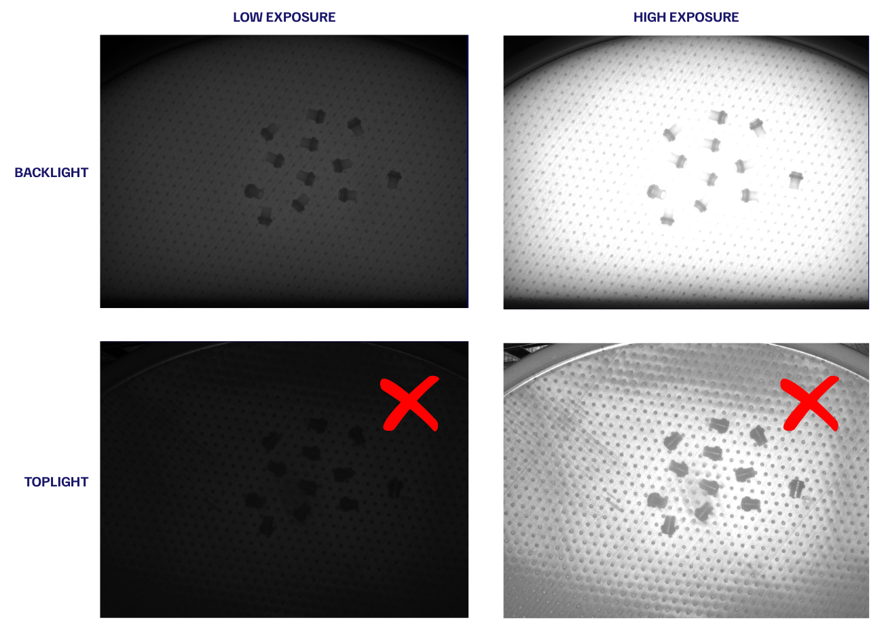

(anti-roll-14-35-spike-beige)=
### Flexi Disc Anti-Roll Beige FDA

:::{list-table}
:header-rows: 1
:widths: 20 80

* - **Taille**
  - **Code catalogue**
* - FlexiBowl® 500
  - Flexi Disc Anti-Roll Spike Beige FDA 500
* - FlexiBowl® 650
  - Flexi Disc Anti-Roll Beige FDA 650
* - FlexiBowl® 800
  - Flexi Disc Anti-Roll Beige FDA 800
* - FlexiBowl® 1200
  - Flexi Disc Anti-Roll Beige FDA 1200
:::

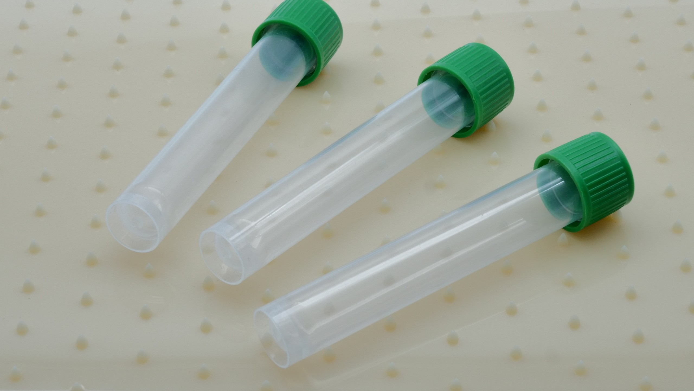

    <strong>Caractéristiques principales :</strong> Recommandée pour les composants cylindriques d'un diamètre supérieur à 15 mm.

    <table class="sphinx-styled-table">
        <thead>
            <tr>
                <th style="width: 30%;">Propriété</th>
                <th style="width: 70%;">Spécification / Niveau</th>
            </tr>
        </thead>
        <tbody>
            <tr>
                <td><strong>Matériau</strong></td>
                <td>Silicone - FDA</td>
            </tr>
            <tr>
                <td><strong>Filaments antistatiques</strong></td>
                <td>Oui</td>
            </tr>
            <tr>
                <td><strong>Diamètre des composants</strong></td>
                <td>14-35 mm</td>
            </tr>
            <tr>
                <td><strong>Backlight</strong></td>
                <td>
                    

                        

                        

                        

                    

                </td>
            </tr>
            <tr>
                <td><strong>Toplight</strong></td>
                <td>
                    

                        

                        

                        

                    

                </td>
            </tr>
            <tr>
                <td><strong>Cleaning</strong></td>
                <td>
                    

                        

                        

                        

                    

                </td>
            </tr>
            <tr>
                <td><strong>Grip</strong></td>
                <td>
                    

                        

                        

                        

                    

                </td>
            </tr>
        </tbody>
    </table>

#### Compatibilité des composants (Flexi Disc Anti-Roll Beige FDA)

    <table class="sphinx-styled-table">
        <thead>
            <tr>
                <th style="width: 30%;">Type de composant</th>
                <th style="width: 70%;">Compatibilité</th>
            </tr>
        </thead>
        <tbody>
            <tr>
                <td><strong>Dirty/Oily</strong></td>
                <td>
                    

                        

                        

                        

                    

                </td>
            </tr>
            <tr>
                <td><strong>Cylindrical</strong></td>
                <td>
                    

                        

                        

                        

                    

                </td>
            </tr>
            <tr>
                <td><strong>Sticky</strong></td>
                <td>
                    

                        

                        

                        

                    

                </td>
            </tr>
            <tr>
                <td><strong>Transparent</strong></td>
                <td>
                    

                        

                        

                        

                    

                </td>
            </tr>
            <tr>
                <td><strong>Sharp</strong></td>
                <td>
                    

                        

                        

                        

                    

                </td>
            </tr>
        </tbody>
    </table>

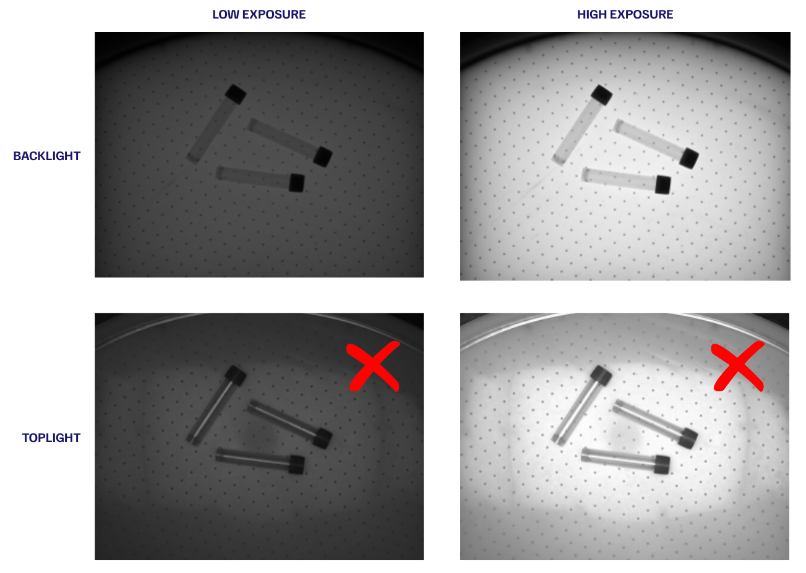

(anti-roll-14-35-spike-blue)=
### Flexi Disc Anti-Roll Blue FDA

:::{list-table}
:header-rows: 1
:widths: 20 80

* - **Taille**
  - **Code catalogue**
* - FlexiBowl® 500
  - Flexi Disc Anti-Roll Blue FDA 500
* - FlexiBowl® 650
  - Flexi Disc Anti-Roll Blue FDA 650
* - FlexiBowl® 800
  - Flexi Disc Anti-Roll Blue FDA 800
* - FlexiBowl® 1200
  - Flexi Disc Anti-Roll Blue FDA 1200
:::

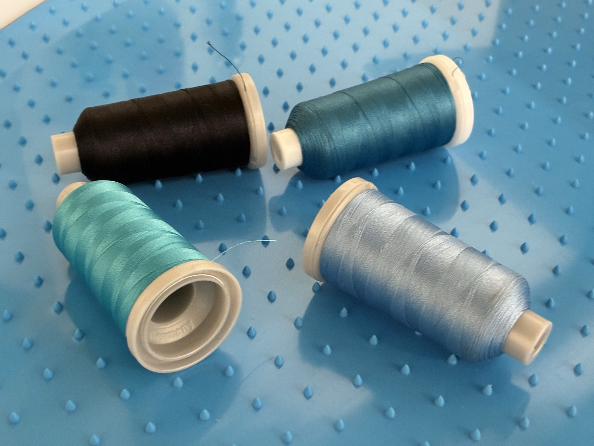

    <strong>Caractéristiques principales :</strong> Recommandée pour les composants cylindriques d'un diamètre supérieur à 15 mm.

    <table class="sphinx-styled-table">
        <thead>
            <tr>
                <th style="width: 30%;">Propriété</th>
                <th style="width: 70%;">Spécification / Niveau</th>
            </tr>
        </thead>
        <tbody>
            <tr>
                <td><strong>Matériau</strong></td>
                <td>Polyuréthane - FDA</td>
            </tr>
            <tr>
                <td><strong>Filaments antistatiques</strong></td>
                <td>Non</td>
            </tr>
            <tr>
                <td><strong>Diamètre des composants</strong></td>
                <td>14-35 mm</td>
            </tr>
            <tr>
                <td><strong>Backlight</strong></td>
                <td>
                    

                        

                        

                        

                    

                </td>
            </tr>
            <tr>
                <td><strong>Toplight</strong></td>
                <td>
                    

                        

                        

                        

                    

                </td>
            </tr>
            <tr>
                <td><strong>Cleaning</strong></td>
                <td>
                    

                        

                        

                        

                    

                </td>
            </tr>
            <tr>
                <td><strong>Grip</strong></td>
                <td>
                    

                        

                        

                        

                    

                </td>
            </tr>
        </tbody>
    </table>

#### Compatibilité des composants (Flexi Disc Anti-Roll Blue FDA)

    <table class="sphinx-styled-table">
        <thead>
            <tr>
                <th style="width: 30%;">Type de composant</th>
                <th style="width: 70%;">Compatibilité</th>
            </tr>
        </thead>
        <tbody>
            <tr>
                <td><strong>Dirty/Oily</strong></td>
                <td>
                    

                        

                        

                        

                    

                </td>
            </tr>
            <tr>
                <td><strong>Cylindrical</strong></td>
                <td>
                    

                        

                        

                        

                    

                </td>
            </tr>
            <tr>
                <td><strong>Sticky</strong></td>
                <td>
                    

                        

                        

                        

                    

                </td>
            </tr>
            <tr>
                <td><strong>Transparent</strong></td>
                <td>
                    

                        

                        

                        

                    

                </td>
            </tr>
            <tr>
                <td><strong>Sharp</strong></td>
                <td>
                    

                        

                        

                        

                    

                </td>
            </tr>
        </tbody>
    </table>

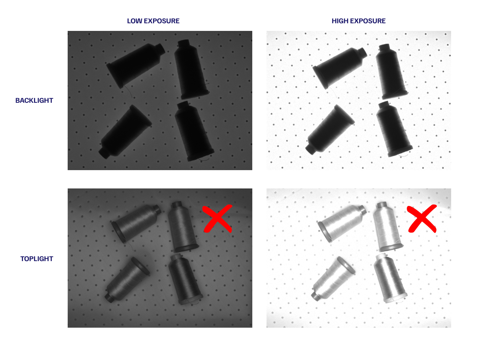

(anti-roll-silicone-white)=
### Flexi Disc Silicone White FDA

:::{list-table}
:header-rows: 1
:widths: 20 80

* - **Taille**
  - **Code catalogue**
* - FlexiBowl® 500
  - Flexi Disc Silicone White FDA 500
* - FlexiBowl® 650
  - Flexi Disc Silicone White FDA 650
* - FlexiBowl® 800
  - Flexi Disc Silicone White FDA 800
* - FlexiBowl® 1200
  - Flexi Disc Anti-Roll Silicone White FDA 1200
:::

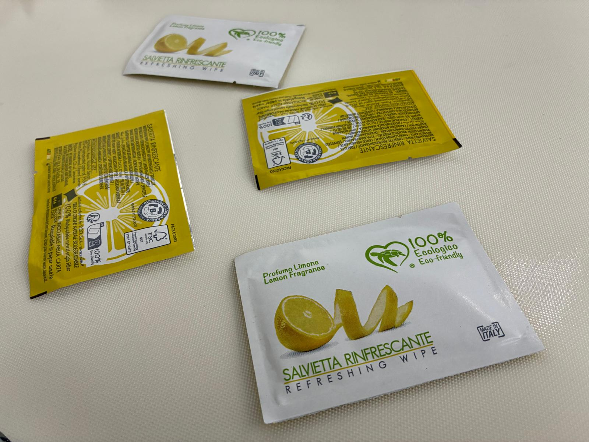

    <strong>Caractéristiques principales :</strong> Recommandée pour les pièces avec une large base d'appui (même si elles ne sont pas parfaitement stables) et pour les composants qui tendent à glisser les uns sur les autres.

    <table class="sphinx-styled-table">
        <thead>
            <tr>
                <th style="width: 30%;">Propriété</th>
                <th style="width: 70%;">Spécification / Niveau</th>
            </tr>
        </thead>
        <tbody>
            <tr>
                <td><strong>Matériau</strong></td>
                <td>Silicone - FDA</td>
            </tr>
            <tr>
                <td><strong>Filaments antistatiques</strong></td>
                <td>Oui</td>
            </tr>
            <tr>
                <td><strong>Backlight</strong></td>
                <td>
                    

                        

                        

                        

                    

                </td>
            </tr>
            <tr>
                <td><strong>Toplight</strong></td>
                <td>
                    

                        

                        

                        

                    

                </td>
            </tr>
            <tr>
                <td><strong>Cleaning</strong></td>
                <td>
                    

                        

                        

                        

                    

                </td>
            </tr>
            <tr>
                <td><strong>Grip</strong></td>
                <td>
                    

                        

                        

                        

                    

                </td>
            </tr>
        </tbody>
    </table>

#### Compatibilité des composants (Flexi Disc Silicone White FDA)

    <table class="sphinx-styled-table">
        <thead>
            <tr>
                <th style="width: 30%;">Type de composant</th>
                <th style="width: 70%;">Compatibilité</th>
            </tr>
        </thead>
        <tbody>
            <tr>
                <td><strong>Dirty/Oily</strong></td>
                <td>
                    

                        

                        

                        

                    

                </td>
            </tr>
            <tr>
                <td><strong>Cylindrical</strong></td>
                <td>
                    

                        

                        

                        

                    

                </td>
            </tr>
            <tr>
                <td><strong>Sticky</strong></td>
                <td>
                    

                        

                        

                        

                    

                </td>
            </tr>
            <tr>
                <td><strong>Transparent</strong></td>
                <td>
                    

                        

                        

                        

                    

                </td>
            </tr>
            <tr>
                <td><strong>Sharp</strong></td>
                <td>
                    

                        

                        

                        

                    

                </td>
            </tr>
        </tbody>
    </table>

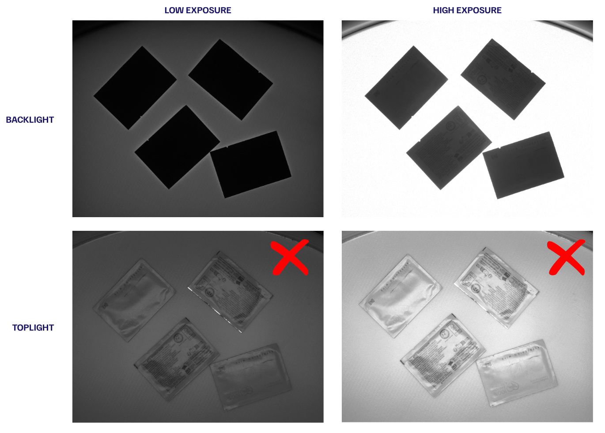

(anti-cut-grey)=
### Flexi Disc Anti-Cut FDA

:::{list-table}
:header-rows: 1
:widths: 20 80

* - **Taille**
  - **Code catalogue**
* - FlexiBowl® 500
  - Flexi Disc Anti-Cut FDA 500
* - FlexiBowl® 650
  - Flexi Disc Anti-Cut Transparent FDA 650
* - FlexiBowl® 800
  - Flexi Disc Anti-Cut FDA 800
* - FlexiBowl® 1200
  - Flexi Disc Anti-Cut FDA 1200
:::

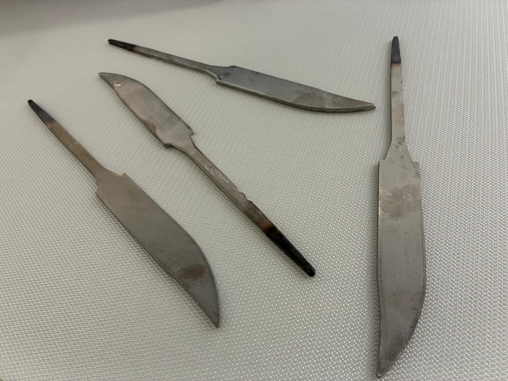

    <strong>Caractéristiques principales :</strong> Recommandée pour les composants tranchants ou à arêtes vives (sharp components).

    <table class="sphinx-styled-table">
        <thead>
            <tr>
                <th style="width: 30%;">Propriété</th>
                <th style="width: 70%;">Spécification / Niveau</th>
            </tr>
        </thead>
        <tbody>
            <tr>
                <td><strong>Matériau</strong></td>
                <td>Silicone - FDA</td>
            </tr>
            <tr>
                <td><strong>Filaments antistatiques</strong></td>
                <td>Oui</td>
            </tr>
            <tr>
                <td><strong>Backlight</strong></td>
                <td>
                    

                        

                        

                        

                    

                </td>
            </tr>
            <tr>
                <td><strong>Toplight</strong></td>
                <td>
                    

                        

                        

                        

                    

                </td>
            </tr>
            <tr>
                <td><strong>Cleaning</strong></td>
                <td>
                    

                        

                        

                        

                    

                </td>
            </tr>
            <tr>
                <td><strong>Grip</strong></td>
                <td>
                    

                        

                        

                        

                    

                </td>
            </tr>
        </tbody>
    </table>

#### Compatibilité des composants (Flexi Disc Anti-Cut FDA)

    <table class="sphinx-styled-table">
        <thead>
            <tr>
                <th style="width: 30%;">Type de composant</th>
                <th style="width: 70%;">Compatibilité</th>
            </tr>
        </thead>
        <tbody>
            <tr>
                <td><strong>Dirty/Oily</strong></td>
                <td>
                    

                        

                        

                        

                    

                </td>
            </tr>
            <tr>
                <td><strong>Cylindrical</strong></td>
                <td>
                    

                        

                        

                        

                    

                </td>
            </tr>
            <tr>
                <td><strong>Sticky</strong></td>
                <td>
                    

                        

                        

                        

                    

                </td>
            </tr>
            <tr>
                <td><strong>Transparent</strong></td>
                <td>
                    

                        

                        

                        

                    

                </td>
            </tr>
            <tr>
                <td><strong>Sharp</strong></td>
                <td>
                    

                        

                        

                        

                    

                </td>
            </tr>
        </tbody>
    </table>

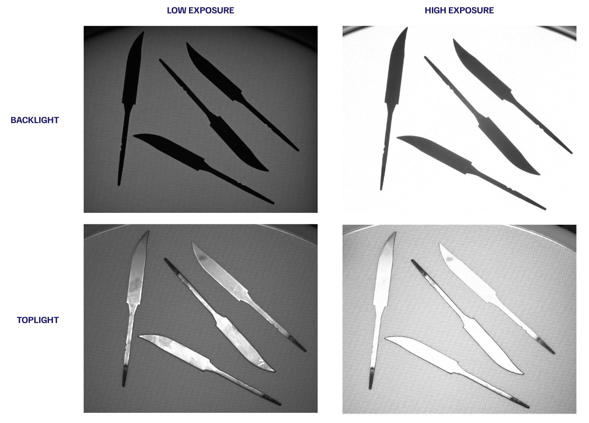

## **Surfaces personnalisées et accessoires**

(custom)=
### Custom Disc

<!-- TODO immagine:  -->

Le **Custom Disc** est une surface conçue sur mesure pour l’application spécifique du client, à partir de la géométrie du composant à alimenter, afin d’obtenir des orientations et des configurations de prélèvement difficiles à atteindre avec les surfaces standard. Le matériau et l’usinage sont définis avec le client.

Disponible pour **FlexiBowl® 500, 650 et 800**. Nécessite le [Lift Support for Custom Disc](lift-support).

(lift-support)=
### Lift Support for Custom Disc

<!-- TODO immagine:  -->

Le **Lift Support for Custom Disc** est le support nécessaire à l’utilisation du [Custom Disc](custom).

Disponible pour **FlexiBowl® 500, 650 et 800**.

## **Tableaux récapitulatifs des surfaces**

### Caractéristiques du disque

<table class="sphinx-styled-table summary">
  <thead><tr><th>Surface</th><th>FDA</th><th>Antistatic</th><th>Backlight</th><th>Toplight</th><th>Cleaning</th><th>Grip</th></tr></thead>
  <tbody>
    <tr><td>Flexi Disc Smooth White FDA</td><td>

</td><td>

</td><td>

</td><td>

</td><td>

</td><td>

</td></tr>
    <tr><td>Flexi Disc Smooth Blue FDA</td><td>

</td><td>

</td><td>

</td><td>

</td><td>

</td><td>

</td></tr>
    <tr><td>Flexi Disc Smooth Transparent FDA</td><td>

</td><td>

</td><td>

</td><td>

</td><td>

</td><td>

</td></tr>
    <tr><td>Flexi Disc Smooth Black</td><td>

</td><td>

</td><td>

</td><td>

</td><td>

</td><td>

</td></tr>
    <tr><td>Flexi Disc Anti-Stick Blue FDA</td><td>

</td><td>

</td><td>

</td><td>

</td><td>

</td><td>

</td></tr>
    <tr><td>Flexi Disc Anti-Roll Small White FDA</td><td>

</td><td>

</td><td>

</td><td>

</td><td>

</td><td>

</td></tr>
    <tr><td>Flexi Disc Anti-Roll Medium White FDA</td><td>

</td><td>

</td><td>

</td><td>

</td><td>

</td><td>

</td></tr>
    <tr><td>Flexi Disc Anti-Roll Transparent FDA</td><td>

</td><td>

</td><td>

</td><td>

</td><td>

</td><td>

</td></tr>
    <tr><td>Flexi Disc Anti-Roll Beige FDA</td><td>

</td><td>

</td><td>

</td><td>

</td><td>

</td><td>

</td></tr>
    <tr><td>Flexi Disc Anti-Roll Blue FDA</td><td>

</td><td>

</td><td>

</td><td>

</td><td>

</td><td>

</td></tr>
    <tr><td>Flexi Disc Silicone White FDA</td><td>

</td><td>

</td><td>

</td><td>

</td><td>

</td><td>

</td></tr>
    <tr><td>Flexi Disc Anti-Cut FDA</td><td>

</td><td>

</td><td>

</td><td>

</td><td>

</td><td>

</td></tr>
  </tbody>
</table>

### Caractéristiques des composants

<table class="sphinx-styled-table summary">
  <thead><tr><th>Surface</th><th>Dirty</th><th>Cyl. 1-5 mm</th><th>Cyl. 5-10 mm</th><th>Cyl. 10-20 mm</th><th>Cyl. &gt;20 mm</th><th>Sticky</th><th>Transparent</th><th>Sharp</th></tr></thead>
  <tbody>
    <tr><td>Flexi Disc Smooth White FDA</td><td>

</td><td>

</td><td>

</td><td>

</td><td>

</td><td>

</td><td>

</td><td>

</td></tr>
    <tr><td>Flexi Disc Smooth Blue FDA</td><td>

</td><td>

</td><td>

</td><td>

</td><td>

</td><td>

</td><td>

</td><td>

</td></tr>
    <tr><td>Flexi Disc Smooth Transparent FDA</td><td>

</td><td>

</td><td>

</td><td>

</td><td>

</td><td>

</td><td>

</td><td>

</td></tr>
    <tr><td>Flexi Disc Smooth Black</td><td>

</td><td>

</td><td>

</td><td>

</td><td>

</td><td>

</td><td>

</td><td>

</td></tr>
    <tr><td>Flexi Disc Anti-Stick Blue FDA</td><td>

</td><td>

</td><td>

</td><td>

</td><td>

</td><td>

</td><td>

</td><td>

</td></tr>
    <tr><td>Flexi Disc Anti-Roll Small White FDA</td><td>

</td><td>

</td><td>

</td><td>

</td><td>

</td><td>

</td><td>

</td><td>

</td></tr>
    <tr><td>Flexi Disc Anti-Roll Medium White FDA</td><td>

</td><td>

</td><td>

</td><td>

</td><td>

</td><td>

</td><td>

</td><td>

</td></tr>
    <tr><td>Flexi Disc Anti-Roll Transparent FDA</td><td>

</td><td>

</td><td>

</td><td>

</td><td>

</td><td>

</td><td>

</td><td>

</td></tr>
    <tr><td>Flexi Disc Anti-Roll Beige FDA</td><td>

</td><td>

</td><td>

</td><td>

</td><td>

</td><td>

</td><td>

</td><td>

</td></tr>
    <tr><td>Flexi Disc Anti-Roll Blue FDA</td><td>

</td><td>

</td><td>

</td><td>

</td><td>

</td><td>

</td><td>

</td><td>

</td></tr>
    <tr><td>Flexi Disc Silicone White FDA</td><td>

</td><td>

</td><td>

</td><td>

</td><td>

</td><td>

</td><td>

</td><td>

</td></tr>
    <tr><td>Flexi Disc Anti-Cut FDA</td><td>

</td><td>

</td><td>

</td><td>

</td><td>

</td><td>

</td><td>

</td><td>

</td></tr>
  </tbody>
</table>

