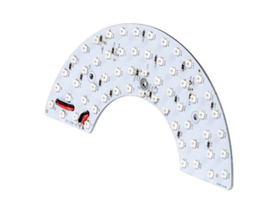
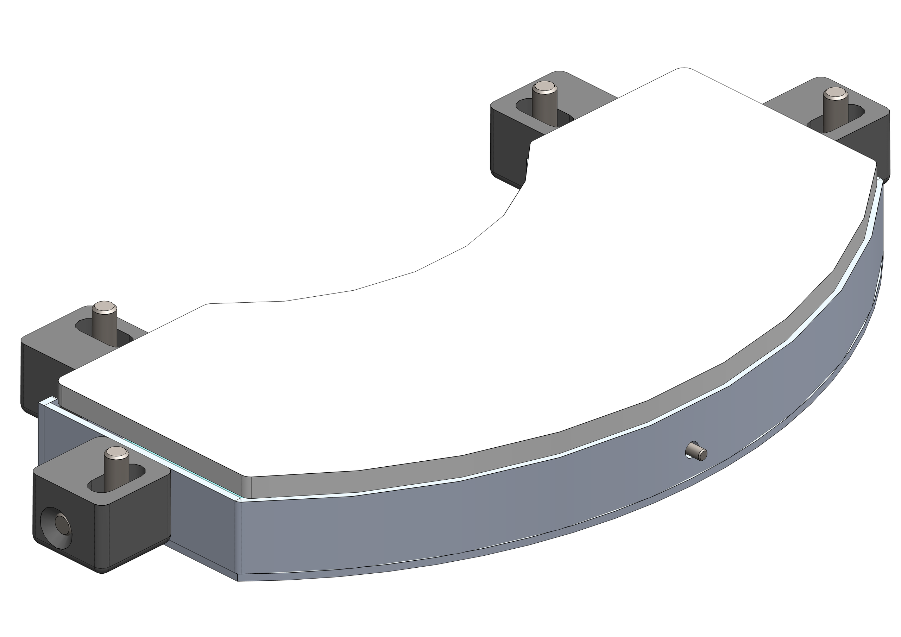
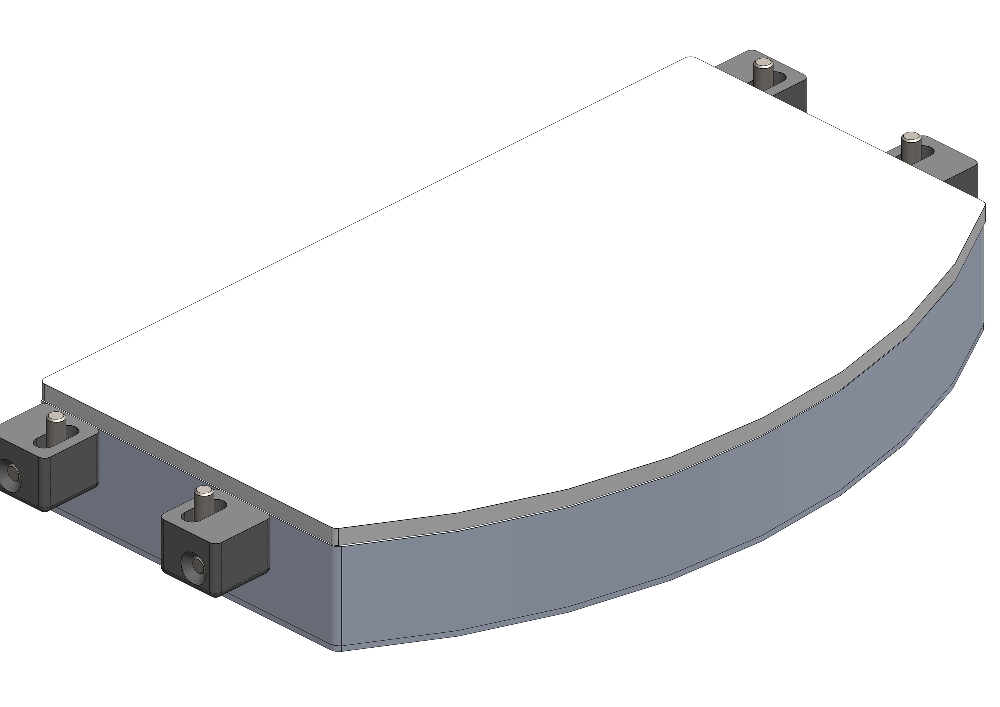
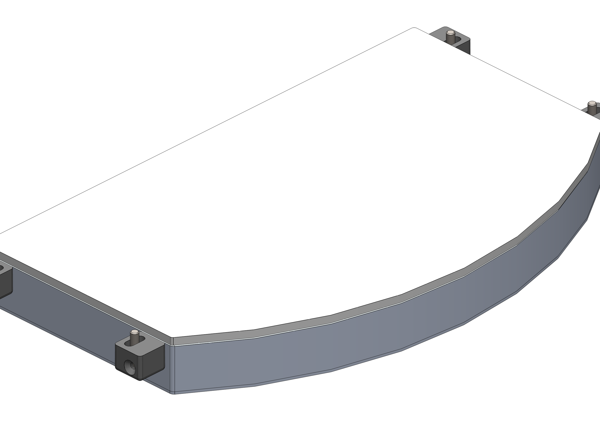
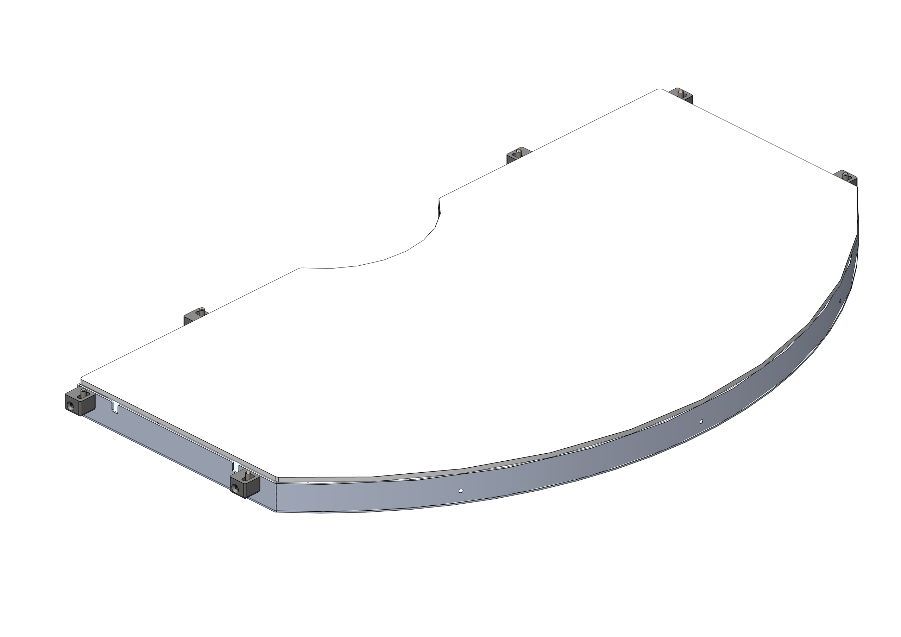
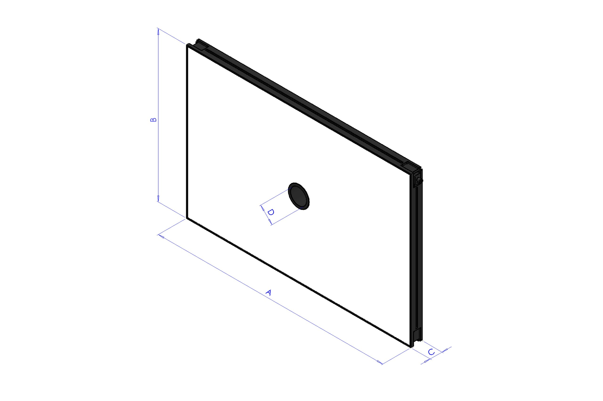
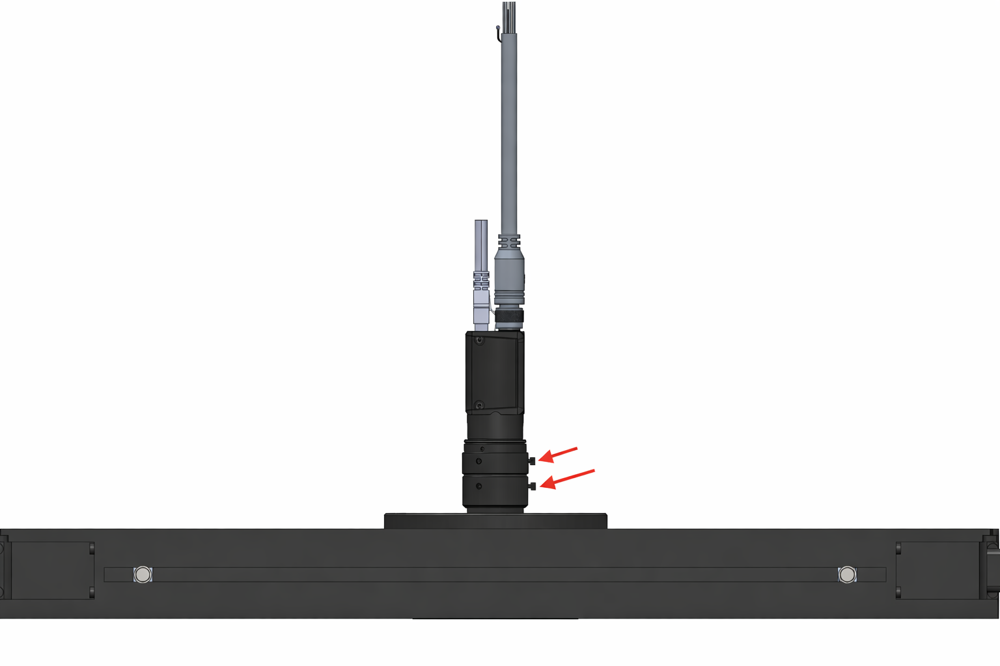
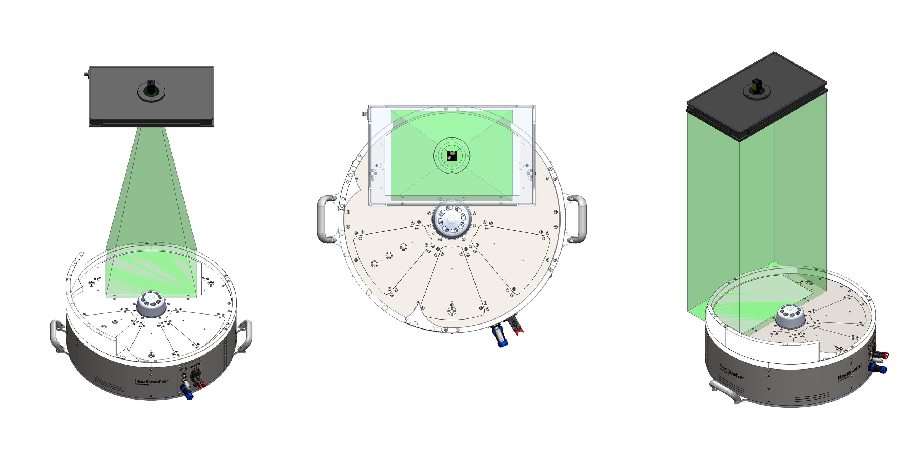
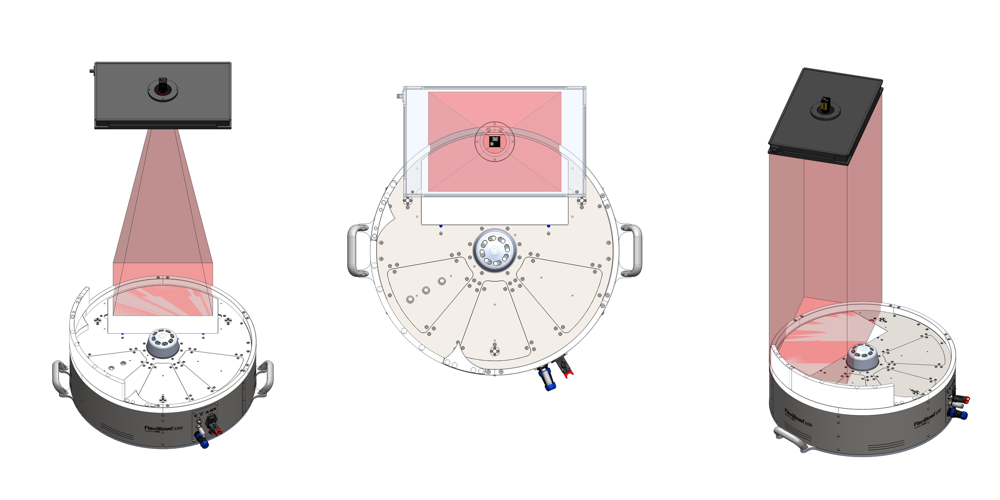
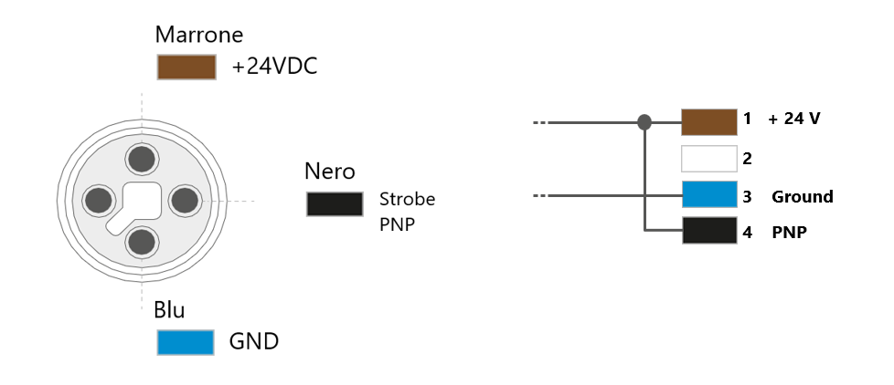

# **Éclairage**

(backlight)=
# **Backlight**

Le Backlight est une source lumineuse située sous la fenêtre en lexan du plan de glissement, de sorte que sa lumière puisse atteindre la surface ou le disque rigide et que la silhouette des composants situés au-dessus devienne visible pour le système de vision. Le Backlight est disponible avec les types de lumière suivants :
- Blanche
- Rouge
- Infrarouge

:::{important}
Le Backlight infrarouge émet une lumière invisible et peut donc sembler ne pas fonctionner. Pour vérifier son fonctionnement, utilisez une caméra équipée d'un filtre infrarouge. La plupart des smartphones affichent l'infrarouge.
:::

Il existe par ailleurs deux types de Backlight :
- Standard : il est alimenté en continu en interne et son allumage et son extinction peuvent être commandés par logiciel ou par E/S numériques ;
- Strobe : il est commandé de l'extérieur via l'entrée « strobe » du connecteur d'entrée. Il incombe au client de fournir l'alimentation 24 Vdc appropriée pour l'allumer.

## Caractéristiques des Backlight

```{dropdown} Backlight pour FB200



| Articles | CE001136 | CE001132 | CE001134 |
|--|--|--|--|
| Couleur des LED | rouge | infrarouge | blanc |
| Longueur d'onde | 630 nm | 850 nm | N/D |
| Tension | 24VDC | 24VDC | 24VDC |
| Courant | 0.17A | 0.12A | 0.17A |
| Zone d'éclairage | 155x75 mm^2 |  |  |
| Matériau de la structure | Alliage d'aluminium |  |  |
| Température de fonctionnement | -40 / +85 °C |  |  |
| Longueur du câble | 0.2 m |  |  |
| Mode de refroidissement | Air naturel |  |  |
| Matériau opalin | Verre 3+3 avec plastique blanc laiteux |  |  |
```

```{dropdown} Backlight pour FB350



| Articles | CE001142 | CE001139 | CE001140 |
|--|--|--|--|
| Couleur des LED | rouge | infrarouge | blanc |
| Longueur d'onde | 630 nm | 850 nm | N/D |
| Tension | 24VDC | 24VDC | 24VDC |
| Courant | 0.18A | 0.13A | 0.18A |
| Zone d'éclairage | 220x100 mm^2 |  |  |
| Matériau de la structure | Alliage d'aluminium |  |  |
| Température de fonctionnement | -40 / +85 °C |  |  |
| Longueur du câble | 0.2 m |  |  |
| Mode de refroidissement | Air naturel |  |  |
| Matériau opalin | Verre 3+3 avec plastique blanc laiteux |  |  |
```

```{dropdown} Backlight pour FB500



| Articles | CE001148 | CE001144 | CE001146 |
|--|--|--|--|
| Couleur des LED | rouge | infrarouge | blanc |
| Longueur d'onde | 630 nm | 850 nm | N/D |
| Tension | 24VDC | 24VDC | 24VDC |
| Courant | 0.46A | 0.31A | 0.46A |
| Zone d'éclairage | 330x170 mm^2 |  |  |
| Matériau de la structure | Alliage d'aluminium |  |  |
| Température de fonctionnement | -40 / +85 °C |  |  |
| Longueur du câble | 0.2 m |  |  |
| Mode de refroidissement | Air naturel |  |  |
| Matériau opalin | Verre 3+3 avec plastique blanc laiteux |  |  |
```

```{dropdown} Backlight pour FB650



| Articles | CE000306 | CE000273 | CE000305 |
|--|--|--|--|
| Articles alternatifs | GM000591 | GM000592 | GM000590 |
| Couleur des LED | rouge | infrarouge | blanc |
| Longueur d'onde | 630 nm | 850 nm | N/D |
| Tension | 24VDC | 24VDC | 24VDC |
| Courant | 0.86A | 0.56A | 0.94A |
| Zone d'éclairage | 400x240 mm^2 |  |  |
| Matériau de la structure | Alliage d'aluminium |  |  |
| Température de fonctionnement | -40 / +85 °C |  |  |
| Longueur du câble | 0.2 m |  |  |
| Mode de refroidissement | Air naturel |  |  |
| Matériau opalin | Verre 3+3 avec plastique blanc laiteux |  |  |
```

```{dropdown} Backlight pour FB800


| Articles | CE001154 | CE001150 | CE001152 |
|--|--|--|--|
| Couleur des LED | rouge | infrarouge | blanc |
| Longueur d'onde | 630 nm | 850 nm | N/D |
| Tension | 24VDC | 24VDC | 24VDC |
| Courant | 1.15A | 0.76A | 1.2A |
| Zone d'éclairage | 400x315 mm^2 |  |  |
| Matériau de la structure | Alliage d'aluminium |  |  |
| Température de fonctionnement | -40 / +85 °C |  |  |
| Longueur du câble | 0.2 m |  |  |
| Mode de refroidissement | Air naturel |  |  |
| Matériau opalin | Verre 3+3 avec plastique blanc laiteux |  |  |
```

```{dropdown} Backlight pour FB1200



| Articles | GE000051 | GE000052 | GE000050 |
|--|--|--|--|
| Couleur des LED | rouge | infrarouge | blanc |
| Longueur d'onde | 630 nm | 850 nm | N/D |
| Tension | 24VDC | 24VDC | 24VDC |
| Courant | 4A | 2.6A | 4.2A |
| Zone d'éclairage | 917x525 mm^2 |  |  |
| Matériau de la structure | Alliage d'aluminium |  |  |
| Température de fonctionnement | -40 / +85 °C |  |  |
| Longueur du câble | 0.2 m |  |  |
| Mode de refroidissement | Air naturel |  |  |
| Matériau opalin | Verre 3+3 avec plastique blanc laiteux |  |  |
```

## Couleurs des Backlight

:::{list-table}
:widths: 15 15 70
:header-rows: 1

* - Couleur
  - Longueur d'onde
  - Utilisation recommandée

* - Red
  - 630 nm
  - Utilisé pour les composants métalliques spéciaux. Longueur d'onde : 630 nm. La cellule doit être protégée de toute source de lumière externe et de la lumière du soleil.

* - IR
  - 850 nm
  - Préféré pour la plupart des types d'applications. Non visible à l'œil humain. Longueur d'onde : 850 nm. Il est recommandé de protéger la cellule afin d'éviter les interférences avec la lumière du soleil.

* - White
  - N/D
  - Utilisé avec les composants transparents. La cellule doit être protégée de toute source de lumière externe et de la lumière du soleil.

:::


(toplight)=
# **Toplight**

Le Toplight est un illuminateur séparé, monté à la hauteur de la caméra, qui éclaire par le dessus la zone de vision du FlexiBowl® afin de mettre en évidence les caractéristiques du composant tournées vers la caméra. Il est principalement indiqué pour les surfaces lisses et non réfléchissantes, ou pour les surfaces présentant un marquage distinctif. Le Toplight est disponible avec les types de lumière suivants :
- Blanche
- Rouge
- Infrarouge

:::{important}
Le Toplight infrarouge émet une lumière invisible et peut donc sembler ne pas fonctionner. Pour vérifier son fonctionnement, utilisez une caméra équipée d'un filtre infrarouge. La plupart des smartphones affichent l'infrarouge.
:::

## Caractéristiques des Toplight

```{dropdown} TopLight 500x300 - White
Cette taille de Toplight est indiquée pour les modèles : FlexiBowl® 200, FlexiBowl® 350, FlexiBowl® 500

 
| Longueur | Largeur | Hauteur | Hauteur avec plaque de fixation | Diamètre du trou central | Surface utile max. [AxB] | Périmètre utile max. |
|--|--|--|--|--|--|--|
| **A** | **B** | **C** | **C + 10mm** | **D** | - | - |
| 500 | 300 | 45 | 55 | 65 | 0.15 m^2 | 1.6 m |
 
:::{list-table}
:widths: 35 65
:header-rows: 0
 
* - **Code**
  - CM002316
 
* - **Électronique**
  -
 
* - Alimentation
  - 24 VDC ±10%
 
* - Mode de commande
  - Continu
 
* - Temps de montée maximal
  - 15 µs
 
* - Temps de descente maximal
  - 10 µs
 
* - Commande
  - [Connettore M12](cablaggio_illuminatore)
 
* - Configuration des broches du connecteur
  - 1: 24VDC / 3: GND / 4: PNP
 
* - Consommation
  - 96.6W
 
* - Tension de fonctionnement minimale
  - 20 V sur l'entrée lumière
 
* - Tension de fonctionnement nominale
  - 24 V sur l'entrée lumière (±10 %)
 
* - Tension de fonctionnement maximale
  - 30 V sur l'entrée lumière
 
* - Longueur d'onde
  -
 
* - Groupe de risque
  - 0 (aucun risque)
 
* - **Mécanique**
  -
 
* - Épaisseur
  - 45 mm + 10 mm avec plaque de fixation
 
* - Diamètre intérieur
  - 65mm
 
* - Poids
  - 23.8 Kg/m² ±15%
 
* - Matériaux
  - Aluminium et ABS chargé
 
* - Diffuseur
  - PMMA blanc
 
* - Fixation
  - 4 écrous M4 (fournis) à insérer dans la rainure ou 4 vis M4x20 (non fournies) appliquées dans les angles
 
* - **Environnement**
  -
 
* - Température de fonctionnement
  - -10 °C à +40 °C / 80 % d'humidité sans condensation. Aucun choc thermique (variation maximale : 10 °C en 24 h)
 
* - Température de stockage
  - -20 °C à +60 °C / 80 % d'humidité sans condensation. Aucun choc thermique (variation maximale : 10 °C en 24 h)
 
* - Indice de protection IP
  - IP 50
 
* - Marquages
  - RoHS-CE-DEEE, UL
:::
 
```
```{dropdown} TopLight 500x300 - Red  
Cette taille de Toplight est indiquée pour les modèles : FlexiBowl® 200, FlexiBowl® 350, FlexiBowl® 500

 
| Longueur | Largeur | Hauteur | Hauteur avec plaque de fixation | Diamètre du trou central | Surface utile max. [AxB] | Périmètre utile max. |
|--|--|--|--|--|--|--|
| **A** | **B** | **C** | **C + 10mm** | **D** | - | - |
| 500 | 300 | 45 | 55 | 65 | 0.15 m^2 | 1.6 m |
 
:::{list-table}
:widths: 35 65
:header-rows: 0
 
* - **Code**
  - CM002401
 
* - **Électronique**
  -
 
* - Alimentation
  - 24 VDC ±10%
 
* - Mode de commande
  - Continu
 
* - Temps de montée maximal
  - 15 µs
 
* - Temps de descente maximal
  - 10 µs
 
* - Commande
  - [Connettore M12](cablaggio_illuminatore)
 
* - Configuration des broches du connecteur
  - 1: 24VDC / 3: GND / 4: PNP
 
* - Consommation
  - 96.6W @24 Vdc
 
* - Tension de fonctionnement minimale
  - 20 V sur l'entrée lumière
 
* - Tension de fonctionnement nominale
  - 24 V sur l'entrée lumière (±10 %)
 
* - Tension de fonctionnement maximale
  - 30 V sur l'entrée lumière
 
* - Longueur d'onde
  - 630 nm
 
* - Groupe de risque
  - 0 (aucun risque)
 
 
* - **Mécanique**
  -
 
* - Épaisseur
  - 45 mm + 10 mm avec plaque de fixation
 
* - Diamètre intérieur
  - 65mm
 
* - Poids
  - 23.8 Kg/m² ±15%
 
* - Matériaux
  - Aluminium et ABS chargé
 
* - Diffuseur
  - PMMA blanc
 
* - Fixation
  - 4 écrous M4 (fournis) à insérer dans la rainure ou 4 vis M4x20 (non fournies) appliquées dans les angles
 
* - **Environnement**
  -
 
* - Température de fonctionnement
  - -10 °C à +40 °C / 80 % d'humidité sans condensation. Aucun choc thermique (variation maximale : 10 °C en 24 h)
 
* - Température de stockage
  - -20 °C à +60 °C / 80 % d'humidité sans condensation. Aucun choc thermique (variation maximale : 10 °C en 24 h)
 
* - Indice de protection IP
  - IP 50
 
* - Marquages
  - RoHS-CE-DEEE, UL
:::
 
```
 
```{dropdown} TopLight 500x300 - Infrared
Cette taille de Toplight est indiquée pour les modèles : FlexiBowl® 200, FlexiBowl® 350, FlexiBowl® 500

 
| Longueur | Largeur | Hauteur | Hauteur avec plaque de fixation | Diamètre du trou central | Surface utile max. [AxB] | Périmètre utile max. |
|--|--|--|--|--|--|--|
| **A** | **B** | **C** | **C + 10mm** | **D** | - | - |
| 500 | 300 | 45 | 55 | 65 | 0.15 m^2 | 1.6 m |
 
:::{list-table}
:widths: 35 65
:header-rows: 0
 
* - **Code**
  - CM002405
 
* - **Électronique**
  -
 
* - Alimentation
  - 24 VDC ±10%
 
* - Mode de commande
  - Continu
 
* - Temps de montée maximal
  - 15 µs
 
* - Temps de descente maximal
  - 10 µs
 
* - Commande
  - [Connettore M12](cablaggio_illuminatore)
 
* - Configuration des broches du connecteur
  - 1: 24VDC / 3: GND / 4: PNP
 
* - Consommation
  - 96.6W @24 Vdc
 
* - Tension de fonctionnement minimale
  - 20 V sur l'entrée lumière
 
* - Tension de fonctionnement nominale
  - 24 V sur l'entrée lumière (±10 %)
 
* - Tension de fonctionnement maximale
  - 30 V sur l'entrée lumière
 
* - Longueur d'onde
  - 850 nm
 
* - Groupe de risque
  - 1 (risque faible)
 
* - **Mécanique**
  -
 
* - Épaisseur
  - 45 mm + 10 mm avec plaque de fixation
 
* - Diamètre intérieur
  - 65mm
 
* - Poids
  - 23.8 Kg/m² ±15%
 
* - Matériaux
  - Aluminium et ABS chargé
 
* - Diffuseur
  - PMMA blanc
 
* - Fixation
  - 4 écrous M4 (fournis) à insérer dans la rainure ou 4 vis M4x20 (non fournies) appliquées dans les angles
 
* - **Environnement**
  -
 
* - Température de fonctionnement
  - -10 °C à +40 °C / 80 % d'humidité sans condensation. Aucun choc thermique (variation maximale : 10 °C en 24 h)
 
* - Température de stockage
  - -20 °C à +60 °C / 80 % d'humidité sans condensation. Aucun choc thermique (variation maximale : 10 °C en 24 h)
 
* - Indice de protection IP
  - IP 50
 
* - Marquages
  - RoHS-CE-DEEE, UL
:::
 
```
 
```{dropdown} TopLight 700x300 - White
Cette taille de Toplight est indiquée pour les modèles : FlexiBowl® 650, FlexiBowl® 800

 
| Longueur | Largeur | Hauteur | Hauteur avec plaque de fixation | Diamètre du trou central | Surface utile max. [AxB] | Périmètre utile max. |
|--|--|--|--|--|--|--|
| **A** | **B** | **C** | **C + 10mm** | **D** | - | - |
| 700 | 300 | 45 | 55 | 65 | 0.21 m^2 | 2 m |
 
:::{list-table}
:widths: 35 65
:header-rows: 0
 
* - **Code**
  - CM002317
 
* - **Électronique**
  -
 
* - Alimentation
  - 24 VDC ±10%
 
* - Mode de commande
  - Continu
 
* - Temps de montée maximal
  - 15 µs
 
* - Temps de descente maximal
  - 10 µs
 
* - Commande
  - [Connettore M12](cablaggio_illuminatore)
 
* - Configuration des broches du connecteur
  - 1: 24VDC / 3: GND / 4: PNP
 
* - Consommation
  - 135.6W @24 Vdc
 
* - Tension de fonctionnement minimale
  - 20 V sur l'entrée lumière
 
* - Tension de fonctionnement nominale
  - 24 V sur l'entrée lumière (±10 %)
 
* - Tension de fonctionnement maximale
  - 30 V sur l'entrée lumière
 
* - Longueur d'onde
  -
 
* - Groupe de risque
  - 0 (aucun risque)
 
* - **Mécanique**
  -
 
* - Épaisseur
  - 45 mm + 10 mm avec plaque de fixation
 
* - Diamètre intérieur
  - 65mm
 
* - Poids
  - 23.8 Kg/m² ±15%
 
* - Matériaux
  - Aluminium et ABS chargé
 
* - Diffuseur
  - PMMA blanc
 
* - Fixation
  - 4 écrous M4 (fournis) à insérer dans la rainure ou 4 vis M4x20 (non fournies) appliquées dans les angles
 
* - **Environnement**
  -
 
* - Température de fonctionnement
  - -10 °C à +40 °C / 80 % d'humidité sans condensation. Aucun choc thermique (variation maximale : 10 °C en 24 h)
 
* - Température de stockage
  - -20 °C à +60 °C / 80 % d'humidité sans condensation. Aucun choc thermique (variation maximale : 10 °C en 24 h)
 
* - Indice de protection IP
  - IP 50
 
* - Marquages
  - RoHS-CE-DEEE, UL
:::
```
 
```{dropdown} TopLight 700x300 - Red
Cette taille de Toplight est indiquée pour les modèles : FlexiBowl® 650, FlexiBowl® 800

 
| Longueur | Largeur | Hauteur | Hauteur avec plaque de fixation | Diamètre du trou central | Surface utile max. [AxB] | Périmètre utile max. |
|--|--|--|--|--|--|--|
| **A** | **B** | **C** | **C + 10mm** | **D** | - | - |
| 700 | 300 | 45 | 55 | 65 | 0.21 m^2 | 2 m |
 
:::{list-table}
:widths: 35 65
:header-rows: 0
 
 * - **Code**
   - CM002402
 
* - **Électronique**
  -
 
* - Alimentation
  - 24 VDC ±10%
 
* - Mode de commande
  - Continu
 
* - Temps de montée maximal
  - 15 µs
 
* - Temps de descente maximal
  - 10 µs
 
* - Commande
  - [Connettore M12](cablaggio_illuminatore)
 
* - Configuration des broches du connecteur
  - 1: 24VDC / 3: GND / 4: PNP
 
* - Consommation
  - 135.6W @24 Vdc
 
* - Tension de fonctionnement minimale
  - 20 V sur l'entrée lumière
 
* - Tension de fonctionnement nominale
  - 24 V sur l'entrée lumière (±10 %)
 
* - Tension de fonctionnement maximale
  - 30 V sur l'entrée lumière
 
* - Longueur d'onde
  - 630 nm
 
* - Groupe de risque
  - 0 (aucun risque)
 
* - **Mécanique**
  -
 
* - Épaisseur
  - 45 mm + 10 mm avec plaque de fixation
 
* - Diamètre intérieur
  - 65mm
 
* - Poids
  - 23.8 Kg/m² ±15%
 
* - Matériaux
  - Aluminium et ABS chargé
 
* - Diffuseur
  - PMMA blanc
 
* - Fixation
  - 4 écrous M4 (fournis) à insérer dans la rainure ou 4 vis M4x20 (non fournies) appliquées dans les angles
 
* - **Environnement**
  -
 
* - Température de fonctionnement
  - -10 °C à +40 °C / 80 % d'humidité sans condensation. Aucun choc thermique (variation maximale : 10 °C en 24 h)
 
* - Température de stockage
  - -20 °C à +60 °C / 80 % d'humidité sans condensation. Aucun choc thermique (variation maximale : 10 °C en 24 h)
 
* - Indice de protection IP
  - IP 50
 
* - Marquages
  - RoHS-CE-DEEE, UL
:::
```
 
```{dropdown} TopLight 700x300 - Infrared
Cette taille de Toplight est indiquée pour les modèles : FlexiBowl® 650, FlexiBowl® 800

 
| Longueur | Largeur | Hauteur | Hauteur avec plaque de fixation | Diamètre du trou central | Surface utile max. [AxB] | Périmètre utile max. |
|--|--|--|--|--|--|--|
| **A** | **B** | **C** | **C + 10mm** | **D** | - | - |
| 700 | 300 | 45 | 55 | 65 | 0.21 m^2 | 2 m |
 
:::{list-table}
:widths: 35 65
:header-rows: 0
 
* - **Code**
  - CM002406
 
* - **Électronique**
  -
 
* - Alimentation
  - 24 VDC ±10%
 
* - Mode de commande
  - Continu
 
* - Temps de montée maximal
  - 15 µs
 
* - Temps de descente maximal
  - 10 µs
 
* - Commande
  - [Connettore M12](cablaggio_illuminatore)
 
* - Configuration des broches du connecteur
  - 1: 24VDC / 3: GND / 4: PNP
 
* - Consommation
  - 135.6W @24 Vdc
 
* - Tension de fonctionnement minimale
  - 20 V sur l'entrée lumière
 
* - Tension de fonctionnement nominale
  - 24 V sur l'entrée lumière (±10 %)
 
* - Tension de fonctionnement maximale
  - 30 V sur l'entrée lumière
 
* - Longueur d'onde
  - 850 nm
 
* - Groupe de risque
  - 1 (risque faible)
 
* - **Mécanique**
  -
 
* - Épaisseur
  - 45 mm + 10 mm avec plaque de fixation
 
* - Diamètre intérieur
  - 65mm
 
* - Poids
  - 23.8 Kg/m² ±15%
 
* - Matériaux
  - Aluminium et ABS chargé
 
* - Diffuseur
  - PMMA blanc
 
* - Fixation
  - 4 écrous M4 (fournis) à insérer dans la rainure ou 4 vis M4x20 (non fournies) appliquées dans les angles
 
* - **Environnement**
  -
 
* - Température de fonctionnement
  - -10 °C à +40 °C / 80 % d'humidité sans condensation. Aucun choc thermique (variation maximale : 10 °C en 24 h)
 
* - Température de stockage
  - -20 °C à +60 °C / 80 % d'humidité sans condensation. Aucun choc thermique (variation maximale : 10 °C en 24 h)
 
* - Indice de protection IP
  - IP 50
 
* - Marquages
  - RoHS-CE-DEEE, UL
:::
```
 
```{dropdown} TopLight 700x500 - White
Cette taille de Toplight est indiquée pour les modèles : FlexiBowl® 650, FlexiBowl® 800

 
| Longueur | Largeur | Hauteur | Hauteur avec plaque de fixation | Diamètre du trou central | Surface utile max. [AxB] | Périmètre utile max. |
|--|--|--|--|--|--|--|
| **A** | **B** | **C** | **C + 10mm** | **D** | - | - |
| 700 | 500 | 45 | 55 | 65 | 0.35 m^2 | 2.4 m |
 
:::{list-table}
:widths: 35 65
:header-rows: 0
 
* - **Code**
  - CM002318
 
* - **Électronique**
  -
 
* - Alimentation
  - 24 VDC ±10%
 
* - Mode de commande
  - Continu
 
* - Temps de montée maximal
  - 15 µs
 
* - Temps de descente maximal
  - 10 µs
 
* - Commande
  - [Connettore M12](cablaggio_illuminatore)
 
* - Configuration des broches du connecteur
  - 1: 24VDC / 3: GND / 4: PNP
 
* - Consommation
  - 252.6W @24 Vdc
 
* - Tension de fonctionnement minimale
  - 20 V sur l'entrée lumière
 
* - Tension de fonctionnement nominale
  - 24 V sur l'entrée lumière (±10 %)
 
* - Tension de fonctionnement maximale
  - 30 V sur l'entrée lumière
 
* - Longueur d'onde
  -
 
* - Groupe de risque
  - 0 (aucun risque)
 
* - **Mécanique**
  -
 
* - Épaisseur
  - 45 mm + 10 mm avec plaque de fixation
 
* - Diamètre intérieur
  - 65mm
 
* - Poids
  - 23.8 Kg/m² ±15%
 
* - Matériaux
  - Aluminium et ABS chargé
 
* - Diffuseur
  - PMMA blanc
 
* - Fixation
  - 4 écrous M4 (fournis) à insérer dans la rainure ou 4 vis M4x20 (non fournies) appliquées dans les angles
 
* - **Environnement**
  -
 
* - Température de fonctionnement
  - -10 °C à +40 °C / 80 % d'humidité sans condensation. Aucun choc thermique (variation maximale : 10 °C en 24 h)
 
* - Température de stockage
  - -20 °C à +60 °C / 80 % d'humidité sans condensation. Aucun choc thermique (variation maximale : 10 °C en 24 h)
 
* - Indice de protection IP
  - IP 50
 
* - Marquages
  - RoHS-CE-DEEE, UL
:::
```
 
```{dropdown} TopLight 700x500 - Red
Cette taille de Toplight est indiquée pour les modèles : FlexiBowl® 650, FlexiBowl® 800

 
| Longueur | Largeur | Hauteur | Hauteur avec plaque de fixation | Diamètre du trou central | Surface utile max. [AxB] | Périmètre utile max. |
|--|--|--|--|--|--|--|
| **A** | **B** | **C** | **C + 10mm** | **D** | - | - |
| 700 | 500 | 45 | 55 | 65 | 0.35 m^2 | 2.4 m |
 
:::{list-table}
:widths: 35 65
:header-rows: 0
 
* - **Code**
  - CM002403
 
* - **Électronique**
  -
 
* - Alimentation
  - 24 VDC ±10%
 
* - Mode de commande
  - Continu
 
* - Temps de montée maximal
  - 15 µs
 
* - Temps de descente maximal
  - 10 µs
 
* - Commande
  - [Connettore M12](cablaggio_illuminatore)
 
* - Configuration des broches du connecteur
  - 1: 24VDC / 3: GND / 4: PNP
 
* - Consommation
  - 252.6W @24 Vdc
 
* - Tension de fonctionnement minimale
  - 20 V sur l'entrée lumière
 
* - Tension de fonctionnement nominale
  - 24 V sur l'entrée lumière (±10 %)
 
* - Tension de fonctionnement maximale
  - 30 V sur l'entrée lumière
 
* - Longueur d'onde
  - 630 nm
 
* - Groupe de risque
  - 0 (aucun risque)
 
* - **Mécanique**
  -
 
* - Épaisseur
  - 45 mm + 10 mm avec plaque de fixation
 
* - Diamètre intérieur
  - 65mm
 
* - Poids
  - 23.8 Kg/m² ±15%
 
* - Matériaux
  - Aluminium et ABS chargé
 
* - Diffuseur
  - PMMA blanc
 
* - Fixation
  - 4 écrous M4 (fournis) à insérer dans la rainure ou 4 vis M4x20 (non fournies) appliquées dans les angles
 
* - **Environnement**
  -
 
* - Température de fonctionnement
  - -10 °C à +40 °C / 80 % d'humidité sans condensation. Aucun choc thermique (variation maximale : 10 °C en 24 h)
 
* - Température de stockage
  - -20 °C à +60 °C / 80 % d'humidité sans condensation. Aucun choc thermique (variation maximale : 10 °C en 24 h)
 
* - Indice de protection IP
  - IP 50
 
* - Marquages
  - RoHS-CE-DEEE, UL
:::
```
 
```{dropdown} TopLight 700x500 - Infrared
Cette taille de Toplight est indiquée pour les modèles : FlexiBowl® 650, FlexiBowl® 800

 
| Longueur | Largeur | Hauteur | Hauteur avec plaque de fixation | Diamètre du trou central | Surface utile max. [AxB] | Périmètre utile max. |
|--|--|--|--|--|--|--|
| **A** | **B** | **C** | **C + 10mm** | **D** | - | - |
| 700 | 500 | 45 | 55 | 65 | 0.35 m^2 | 2.4 m |
 
:::{list-table}
:widths: 35 65
:header-rows: 0
 
* - **Code**
  - CM002407
 
* - **Électronique**
  -
 
* - Alimentation
  - 24 VDC ±10%
 
* - Mode de commande
  - Continu
 
* - Temps de montée maximal
  - 15 µs
 
* - Temps de descente maximal
  - 10 µs
 
* - Commande
  - [Connettore M12](cablaggio_illuminatore)
 
* - Configuration des broches du connecteur
  - 1: 24VDC / 3: GND / 4: PNP
 
* - Consommation
  - 252.6W @24 Vdc
 
* - Tension de fonctionnement minimale
  - 20 V sur l'entrée lumière
 
* - Tension de fonctionnement nominale
  - 24 V sur l'entrée lumière (±10 %)
 
* - Tension de fonctionnement maximale
  - 30 V sur l'entrée lumière
 
* - Longueur d'onde
  - 850 nm
 
* - Groupe de risque
  - 1 (risque faible)
 
* - **Mécanique**
  -
 
* - Épaisseur
  - 45 mm + 10 mm avec plaque de fixation
 
* - Diamètre intérieur
  - 65mm
 
* - Poids
  - 23.8 Kg/m² ±15%
 
* - Matériaux
  - Aluminium et ABS chargé
 
* - Diffuseur
  - PMMA blanc
 
* - Fixation
  - 4 écrous M4 (fournis) à insérer dans la rainure ou 4 vis M4x20 (non fournies) appliquées dans les angles
 
* - **Environnement**
  -
 
* - Température de fonctionnement
  - -10 °C à +40 °C / 80 % d'humidité sans condensation. Aucun choc thermique (variation maximale : 10 °C en 24 h)
 
* - Température de stockage
  - -20 °C à +60 °C / 80 % d'humidité sans condensation. Aucun choc thermique (variation maximale : 10 °C en 24 h)
 
* - Indice de protection IP
  - IP 50
 
* - Marquages
  - RoHS-CE-DEEE, UL
:::
```
 
```{dropdown} TopLight 900x600 - White
Cette taille de Toplight est indiquée pour les modèles FlexiBowl® 1200

 
| Longueur | Largeur | Hauteur | Hauteur avec plaque de fixation | Diamètre du trou central | Surface utile max. [AxB] | Périmètre utile max. |
|--|--|--|--|--|--|--|
| **A** | **B** | **C** | **C + 10mm** | **D** | - | - |
| 900 | 600 | 45 | 55 | 65 | 0.54 m^2 | 3 m |
 
:::{list-table}
:widths: 35 65
:header-rows: 0
 
* - **Code**
  - CM002319
 
* - **Électronique**
  -
 
* - Alimentation
  - 24 VDC ±10%
 
* - Mode de commande
  - Continu
 
* - Temps de montée maximal
  - 15 µs
 
* - Temps de descente maximal
  - 10 µs
 
* - Commande
  - [Connettore M12](cablaggio_illuminatore)
 
* - Configuration des broches du connecteur
  - 1: 24VDC / 3: GND / 4: PNP
 
* - Consommation
  - 345.6W @24 Vdc
 
* - Tension de fonctionnement minimale
  - 20 V sur l'entrée lumière
 
* - Tension de fonctionnement nominale
  - 24 V sur l'entrée lumière (±10 %)
 
* - Tension de fonctionnement maximale
  - 30 V sur l'entrée lumière
 
* - Longueur d'onde
  -
 
* - Groupe de risque
  - 0 (aucun risque)
 
* - **Mécanique**
  -
 
* - Épaisseur
  - 45 mm + 10 mm avec plaque de fixation
 
* - Diamètre intérieur
  - 65mm
 
* - Poids
  - 23.8 Kg/m² ±15%
 
* - Matériaux
  - Aluminium et ABS chargé
 
* - Diffuseur
  - PMMA blanc
 
* - Fixation
  - 4 écrous M4 (fournis) à insérer dans la rainure ou 4 vis M4x20 (non fournies) appliquées dans les angles
 
* - **Environnement**
  -
 
* - Température de fonctionnement
  - -10 °C à +40 °C / 80 % d'humidité sans condensation. Aucun choc thermique (variation maximale : 10 °C en 24 h)
 
* - Température de stockage
  - -20 °C à +60 °C / 80 % d'humidité sans condensation. Aucun choc thermique (variation maximale : 10 °C en 24 h)
 
* - Indice de protection IP
  - IP 50
 
* - Marquages
  - RoHS-CE-DEEE, UL
:::
```
```{dropdown} TopLight 900x600 - Red
Cette taille de Toplight est indiquée pour les modèles FlexiBowl® 1200

 
| Longueur | Largeur | Hauteur | Hauteur avec plaque de fixation | Diamètre du trou central | Surface utile max. [AxB] | Périmètre utile max. |
|--|--|--|--|--|--|--|
| **A** | **B** | **C** | **C + 10mm** | **D** | - | - |
| 900 | 600 | 45 | 55 | 65 | 0.54 m^2 | 3 m |
 
:::{list-table}
:widths: 35 65
:header-rows: 0
 
* - **Code**
  - CM002404
 
* - **Électronique**
  -
 
* - Alimentation
  - 24 VDC ±10%
 
* - Mode de commande
  - Continu
 
* - Temps de montée maximal
  - 15 µs
 
* - Temps de descente maximal
  - 10 µs
 
* - Commande
  - [Connettore M12](cablaggio_illuminatore)
 
* - Configuration des broches du connecteur
  - 1: 24VDC / 3: GND / 4: PNP
 
* - Consommation
  - 345.6W @24 Vdc
 
* - Tension de fonctionnement minimale
  - 20 V sur l'entrée lumière
 
* - Tension de fonctionnement nominale
  - 24 V sur l'entrée lumière (±10 %)
 
* - Tension de fonctionnement maximale
  - 30 V sur l'entrée lumière
 
* - Longueur d'onde
  - 630 nm
 
* - Groupe de risque
  - 0 (aucun risque)
 
* - **Mécanique**
  -
 
* - Épaisseur
  - 45 mm + 10 mm avec plaque de fixation
 
* - Diamètre intérieur
  - 65mm
 
* - Poids
  - 23.8 Kg/m² ±15%
 
* - Matériaux
  - Aluminium et ABS chargé
 
* - Diffuseur
  - PMMA blanc
 
* - Fixation
  - 4 écrous M4 (fournis) à insérer dans la rainure ou 4 vis M4x20 (non fournies) appliquées dans les angles
 
* - **Environnement**
  -
 
* - Température de fonctionnement
  - -10 °C à +40 °C / 80 % d'humidité sans condensation. Aucun choc thermique (variation maximale : 10 °C en 24 h)
 
* - Température de stockage
  - -20 °C à +60 °C / 80 % d'humidité sans condensation. Aucun choc thermique (variation maximale : 10 °C en 24 h)
 
* - Indice de protection IP
  - IP 50
 
* - Marquages
  - RoHS-CE-DEEE, UL
:::
```
 
```{dropdown} TopLight 900x600 - Infrared
Cette taille de Toplight est indiquée pour les modèles FlexiBowl® 1200

 
| Longueur | Largeur | Hauteur | Hauteur avec plaque de fixation | Diamètre du trou central | Surface utile max. [AxB] | Périmètre utile max. |
|--|--|--|--|--|--|--|
| **A** | **B** | **C** | **C + 10mm** | **D** | - | - |
| 900 | 600 | 45 | 55 | 65 | 0.54 m^2 | 3 m |
 
:::{list-table}
:widths: 35 65
:header-rows: 0
 
* - **Code**
  - CM002408
 
* - **Électronique**
  -
 
* - Alimentation
  - 24 VDC ±10%
 
* - Mode de commande
  - Continu
 
* - Temps de montée maximal
  - 15 µs
 
* - Temps de descente maximal
  - 10 µs
 
* - Commande
  - [Connettore M12](cablaggio_illuminatore)
 
* - Configuration des broches du connecteur
  - 1: 24VDC / 3: GND / 4: PNP
 
* - Consommation
  - 345.6W @24 Vdc
 
* - Tension de fonctionnement minimale
  - 20 V sur l'entrée lumière
 
* - Tension de fonctionnement nominale
  - 24 V sur l'entrée lumière (±10 %)
 
* - Tension de fonctionnement maximale
  - 30 V sur l'entrée lumière
 
* - Longueur d'onde
  - 850 nm
 
* - Groupe de risque
  - 1 (risque faible)
 
* - **Mécanique**
  -
 
* - Épaisseur
  - 45 mm + 10 mm avec plaque de fixation
 
* - Diamètre intérieur
  - 65mm
 
* - Poids
  - 23.8 Kg/m² ±15%
 
* - Matériaux
  - Aluminium et ABS chargé
 
* - Diffuseur
  - PMMA blanc
 
* - Fixation
  - 4 écrous M4 (fournis) à insérer dans la rainure ou 4 vis M4x20 (non fournies) appliquées dans les angles
 
* - **Environnement**
  -
 
* - Température de fonctionnement
  - -10 °C à +40 °C / 80 % d'humidité sans condensation. Aucun choc thermique (variation maximale : 10 °C en 24 h)
 
* - Température de stockage
  - -20 °C à +60 °C / 80 % d'humidité sans condensation. Aucun choc thermique (variation maximale : 10 °C en 24 h)
 
* - Indice de protection IP
  - IP 50
 
* - Marquages
  - RoHS-CE-DEEE, UL
:::
```

## Couleurs des Toplight

:::{list-table}
:widths: 15 15 70
:header-rows: 1

* - Couleur
  - Longueur d'onde
  - Utilisation recommandée

* - Red
  - 630 nm
  - Utilisé pour les composants métalliques spéciaux. Longueur d'onde : 630 nm. La cellule doit être protégée de toute source de lumière externe et de la lumière du soleil.

* - IR
  - 850 nm
  - Préféré pour la plupart des types d'applications. Non visible à l'œil humain. Longueur d'onde : 850 nm. Il est recommandé de protéger la cellule afin d'éviter les interférences avec la lumière du soleil.

* - White
  - N/D
  - Utilisé avec les composants transparents. La cellule doit être protégée de toute source de lumière externe et de la lumière du soleil.

:::

### *Câble d'alimentation Toplight* 

```{image} ../../../../_shared/media/images/cavoalimtoplight1.png
:align: center
:width: 60%
```

| Code   | Description              | Connecteur |
|----------|--------------------------|------------|
| CE001337 | Câble d'alimentation Toplight 2M  | M12 4 Pin Female |
| CE001338 | Câble d'alimentation Toplight 5M | M12 4 Pin Female |
| CE001339 | Câble d'alimentation Toplight 10M | M12 4 Pin Female |

(staffa)=
### *Support de montage du Toplight* 
Pour le [montage du toplight sur le côté](montaggio_staffa), un support dédié peut être acheté **séparément**.

```{image} ../../../../_shared/media/images/staffa_montaggio.png
:align: center
:width: 80%
```
## Montage du Toplight

Si la commande comprend un Toplight (illuminateur par le dessus), celui-ci doit être monté sur la même structure de support que la caméra afin de garantir un éclairage uniforme de la surface de travail.

:::{attention}
Pendant le montage, l'appareil doit être éteint et débranché de l'alimentation électrique.
:::
### *Dimensions du Toplight* 


| Longueur x Largeur (mm) | Hauteur (mm) | Hauteur avec plaque de fixation (mm) | Diamètre du trou central | Surface utile maximale [A x B] | Périmètre utile maximal |
|:---:|:---:|:---:|:---:|:---:|:---:|
| **A x B** | **C** | **C + 10 mm** | **D** | **–** | **–** |
| 500x300 | 45 | 55 | 65 | 0,15 m² | 1,6 m |
| 700x300 | 45 | 55 | 65 | 0,21 m² | 2 m |
| 700x500 | 45 | 55 | 65 | 0,35 m² | 2,4 m |
| 900x600 | 45 | 55 | 65 | 0,54 m² | 3 m |

### *Positionnement du Toplight* 
Le toplight doit être positionné au centre de la surface utile du panneau lumineux, l'optique de la caméra étant montée à l'intérieur du trou central, à fleur de la surface supérieure du toplight.
Les flèches rouges indiquent les vis de blocage des bagues de l'objectif, l'une pour le réglage de la mise au point et l'autre pour le réglage du diaphragme. Comme illustré sur la figure, le toplight doit être monté de manière à ce que les deux vis restent accessibles par le dessus.



Le champ de vision de la caméra et le faisceau lumineux du toplight (en vert) doivent être alignés de manière concentrique et perpendiculaire par rapport à la zone de vision sur le FlexiBowl®.
Comme le montrent les trois vues (de face, de dessus et axonométrique), le toplight doit éclairer exactement la zone cadrée par la caméra, les deux éléments étant centrés sur l'axe optique vertical du système.



Un positionnement incorrect se produit lorsque le toplight et la caméra ne sont pas centrés sur la zone de vision du FlexiBowl®.
Comme illustré (en rouge), deux erreurs typiques sont :
- se décaler vers l'avant ou vers l'arrière par rapport à la zone de vision.
- faire pivoter le toplight par rapport à celle-ci.
  
Dans les deux cas, l'éclairage est désaxé et non perpendiculaire, ce qui compromet la qualité de l'acquisition.



### *Procédure d'installation*
```{list-table}
:header-rows: 1
:widths: 35 65

* - **Étape**
  - **Instructions opérationnelles**
* - **1. Positionnement**
  - Fixer le Toplight sur la structure de support en position concentrique par rapport à la caméra.
* - **2. Distance par rapport à la surface**
  - Positionner l'illuminateur à une distance de la surface du FlexiBowl® similaire à celle de la caméra afin de :
    
    * Minimiser les ombres projetées par les pièces
    * Maximiser l'uniformité lumineuse
    * Éviter les réflexions directes vers la caméra
* - **3. Orientation**
  - S'assurer que la surface émettrice du Toplight est parallèle à la surface de travail du FlexiBowl®.
* - **4. Angle d'éclairage**
  - Perpendiculaire à la surface (inclinaison de 0°).
* - **5. Fixation**
  - Selon les spécifications du mode choisi (voir la section suivante).
```

### *Modes de fixation*

Le Toplight peut être fixé de deux manières : dans l'[angle](angolo) ou sur le [côté](lato).

:::{note}
Les éléments de fixation **ne sont pas inclus** dans la fourniture du Toplight. Le montage peut donc être personnalisé en fonction des exigences de l'installation.

- Fixation latérale (rainure) : écrous M4 **fournis**
- Fixation dans l'angle : vis CHC M4x20 **non fournies**

Dans les deux cas, il est recommandé d'utiliser un **frein-filet** (non fourni) pour éviter tout desserrage dans le temps. Le couple de serrage recommandé est compris entre **0,5 et 1,5 Nm**.
:::

(angolo)=
#### *1. Fixation dans l'angle*

La fixation dans l'angle utilise des vis CHC M4x20 (non fournies) appliquées dans les trous situés aux quatre angles du Toplight.
```{figure} ../../../../_shared/media/images/fissaggio_angolo.png
:alt: Fixation du Toplight dans l'angle avec une vis CHC M4x20
:align: center
:width: 60%

Fixation dans l'angle au moyen d'une vis CHC M4x20 (non fournie).
```

:::{figure} ../../../../_shared/media/images/tlfix-angoli.PNG 
:align: center
:width: 100%
:::

:::{list-table}
:widths: 33 33 33
:header-rows: 1

* - Taille
  - 500x300
  - 700x300
  - 700x500
  - 900x600

* - Distance A
  - 498 mm
  - 698 mm
  - 698 mm
  - 898 mm

* - Distance B
  - 298 mm
  - 298 mm
  - 498 mm
  - 598 mm

:::

(lato)=
#### *2. Fixation latérale (rainure)*

La fixation latérale utilise 4 écrous M4 (fournis) à insérer dans la rainure latérale du profilé du Toplight.
   La profondeur maximale d'insertion de l'écrou dans la rainure est de **5 mm**.
     Les vis recommandées sont des M4x8.

```{figure} ../../../../_shared/media/images/tlfix-sezione.PNG
:alt: Fixation latérale du Toplight 
:align: center
:width: 100%

Fixation latérale
```
(montaggio_staffa)=
##### Fixation latérale avec supports 
Si le Toplight est fixé avec des supports :

::::::{error}
:::::{grid} 2

::::{grid-item}
:::{figure} ../../../../_shared/media/images/tlfix-alto.PNG 
:align: center
:width: 100%

Ne pas suspendre l'illuminateur par un seul côté
:::
::::

::::{grid-item}
:::{figure} ../../../../_shared/media/images/tlfix-staffedef.PNG 
:align: center
:width: 100%

Ne pas déformer la structure de fixation du Toplight
:::
::::
::::::

::::::{tip}

Voici quelques exemples de fixation correcte du Toplight :

:::::{grid} 2

::::{grid-item}
:::{figure} ../../../../_shared/media/images/tlfix-basso.PNG 
:align: center
:width: 100%
:::
::::

::::{grid-item}
:::{figure} ../../../../_shared/media/images/tlfix-steso.PNG 
:align: center
:width: 100%
:::
::::
::::::

:::{card}
  Pour le montage latéral, le [support](staffa) dédié peut être acheté **séparément**.
:::


### *Câblage de l'illuminateur*




```{list-table} 
:header-rows: 1
:widths: 30 70

* - Paramètre
  - Exigence / Action
* - **Tension**
  - 24 V DC (±10 %). Tension de fonctionnement minimale : 20 V DC sur l'entrée lumière.
* - **Connecteur**
  - M12 5 broches (codage T).
* - **Brochage du connecteur**
  - Broche 1 : +24 V (marron) — Broche 3 : GND (bleu) — Broche 4 : STROBE PNP (noir)
* - **Mode STROBE (PNP)**
  - De 5 V à 24 V pour un allumage à 100 %. De 0 V à 1 V pour une extinction à 100 %.
* - **Mode CONTINU**
  - Broche 1 (+24 V) et broche 3 (GND) connectées ; broche 4 (PNP) reliée à la broche 1.
* - **Chute de tension (câble M12, 10 m)**
  - 1,15 V @ 5 A — 2,3 V @ 10 A — 3,5 V @ 15 A — 4,6 V @ 20 A (max. 20 A)
* - **Blindage**
  - Utiliser des câbles blindés pour réduire les interférences électromagnétiques (EMI).
```
```{warning}
**Sécurité électrique**

- Respecter les tensions d'alimentation et les bornes de raccordement indiquées.
- Ne pas modifier ni démonter le produit.
- Ne pas raccorder ni nettoyer l'appareil lorsqu'il est sous tension.
- Ne pas regarder directement la source lumineuse.
```

### Schéma des trous de fixation


# **Backlight ou Toplight ?**

```{warning}
**Impact sur la reconnaissance des pièces**

Le choix entre backlight et toplight influence de manière significative la reconnaissance :

- **Backlight** : excellent pour les profils/contours ; les pièces apparaissent comme des silhouettes sombres sur fond clair
- **Toplight** : nécessaire pour reconnaître les détails de surface, les textures et les caractéristiques internes

Lorsqu'une grille d'étalonnage ARS est utilisée, l'étalonnage doit être effectué avec l'illuminateur backlight et le toplight, s'il est présent, doit être éteint.
```


### *Quand utiliser l'un ou l'autre*

```{eval-rst}
.. list-table::
   :widths: 20 50 30
   :header-rows: 1

   * - Illuminatore
     - Quando usarlo
     - Esempio
   * - **Toplight**
     - Utilizzato quando il riconoscimento del componente non può essere effettuato dalla sola forma, ma dai dettagli presenti sull'oggetto. È indicato principalmente per superfici lisce e non riflettenti, o superfici che presentano qualche tipo di marcatura distinguibile.
     - .. image:: ../../../../_shared/media/images/TOPLIGHT.png
          :width: 150px
   * - **Backlight**
     - Il caso d'uso principale del backlight è quando l'oggetto può essere riconosciuto dalla sua silhouette/forma oppure con parti trasparenti.
     - .. image:: ../../../../_shared/media/images/BACKLIGHT.png
          :width: 150px
```
#### *Cas d'utilisation typiques*

- Vis, boulons, rondelles → **Backlight**
- Pièces avec marquage sur la face supérieure, pièces mates sur surfaces sombres → **Toplight**
- Pièces transparentes ou translucides → **Backlight**
- Pièces brillantes avec reflets → **Backlight**

---

(colore_illuminazione)=
## Couleur de l'éclairage

### *Quand utiliser chaque couleur*

````{list-table}
   :widths: 20 50 30
   :header-rows: 1

* - Couleur / Longueur d'onde
  - Utilisation recommandée
  - Exemples
* - **Blanc**
  - Utilisé avec les composants transparents. La cellule doit être protégée de toute source de lumière externe et de la lumière du soleil.
  - ```{image} ../../../../_shared/media/images/WHITELIGHT1.png
      :width: 120px
    ```
    ```{figure} ../../../../_shared/media/images/WHITELIGHT2.png
      :width: 120px
    ```
* - **Rouge (630 nm)**
  - Utilisé pour les composants métalliques spéciaux. Longueur d'onde : 630 nm. La cellule doit être protégée de toute source de lumière externe et de la lumière du soleil.
  - ```{image} ../../../../_shared/media/images/REDLIGHT1.png
      :width: 120px
    ```
    ```{figure} ../../../../_shared/media/images/REDLIGHT2.png
      :width: 120px
    ```
* - **Infrarouge (850 nm)**
  - Préféré pour la plupart des types d'applications. Non visible à l'œil humain. Longueur d'onde : 850 nm. Il est recommandé de protéger la cellule afin d'éviter les interférences avec la lumière du soleil.
  - ```{image} ../../../../_shared/media/images/INFRARED1.png
      :width: 120px
    ```
    ```{figure} ../../../../_shared/media/images/INFRARED2.png
      :width: 120px
    ```
````
Pour plus d'informations sur le blindage de la lumière ambiante, consulter la section [Blindage de la lumière ambiante](luce_ambientale).

# **Vérification du bon fonctionnement du Backlight et du Toplight**

Pour vérifier le fonctionnement des illuminateurs, il suffit de les allumer depuis l'interface et de vérifier qu'ils s'allument.

::::{warning}
:::{raw} html
<table style="width: 100%; border: none; background: transparent;">
  <tr style="background: transparent !important; border: none !important;">
    <td style="width: 10%; border: none; vertical-align: middle; text-align: center; background: transparent !important;">
      
    </td>
    <td style="width: 90%; border: none; vertical-align: middle; background: transparent !important; padding-left: 15px;">
      L'exposition directe à la lumière des illuminateurs peut être nocive pour les yeux. Porter des protections adaptées.
    </td>
  </tr>
</table>
:::
::::

:::{note}
Les illuminateurs infrarouges émettent une lumière invisible et peuvent donc sembler ne pas fonctionner. Pour vérifier leur fonctionnement, utilisez une caméra équipée d'un filtre infrarouge. La plupart des smartphones affichent l'infrarouge.
:::