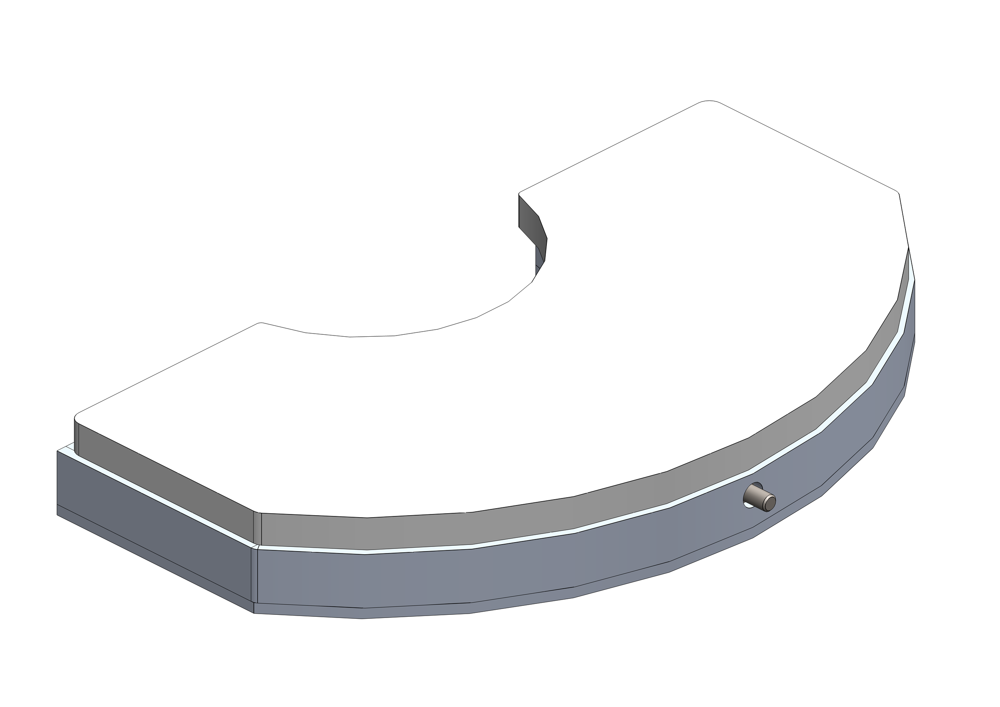
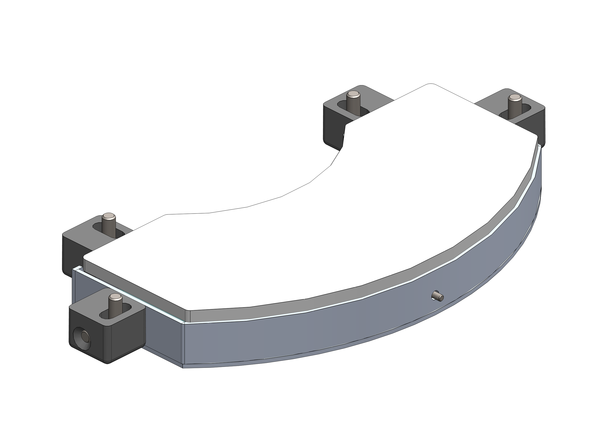
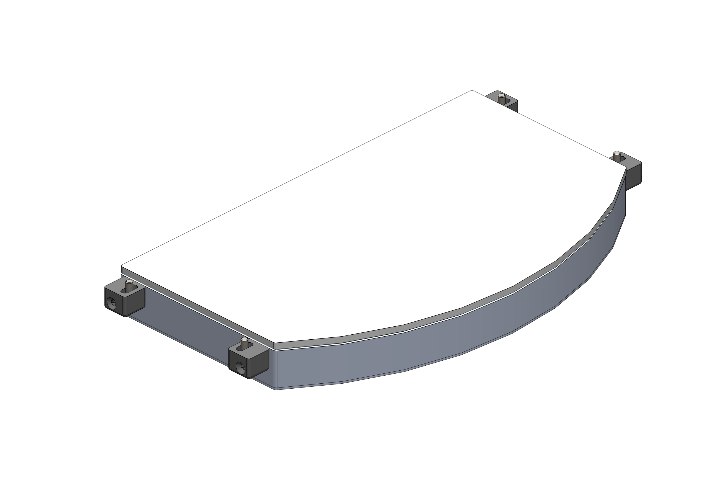
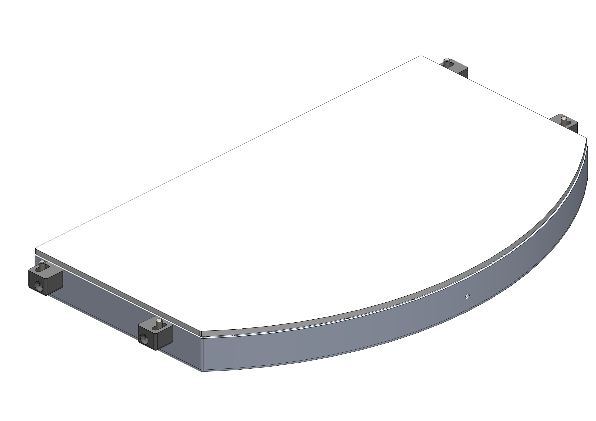

(backlight)=
# **Backlight**

Le Backlight est une source lumineuse située sous la fenêtre en lexan du plan de glissement, de sorte que sa lumière puisse atteindre la surface ou le disque rigide et que la silhouette des composants situés au-dessus devienne visible pour le système de vision. Le Backlight est disponible avec les types de lumière suivants :
- Blanche
- Rouge
- Infrarouge

:::{important}
Le Backlight infrarouge émet une lumière invisible et peut donc sembler ne pas fonctionner. Pour vérifier son fonctionnement, utilisez une caméra équipée d'un filtre infrarouge. La plupart des smartphones affichent l'infrarouge.
:::

Il existe par ailleurs deux types de Backlight :
- Standard : il est alimenté en continu en interne et son allumage et son extinction peuvent être commandés par logiciel ou par E/S numériques ;
- Strobe : il est commandé de l'extérieur via l'entrée « strobe » du connecteur d'entrée. Il incombe au client de fournir l'alimentation 24 Vdc appropriée pour l'allumer.

## Caractéristiques des Backlight

```{dropdown} Backlight pour FB200



| Articles | CE001136 | CE001132 | CE001134 |
|--|--|--|--|
| Couleur des LED | rouge | infrarouge | blanc |
| Longueur d'onde | 630 nm | 850 nm | N/D |
| Tension | 24VDC | 24VDC | 24VDC |
| Courant | 0.17A | 0.12A | 0.17A |
| Zone d'éclairage | 155x75 mm^2 |  |  |
| Matériau de la structure | Alliage d'aluminium |  |  |
| Température de fonctionnement | -40 / +85 °C |  |  |
| Longueur du câble | 0.2 m |  |  |
| Mode de refroidissement | Air naturel |  |  |
| Matériau opalin | Verre 3+3 avec plastique blanc laiteux |  |  |
```

```{dropdown} Backlight pour FB350



| Articles | CE001142 | CE001139 | CE001140 |
|--|--|--|--|
| Couleur des LED | rouge | infrarouge | blanc |
| Longueur d'onde | 630 nm | 850 nm | N/D |
| Tension | 24VDC | 24VDC | 24VDC |
| Courant | 0.18A | 0.13A | 0.18A |
| Zone d'éclairage | 220x100 mm^2 |  |  |
| Matériau de la structure | Alliage d'aluminium |  |  |
| Température de fonctionnement | -40 / +85 °C |  |  |
| Longueur du câble | 0.2 m |  |  |
| Mode de refroidissement | Air naturel |  |  |
| Matériau opalin | Verre 3+3 avec plastique blanc laiteux |  |  |
```

```{dropdown} Backlight pour FB500


| Articles | CE001148 | CE001144 | CE001146 |
|--|--|--|--|
| Couleur des LED | rouge | infrarouge | blanc |
| Longueur d'onde | 630 nm | 850 nm | N/D |
| Tension | 24VDC | 24VDC | 24VDC |
| Courant | 0.46A | 0.31A | 0.46A |
| Zone d'éclairage | 330x170 mm^2 |  |  |
| Matériau de la structure | Alliage d'aluminium |  |  |
| Température de fonctionnement | -40 / +85 °C |  |  |
| Longueur du câble | 0.2 m |  |  |
| Mode de refroidissement | Air naturel |  |  |
| Matériau opalin | Verre 3+3 avec plastique blanc laiteux |  |  |
```

```{dropdown} Backlight pour FB650



| Articles | CE000306 | CE000273 | CE000305 |
|--|--|--|--|
| Articles alternatifs | GM000591 | GM000592 | GM000590 |
| Couleur des LED | rouge | infrarouge | blanc |
| Longueur d'onde | 630 nm | 850 nm | N/D |
| Tension | 24VDC | 24VDC | 24VDC |
| Courant | 0.86A | 0.56A | 0.94A |
| Zone d'éclairage | 400x240 mm^2 |  |  |
| Matériau de la structure | Alliage d'aluminium |  |  |
| Température de fonctionnement | -40 / +85 °C |  |  |
| Longueur du câble | 0.2 m |  |  |
| Mode de refroidissement | Air naturel |  |  |
| Matériau opalin | Verre 3+3 avec plastique blanc laiteux |  |  |
```

```{dropdown} Backlight pour FB800



| Articles | CE001154 | CE001150 | CE001152 |
|--|--|--|--|
| Couleur des LED | rouge | infrarouge | blanc |
| Longueur d'onde | 630 nm | 850 nm | N/D |
| Tension | 24VDC | 24VDC | 24VDC |
| Courant | 1.15A | 0.76A | 1.2A |
| Zone d'éclairage | 400x315 mm^2 |  |  |
| Matériau de la structure | Alliage d'aluminium |  |  |
| Température de fonctionnement | -40 / +85 °C |  |  |
| Longueur du câble | 0.2 m |  |  |
| Mode de refroidissement | Air naturel |  |  |
| Matériau opalin | Verre 3+3 avec plastique blanc laiteux |  |  |
```

```{dropdown} Backlight pour FB1200


| Articles | GE000051 | GE000052 | GE000050 |
|--|--|--|--|
| Couleur des LED | rouge | infrarouge | blanc |
| Longueur d'onde | 630 nm | 850 nm | N/D |
| Tension | 24VDC | 24VDC | 24VDC |
| Courant | 4A | 2.6A | 4.2A |
| Zone d'éclairage | 917x525 mm^2 |  |  |
| Matériau de la structure | Alliage d'aluminium |  |  |
| Température de fonctionnement | -40 / +85 °C |  |  |
| Longueur du câble | 0.2 m |  |  |
| Mode de refroidissement | Air naturel |  |  |
| Matériau opalin | Verre 3+3 avec plastique blanc laiteux |  |  |
```

## Couleurs des Backlight

:::{list-table}
:widths: 15 15 70
:header-rows: 1

* - Couleur
  - Longueur d'onde
  - Utilisation recommandée

* - Red
  - 630 nm
  - Utilisé pour les composants métalliques spéciaux. Longueur d'onde : 630 nm. La cellule doit être protégée de toute source de lumière externe et de la lumière du soleil.

* - IR
  - 850 nm
  - Préféré pour la plupart des types d'applications. Non visible à l'œil humain. Longueur d'onde : 850 nm. Il est recommandé de protéger la cellule afin d'éviter les interférences avec la lumière du soleil.

* - White
  - N/D
  - Utilisé avec les composants transparents. La cellule doit être protégée de toute source de lumière externe et de la lumière du soleil.

:::