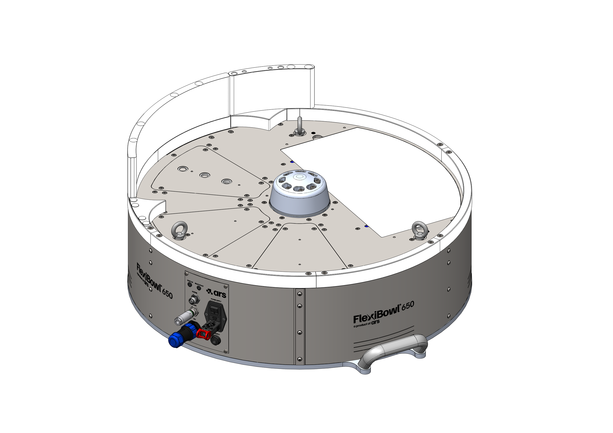
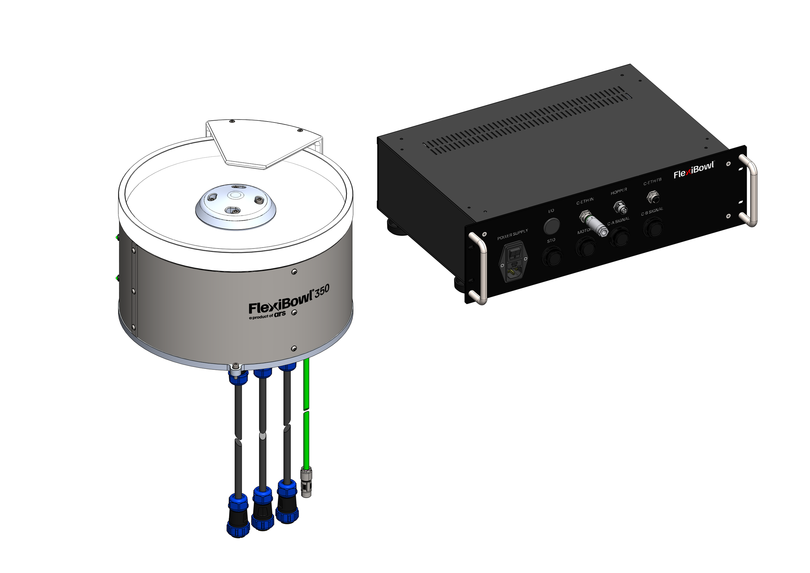
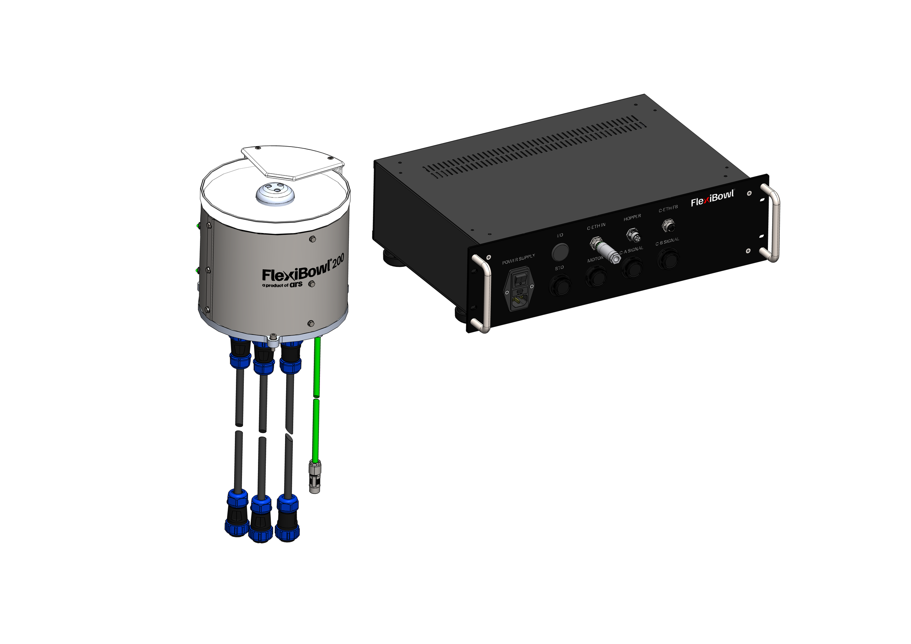

(panoramica)=
# **Présentation générale et déballage**

## Principaux composants du FlexiBowl®

Le FlexiBowl® se compose des principaux éléments suivants :

:::{raw} html
<style>
*{box-sizing:border-box;margin:0;padding:0}
:root{
  --acc:#1a6fc4;--acc-dk:#0d4a8a;--acc-bg:#e8f1fb;
  --bd:#e0e0e0;--bg-p:#ffffff;--bg-s:#f7f8f9;--bg-h:#f0f4fa;
  --tx1:#1a1a1a;--tx2:#555;--tx3:#888;
  --r:10px;--tr:0.35s cubic-bezier(.4,0,.2,1);
}

/* ── Tab bar ── */
.fb-tabs{display:flex;gap:6px;margin-bottom:12px}
.fb-tab{padding:5px 14px;border-radius:6px;border:1.5px solid var(--bd);background:#fff;font-size:13px;font-weight:600;color:var(--tx2);cursor:pointer;transition:background var(--tr),color var(--tr),border-color var(--tr)}
.fb-tab:hover{background:var(--bg-h)}
.fb-tab.on{background:var(--acc-bg);color:var(--acc-dk);border-color:var(--acc)}

/* ── Panel ── */
.fb-panel{display:none}
.fb-panel.on{display:block}
.fb-wrap{border:1px solid var(--bd);border-radius:var(--r);overflow:hidden;background:var(--bg-p);box-shadow:0 2px 12px rgba(0,0,0,0.07)}
.fb-img-outer{position:relative;width:100%;padding-top:70.71%}
.fb-img-outer img{position:absolute;inset:0;width:100%;height:100%;object-fit:contain;padding:0;transition:opacity var(--tr)}
.fb-img-base{opacity:1;z-index:1}
.fb-img-hl{opacity:0;z-index:2}
.fb-badge{position:absolute;top:12px;left:14px;z-index:3;background:var(--acc);color:#fff;font-size:12px;font-weight:600;padding:4px 10px;border-radius:20px;opacity:0;transform:translateY(-4px);transition:opacity var(--tr),transform var(--tr);pointer-events:none;white-space:nowrap}
.fb-badge.on{opacity:1;transform:translateY(0)}
.fb-hint{position:absolute;bottom:14px;left:50%;z-index:3;transform:translateX(-50%);font-size:13px;color:#fff;background:rgba(0,0,0,0.38);padding:6px 16px;border-radius:20px;pointer-events:none;transition:opacity var(--tr);white-space:nowrap}
.fb-list-panel{border-top:1px solid var(--bd);background:var(--bg-p)}
.fb-list-head{display:grid;grid-template-columns:40px 160px 1fr;gap:8px;padding:8px 14px;background:var(--bg-s);border-bottom:1px solid var(--bd);font-size:11px;font-weight:600;text-transform:uppercase;letter-spacing:.05em;color:var(--tx3)}
.fb-row{display:grid;grid-template-columns:40px 160px 1fr;gap:8px;align-items:center;padding:9px 14px;border-bottom:1px solid var(--bd);cursor:pointer;transition:background var(--tr);user-select:none}
.fb-row:last-child{border-bottom:none}
.fb-row:hover{background:var(--bg-h)}
.fb-row.on{background:var(--acc-bg)}
.fb-bubble{width:26px;height:26px;border-radius:50%;border:1.5px solid var(--bd);background:#fff;display:flex;align-items:center;justify-content:center;font-size:12px;font-weight:600;color:var(--tx2);flex-shrink:0;transition:background var(--tr),color var(--tr),border-color var(--tr)}
.fb-row.on .fb-bubble{background:var(--acc);color:#fff;border-color:var(--acc)}
.fb-name{font-size:13px;font-weight:500;color:var(--tx1);transition:color var(--tr)}
.fb-row.on .fb-name{color:var(--acc-dk)}
.fb-desc{font-size:12px;color:var(--tx2);line-height:1.55}
.fb-desc a{color:var(--acc);text-decoration:underline}
</style>

<!-- Tab bar -->
<div class="fb-tabs">
  <button class="fb-tab on"    onclick="fbSwitchTab('fb200',this)">FB200</button>
  <button class="fb-tab"    onclick="fbSwitchTab('fb350',this)">FB350</button>
  <button class="fb-tab" onclick="fbSwitchTab('fb650',this)">FB500-650-800-1200</button>
</div>

<!-- ══════════ FB650 ══════════ -->
<div class="fb-panel" id="fb-panel-fb650">
  <div class="fb-wrap">
    <div class="fb-img-outer">
      
      
      <div class="fb-badge" id="fb650-badge"></div>
      <div class="fb-hint"  id="fb650-hint">Sélectionner un composant dans la liste</div>
    </div>
    <div class="fb-list-panel">
      <div class="fb-list-head"><span>N°</span><span>Composant</span><span>Description</span></div>
      <div id="fb650-list"></div>
    </div>
  </div>
</div>

<!-- ══════════ FB350 ══════════ -->
<div class="fb-panel" id="fb-panel-fb350">
  <div class="fb-wrap">
    <div class="fb-img-outer">
      
      
      <div class="fb-badge" id="fb350-badge"></div>
      <div class="fb-hint"  id="fb350-hint">Sélectionner un composant dans la liste</div>
    </div>
    <div class="fb-list-panel">
      <div class="fb-list-head"><span>N°</span><span>Composant</span><span>Description</span></div>
      <div id="fb350-list"></div>
    </div>
  </div>
</div>

<!-- ══════════ FB200 ══════════ -->
<div class="fb-panel on" id="fb-panel-fb200">
  <div class="fb-wrap">
    <div class="fb-img-outer">
      
      
      <div class="fb-badge" id="fb200-badge"></div>
      <div class="fb-hint"  id="fb200-hint">Sélectionner un composant dans la liste</div>
    </div>
    <div class="fb-list-panel">
      <div class="fb-list-head"><span>N°</span><span>Composant</span><span>Description</span></div>
      <div id="fb200-list"></div>
    </div>
  </div>
</div>

<script>
(function(){

  /* ── dati componenti ── */
  var models = {
    fb650: {
      imgPath: '../../../../_shared/media/images/component_',
      imgDefault: '../../../../_shared/media/images/component_default.PNG',
      imgExt: '.PNG',
      comps: [
//        {n:1,  name:'Groupe pneumatique',           desc:'Ils alimentent le groupe flip et les éventuels soufflages.'},
//        {n:2,  name:'Groupe moteur',               desc:'Permet la rotation de la surface ou du disque rigide.'},
        {img:3,  name:'Anneau de confinement',      desc:'Composé de plusieurs secteurs, il empêche les pièces de sortir pendant le fonctionnement. Il contient également les déflecteurs en l’absence d’accessoires.'},
//        {img:4,  name:'Rétroéclairage',                   desc:'Rétroéclaire la zone de vision pour mettre en évidence les contours des pièces.'},
        {img:5,  name:'Écran flip',                desc:'Empêche les pièces de sortir pendant le retournement.'},
        {img:6,  name:'Carter',                      desc:'Contient et protège les éléments internes. Protège l’utilisateur de l’exposition à la tension électrique et aux composants en mouvement.'},
//        {img:7,  name:'Groupe flip',                 desc:'Percuteur actionné par un mini-chariot pneumatique (350–1200) ou un vérin pneumatique (200). Il génère une impulsion qui retourne les objets avant la fenêtre de vision.'},
//        {n:8,  name:'Châssis',                      desc:'C’est la structure porteuse du FlexiBowl®.'},
//        {n:9, name:'Groupe électronique',          desc:'Comprend toute l’électronique de commande du FlexiBowl®.'},
//        {n:10, name:'Panneau de connecteurs',         desc:'Comprend tous les raccordements électriques et pneumatiques.'},
        {img:11, name:'Support surface / disque', desc:'Maintient la surface ou le disque rigide solidement fixé au groupe moteur.'},
//        {n:12, name:'Plaques de recouvrement',        desc:'Permettent un accès facile aux composants internes pour la maintenance.'}
      ]
    },
    fb350: {
      imgPath: '../../../../_shared/media/images/FB350-',
      imgDefault: '../../../../_shared/media/images/FB350-0.PNG',
      imgExt: '.PNG',
      comps: [
        {img:1,  name:'Câbles et rallonges',  desc:'Ce sont les connexions électroniques entre les différents composants internes du FlexiBowl®.'},
//        {n:2,  name:'Groupe pneumatique', desc:'Alimente le groupe flip et les soufflages.'},
//        {n:3,  name:'Groupe moteur',     desc:'Permet la rotation du disque rigide.'},
        {img:4,  name:'Disque',             desc:'<a href="../ACCESSORI/02_DISCHI_RIGIDI.html">Voir le paragraphe dédié</a>.'},
//        {n:5,  name:'Rétroéclairage',         desc:'Rétroéclaire la zone de vision pour mettre en évidence les contours des pièces.'},
        {img:6,  name:'Écran flip',      desc:'Empêche les pièces de sortir pendant le retournement. Comprend également les <a href="../ACCESSORI/06-4_INTEGRATI.html">soufflages</a>.'},
        {img:7,  name:'Carter',            desc:'Contient et protège les éléments internes. Protège l’utilisateur de l’exposition à la tension électrique et aux composants en mouvement.'},
//        {n:8,  name:'Groupe flip',       desc:'Percuteur actionné par un vérin pneumatique (200). Il génère une impulsion qui retourne les objets avant la fenêtre de vision.'},
//        {n:9,  name:'Châssis',            desc:'C’est la structure porteuse du FlexiBowl®.'},
        {img:10, name:'Support disque',    desc:'Maintient le disque rigide solidement fixé au groupe moteur.'},
        {img:11, name:'Rack',              desc:'Contient toute l’électronique du FlexiBowl®.'}
      ]
    },
    fb200: {
      imgPath: '../../../../_shared/media/images/FB200-',
      imgDefault: '../../../../_shared/media/images/FB200-0.PNG',
      imgExt: '.PNG',
      comps: [
        {img:1,  name:'Câbles et rallonges',  desc:'Ce sont les connexions électroniques entre les différents composants internes du FlexiBowl®.'},
//        {n:2,  name:'Groupe pneumatique', desc:'Alimente le groupe flip et les soufflages.'},
//        {n:3,  name:'Groupe moteur',     desc:'Permet la rotation du disque rigide.'},
        {img:4,  name:'Disque',             desc:'<a href="../ACCESSORI/02_DISCHI_RIGIDI.html">Voir le paragraphe dédié</a>.'},
//        {n:5,  name:'Rétroéclairage',         desc:'Rétroéclaire la zone de vision pour mettre en évidence les contours des pièces.'},
        {img:6,  name:'Écran flip',      desc:'Empêche les pièces de sortir pendant le retournement. Comprend également les <a href="../ACCESSORI/06-4_INTEGRATI.html">soufflages</a>.'},
        {img:7,  name:'Carter',            desc:'Contient et protège les éléments internes. Protège l’utilisateur de l’exposition à la tension électrique et aux composants en mouvement.'},
//        {n:8,  name:'Groupe flip',       desc:'Percuteur actionné par un vérin pneumatique (200). Il génère une impulsion qui retourne les objets avant la fenêtre de vision.'},
//        {n:9,  name:'Châssis',            desc:'C’est la structure porteuse du FlexiBowl®.'},
        {img:10, name:'Rack',              desc:'Contient toute l’électronique du FlexiBowl®.'}
      ]
    }
  };

  Object.keys(models).forEach(function(id){
  models[id].comps.forEach(function(c, i){
    if (c.img === undefined) c.img = c.n;
    c.n = i + 1;
  });
});

  /* ── stato per modello ── */
  var state = {};
  Object.keys(models).forEach(function(id){ state[id]={activeN:null,activeRow:null}; });

  /* ── costruisce le liste ── */
  Object.keys(models).forEach(function(id){
    var m   = models[id];
    var el  = document.getElementById(id+'-list');
    m.comps.forEach(function(c){
      var row = document.createElement('div');
      row.className = 'fb-row';
      row.innerHTML = '<div class="fb-bubble">'+c.n+'</div>'
                    + '<div class="fb-name">'+c.name+'</div>'
                    + '<div class="fb-desc">'+c.desc+'</div>';
      row.addEventListener('click', function(){ toggle(id, c, row); });
      el.appendChild(row);
    });
  });

  /* ── toggle componente ── */
  function toggle(id, c, row){
    var s       = state[id];
    var m       = models[id];
    var imgBase = document.getElementById(id+'-img-base');
    var imgHl   = document.getElementById(id+'-img-hl');
    var badge   = document.getElementById(id+'-badge');
    var hint    = document.getElementById(id+'-hint');

    if(s.activeN === c.n){ reset(id); return; }
    if(s.activeRow) s.activeRow.classList.remove('on');
    row.classList.add('on');
    s.activeRow = row; s.activeN = c.n;

    badge.textContent = c.n + ' \u2014 ' + c.name;
    badge.classList.add('on');
    hint.style.opacity = '0';

    var newImg = new Image();
    newImg.onload = function(){
      imgHl.src = newImg.src;
      imgHl.style.opacity = '1';
      imgBase.style.opacity = '0';
    };
    newImg.onerror = function(){
      imgBase.style.opacity = '1';
      imgHl.style.opacity = '0';
    };
    newImg.src = m.imgPath + c.img + m.imgExt;   // <-- c.img, non c.n
  }

  /* ── reset ── */
  function reset(id){
    var s       = state[id];
    var m       = models[id];
    var imgBase = document.getElementById(id+'-img-base');
    var imgHl   = document.getElementById(id+'-img-hl');
    var badge   = document.getElementById(id+'-badge');
    var hint    = document.getElementById(id+'-hint');

    if(s.activeRow) s.activeRow.classList.remove('on');
    s.activeRow = null; s.activeN = null;
    imgBase.style.opacity = '1';
    imgHl.style.opacity = '0';
    setTimeout(function(){ imgHl.src = ''; }, 350);
    badge.classList.remove('on');
    hint.style.opacity = '1';
  }

  /* ── switch tab ── */
  window.fbSwitchTab = function(id, btn){
    /* resetta il pannello attualmente attivo prima di cambiare */
    document.querySelectorAll('.fb-panel.on').forEach(function(p){
      var oldId = p.id.replace('fb-panel-','');
      reset(oldId);
    });
    document.querySelectorAll('.fb-tab').forEach(function(b){ b.classList.remove('on'); });
    document.querySelectorAll('.fb-panel').forEach(function(p){ p.classList.remove('on'); });
    btn.classList.add('on');
    document.getElementById('fb-panel-'+id).classList.add('on');
  };

})();
</script>
:::

## Que contient la boîte ?


Cette section décrit le contenu de l'emballage du **FlexiBowl® 3.0** et les composants standard fournis avec l'unité.

:::{important}
Avant de procéder à l'installation, vérifier que tous les composants énumérés dans cette section sont présents dans l'emballage. En cas de composants manquants ou endommagés, contacter le [Support technique](support) avant de mettre l'appareil en service.
:::

---

### 1. Contenu de l'emballage

L'emballage contient le **FlexiBowl®** et tous les adaptateurs de connexion standard :

```{list-table}
:header-rows: 1
:widths: 22 58 20

* - Composant
  - Description
  - Image
* - **Connecteur d'alimentation**
  - Équipé d'un clip de verrouillage qui empêche toute déconnexion accidentelle
  - :::{image} ../../../../_shared/media/images/connettore_power.png
    :width: 100%
    :::
* - **Câble connecteur 10 broches**
  - Véhicule l'alimentation 24 Vdc et les deux canaux Safe Torque Off (STO)
  - :::{image} ../../../../_shared/media/images/connettore_STO.png
    :width: 100%
    :::
* - **Connecteur M12 codage D**
  - Utilisé pour la communication Ethernet entre le FlexiBowl® et le système
  - :::{image} ../../../../_shared/media/images/connettore_ethernet.png
    :width: 100%
    :::
* - **Connecteur M12 codage A**
  - Utilisé pour la communication Modbus RTU avec le contrôleur du Bulk Feeder
  - :::{image} ../../../../_shared/media/images/connettore_hopper.png
    :width: 100%
    :::
* - **Clé USB**
  - Contient les manuels de l'unité et son rapport de test individuel
  - —
```
:::{note}
Les câbles de raccordement s'achètent séparément en option en 3, 5 ou 10 mètres : voir {ref}`Câbles de raccordement <cavi>`.
:::

---

### 2. Composants supplémentaires par taille


```{list-table}
:header-rows: 1
:widths: 20 20 60

* - Modèle
  - Image
  - Équipement supplémentaire
* - **FlexiBowl® 200 / 350**
  - :::{image} ../../../../_shared/media/images/FB350.png
    :width: 100%
    :::
  - Comprend également le **rack** et les **câbles de raccordement** correspondants, nécessaires pour l'électronique externe. Les câbles inclus, d'une longueur de 3 m, permettent de réaliser toutes les connexions entre le rack et le FlexiBowl®. Des longueurs de 5/10 mètres sont disponibles en option ({ref}`voir câbles pour rack <cavo-rack>`).
    :::{image} ../../../../_shared/media/images/rack.png
    :width: 100%
    :::
* - **FlexiBowl® 500 et supérieurs**
  - :::{image} ../../../../_shared/media/images/FB650.png
    :width: 100%
    :::
  - Ne nécessitent pas de rack de raccordement externe : l'électronique est intégrée directement dans l'unité
```


#### Panneau de connexions du rack (FlexiBowl® 200 / 350)

```{image} ../../../../_shared/media/images/rack.png
:alt: Panneau de connexions du rack
:width: 80%
:align: center
```

Le panneau arrière du rack regroupe tous les points de connexion décrits au paragraphe précédent : alimentation (**POWER SUPPLY**), Safe Torque Off (**STO**), moteur (**MOTOR**), Ethernet vers le système (**C-ETH IN**) et vers le FlexiBowl® (**C-ETH FB**), Bulk Feeder (**HOPPER**) et signaux encodeur (**C-A SIGNAL**, **C-B SIGNAL**).

:::{note}
Pour les détails relatifs au positionnement et au raccordement du rack, se reporter à la section [Installation mécanique](mech_install).
:::


---

### 3. Documentation fournie

La clé USB fournie contient :

- Les **manuels** de l'unité (version hors ligne de la documentation)
- Le **rapport de test** individuel du FlexiBowl® acheté


