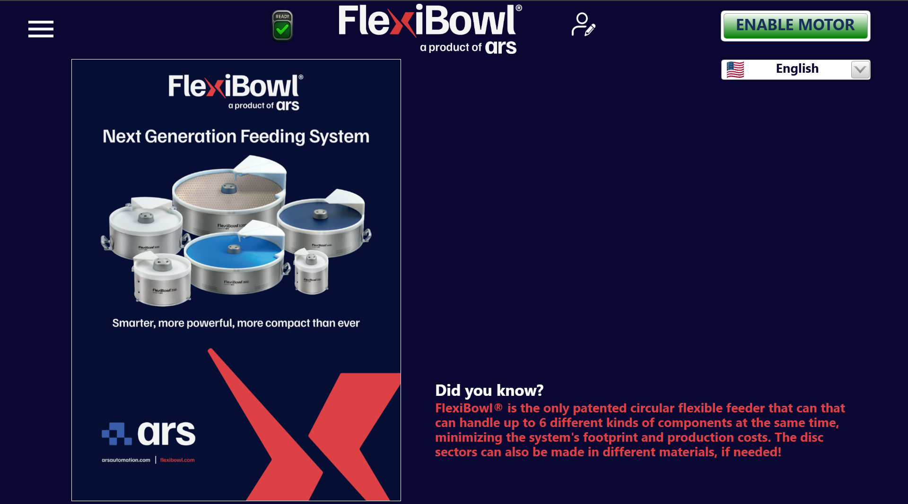

# **Home**

La nouvelle interface FlexiBowl® est entièrement web. Pour y accéder, il suffit de saisir l'adresse IP par défaut du FlexiBowl® `192.168.1.10` dans la barre d'adresse de votre navigateur.

## Présentation

La page **Home** est l'écran principal de l'interface logicielle FlexiBowl®. Elle s'affiche au démarrage du système et offre à l'opérateur une vue d'ensemble immédiate de l'état de l'appareil, ainsi que l'accès aux fonctions principales.


| Élément | Position | Description |
|---|---|---|
| **Menu** (☰) | En haut à gauche | Ouvre le menu latéral de navigation principal, qui donne accès à toutes les sections du logiciel (paramètres, diagnostic, historique, réglages, etc.) |
| **Icône d'état** (READY ✓) | Centre gauche | Indique l'état de fonctionnement actuel du système. L'icône verte avec la coche et l'inscription **READY** signale que le système est prêt pour l'exploitation |
| **Icône utilisateur** | Centre droit | Permet de gérer le profil utilisateur actif (connexion, déconnexion, changement d'utilisateur) |
| **Pulsante ENABLE MOTOR** | En haut à droite | Active le moteur du FlexiBowl®. |
| **Sélecteur de langue** | Sous ENABLE MOTOR | Menu déroulant pour sélectionner la langue de l'interface. Il affiche le drapeau de la langue active (par ex. 🇺🇸 English) |

---

## Menu

<style>
.home-menu-wrap {
  display: flex;
  gap: 1.5rem;
  align-items: flex-start;
  margin: 1rem 0 1.5rem;
  flex-wrap: wrap;
}
.home-menu-img {
  flex: 0 0 auto;
  width: 200px;
  border: 1px solid #e2eef6;
  border-radius: 10px;
  overflow: hidden;
}
.home-menu-img img { display: block; width: 100%; }
.home-menu-cards {
  flex: 1 1 420px;
  display: grid;
  grid-template-columns: repeat(2, 1fr);
  gap: 0.75rem;
}
@media (max-width: 560px) {
  .home-menu-cards { grid-template-columns: 1fr; }
}
.home-menu-card {
  display: block;
  padding: 0.7rem 0.9rem;
  border: 1.5px solid #d0e4f0;
  border-radius: 8px;
  background: #fff;
  text-decoration: none;
  color: inherit;
  transition: border-color 0.18s, background 0.18s;
}
.home-menu-card:hover {
  border-color: #2980b9;
  background: #f0f7ff;
  text-decoration: none;
}
.home-menu-card-title {
  font-weight: 700;
  font-size: 0.88rem;
  color: #1a3a52;
}
.home-menu-card-sub {
  font-size: 0.78rem;
  color: #556b7d;
  margin-top: 0.2rem;
  line-height: 1.35;
}
</style>

Le menu latéral, qui s'ouvre avec l'icône ☰, donne accès à toutes les pages de l'interface :

<div class="home-menu-wrap">
<div class="home-menu-img">

```{image} ../../../../_shared/media/images/menu_laterale.png
:alt: Menu latéral de navigation
```

</div>
<div class="home-menu-cards">

<a class="home-menu-card" href="04_home.html">
<div class="home-menu-card-title">Home</div>
<div class="home-menu-card-sub">Écran principal avec l'état du système et accès rapide aux fonctions</div>
</a>

<a class="home-menu-card" href="04b_maincommand.html">
<div class="home-menu-card-title">Main Command</div>
<div class="home-menu-card-sub">Configure les options générales de l'unité ainsi que les mouvements Move et Shake (onglets Option, Move, Shake)</div>
</a>

<a class="home-menu-card" href="04c_sequence.html">
<div class="home-menu-card-title">Sequence</div>
<div class="home-menu-card-sub">Crée et modifie les séquences d'alimentation directement depuis l'interface</div>
</a>

<a class="home-menu-card" href="04d_monitor.html">
<div class="home-menu-card-title">Monitor</div>
<div class="home-menu-card-sub">Vue en temps réel de l'état du FlexiBowl®, avec journal des événements horodaté</div>
</a>

<a class="home-menu-card" href="04e_jogmotor.html">
<div class="home-menu-card-title">Jog Motor</div>
<div class="home-menu-card-sub">Déplacement manuel du moteur, utile lors de la configuration, des tests ou du dépannage</div>
</a>

<a class="home-menu-card" href="04f_wizard.html">
<div class="home-menu-card-title">Wizard Param</div>
<div class="home-menu-card-sub">Procédure guidée pas à pas pour la configuration du FlexiBowl®</div>
</a>

<a class="home-menu-card" href="manual.html">
<div class="home-menu-card-title">Manual</div>
<div class="home-menu-card-sub">Permet de consulter la documentation de l'appareil directement depuis l'interface</div>
</a>

<a class="home-menu-card" href="04h_graphs.html">
<div class="home-menu-card-title">Graphs</div>
<div class="home-menu-card-sub">Tableau de bord avec les graphiques en temps réel des grandeurs électriques et thermiques du driver moteur</div>
</a>

<a class="home-menu-card" href="04i_filetransfer.html">
<div class="home-menu-card-title">File Transfer</div>
<div class="home-menu-card-sub">Transfert de paramètres et de recettes depuis et vers les sauvegardes de l'unité</div>
</a>

<a class="home-menu-card" href="04l_setup.html">
<div class="home-menu-card-title">Setup</div>
<div class="home-menu-card-sub">Configuration réseau, sélection du protocole de communication et autres réglages système</div>
</a>

<a class="home-menu-card" href="04m_hopper.html">
<div class="home-menu-card-title">Hopper</div>
<div class="home-menu-card-sub">Configuration et contrôle des Bulk Feeders connectés (ID, amplitude, fréquence, temps d'activation)</div>
</a>

<a class="home-menu-card" href="04n_emptying.html">
<div class="home-menu-card-title">Emptying</div>
<div class="home-menu-card-sub">Vidage automatique du plateau en enchaînant jusqu'à 4 séquences avec des boucles configurables</div>
</a>

</div>
</div>


---
## Notes d'utilisation

:::{attention}   
Avant d'activer le moteur, vérifier que l'état du système est **READY** (icône verte visible dans la barre supérieure). Si l'icône n'est pas verte, contrôler les messages d'erreur dans les sections de diagnostic.
:::

:::{note}  
La langue sélectionnée depuis la page Home est appliquée à toute l'interface logicielle. La modification est immédiate et ne nécessite pas de redémarrage du système.
:::
