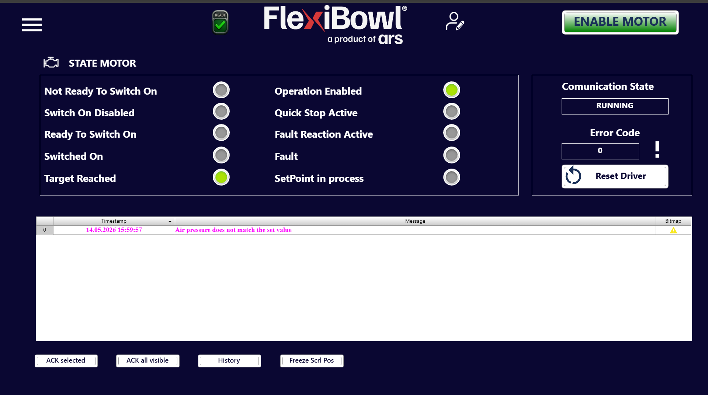

# **Monitor**

## Présentation

La page **Monitor** fournit une vue en temps réel de l'état du moteur et du système de communication, et enregistre tous les événements et alarmes générés pendant le fonctionnement du FlexiBowl®. C'est la page de référence pour le diagnostic et le dépannage.

---

## Section STATE MOTOR

Le panneau **STATE MOTOR** affiche l'état opérationnel actuel du driver moteur au moyen d'une série de voyants lumineux (LED virtuelles).
Chaque LED peut être :
🟢 **Vert** : état actif
⚫ **Gris** : état inactif

### Indicateurs d'état

| Indicateur | Description |
|---|---|
| **Not Ready To Switch On** | Le driver n'est pas prêt pour l'activation  |
| **Switch On Disabled** | L'activation du moteur est bloquée  |
| **Ready To Switch On** | Le driver est prêt à recevoir la commande d'activation |
| **Switched On** | Le moteur est alimenté mais pas encore sous contrôle actif |
| **Target Reached** | Le FlexiBowl® a atteint la position ou la consigne cible |
| **Operation Enabled** | Le moteur est activé et opérationnel |
| **Quick Stop Active** | Arrêt rapide du moteur demandé |
| **Fault Reaction Active** | Le driver exécute la procédure de réaction à un défaut |
| **Fault** | Un défaut actif est présent sur le driver moteur |
| **SetPoint in process** | Le système est en train de traiter ou d'atteindre une nouvelle consigne de position |

:::{note}
En fonctionnement normal, les LED **Operation Enabled** et **Target Reached** doivent être vertes. Toute autre LED verte indique une condition anormale qui requiert de l'attention.
:::

---

## Section Communication State

Le panneau latéral de droite affiche l'état de la communication entre le logiciel et le driver moteur.

| Champ | Valeur d'exemple | Description |
|---|---|---|
| **Communication State** | `RUNNING` | Indique que la communication avec le driver est active et fonctionnelle |
| **Error Code** | `0` | Code d'erreur renvoyé par le driver. La valeur `0` indique l'absence d'erreurs |

### Bouton Reset Driver

Le bouton **Reset Driver** effectue une réinitialisation du driver moteur, utile pour sortir d'un état de défaut ou pour réinitialiser la communication.

:::{warning}
N'appuyer sur **Reset Driver** qu'après avoir identifié et résolu la cause du défaut. Effectuer la réinitialisation sans avoir éliminé la cause du problème peut entraîner la répétition de l'erreur ou endommager le système.
:::

---

## Journal des événements (tableau des messages)

Le tableau central enregistre en temps réel tous les événements, alarmes et messages système générés pendant le fonctionnement.

### Colonnes du tableau

| Colonne | Description |
|---|---|
| **Timestamp** | Date et heure de l'événement au format `GG.MM.AAAA HH:MM:SS` |
| **Message** | Description textuelle de l'événement ou de l'alarme |
| **Bitmap** | Icône indiquant le type d'événement (⚠️ avertissement, ❌ erreur, etc.) |

### Exemple de message

| # | Timestamp | Message | Bitmap |
|---|---|---|---|
| 0 | 14.05.2026 15:59:57 | Air pressure does not match the set value | ⚠️ |

:::{warning}
Le message **« Air pressure does not match the set value »** indique que la pression d'air détectée par le système ne correspond pas à la valeur définie dans les paramètres. Vérifier l'alimentation pneumatique et contrôler les valeurs **Flip Pressure** et **Blow Pressure** dans la page **Main Command > OPTION**.
:::

:::{tip}
Les messages d'avertissement sont affichés en **rouge** dans la colonne Timestamp et en **orange** dans la colonne Message, afin de les reconnaître immédiatement même en présence de nombreuses lignes dans le journal.
:::

---

## Boutons de gestion du journal

| Bouton | Fonction |
|---|---|
| **ACK selected** | Acquitte le message sélectionné dans le tableau, en le marquant comme pris en charge |
| **ACK all visible** | Acquitte tous les messages actuellement visibles dans le tableau |
| **History** | Ouvre l'historique complet des événements enregistrés par le système |
| **Freeze Scrl Pos** | Bloque le défilement automatique du tableau, permettant d'examiner les messages précédents sans que l'affichage se déplace vers les nouveaux événements |

:::{note}
Il est recommandé d'effectuer l'**ACK** des alarmes uniquement après avoir vérifié et résolu la condition qui les a générées, et non pour supprimer la notification sans intervenir.
:::
