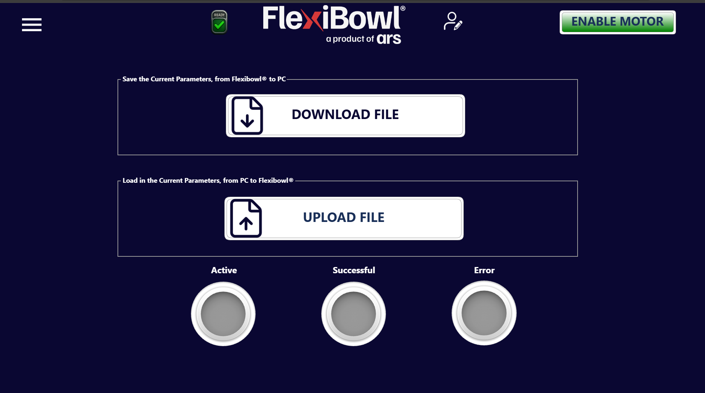

# **File Transfer**

## Présentation

La page **File Transfer** permet d'exporter et d'importer la configuration complète des paramètres du FlexiBowl®, en transférant les données entre le système et un PC. C'est la fonction dédiée à la sauvegarde et à la restauration de la configuration opérationnelle.

---

## Fonctions disponibles

### DOWNLOAD FILE — Sauvegarde des paramètres (FlexiBowl® → PC)

Le panneau supérieur, intitulé **« Save the Current Parameters, from FlexiBowl® to PC »**, permet d'exporter dans un fichier tous les paramètres actuellement configurés dans le système.

En appuyant sur le bouton **DOWNLOAD FILE**, le logiciel génère un fichier de configuration et le met à disposition pour l'enregistrement sur le PC connecté.

:::{tip}
Effectuer un **DOWNLOAD FILE** avant toute modification significative des paramètres opérationnels. Le fichier téléchargé constitue une sauvegarde complète de la configuration et permet de rétablir rapidement l'état précédent en cas d'erreur.
:::

---

### UPLOAD FILE — Chargement des paramètres (PC → FlexiBowl®)

Le panneau inférieur, intitulé **« Load in the Current Parameters, from PC to FlexiBowl® »**, permet d'importer dans le système un fichier de configuration précédemment enregistré.

Appuyer sur le bouton **UPLOAD FILE** ouvre le sélecteur de fichiers du système d'exploitation. Une fois le fichier sélectionné, les paramètres sont chargés dans le FlexiBowl® et appliqués immédiatement.

:::{warning}
Le chargement d'un fichier de configuration **écrase tous les paramètres actuels** du système. Avant de poursuivre, s'assurer que le fichier sélectionné est compatible avec le modèle de FlexiBowl® utilisé et avec la version du logiciel installée.
:::

:::{warning}
Ne pas éteindre le système et ne pas interrompre la connexion pendant le transfert du fichier. Une interruption pendant l'upload pourrait entraîner une configuration incomplète ou corrompue.
:::

---

## Indicateurs d'état du transfert

En bas de la page se trouvent trois voyants lumineux (LED virtuelles) qui signalent le résultat de l'opération de transfert.

| Indicateur | Couleur active | Description |
|---|---|---|
| **Active** | 🟡 Jaune | Le transfert est en cours |
| **Successful** | 🟢 Vert | Le transfert s'est terminé correctement |
| **Error** | 🔴 Rouge | Une erreur s'est produite pendant le transfert |

:::{note}
Pendant une opération de download ou d'upload, attendre que la LED **Successful** s'allume avant de poursuivre avec d'autres opérations. Si la LED **Error** s'allume, vérifier la connexion au PC et répéter l'opération.
:::
